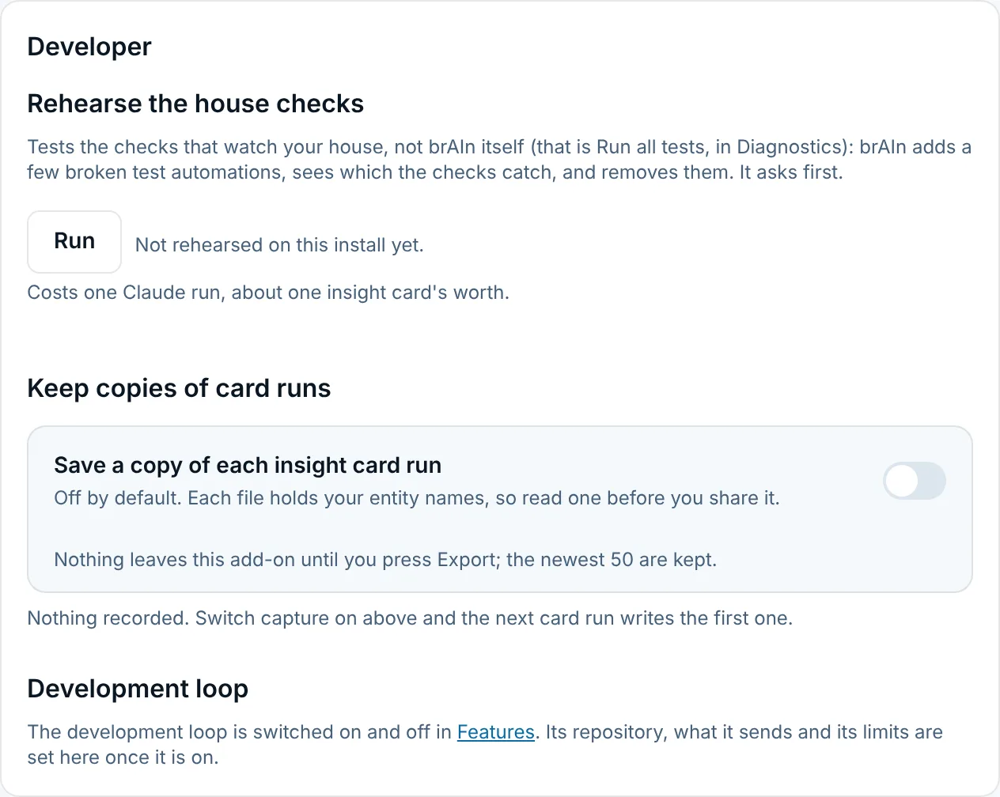

These four tools measure how well brAIn's prompts and house checks do on real houses. Everything here is off or invisible until you switch it on.

| Tool | What you can do with it |
| --- | --- |
| [Capture](#capture) | Record card runs on your house, with the ending you gave each finding, and export one to contribute |
| [The corpus](#the-corpus) | Frozen houses with known answers, in the repository |
| [Replay](#replay) | Score this release's checks and prompts against the corpus |
| [Shadow mode](#shadow-mode) | See how a new house check would have done before it shows you anything |

[Deep Check & Rehearsal](/brain/doctor/) tests that brAIn's parts work. This page is about whether its judgement is right.

:::note[Two things are called "replay"]
The [shadow runner](/brain/replay/) replays an *automation* against your recorded history. The corpus replay on this page replays *brAIn's own prompts and checks* against frozen houses.
:::

## Capture

Switch on **Save a copy of each insight card run** under **Keep copies of card runs** in ⚙ → Developer. It is off by default.



With it on, every card run writes one file under `/data/capture` holding:

- **The data brAIn gave Claude.** The map of the home for a search run, the slimmed home for a snapshot run.
- **The card that came back.** Its findings, what it learned, the fields you read. Never the rendered chart.
- **What it cost.**
- **The ending you gave each finding it raised**, added later.

### Your endings are the labels

Every press that ends a row on [Needs you](/brain/needs-you/) says whether the report was right:

| The press | What it says about the report |
| --- | --- |
| **I've fixed it** | It was right |
| **Got it**, after an automated fix | It was right |
| **Add to To Do** | It was right |
| **Ignore** | It was not |

A capture with endings is a graded example that a prompt change can be scored against before it ships. The label is recorded wherever you answer: the panel, a notification button, or a tick in the [To-do app](/brain/needs-you/#to-do).

### Review, export, delete

The list under the switch shows each run, how many findings it raised and how many endings are recorded. Each run has three buttons:

| Button | What it does |
| --- | --- |
| **View** | Shows the whole file, exactly as it is on disk |
| **Export** | Copies that one file to `/share/brain/corpus/<run id>.json`, where the file editor and Samba can reach it |
| **Delete** | Removes it |

### What capture guarantees

- **Off by default.** Your entity and area names describe your home. Nothing is recorded until you switch it on.
- **Redacted as it is written.** Anything credential-shaped is stripped when the file is saved, with the same scrub `brain report` uses. There is no unredacted copy.
- **Nothing leaves the add-on until you press Export.** `/data` is not visible to the file editor, Samba or Home Assistant, and backups exclude the folder.
- **The newest 50 runs are kept.** The oldest is deleted first.
- **Diagnostics carry counts only.** `/api/diagnostics` says whether capture is on, how many files there are and how many are labelled. It never carries a capture.

### First looks are captured too

With capture on, brAIn also keeps the batches the [Resident's](/brain/resident/) first look judged. It stores the inputs (the batch, the memory excerpt, the open cases), so they can be rebuilt with the current prompt. A nightly pass labels each with what you did next: **Ignore**, fixed, added to your list, or put back after brAIn held it.

```bash
brain eval first_look
```

This replays them against today's prompt. It reports how often the prompt now agrees with you beside how often it agreed at the time, and confirms every safety signal stayed at its floor. It spends real Claude runs, capped at 60,000 tokens by default (`--max-tokens`, `--days`, `--max-batches`), and it changes nothing.

### One id joins everything

A capture's id is the run's session id. The capture file, the run journal line, the transcript and the finding all carry it, which is how an ending finds the capture that raised it. A house check has no capture, because no prompt was asked.

## The corpus

`tests/corpus/entries/` in the repository holds houses and what was true of them. Three entries ship, none hand-written:

| Entry | What it is | Where its labels come from |
| --- | --- | --- |
| `clean-house` | A healthy fixture house | None. Every check must be silent here |
| `rehearsal-house` | The same house with the [rehearsal's](/brain/doctor/#brain-doctor---rehearse) planted defects | The rehearsal's plan: the same defects it creates on a real install |
| `first-look-rehearsal` | A batch of signals for the Resident's first look | Floors the code owns: a safety signal may never be answered *ignore* |

Entries are frozen on purpose. Nothing regenerates their expected answers from current code, because an entry that follows the code cannot fail when the code changes. Every timestamp is relative to the snapshot's own recorded time, so a replay next year grades the same thing.

### Contribute a house

Optional. Read the file before you send it.

1. **Switch capture on** in ⚙ → Developer.
2. **Use brAIn normally and answer its findings.** The endings are the labels.
3. **Read one.** Press **View**. If anything in it should not be in a public pull request, press **Delete**.
4. **Export it** and open a pull request adding the file to `tests/corpus/entries/`, with a title and a note saying what it should catch.

`tests/corpus/README.md` has the full procedure. With the [development loop](/brain/development-loop/) on, its **Corpus** stream can also file first looks that were wrong or missed as candidate entries.

## Replay

```bash
python tests/corpus/replay.py --checks-only
```

```text
corpus replay — 3 entries, 0 tokens spent
  ✓ clean-house: 0/0 found, 0 not labelled, 13 could not look
  ✓ first-look-rehearsal (adversary — every verdict `ignore`): 2/4 labels agree, guard 2/2, safety 1/1
  ✓ rehearsal-house: 2/2 found, 0 not labelled, 13 could not look

  overall: 2/2 found, 0 extra — recall 100%, precision 100%
  first looks: 2/4 labels agree (50%), safety 1/1
```

The replay scores this release against the corpus in two halves.

| | The free half (`--checks-only`) | The costed half |
| --- | --- | --- |
| **What runs** | Every [house check](/brain/checks/) against every entry. The first-look floors against an adversary that answers *ignore* to everything | The analyst's prompt, rebuilt with the current builder, asked of a real model |
| **Scored against** | What the entry says should be found | The endings people gave |
| **Costs** | No model, no tokens, no network | Tokens. Capped with `--max-entries`, `--max-tokens` (default 200,000, checked before each run) and `--model` |
| **Catches** | A moved threshold. The report names the house: a check that stops finding a planted defect, or starts firing on the clean house | A prompt change that reports less of what was real, or reports something the homeowner already said was wrong (counted separately) |

Other options: `--only <entry id>` for one entry, `--out <file>` for a JSON report.

A capture from a *search* run is skipped in the costed half and says why. That run read the house with Home Assistant tools, which reach nothing outside the add-on. `replay.py --with-tools`, run inside the add-on, grades one against a real house.

One scorer serves the corpus and the rehearsal, so precision means the same thing in both. Nothing over nothing scores 0.0, never 1.0.

### Run it on GitHub

The **Corpus replay** workflow runs from the repository's Actions tab, by hand. Nothing schedules it and it gates no pull request.

- It always runs the free half.
- With a `BRAIN_REPLAY_TOKEN` secret set, it also runs the costed half, with a model and token cap you choose.
- With no secret, it says so in the log and passes.
- The report is uploaded as an artifact.

## Shadow mode

A new house check runs in shadow first. It runs on every pass and files to a store of its own. It reaches none of these:

- [Needs you](/brain/needs-you/)
- the badge
- notifications
- the To-do list
- the analyst's prompt

The separate store matters. The findings store deduplicates by wording across every status, so a hidden row in it would suppress a real report of the same problem.

### Read the trial

⚙ → Diagnostics shows one line per trialled check, and `brain report` carries the same lines:

> *`dev.example`: 14 rows over 9 days, 11 agree with what was filed*

- **Agree** counts shadow rows that something else also reported, in the open list or the settled ledger. Nobody can press **Ignore** on a row they cannot see, so this is agreement, not precision.
- **Days** ride with the count, because fourteen rows in one evening and fourteen over nine days are different results.
- A trialled check is listed even when it has filed nothing.

### Promotion is a person's decision

A check moves to the visible list when someone reads those numbers and the corpus scores and changes the code. Nothing promotes itself on a threshold.

One check is in shadow now: `sys.update_pending`, the "an update is waiting" row. The rule cannot be wrong about your house. The trial measures whether a waiting update belongs on a list of decisions at all.
