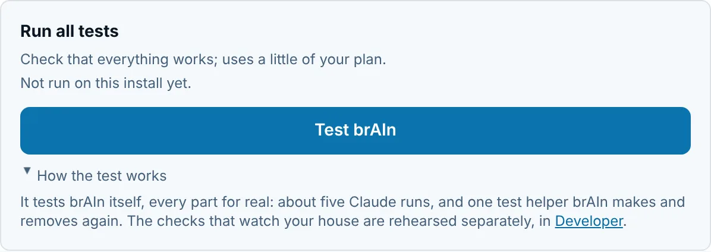
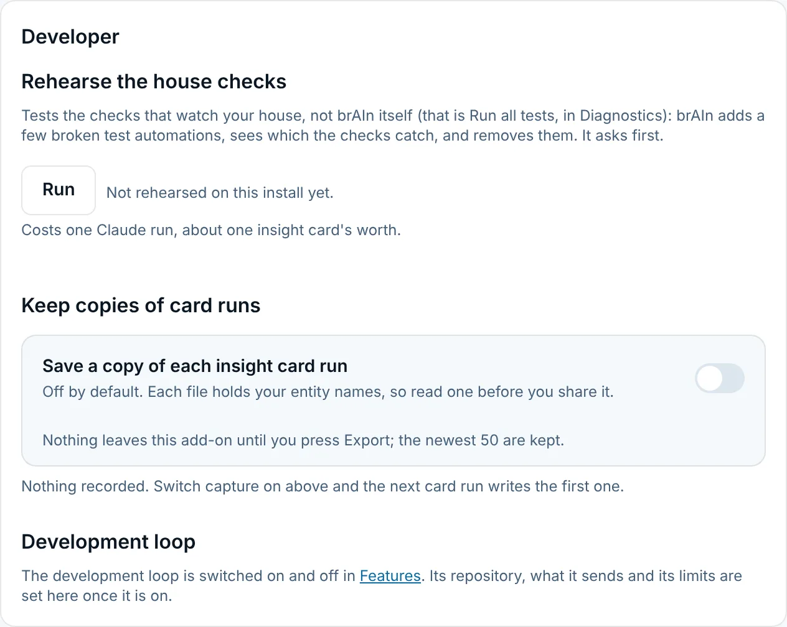

Three commands tell you whether brAIn works on your install. Run the free one first.

| | What it answers | What it spends | In the panel |
| --- | --- | --- | --- |
| **`brain doctor`** | Is everything connected? | Nothing. It never calls Claude | ⚙ → Diagnostics → **Right now** |
| **`brain doctor --deep`** | Does each face work end to end, right now? | About **five Claude turns**, a few minutes | ⚙ → Diagnostics → **Run all tests** |
| **`brain doctor --rehearse`** | Do the house checks and the analyst find a defect planted in this house? | **One analyst run** | ⚙ → Developer → **Rehearse the house checks** |

The two that spend never run on a timer. There is no option that schedules either.



## `brain doctor --deep`

```bash
brain doctor --deep           # each stage as it lands
brain doctor --deep --json    # the whole object, for a script
```

Or press **Test brAIn** under **Run all tests** in ⚙ → Diagnostics. The header reads like "6 of 6 passed · 2 skipped", with one row per test and its reason in plain words.

It runs eight stages in order. Each is a real round trip.

| Stage | The round trip | What a pass proves |
| --- | --- | --- |
| **Claude, no tools** | Asks for a fixed JSON object and reads it back | The sign-in works for a plain run, and a real reply can be parsed. Every insight card depends on this |
| **Analyst tools** | Asks for the area count **and** attempts a `call_service` | The model reaches the MCP tools, a read is allowed, and an acting tool is blocked. A `call_service` that ran is a failure |
| **Chat session** | Opens its own session, sends one message, closes it | A chat session starts, answers and ends a turn |
| **Automation listener** | Writes a task the way the integration does | The listener is alive, claims the task and returns a result |
| **Assist** | One conversation turn through Home Assistant with brAIn's agent | Voice answers through Home Assistant, not only its own health endpoint |
| **Memory** | Queues a fact, consolidates, removes it | A fact reaches `memory.md` and the facts store, and can be taken out of both |
| **Findings and undo** | Files a finding, ends it, undoes it, ends it for good | The findings store, the settled ledger, the memory line and undo all work |
| **Fixer** | One real fix run that renames a `brain_test_` helper | The one path that can change your house works, and puts the change back |

### Read the report

| State | Meaning |
| --- | --- |
| `ok` | The round trip completed and the answer was right |
| `failed` | It did not. The line names the switch or log to look at |
| `skipped` | brAIn did not look, and says why |

- Every stage is reported, not only the first failure. The verdict is the worst state, and the report names the first stage that failed.
- The exit code is non-zero on any failure.
- A stage is **skipped**, not failed, when an earlier stage it depends on failed (for example the plain Claude run could not sign in) or its face is switched off. Assist skips with the Voice assistant option off, the automation task with Automation tasks off, and the fixer when `protected_entities` covers its test helper. The chat stage skips when it would have to close somebody's conversation to make room.

### What it creates and removes

The deep check creates a test fact, a test finding and a test helper, and removes all three. It then verifies each removal. Anything left behind fails the stage that left it.

Its Claude turns are counted like any other: they show in the usage pill, and they never appear in your Chats list. A second press while a run is going shows that run instead of starting another.

## `brain doctor --rehearse`

```bash
brain doctor --rehearse            # shows what it would create, then asks
brain doctor --rehearse --yes      # skip the question
brain doctor --rehearse --json     # the whole object
brain doctor --sweep               # remove anything a rehearsal left behind
```

Or press **Run** under **Rehearse the house checks** in ⚙ → Developer, which shows the same list in a confirm dialog.



A rehearsal tests the [house checks](/brain/checks/) against your install: your Home Assistant version, your integrations, your data. It plants three things, runs the checks and the analyst, scores both, and removes everything.

### It asks first

Nothing is written before you answer. The question lists exactly what would be created:

```text
A rehearsal creates these in your Home Assistant, runs the checks and the analyst against them, and then removes them:
  brain_test_dead_ref
      an automation whose action names light.brain_test_missing — an entity that does not exist
      for auto.dead_ref — automations naming missing entities
  brain_test_dead_service
      an automation calling notify.brain_test_nowhere — a service that is not registered
      for auto.dead_service — automations calling missing services
  input_number.brain_test_reading
      an input_number.brain_test_reading helper set to 21.5
      for that NOTHING fires on a healthy planted row — a check that reports this one is a false positive worth knowing about
Go ahead? [y/N]
```

| Planted | A working install should |
| --- | --- |
| `brain_test_dead_ref` | Find it with the *automation names a missing entity* check |
| `brain_test_dead_service` | Find it with the *automation calls a missing service* check |
| `input_number.brain_test_reading` | Report **nothing**. A report here is a false positive |

The automations go in through the same write, reload and verify path an accepted [proposal](/brain/proposals/) uses, so a rehearsal also tests that path.

:::caution[What a rehearsal will not do]
- It refuses, before asking, if `protected_entities` matches anything it would create.
- It files nothing and notifies nobody. The check rules run directly, never the scheduled pass, so a planted defect cannot ring a phone or clear a real finding.
:::

### Read the scores

```text
  Checks:  2 of 2 planted defects found, 0 reported that were not planted
    found           brain_test_dead_ref  (auto.dead_ref)
    found           brain_test_dead_service  (auto.dead_service)
    clean           brain_test_reading
  Analyst: found 1 of 2 (recall 50%, precision 100%) on the default model
  Cleanup: removed all 3 and checked they are gone
```

| Line | What it says |
| --- | --- |
| **Checks** | How many planted defects the rules found, and whether anything else fired on a `brain_test_` row |
| **Analyst** | The automations card's own prompt, run against the same house. **Recall** is how many planted defects it reported. **Precision** is how much of what it reported was really there |
| **Cleanup** | What was removed, and anything that could not be |

Both scores count only `brain_test_` rows. A finding about your real house is not a false positive. A score with nothing behind it is reported as 0.0, never 1.0.

### Checks one pass cannot rehearse

Some checks need days of history, so a rehearsal names them as not rehearsable instead of counting them as missed:

| Check | Needs |
| --- | --- |
| `auto.forgotten_off` | The automation switched off for 30 days |
| `auto.never_fired` | The automation to have existed for 30 days without firing |
| `auto.condition_never_passes` | At least 3 stored traces that all stopped at the same condition |
| `auto.trace_error` | A stored trace of a run that failed |
| `dev.frozen` | A week of hourly statistics reading the same value |
| `dev.unavailable` | The entity unavailable for 24 hours |
| `reg.unused_helper` | A helper unused for 30 days |

### If something is left behind

Cleanup runs even when a rehearsal fails halfway, and it is verified in the automations file, the entity registry and the states. If something still survives, the free `brain doctor` warns:

```text
a rehearsal left something behind: /config/automations.yaml, input_number.brain_test_reading
Fix: run 'brain doctor --sweep'
```

Run `brain doctor --sweep`, or press **Delete** beside **Run** in ⚙ → Developer (the button appears only while there is something to clear). The sweep removes only what is named `brain_test_*`. It creates nothing, calls no model and needs no consent.

A leftover does not turn the [Health sensor](/brain/reference/#health-sensors) to `degraded`. It is a tidy-up, not brAIn failing to work.

## Where the verdicts show up

| Where | What it carries |
| --- | --- |
| ⚙ → Diagnostics and ⚙ → Developer | The free report, Run all tests and the rehearsal, each with the date and verdict of its last run |
| `/api/diagnostics` | When the last deep run was, its verdict and which stage failed; the last rehearsal's scores and cleanup line. Never a transcript or a prompt |
| `brain report` | That payload, `brain doctor --json` and the tail of the add-on log, in one redacted text file under `/share/brain/reports/` |
| **Download diagnostics** on the brAIn integration | The same payload |

## What these do not measure

The prompts. A deep check proves the analyst's tools reach the house, and a rehearsal scores one prompt against two planted defects on one install. Whether a prompt change made cards better or worse across many houses is what [capture and the corpus](/brain/corpus/) measure.
