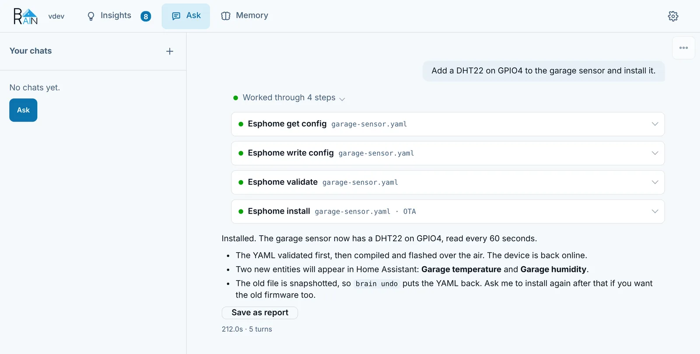

import { Steps } from '@astrojs/starlight/components';

Ask brAIn in a sentence to change an ESPHome device, and it edits the YAML, validates it, and installs the firmware over the air.

## What you can ask

Ask from the chat or the terminal, or by voice with an agent set to **Whole house** or **Full admin**.

| Ask | What happens |
| --- | --- |
| *"What ESPHome devices do I have, and which need a firmware update?"* | A list of every file in `/config/esphome`: chip and board, online or not, running firmware against what the dashboard would build now (*2026.8.0 → 2026.9.0*), and which Home Assistant device it is. Shared packages and includes are listed and marked. |
| *"Add a DHT22 on GPIO4 to the garage sensor and install it."* | brAIn edits the YAML, validates it, fixes what ESPHome complains about, then compiles and flashes over the air. "Done" means flashed. |
| *"Why does the porch light keep dropping off Wi-Fi?"* | brAIn reads the device's live log and tells you what it shows. |
| *"Update every device that has firmware waiting."* | Each device with an update is rebuilt and flashed. |
| *"Make a new ESP32 device for the shed with a relay on GPIO26."* | A new file like the dashboard's wizard writes: a fresh API encryption key, OTA password and fallback hotspot, and Wi-Fi from your secrets. |
| *"Change the Wi-Fi password in my ESPHome secrets."* | That one line of `secrets.yaml` changes. The value is never read back. |
| *"Clean the build files for the garage sensor."* | A stuck build is cleared. brAIn can also compile without flashing. |
| *"Delete the old test device."* | Its file moves into `archive/`, as the dashboard does. The device keeps running its firmware. |

Two limits to know:

- **A new board's first install is over USB**, from the ESPHome dashboard. Every install after that can be asked for.
- **An offline device is compiled now** and flashed by the dashboard when it comes back. brAIn tells you so.

## Set it up

brAIn edits files in `/config/esphome` directly. To validate, compile, install and read logs it needs to reach the ESPHome dashboard.

<Steps>

1. **Install and start the ESPHome app** (ESPHome Device Builder).

2. **Create a long-lived access token** as a Home Assistant administrator: your profile → **Security** → **Long-lived access tokens**.

3. **Paste it into `esphome_ha_token`** on brAIn's Configuration tab and restart brAIn.

4. **Ask** *"what ESPHome devices do I have?"* in the chat. If brAIn cannot reach the dashboard, the answer names the setting that is missing.

</Steps>

brAIn finds the ESPHome app on its own and reaches its dashboard one of three ways:

| Route | When to use it |
| --- | --- |
| `esphome_ha_token` | The usual one. brAIn uses the token only to ask Home Assistant for an ingress session, the way your browser opens the dashboard. |
| The ESPHome app's own port | Used automatically if you gave the app a port under its **Network** settings. It answers without a password only when that app's `leave_front_door_open` is on, which leaves the dashboard open to your whole network. |
| `esphome_dashboard_url` | A dashboard somewhere else, such as `http://192.168.1.20:6052`. Set it instead of the token. |

brAIn works with both the current **ESPHome Device Builder** (ESPHome 2026.9 and later) and the older dashboard.

If the dashboard cannot be reached, brAIn says why and which setting fixes it. File editing keeps working, and a device with an update waiting can still be updated through Home Assistant's own update entity.

## Safety

- **Every save can be undone.** The file is snapshotted before it is written, so `brain undo` puts it back.
- **Your edits are not overwritten.** If a file was saved from the ESPHome dashboard since brAIn read it, brAIn refuses to save over it.
- **Broken YAML is still saved**, because it is your file. brAIn says where the parser stopped.
- **Protected entities apply.** A device that carries anything on `protected_entities` is refused for install, upload, update and delete, and the refusal names the entity.
- **Secret values are never shown.** brAIn can list the names in `secrets.yaml`, not the values.

## Who may use these tools

| Who is asking | What they get |
| --- | --- |
| The chat and the terminal | Everything. |
| A voice agent set to **Whole house** or **Full admin** | Everything. |
| A voice agent set to **Voice assistant** | None of the ESPHome tools. |
| Scheduled, unattended runs (cards, the Resident) | Read device files, validate them, read logs and check on a build. Writing, compiling, installing and deleting happen only when somebody asks. |

## Tool reference

| Tool | What it does |
| --- | --- |
| `esphome_list_devices` | Every device file with its name, platform, board, address, online state, deployed and current firmware version, its Home Assistant device and whether it carries a protected entity. Also discovered devices not yet adopted, the key names in `secrets.yaml`, and whether the dashboard can be reached. |
| `esphome_get_config` | Read one device's YAML as it is on disk. |
| `esphome_write_config` | Save a device's YAML. Nothing changes on the device until it is installed. |
| `esphome_create_device` | Start a new device file the way the dashboard's wizard does. |
| `esphome_delete_device` | Move a device file into the archive folder. |
| `esphome_validate` | Validate a configuration with ESPHome itself. |
| `esphome_compile` | Compile firmware without installing it. |
| `esphome_install` | Compile and install, over the air by default or to an address. The device reboots. |
| `esphome_update_firmware` | Install a waiting update through Home Assistant's update entity. Works when the dashboard cannot be reached. |
| `esphome_clean` | Delete a device's build files. |
| `esphome_logs` | Read a device's live log for 20 seconds by default, 120 at most. |
| `esphome_job` | Follow a validate, compile, install, logs or clean job by its id. |
| `esphome_set_secret` | Set one key in `secrets.yaml`. |

brAIn's panel has no ESPHome screen. Use the ESPHome dashboard for that, and brAIn for everything you would rather ask for.
