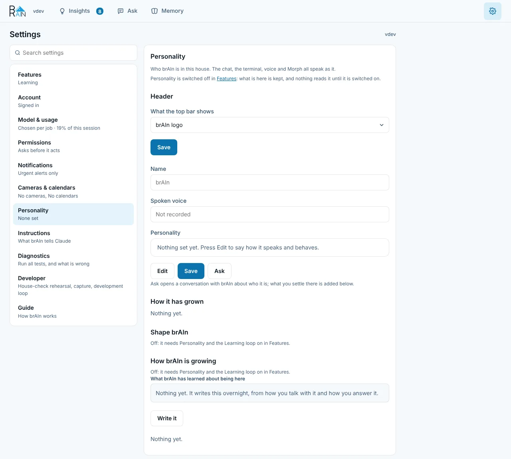

import { Aside } from '@astrojs/starlight/components';

**⚙ › Features** has four switches that decide how much brAIn does. Each takes effect at once,
with no restart. Only the Development loop sends anything out of your house.

| Switch | What you get | Where its work goes | On a new install |
| --- | --- | --- | --- |
| **Morph dashboard** | The Home tab: a dashboard that says what matters right now, which brAIn designs and edits with you. | Stays in this house | Off |
| **Personality** | brAIn uses the name and personality you give it, everywhere. | Stays in this house | Off (on if a personality is already set) |
| **Learning loop** (self-improvement) | Everything brAIn learns and changes about itself on its own. | Stays in this house | On (follows the `learning` option) |
| **Development loop** | brAIn reports its own faults as issues in your private GitHub repository. | **Leaves this house**, with names, rooms and entity ids replaced by aliases | Off |

## Morph dashboard

Switch it on and brAIn's sidebar entry opens on the **Home** tab, labelled *Morph UI* until
you rename it. brAIn builds the dashboard from your areas and floors.

- A verdict sentence says what is going on, and cards that stand out carry a *because* line.
- Your order never changes.
- An *Ask or tell the house* line sits at the top.
- In Edit, hold anything and [Tell brAIn](/brain/morph/tell-brain/) what to change. Every
  change is a version you can undo.
- Morph's cards, room rail and themes also work on
  [Home Assistant's own dashboards](/brain/morph/home-assistant-dashboards/).

Someone who is not a Home Assistant administrator sees the dashboard alone, without brAIn's
other tabs. Morph is experimental, so keep your usual dashboards beside it.

**[The Morph dashboard →](/brain/morph/)** · [Quick Start](/brain/morph/quickstart/) ·
[Settings](/brain/morph/settings/)

## Personality

Write a name and a personality in **⚙ › Personality** and brAIn uses them everywhere: the
sidebar entry, every screen, the chat, voice and notifications.

- With a name set, nothing says "brAIn" any more. In BRUH Minecraft the companion uses the
  name too.
- What brAIn writes unprompted (the morning brief, the weekly report, a report on something
  it looked into, a notification that can wait) takes the personality's tone. The facts do
  not change, and anything urgent stays plain.
- With the Learning loop also on, the assistant can ask how it should be and keeps a
  paragraph about how it has learned to be in your house.
  [Learning →](/brain/learning/#shaping-who-it-is)

Switched off, the personality you wrote is kept and nothing reads it.

## Learning loop

One switch covers everything brAIn learns on its own:

- the memory it files from what you say in a conversation or to voice;
- the nightly lessons it draws from how its reports ended;
- the presence loop (the assistant growing its own way of being in your house);
- the Morph dashboard's lessons, and changes to its own dashboard code;
- memory clean-up.

A line under the switch says what learning wrote in the last seven days, counted per learner.

Switched off, brAIn still does what you ask and learns nothing on its own. What it already
learned is kept. [Learning →](/brain/learning/)

The add-on option `learning` only sets where this switch starts. After the first start, only
the switch decides. The memory consolidator and the study watcher follow a change at the next
restart of the app.

## Development loop

brAIn reports its own faults, redacted, as issues in a **private** GitHub repository you own.
A scheduled cloud routine can then fix brAIn's code and ship an update.

Set the repository, the token, what it sends and its daily limits in **⚙ › Developer**. It
refuses to send to a public repository. [Development loop →](/brain/development-loop/)

<Aside type="note" title="Two loops, and your home's facts are neither">
**Learning** is brAIn changing itself on this house, with nothing leaving it.
**Development** is brAIn reporting back to the repository its code comes from. What brAIn
knows about your home (facts, the memory document) is under Memory › Knowledge.
</Aside>

## Upgrading from 3.x

The switches start matching what you had: Morph on if the Morph app was installed,
Personality on if one was set, the Learning loop on, and the Development loop as it was.
brAIn stops the old Morph app and sets it not to start at boot. It never uninstalls it.
