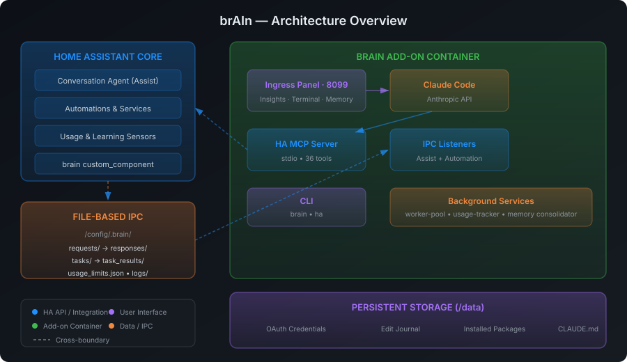

brAIn reaches Home Assistant three ways. You ask in plain words and brAIn picks the route:

> **Files → CLI. Live home → MCP tools. Admin changes → Power Tools, called through MCP.**



## The three layers

| | [CLI](/brain/cli/) (`brain`, `ha`) | [MCP tools](/brain/mcp/) | [Power Tools](/brain/power-tools/) (`brain.*` services) |
|---|---|---|---|
| **What it is** | Shell commands in the terminal | Claude's live API into Home Assistant, 120 tools | 91 Home Assistant services the integration registers |
| **Who can call it** | You and Claude, in the terminal | Claude only: chat, terminal, voice, tasks, fixes | Claude, your automations and scripts, and admins in Developer Tools → Actions |
| **What it touches** | Files and workflow: YAML, logs, memory, undo, packages | Live state: entities, devices, cameras, history, registries, dashboards | Admin state: areas, labels, helpers, users, dashboards, zones |
| **Example** | `ha reload automations` | `control_light`, `get_camera_snapshot` | `brain.create_helper` |

## What a request looks like

```text
"Label everything battery-powered and build me a guest-mode toggle"
        │
        ▼
   Claude (terminal / voice / task)
        │  MCP: protected entities, Blocked services, the action gate
        ├── get_registry ─────────── read: which entities, which labels exist
        ├── call_service ──────────► brain.add_label        (Power Tool)
        └── call_service ──────────► brain.create_helper    (Power Tool)

"Fix my automations.yaml indentation and reload"
        │
        ▼
   Claude (terminal)
        ├── edits the file (snapshotted for brain undo)
        └── ha reload automations                           (CLI)
```

- **MCP is the only route to the live home.** Every read, every device command and every service call goes through it, so the safety checks run in one place. A service call typed as a shell command (`ha service call`, a `curl` to the services API) is refused while you have protected entities set.
- **Power Tools are services, so your automations get them too.** A nightly automation can call `brain.find_orphaned_references` with no Claude run. They are admin-only. A voice agent at the default **Voice assistant** level cannot use them, and new agents start with `brain.*` ticked under **Blocked services**.
- **The CLI covers what a live API cannot.** Editing and reloading YAML, tailing logs, the memory document, the edit journal, persistent packages.

`ha service call` and `call_service` reach the same Home Assistant endpoint on purpose. One is for you at a shell prompt, the other is for Claude, where the checks are.

## What every action passes

Each check can only make the answer stricter. In order:

| # | Check | What it does |
|---|---|---|
| 1 | **Asking first** | The [terminal and the chat ask you](/brain/terminal/#asking-before-acting) before Claude runs a command, edits a file or calls a service. Reading is never asked about. *Let brAIn act without asking* turns this off for those two faces only. Scheduled work (cards, the brief, the weekly report, study) has read-only tools and cannot act. |
| 2 | **The tripwire** | An entity you made for nothing to touch. An attempt is refused before it reaches Home Assistant, and a security card reaches your phone. |
| 3 | **Protected entities** | Refused on every face. The check follows what a call names: an area or device that contains one, a scene's entity map, a script variable, and what a scene, script or automation reaches when it runs. |
| 4 | **The agent's limits** | On voice: the entities you exposed to Assist, the services that belong to them, and that agent's **Blocked services**. A call is judged by what it does, so `homeassistant.turn_on` aimed at a garage door is a cover call. |
| 5 | **The action gate** | In the chat, the terminal, an automation task or a fix, the action is checked against your own words and what it would reach. It never sees text brAIn read on the way, so a planted device name or calendar entry cannot argue it into anything. Your **house rules** apply here. If the gate cannot be reached you are asked, and an unattended run is refused. |
| 6 | **A fix's contract** | A **Plan** run may make only the service calls and edit only the files its approved plan listed. Any other call is refused, and so is any shell command that does more than read (except `brain own` on the files the plan edits). |

Every service call that gets through is recorded with each entity's state just before it, which face asked and which run it was. That record is what **Put them back** on a fix uses.

The homeowner's version, with approval cards, cameras and undo: [Permissions & Safety](/brain/safety/).

### Claude runs take turns

Every Claude run the panel starts waits in one queue, three at a time by default. A safety alert goes first, then anything you pressed, then scheduled work. One seat is always kept free of scheduled work, so **Regenerate** or **Plan** never waits behind the overnight cards.

## What brAIn can and can't reach

**Covered:**

| Area | What brAIn can do |
|---|---|
| Devices and entities | Control every major domain; cameras; history and statistics; names, ids, aliases, icons, visibility; what a device shows as (a contact sensor as a door, a smart plug as a fan or light, a sensor's decimals and unit) |
| Automation | Automations, scripts and scenes (YAML and reload), blueprints, traces, templates |
| Organisation | Areas, floors, labels, zones, persons, users, helpers (all 8 types) |
| Dashboards | Dashboards, including custom-card resources |
| Integrations | Enable, disable, reload and remove; device and entity deletion, with orphan sweeps that dry-run by default |
| Maintenance | Repairs, logs, statistics backfill, undo of any file it edited |
| Reporting back | An open-findings sensor, a `brain_finding` event and an optional phone push |

**Left to you, on purpose:**

- **Adding an integration.** Config flows are interactive (OAuth, discovery, pairing buttons), so brAIn takes you to the right screen. Removing one it can do: `brain.delete_integration` drops the config entry and reports the entities and devices that went with it.
- **Credentials.** API keys inside `core.config_entries`, tokens, MFA. Never read, never written, never snapshotted.
- **Backups of your configuration.** That is Home Assistant's own backups. brAIn keeps an [edit journal](/brain/reference/#undo) of the files it touched so `brain undo` can revert one.
- **Home Assistant Core/OS updates and add-on installs.** `ha addon` covers restarts and logs. Installs stay your decision.

### YAML config is not an exception

A dashboard, helper or person defined in YAML is not in the registry, so the `brain.*` service for it declines. brAIn takes the file route: it opens the file, edits it, validates it and reloads the domain. The edit is in the same journal, so `brain undo` puts it back.

<a id="three-things-happen-without-claude"></a>

### What happens without Claude

Four things change your house or `/config` with no model in the loop.

| What | Who does it | Limits |
|---|---|---|
| **Applying a plan** | The panel carries out the plan's typed steps (change one automation, reload, call a service on named devices, rename an entity, move it to a room). | Stops at the first failed step and puts back the edits already made. A step that needs working out starts a Claude run held to the plan's contract. [Needs you](/brain/needs-you/) |
| **A press on Needs you** | The panel writes to `/config`: [accepting a proposal](/brain/proposals/#saying-yes-and-taking-it-back), or **Remove** on a one-off that has fired. | The file is snapshotted first. The change settles only once Home Assistant is running it, and is reverted if not. The toast and `brain undo` take it back. |
| **An accepted [emergency playbook](/brain/playbooks/)** | Home Assistant runs it. It is an ordinary automation in `automations.yaml`. | Composed from your registries, not by a model. Every entity is listed on the card before you accept. No playbook unlocks a door or disarms an alarm. brAIn has no path that fires one. |
| **[Overnight self-healing](/brain/self-healing/)** | brAIn, with nobody's press. **Off by default.** | Three repairs only: start an add-on set to run at boot, ping a dead Z-Wave node, reload a config entry that failed to set up. Once a night, inside quiet hours, at most three, never a protected entity, never a finding you already answered. |

A press on Needs you writes in one of three shapes, and `brain undo` covers all three because the whole file is snapshotted first:

- **Append.** One automation on the end of `automations.yaml`, or four [scenes](/brain/scenes/) on the end of `scenes.yaml`. Everything above is byte-for-byte what you wrote.
- **Edit one entry.** A [condition proposal](/brain/proposals/#the-condition-it-is-missing) replaces the bytes of one automation. Your ordering, comments and quoting outside it are untouched. brAIn refuses when it cannot tell where the entry ends: an id that appears twice, a file that is not a top-level list.
- **Remove one entry.** Only the **Remove** button on a [one-off](/brain/intents/) that has fired does this. Nothing in brAIn removes an automation on its own.
