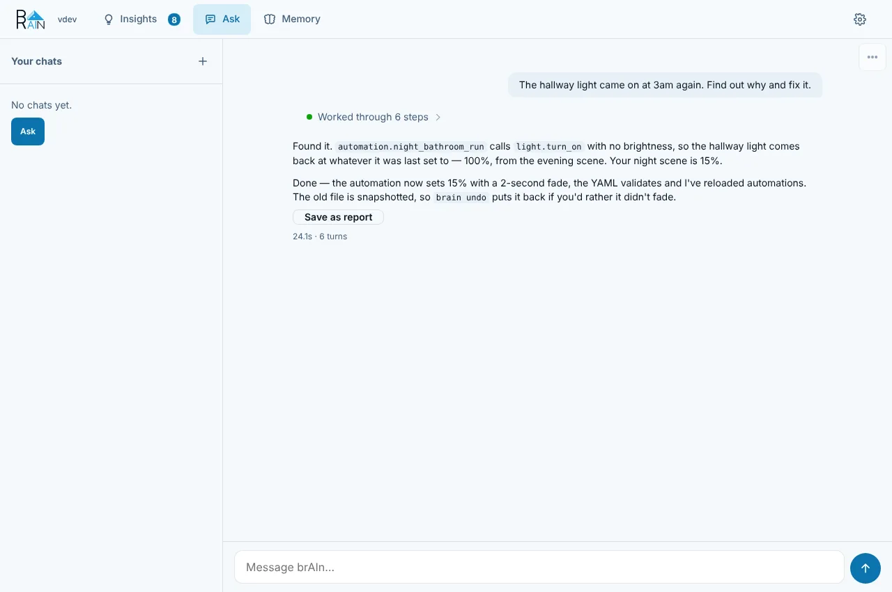
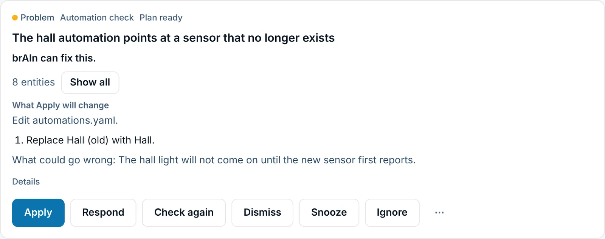
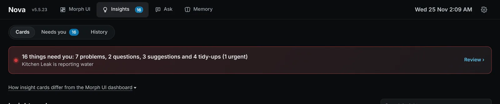
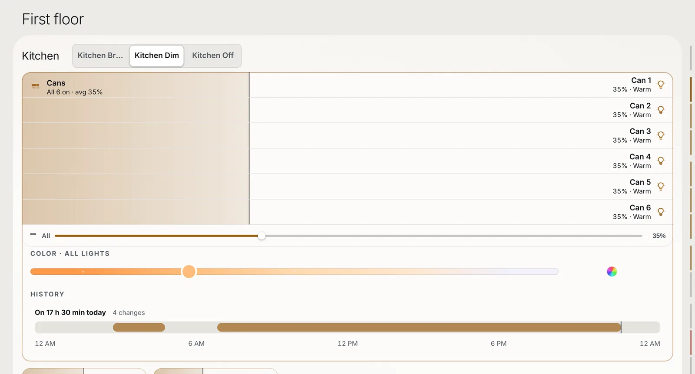
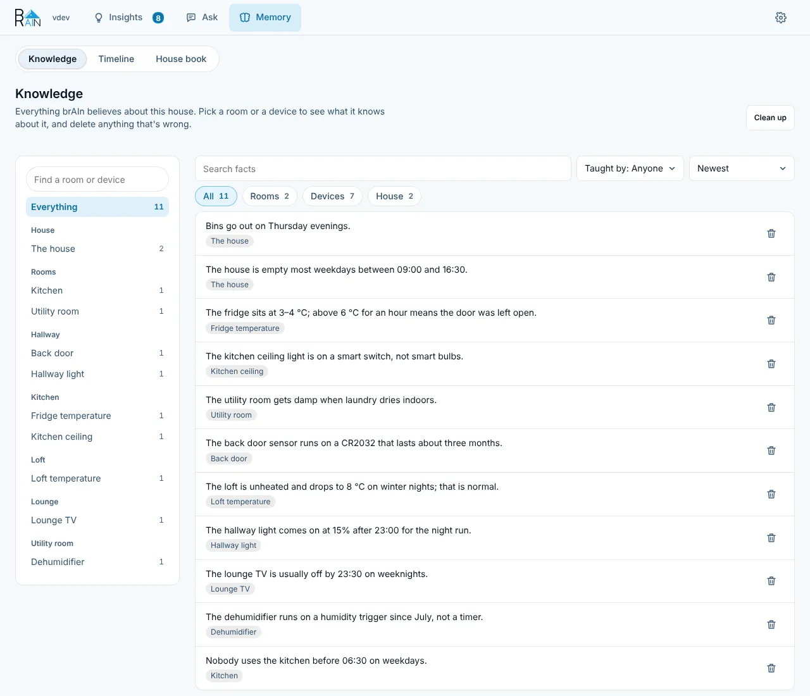

import { CardGrid, LinkCard, Aside, Badge } from '@astrojs/starlight/components';

<Badge text="Version 5.5" variant="note" /> <Badge text="Experimental" variant="caution" />

brAIn is a Home Assistant app that runs **Claude Code** inside your house. It sees and can
change all of Home Assistant, watches for what goes wrong, explains what happened, and
remembers how your home works.

Everything is in **one sidebar entry with one Claude login**. Your Claude Pro or Max
subscription pays for it, or an API key. There is no brAIn subscription.


The sidebar entry has up to four tabs: **Morph UI** (the dashboard), **Insights**, **Ask** and
**Memory**. ⚙ in the top bar holds Settings and a built-in Guide that works with no internet.
On a phone the tabs sit in a row under the header.

## What you can do

### Ask it anything, and have it fix things

Open **Ask** and type. brAIn reads the logbook, traces, history and your YAML, then answers.

| You say | What happens |
| --- | --- |
| *"Why did the hallway light come on at 3 am? Fix it."* | It reads the automation's trace, explains the missing brightness, edits the automation, validates the YAML and reloads. `brain undo` puts the old file back. |
| *"Which of my devices have stopped reporting?"* | A list, from live state and history. |
| *"Every basement light belongs in a Basement area on a Lower Floor. Rename the Sonoff switches to what they control."* | It does the whole sweep through Home Assistant's own registries. |
| *"Add a soil moisture sensor to the greenhouse ESP and flash it."* | It edits the ESPHome YAML, validates it and installs over the air. |



Ask is a chat that fits a phone, or a real terminal, with several conversations open at
once. [Ask →](/brain/terminal/) · [Power Tools →](/brain/power-tools/) ·
[ESPHome →](/brain/esphome/) · [Music Assistant →](/brain/music-assistant/)

### See what needs you, in one list

brAIn checks the house on its own and looks into each problem before you see it.
**Insights → Needs you** holds every decision waiting on you as one kind of card.

- **A dead battery.** The back door sensor has reported nothing since Tuesday. The card
  says what brAIn found and how to fix it. Press **Add to To Do**, **Snooze** or **Ignore**.
- **A broken automation.** Press **Plan** to see the exact change, then **Apply**. The card
  keeps **Undo**.
- **From your phone.** The notification carries the same buttons and a **Reply** box. Type
  *"I already replaced it"* and it is marked fixed. The same card is in Home Assistant's
  Repairs.



[Needs you & To Do →](/brain/needs-you/) · [Notifications & Repairs →](/brain/notifications/) ·
[House checks →](/brain/checks/) · [The Resident →](/brain/resident/)

### Hear about a leak, whatever else is going on

A tripped leak, smoke, CO or gas sensor goes to your phone the moment it trips. It goes
through quiet hours and repeats after an hour, four hours and twelve hours until you answer.
It needs no Claude run, no sign-in and no usage budget.



[Notifications →](/brain/notifications/) · [Emergency playbooks →](/brain/playbooks/)

### Get answers as cards

Ask a question about your house and get an insight card: the answer first, the numbers it
rests on, and a chart drawn for your data. Refresh it on a schedule, share it as a picture,
or put it on a dashboard.


[Insights →](/brain/insights/) · [Timeline: what caused each change →](/brain/activity/) ·
[Upkeep & the house book →](/brain/upkeep/)

### Know what is unusual for this house

Every night brAIn measures what normal is here, with no Claude run: what each sensor reads at
this hour, when the house gets up, which doors are usually open, how fast rooms lose heat.

- The garage freezer's door is open at 23:30 and it never is. You get one row before bed.
- A freezer drifting warmer over weeks is caught by its trend, not by any single day.
- The heating starts too late for the room to be warm by seven. brAIn says so, with the numbers.

[What brAIn measures →](/brain/measurements/) · [Heating & climate →](/brain/climate/)

### Use a dashboard that says what matters

Switch on **Morph** and brAIn's first tab is a dashboard built from your areas. A sentence at
the top says what is going on. Tap, slide or hold any card. To change the dashboard, hold
anything and tell brAIn what should be different.



Morph's cards, themes and room rail also work on Home Assistant's own dashboards.
[Morph →](/brain/morph/)

### Automate in a sentence

| You say or press | What happens |
| --- | --- |
| *"Whenever the front door opens after dark, turn the hall light on."* | brAIn drafts the automation and replays it over your last month: it would have fired nine times. Accept it, or try it for a week first. |
| *"Turn the porch light off at midnight tonight."* | A one-off that runs once and switches itself off. |
| Nothing. You keep doing the same thing by hand. | brAIn offers the automation, with the evidence. |
| *"Design scenes for the living room."* | Four moods (morning, day, evening, night), shown as swatches before you accept. |
| You open **Emergency playbooks** | The automation you want for smoke, a leak or a freeze, written from the devices you have. |
| You turn on **overnight self-healing** (off by default) | brAIn may fix three things while you sleep: an app that should be running, a dead Z-Wave node, an integration that failed to set up. At most three a night. |

Nothing is written to your house until you accept it.
[Rules & one-offs →](/brain/intents/) · [Suggestions →](/brain/proposals/) ·
[Scene designer →](/brain/scenes/) · [Playbooks →](/brain/playbooks/) ·
[Self-healing →](/brain/self-healing/) · [Replay →](/brain/replay/)

### Talk to it

Pick brAIn as your Assist conversation agent. *"Is anyone still in the garage?"* *"Turn the
lounge down for a film."* *"Remember that we call the office lamp the beacon."*

Each agent has its own name, model and reach. A new agent reaches only what you expose to
Assist. [Voice →](/brain/voice/)

### Call it from automations

`brain.ask` returns an answer as data your automation can branch on:

```yaml
action: brain.ask
data:
  question: Is anything in the house drawing more than usual right now?
  schema:
    type: object
    properties:
      unusual: {type: boolean}
      why: {type: string}
    required: [unusual, why]
response_variable: answer
# answer.data.unusual is a boolean you can put in a condition
```

It is read-only unless you say otherwise. `brain.run_task` runs a job in the background,
events fire for every new case, and brAIn can answer Home Assistant's **Suggest with AI**
buttons. [Automations & insight jobs →](/brain/automations/)

### Teach it, and see what it learned

**Memory → Knowledge** lists every fact brAIn holds, by room and device, each with a bin
beside it. Type a fact to teach it. When it believes something it cannot confirm, it asks one
yes/no question. An **Ignore** with a reason becomes a correction, so the same non-problem is
not raised again.



[Memory & knowledge →](/brain/memory/) · [Learning →](/brain/learning/)

### Drive your other BRUH apps

With another BRUH app installed, brAIn gets its tools in the chat, the terminal, automation
tasks and voice. There is nothing to set up.

| App | Ask brAIn to |
| --- | --- |
| [BRUH Bambu Studio](/bruh-bambu-studio/) | Check a printer, start and control prints, slice, design a part from a sentence. |
| [BRUH Cooking](/bruh-cooking/) | Say what each Joule or Breville+ appliance is doing, and start a cook by name. |
| [BRUH Browser](/bruh-browser/) | Run a web errand such as a grocery cart. A purchase is always a second step you approve. |
| [GardenRX](/gardenrx/) | Report this season's harvest and running spray intervals, and log a pick or a spray. |
| [BRight](/bright/) | Start a party or one track's light show, and stop it with a scene. |
| [BRUH Print](/bruh-print/) | Print a label in words or from a template. |
| [BRUH Minecraft](/bruh-minecraft/) | Teleport, set game modes, give items, change the weather, manage add-ons. |
| [BRUH Task Manager](/bruh-task-manager/) | Read per-app CPU and memory, and the runaway-app sensor. |

[brAIn and the BRUH apps →](/brain/apps/)

## It asks first, and it can be undone

- **Reading is never asked about. Changing something asks first**, unless you choose
  otherwise in ⚙ → Permissions.
- **Nothing on a schedule acts on your house.** Cards, the brief and study sessions only read.
- **Protected entities are never acted on.** Put locks, alarms and the garage door on the list.
- **Every change can be put back**: files with `brain undo`, a fix with **Undo** on its card.
- **Cameras are off until you tick one**, and brAIn looks through a ticked camera on its own
  at most a dozen times a day.

[Permissions & safety →](/brain/safety/)

## Where your data goes

- **Everything runs in your Home Assistant.** Memory, measurements and stores live on your
  machine.
- **Claude runs go to Anthropic** under your own account: the prompt, and what brAIn read to
  answer it. House checks, measurements, safety alerts and self-healing cost no Claude run.
- **Only the development loop sends anything elsewhere.** It is off by default and sends to a
  private GitHub repository you own, with names, rooms and entity ids replaced by aliases.
  [Development loop →](/brain/development-loop/)
- **Your Claude credential is kept out of Home Assistant backups.** Sharing the login with
  the other BRUH apps is a switch, off by default.

## What you need

| | |
| --- | --- |
| **Home Assistant** | OS or Supervised, 2023.6 or later. The To-do list needs 2023.11 and AI Task needs 2025.7. |
| **Host** | 64-bit, `amd64` or `aarch64`. A Raspberry Pi 4 or 5 is fine. |
| **Memory** | About 1 GB free beyond Home Assistant's own. |
| **Account** | An Anthropic account. Claude Pro or Max is the most economical. An API key works too. |

<Aside type="caution" title="Back up Home Assistant first, somewhere that isn't this machine">
brAIn edits your real configuration. It snapshots files before it changes them, but that is
not a backup you can restore from. Use **Settings → System → Backups**, then copy the backup
off the device. brAIn is experimental and changes often.
</Aside>

## Where to go next

<CardGrid>
  <LinkCard title="Quick Start" description="Install, restart once, sign in, press Start learning. About five minutes." href="/brain/quickstart/" />
  <LinkCard title="The four switches" description="Morph dashboard, Personality, Learning loop, Development loop." href="/brain/features/" />
  <LinkCard title="Permissions & safety" description="What asks first, what is refused, and how to put a change back." href="/brain/safety/" />
  <LinkCard title="Morph" description="The dashboard that says what matters, and that you change by telling brAIn." href="/brain/morph/" />
  <LinkCard title="Using brAIn" description="Needs you, Insights, Ask, Memory, Timeline, Upkeep and Notifications." href="/brain/needs-you/" />
  <LinkCard title="How it thinks" description="The Resident, measurements, house checks, climate, learning and replay." href="/brain/resident/" />
  <LinkCard title="Acting on your house" description="Suggestions, rules, scenes, playbooks and overnight self-healing." href="/brain/proposals/" />
  <LinkCard title="Voice and automations" description="brAIn as an Assist agent, and brain.ask in your automations." href="/brain/voice/" />
  <LinkCard title="Power Tools" description="91 admin services for areas, entities, devices, helpers, dashboards and more." href="/brain/power-tools/" />
  <LinkCard title="Under the hood" description="How brAIn controls Home Assistant, the 115 MCP tools, the CLI and the deep check." href="/brain/how-brain-controls-ha/" />
  <LinkCard title="Reference" description="Every option, service, sensor and event." href="/brain/reference/" />
  <LinkCard title="Changelog" description="Every notable change, newest first." href="/brain/changelog/" />
</CardGrid>
