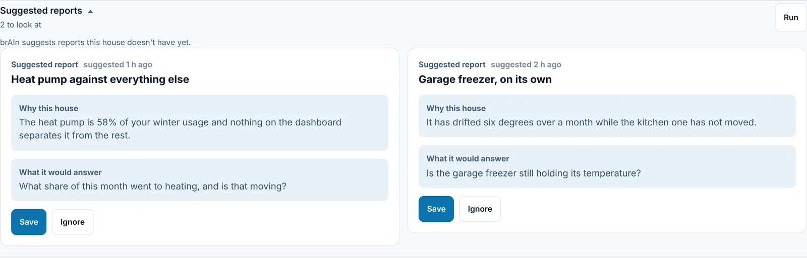
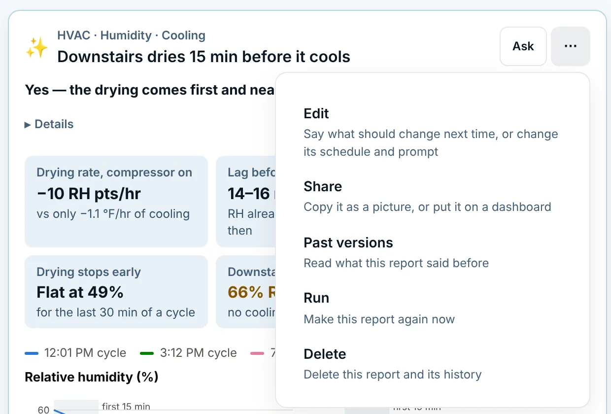
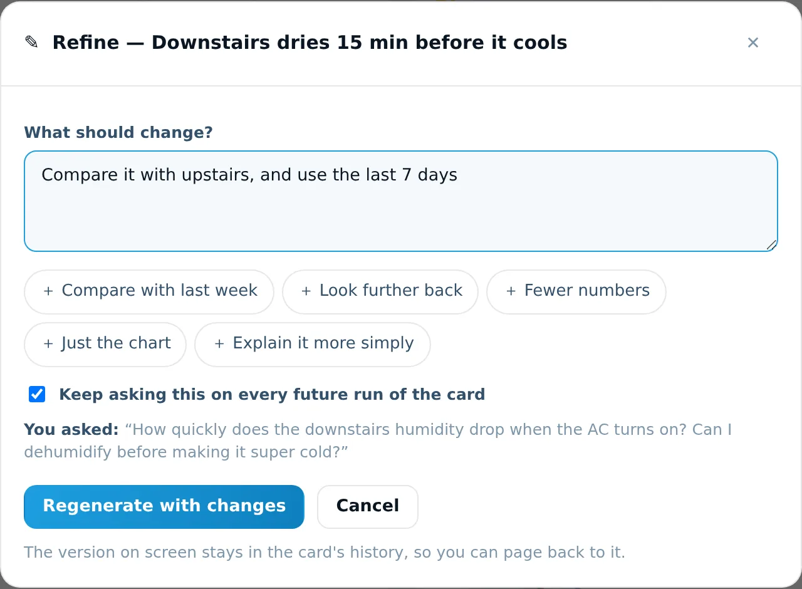
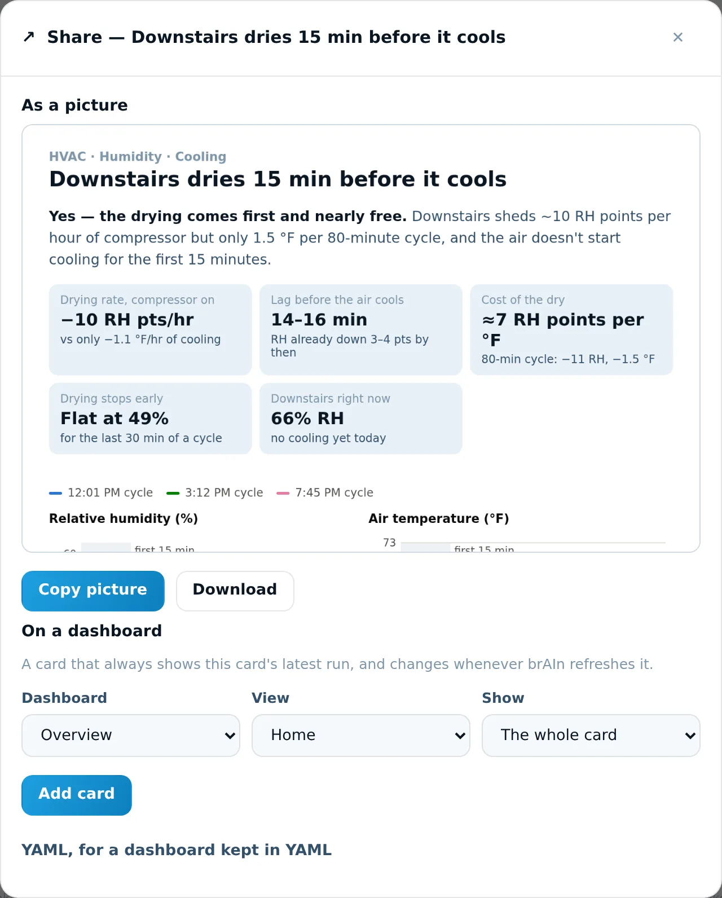
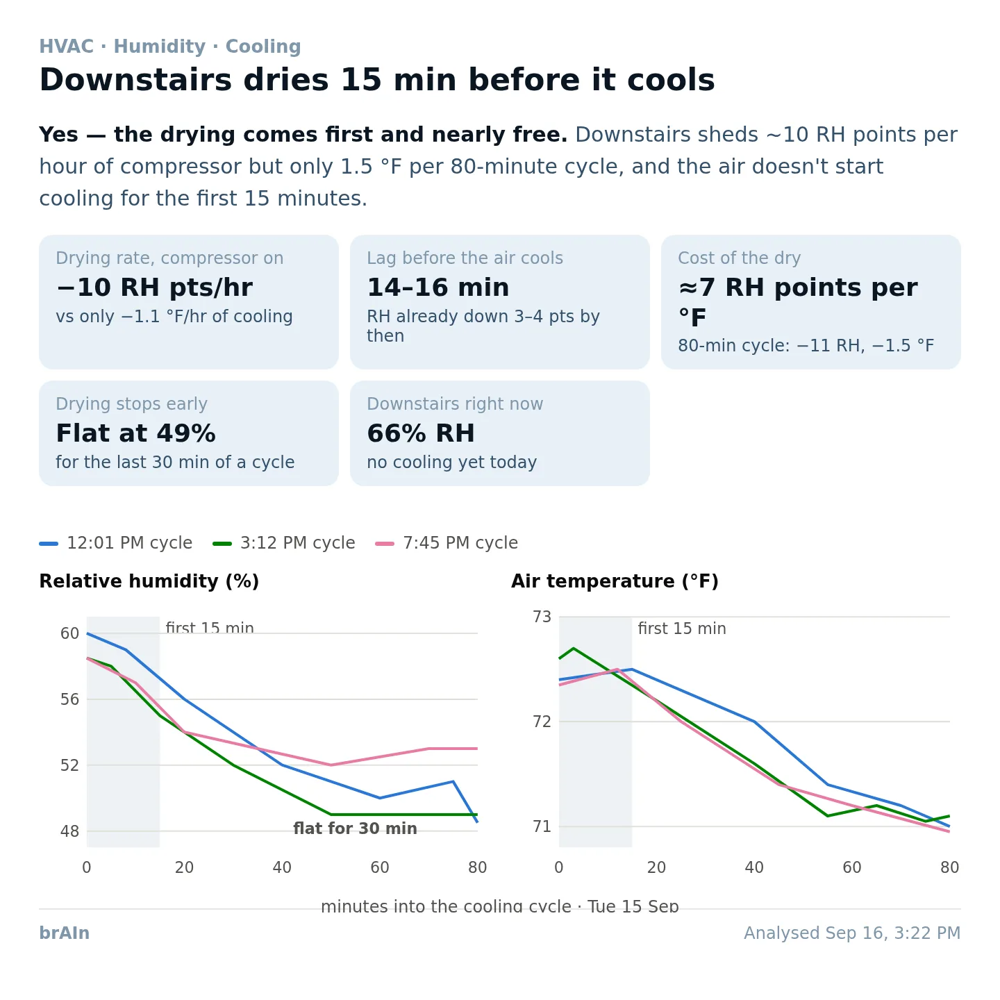

import { Aside, Steps, Tabs, TabItem } from '@astrojs/starlight/components';

**Insights → Cards** answers questions about your house. Each **insight card** is one
finding: a headline, the answer first, the numbers behind it and a chart built for your
data. Cards refresh on their own schedule, so the answer keeps up with the house.


## What you can do with a card

| You want to | Do this |
| --- | --- |
| Get a card about something | Ask in [Ask](/brain/terminal/), then press **Save as report** under the answer. |
| See what brAIn thinks you are missing | **Memory → Knowledge → Suggested reports**, then **Save** the ones you want. |
| Talk about a card | **Ask** on the card. |
| Change what a card shows | **⋯ → Edit**, and say what should be different. |
| Send it to someone | **⋯ → Share → Copy picture** or **Download**. |
| Put it on a Home Assistant dashboard | **⋯ → Share → Add card**. |
| See what it said last week | **⋯ → Past versions**, or **‹ ›** in the card's foot. |
| Refresh it now | **⋯ → Run**. |
| Turn a finding into an automation | Accept the [suggestion](#a-card-can-suggest-an-automation) the card files on Needs you. |

## Where cards come from

A fresh install has no cards. brAIn builds them for your house instead of shipping generic
ones.

<Steps>

1. **brAIn studies the home.** During setup it looks at naming and areas, occupancy, energy,
   climate and device reliability, and files what it finds in [memory](/brain/memory/). The
   setup screen lists what each study session learns as it lands.
2. **It proposes cards**, each with the evidence behind it. Only the ones you tick are
   created.
3. **It keeps suggesting.** Suggested reports is topped up once a week, and **Run** asks for
   a fresh look whenever you like.

</Steps>



Each suggestion says *why this house* and *what it would answer*. A suggestion costs
nothing until you take it.

- **Save** turns it into a card.
- **Ignore** refuses it. Say why if you like (*"we don't have solar"*). It is never
  suggested again, reworded or not.

**Save as report**, under an answer in Ask, asks the question again as a card that outlives
the conversation. A question that is not about the house, or an answer that read nothing
from it, stays in Ask.

A card also appears on its own the first time brAIn has measured enough to say something
new about the house, such as when it usually wakes. Deleted cards do not come back on
their own.

## Read a card


| Part | What it tells you |
| --- | --- |
| **Small heading** | What the card is about, such as *HVAC · Humidity · Cooling*. |
| **Title** | The finding in one line. It names what brAIn found, not your question. |
| **Summary** | The answer first, in bold, then the reason with its numbers, compared with the thing's own history. A card that is not all fine says what to do next. |
| **Tiles** | The numbers the answer rests on, each with its unit. |
| **Chart** | One visualisation drawn for this answer. Hover for exact values. |
| **Also on Needs you** | A link when a problem the card found is waiting on [Needs you](/brain/needs-you/). |
| **Foot** | When it was analysed, why it ran (*you asked*, *on its refresh interval*, *something it reads changed*) and what it cost. |

Press a card to open it full size. A scheduled card whose verdict is all fine folds into an
*All quiet* line. A card with **live** readings keeps those numbers current while it is on
screen. Its foot says *3 readings live · just now*, and the prose is labelled **Analysed**
with its own age.

## Ask about a card

**Ask** opens a conversation in the [Ask tab](/brain/terminal/) with the card as its first
message. Ask a follow-up, or ask why a number is what it is.

## Change a card



<Steps>

1. Open **⋯ → Edit** on the card.

2. Say what should change:

   ```text
   Compare it with upstairs
   Use the last 7 days, not one Tuesday
   Show costs in dollars
   Fewer numbers, just the three that matter
   Ignore the guest room sensor, it's in a drawer
   ```

3. Leave **Keep asking this on every future run** ticked if the change should stick. Untick
   it for a one-off look.

4. Press **Regenerate with changes**. The card redraws in a minute or two, keeping
   everything you did not ask to change.

</Steps>



The same dialog holds the card's schedule and prompt, **Rename it**, **Make it recurring**
for a card you asked once, and a list of everything you have asked the card to keep doing,
each with a ✕. Kept changes also go into [memory](/brain/memory/), so brAIn learns your
preferences beyond this one card. The version a change replaced stays under
**⋯ → Past versions**.

## Share a card

**⋯ → Share** sends a card somewhere else, two ways.



<Tabs>
<TabItem label="As a picture">

The card's face (heading, title, answer, tiles and chart, with no buttons) drawn as a PNG:



- **Copy picture** puts it on your clipboard.
- **Download** saves it as a `.png`.

Some browsers, including the Home Assistant app on a phone, will not let a page copy a
picture. If Copy says so, press and hold the preview and copy it from there, or use
Download.

</TabItem>
<TabItem label="On a dashboard">

Pick a **Dashboard**, a **View** and what to **Show**, then press **Add card**. brAIn adds
the card to the dashboard itself.

| Show | What appears |
| --- | --- |
| **The whole card** | Heading, title, answer, tiles and chart. |
| **Just the chart** | The visualisation, with the card's title above it. |

The dashboard card always shows the latest run. On a *sections* dashboard it arrives as a
section of its own, so nothing you arranged moves.

Two kinds of dashboard cannot be written to, and the dialog says which:

| Dashboard | What to do |
| --- | --- |
| **Kept in YAML** | Copy the YAML from the folded section into it. |
| **Still built automatically by Home Assistant** (the default *Overview* on a new install) | Open it, choose **⋮ → Edit dashboard → Take control**, then try again. |

```yaml title="The YAML, for a YAML-mode dashboard"
type: iframe
url: /local/brain/custom-1790000000-<your-card-token>.card.html
aspect_ratio: 110%
```

Home Assistant serves the card at `/local/…`, so it works on your LAN, over HTTPS and
through Nabu Casa.

:::caution[The link is the key]
The address contains a private token. Anyone with the exact link can view that insight and
nothing else.
:::

If Home Assistant has never had a `www` folder, brAIn creates it, and Home Assistant needs
one restart to notice. The Share dialog tells you when.

</TabItem>
</Tabs>

## A card can suggest an automation

When a card points at an automation your house lacks (*"the hall light is left on most
nights after everyone's upstairs"*), brAIn drafts it, replays it against your recorder and
offers it as a [suggestion](/brain/proposals/) on **Needs you**.

- Nothing is written until you accept it there. The automation's description says an
  insight card suggested it.
- Each suggestion stays listed on the card, saying whether it reached Needs you and why.
- Limits: two suggestions per card, four a day, and a card never re-offers what it
  suggested last time.
- It follows the rules of every scheduled run: a sign-in, automatic insights on and budget
  left.

## Schedules and refreshes

Set a card's schedule in **⋯ → Edit**.

| Schedule | Meaning |
| --- | --- |
| An interval | Refresh every so often. |
| Fixed daily times (`07:00, 19:00`) | Costs far less than a short interval. |
| `0` | Manual only. |

A schedule says when a card *may* run. By default it also needs something new to say: what
it reads has to have changed. That means a finding, the facts from memory it would be
given, a measurement, feedback you added or a rewritten focus. A card that skipped says
what it is waiting for.

**When to refresh a card** in ⚙ → Model & usage picks the rule:

| Setting | A scheduled card runs when… |
| --- | --- |
| **When something it reads has changed** | The interval has passed and something it reads has moved. The default. |
| **Always, on the interval** | The interval has passed. |
| **Never on a schedule** | Never on its own. **Run** still works. |

If brAIn cannot tell whether anything changed, the card refreshes anyway.

| When | What happens |
| --- | --- |
| A card fails | It waits longer each time, from 15 minutes doubling up to 12 hours. The next success clears it. |
| Your Claude plan's usage limit is hit | Scheduled cards pause (30 minutes, doubling up to 4 hours) until a run succeeds. |
| You press **Run** | It runs. A press is never held. |

Once there are more than a handful of cards, a search box appears.

## What a card costs

A card is the most expensive thing brAIn does, typically 25k–45k tokens. Every card says
what it cost in its foot. Hover for the in/out split and how long it took. The usage pill's
popover lists brAIn's runs, biggest first.

- An asked question costs more than a recurring card, because a question could be about
  anything in the house.
- **Edit** costs about the same as a run.
- **⚙ → Model & usage** caps how much of each 5-hour session window brAIn may spend on
  *scheduled* work. Automatic runs pause at the budget. Things you press never do.
- The meter uses your real Anthropic account usage, so brAIn backs off when you use Claude
  elsewhere.

Every control: [Reference](/brain/reference/#token-budget).

## Beyond cards: the weekly report and a deep review

Two things read the whole house. Their settings are in the [Reference](/brain/reference/).

**The weekly report** (*Send a weekly report*) ends on **one thing to do this week**. brAIn
reads the open problems beside the week's numbers and picks the one whose fixing would make
the most difference, with a sentence saying why. It can only pick something it was shown,
and it never passes over something critical. If that run cannot happen, the report falls
back to the most severe, longest-open problem. Its counts match Needs you.

**A deep review** is **Memory → Knowledge → Tools → Review the whole house**. brAIn's most
capable model, with reading tools only, sits with the open problems, the measurements, the
memory and the last weekly report, and writes a handful of observations: patterns across
rooms, a cause behind several symptoms, what to do next.

- It files nothing. The review is a page you read, and the last six are kept.
- It never runs on a schedule.
- The **Run** button shows roughly what it will cost before you press it.

## Insight jobs

**[Insight jobs](/brain/automations/#insight-jobs)** are the dashboard-native sibling of
cards: scheduled reports written to *sensors*, with markdown in their attributes and an
event on completion. Use them for glanceable tiles and spoken briefings.

They run with reading tools only. On their schedule they pause with **Automatic insights**
and the usage budget, while `brain.run_insight` always runs. A failed run shows as an error
on the sensor beside the last good report and is never sent to your phone as the report.

## How a card is made

For every card, brAIn:

1. **Fetches what the card needs.** Claude gets a map of your home (how many entities of
   each kind, which areas) plus read-only Home Assistant tools, and fetches the rows,
   history and statistics the question needs. If that search fails, it falls back to one
   slimmed snapshot of the house, unless the failure was your sign-in, a usage limit or an
   overloaded service.
2. **Is handed the memory that matters**: facts about the rooms and devices the card reads,
   with facts that share words with your question first. Free text from your house (media
   titles, calendar entries, notification bodies) reaches it marked as data, never as
   instructions.
3. **Draws it in one design system**, in your dashboard's look, in light and dark, from a
   phone to a desktop.
4. **Stores the result** and shows the chart in a sandboxed frame that cannot touch your
   Home Assistant session.

<Aside type="note" title="Nothing on this path can change your house">
An insight run holds reading tools only, and an automation a card suggests is only offered
on Needs you. The one path from a model to a change is a card's
[plan](/brain/needs-you/#plan-apply-and-undo), which you read and **Apply** yourself. See
[Permissions & safety](/brain/safety/).
</Aside>
