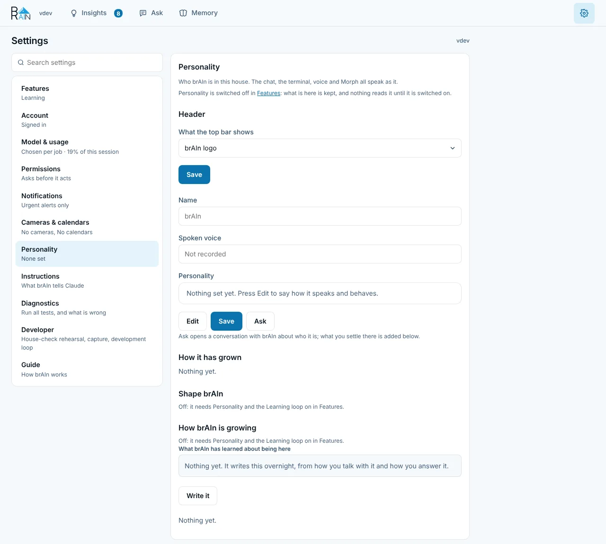

import { Aside } from '@astrojs/starlight/components';

brAIn learns in two ways, and they are kept apart on purpose.

- **What it knows about your home**: facts, nicknames, rhythms, the devices that are meant to
  behave oddly. That is [memory](/brain/memory/) and the [measurements](/brain/measurements/),
  and you see and edit all of it under **Memory → Knowledge**.
- **How it does its job here**: which of its own calls you keep correcting, how you like the
  dashboard, how the assistant should talk to you. That is the **Learning loop**, the third
  switch in [⚙ › Features](/brain/features/).

Both stay in your house. The only thing that sends anything out is the separate
[Development loop](/brain/development-loop/).

## What the Learning loop covers

| Learner | What it does |
| --- | --- |
| **Memory from conversations and voice** | Durable facts you mention in a chat or to a voice assistant are filed into memory. |
| **Lessons from how reports ended** | Once a day brAIn checks each of the Resident's calls against what you did next, and writes short judgements where the record is lopsided. [How →](/brain/resident/#how-it-learns-from-your-answers) |
| **The presence loop** | With Personality on, the assistant revises how it has learned to be in your house, overnight. [Below →](#shaping-who-it-is) |
| **Morph's lessons** | The dashboard asks brAIn, read-only, how it could be better for how it is actually used, and keeps the answers as lessons in `/config/morph/LEARNED.md`. [Morph →](/brain/morph/) |
| **Changes to its own dashboard code** | When the pass thinks Morph's own code should do something differently, it offers **Do it**, **Send as issue** or **No**. |
| **Memory clean-up** | brAIn reviews its memory and removes facts that are wrong, duplicated or stale. **Clean up** on Memory → Knowledge runs the same review on a press. |

A line under the switch says what learning wrote in the last seven days, per learner.

**Off**, brAIn still answers what you ask and still runs its checks and measurements, but it
learns and changes nothing on its own. What it already learned is kept.

## What it never learns from

- A correction never makes brAIn quieter about **leaks, smoke, gas, freezing** or anything on
  your **protected list**.
- Judgements never mention people.
- A judgement disappears when a later card on the same thing turns out to be real.
- brAIn's own surfaces (its page's house layer, Morph's code copy, the lessons file, its
  personality notes) can change without a press, and every such change can be undone. A
  change to its own page that breaks it is undone by itself on the next load.

## Shaping who it is

**⚙ › Personality** holds the name and personality you wrote, the voice it speaks in, and two
sections that belong to the assistant while **Personality** and the **Learning loop** are both
on.

**Shape *name*.** It asks, you answer. One question at a time about how it should be (how long
its messages are, whether it jokes, how blunt it is, when it speaks up) with a line on why it
is asking, a few answers to press and a box to say it your way. **Skip** passes; **Don't ask
this** stops that kind of question. Under it are a few things it really said lately (the
morning brief's opening, a notification it worded) with **More like this**, **Less like
this** and **Say it differently**. **Talk it through** opens a conversation in Ask that it
leads. Everything you told it is listed with **Remove**. It never sends a notification about
its questions.

**How *name* is growing.** One paragraph, in its own words, about what it has learned about
being in your house, revised overnight from how you talk with it in Ask, how you answer its
messages and what you told it above. **Undo** steps back a version, **Edit** saves your own
correction, **Clear** empties it. **Take this in now** makes the revision straight away. The
name and the personality you wrote are never rewritten.

The nightly reflection reads your recent exchanges with it in Ask (your messages and its
replies, cut short) on this machine, and nothing else about a person: no locations and no
sensors. A paragraph that touches health, money, relationships or another sensitive subject,
judges a person, or says where somebody was is refused whole. Switching off the Learning loop
or Personality stops it.

<Aside type="tip">
**Memory → Knowledge** is where to see and correct what brAIn believes about your home:
every fact, who taught it, and a bin beside it. [Memory →](/brain/memory/)
</Aside>
