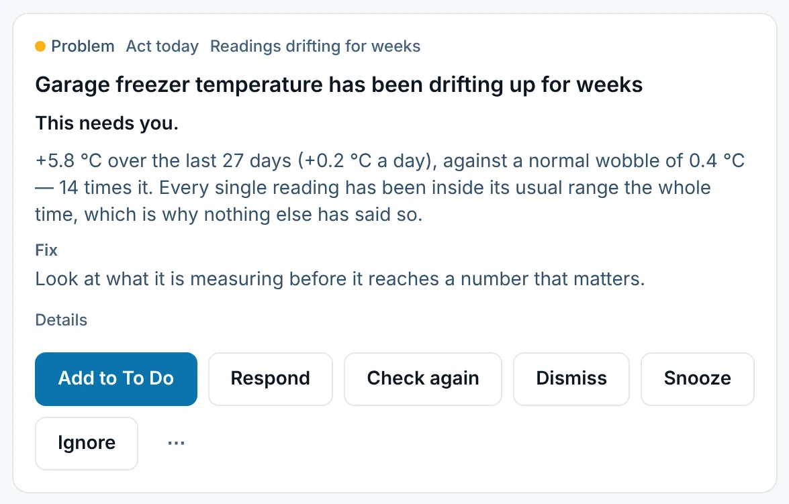

Every night brAIn measures what your house normally does, then raises an alert only when
something strays from that. You set no thresholds. The measuring is arithmetic over
history Home Assistant already keeps and uses no Claude run.

See every measurement and how far it has got under **⚙ → Diagnostics → Measurements**:


Each row reads **ready**, **collecting** (with the date it will be ready), **stale**, or
**not available** with the reason. **Ask now** runs the pass straight away.

## What gets measured

| Measurement | The question it answers | What it reads |
| --- | --- | --- |
| **When the house wakes** | When does this house get up, and when does it settle for the night? | The first and last thing a person does each day. Needs 10 days |
| **What is normal here** | What does this sensor normally read at this hour of this day of the week, and how far does it stray? | 28 days of statistics for sensors whose readings vary |
| **How rooms hold heat** | How fast does each room lose heat, and how fast can the heating put it back? | 28 days of temperatures, one outdoor thermometer and indoor ones in areas. [Heating & Climate →](/brain/climate/) |
| **Doors and windows** | How much of each hour of the week is this door, window, lock or cover open? | 28 days of door history |
| **Machines** | What does this machine draw when idle, running and finished? | 10 days of a power sensor. A smart plug is enough |
| **Habits** | What do you do by hand, on the same days, at about the same time? | Changes a person made. Needs 6 separate days |
| **Energy this week** | How does this week's electricity compare with last week's? | The meters in Home Assistant's Energy configuration, over seven complete days |

The first pass runs overnight. A measurement that does not have enough history says *not
measured yet* and never guesses.

## What you get from them

| What happened | What brAIn tells you |
| --- | --- |
| A reading is far from what this sensor does at this hour of the week | *"…is reading outside its usual range"* |
| A reading has crept one way for weeks without ever leaving its usual range | *"…has been drifting up for weeks"* |
| A door or window is open at bedtime and is usually shut then | *"Open at bedtime, and usually shut"* |
| The washing machine, dryer or dishwasher finished and nothing has run since | A chore card that clears when you tick it off or the machine runs again |
| The bedroom is still warming up when the house gets up | The time the heating would need to start. [Climate →](/brain/climate/) |



The full list of checks that read these measurements is on [House Checks](/brain/checks/).
The measurements also set the hour of the morning brief, the bedtime door check and
overnight repairs.

## Use the house's state in an automation

`sensor.brain_house` says what the house is doing now. Its state is one of `home`, `away`,
`asleep`, `waking`, `guests` or `unknown`.

```yaml
trigger:
  - trigger: state
    entity_id: sensor.brain_house
    to: away
    for: "00:15:00"
action:
  - action: climate.set_preset_mode
    target: { entity_id: climate.hall }
    data: { preset_mode: away }
```

| Attribute | What it holds |
| --- | --- |
| `sentence` | One sentence about the house now |
| `rooms_in_use` | Rooms with recent motion, media or lights |
| `unusual_together` | Things that are unusual at the same time |
| `because` | Why brAIn chose this mode |
| `coming_up` | Notes about the next three days |
| `published_age_minutes` | How old the reading is |
| `reason` | Why the state is `unknown`, when it is |

The sensor never goes unavailable. A reading that stopped being refreshed reads `unknown`,
so treat `unknown` as "do nothing".

:::caution[The mode is context, never a switch]
A wrong *away* does not make a leak alarm or a protected device any less important to
brAIn. *Away* needs somebody's presence sensor to say nobody is home. The sentence never
says anything about a person's body, health or sleep.
:::

### How the sentence is made

Every few minutes brAIn gathers what it can see: who is home, which rooms are in use, which
doors are open when they usually are not, what is running, the weather, and today's event
on any calendar you chose. When that picture changes, a quick run turns it into a mode and
one sentence, shown at the top of **Memory → Timeline**:

> Home, settled for the evening — the lounge and kitchen in use, the dishwasher running.

Every number and device the sentence names has to be in what brAIn could see. If one is
not, the previous sentence is kept and labelled **earlier**.

### What is coming up

Twice a day brAIn reads the next three days of your weather forecast and writes a short
note for each of these, with arithmetic and no model:

| Note | When |
| --- | --- |
| Frost | 0 °C or below |
| Hot day | 30 °C or above |
| Heavy rain | 10 mm or more in a day |
| Strong wind | Gusts of 60 km/h or more |

To add calendar events, tick a calendar under **⚙ → Cameras & calendars**. None is ticked
by default and nothing is read until you tick one. Notable events in the next three days
become notes such as *"Mum staying Fri–Sun"*. brAIn treats what a calendar says as
information and never as an instruction.

Each note expires when the occasion is over. Notes change nothing in the house.

## How "normal" is worked out

You do not need this section to use brAIn. It explains why an alert did or did not fire.

### Hour of the week, in your timezone

A weekday 7 am and a Sunday 7 am are measured apart, so there are 168 buckets per sensor,
in your local time.

### Which sensors are measured

The nightly pass reads at most **400 sensors**. Only sensors whose readings vary take a
place. Diagnostic sensors such as signal strength and uptime do not. If the limit leaves
some out, ⚙ → Diagnostics says how many.

A sensor whose whole history is one value is reported as **flat** and gets no baseline.

### What "unusual" has to clear

The width of normal is a median absolute deviation (a "spread"), so one spike does not
widen the band. A reading is unusual only when it clears every row:

| Floor | Value |
| --- | --- |
| Distance from the median for this hour of the week | 6 spreads |
| Distance when only the sensor's whole history is available | 9 spreads |
| Minimum move in the sensor's own unit | For example 20 W, 2 % or 0.5 ° |
| Too many rows at once | Nothing is reported, because the baseline no longer describes the house (a heating season starting, a meter replaced) |

### Slow drifts

A slow drift moves the band along with it, so the band cannot see it. brAIn also fits a
trend line to each sensor. A drift is reported when all of these hold:

- Both halves of the window agree on a direction. This tells a drift from a season turning
  or a meter being replaced.
- The move is bigger than the sensor's own noise.
- The rest of its device class is not drifting with it. Five thermometers drifting together
  is the weather.
- Only a handful of sensors are drifting. Past that, nothing is reported.

A sensor the trend reports is not also reported as unusual. One sensor gets one card.

### Doors and windows

A door has no median. brAIn measures how much of each hour of the week it is open, by time
and not by sample. Only doors, windows, locks and covers are measured. An hour that was
never observed is kept apart from an hour when the door was never open.

### Machines

Each machine is measured from ten days of its own five-minute power history. brAIn looks
for long idle stretches broken by runs well above them. A sensor without that shape, such
as a router, gets no profile.

The quiet phases inside a cycle are measured too, so a dishwasher's dry phase does not
read as *done*. On a house with more power sensors than the nightly limit, washers, dryers
and dishwashers are measured first.

:::note[brAIn cannot see that you emptied it]
An empty machine and a full one draw the same power. End the chore by ticking it off in
the To-do list, pressing the notification button, or pressing it in the panel. It also
clears when the machine runs again.
:::

### Rhythm: when this house gets up

The wake time is the first change a person causes each day. A motion sensor or an
automation's light does not count. A voice command does.

- **A day runs from 04:00 to 04:00.** A household that goes to bed at 00:40 is measured as
  settling at 00:40 that night.
- **Weekdays and weekends are measured apart.** A weekend gains two days a week, so its
  answer takes about five weeks.
- **Times are averaged around the clock.** Settle times either side of midnight give an
  answer near midnight.

## Read the measurements yourself

| Where | What it returns |
| --- | --- |
| **⚙ → Diagnostics → Measurements** | Every measurement, when it ran, and why one could not |
| `brain doctor` | The same, in the terminal. [Doctor →](/brain/doctor/) |
| `GET /api/baselines` | The baselines |
| `GET /api/appliances` | The machine profiles |
| `GET /api/habits` | The habits |
| `GET /api/situation` | The house's mode and sentence |
| `GET /api/occasions` | The notes about what is coming up |

If the nightly pass stops running, brAIn files a finding of its own (*"Baselines no longer
being measured"*), because every check that reads a baseline says nothing while the
measurements are stale.
