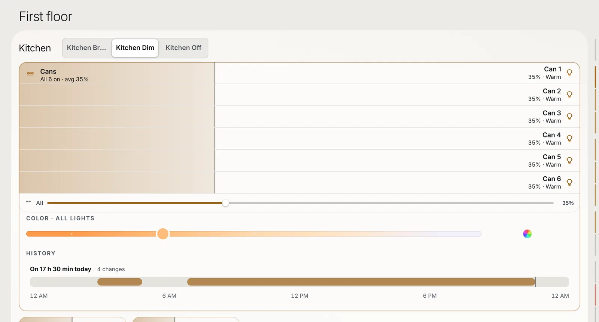
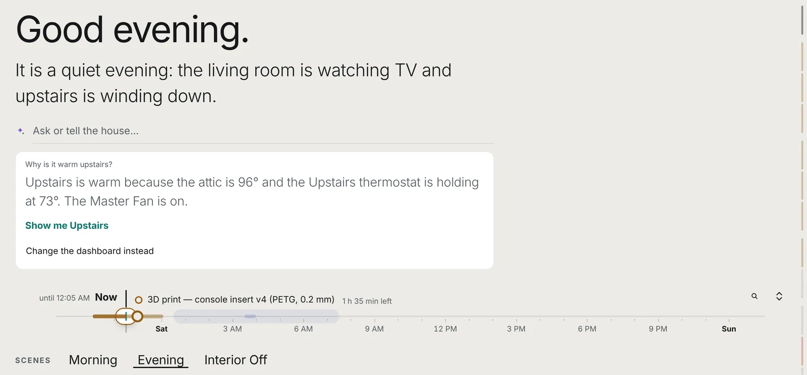
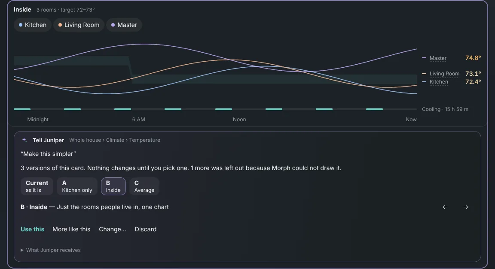

import { CardGrid, LinkCard, Aside } from '@astrojs/starlight/components';

Morph is the dashboard in brAIn's first tab. A sentence at the top says what is going on in
the house, your rooms stay where you put them, and you change anything by telling brAIn.

## What you can do

### Read the house in two seconds

The first line is a verdict: rose when something is wrong, amber for something worth a look,
indigo when the house is at rest. A card that stands out is tinted and says why. Nothing on
the page moves to make the point.

- *The garage door is open*, in rose. Tap the garage card, tap again to confirm, and it closes.
- On a quiet evening the page is exactly where you left it.

[Using Morph →](/brain/morph/using/)

### Tap, slide, hold

| Gesture | Does |
| --- | --- |
| **Tap** | The main thing: toggle a light, play, lock, run a script. |
| **Slide** | Sets a level: brightness, fan speed, blind position. |
| **Hold** | Opens the card in place with its options, its history and Home Assistant's own Details. The other cards make room. |

### Ask the house

Type into the *Ask or tell the house…* line. A question is answered right there. A change to
the dashboard is made, with Undo.

### Change it by telling brAIn

Hold a card, a room, a floor or the whole page and say what should be different.

| You say | What happens |
| --- | --- |
| *"This is cut off."* | brAIn looks at a picture of the card as you see it, and fixes it. |
| *"Make this simpler."* | brAIn draws two or three versions in the card's place. Pick one with **Use this**. |
| *"Put the porch light in Entry."* | The card moves. **Keep** or **Undo**. |
| *"Add a switch in the header for the porch light."* | brAIn changes your copy of Morph's own code. |

Every change is a commit you can undo. [Tell brAIn & Edit →](/brain/morph/tell-brain/)

### Everything else

- **Host any Lovelace card.** Paste a built-in or HACS card's YAML and it sits in a room,
  with your theme and live state.
- **See the day on a line.** The Coming up strip shows what is scheduled and what is running,
  with lanes for machines such as a washer or a 3D printer.
- **Protect a sleeping room.** With `sleep_guard` on, anything aimed at a room whose sleeper
  is in bed asks first.
- **Get around a big house.** On a touch screen, swipe the right edge and slide from room to
  room.
- **Use it on Home Assistant's dashboards.** 21 Morph cards in **Add card**, card types
  brAIn builds once and you reuse, a brAIn button on any dashboard, and Morph's themes.
  [Morph on HA dashboards →](/brain/morph/home-assistant-dashboards/)
- **Let it learn.** Morph notices how the dashboard is used and suggests changes. A no is
  remembered. Nothing leaves your house. [How it learns →](/brain/morph/learning/)

<Aside type="caution" title="Experimental">
Morph is still being developed. Keep your usual dashboards beside it. It writes only its own
folder (`/config/morph`), and it changes Home Assistant itself only when you ask for that in
words.
</Aside>

## What you need

| | |
| --- | --- |
| **brAIn** | Installed and signed in, with Home Assistant restarted once. [brAIn's Quick Start](/brain/quickstart/) |
| **The switch** | **Morph dashboard** on in brAIn's **⚙ › Features**. It is off on a fresh install and on if you upgraded from the old Morph app. |
| **For Tell and learning** | brAIn's **Automation tasks** option (`enable_automation_integration`, on by default), and the **Learning loop** switch for learning. |
| **An administrator** | Only a Home Assistant administrator can change the dashboard. Everyone else sees the dashboard alone, without brAIn's other tabs. |

## Where to go next

<CardGrid>
  <LinkCard title="Quick Start" description="Switch Morph on, open it, and make your first change." href="/brain/morph/quickstart/" />
  <LinkCard title="Using Morph" description="The verdict, rooms, cards in place, Coming up, Ask, the room rail." href="/brain/morph/using/" />
  <LinkCard title="Tell brAIn & Edit" description="Hold anything and say what should change. Versions, Edit mode, history and undo." href="/brain/morph/tell-brain/" />
  <LinkCard title="Morph on HA dashboards" description="Morph cards, card types, dashboards brAIn looks after, the rail and themes." href="/brain/morph/home-assistant-dashboards/" />
  <LinkCard title="How it learns" description="Suggestions, lessons, and why nothing leaves the house." href="/brain/morph/learning/" />
  <LinkCard title="Settings & files" description="⚙ › Dashboard, and every key of dashboard.yaml." href="/brain/morph/settings/" />
</CardGrid>
