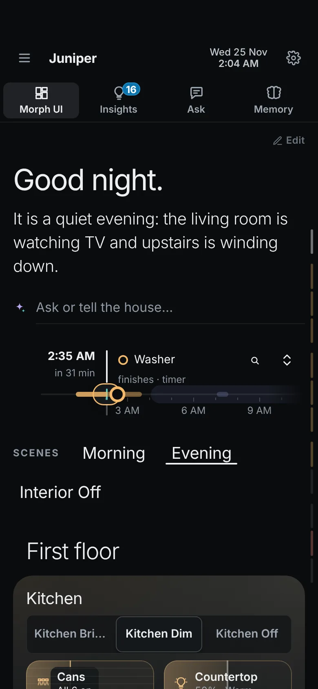

import { Steps, Aside, LinkCard } from '@astrojs/starlight/components';

Switch Morph on and brAIn builds a dashboard from your house. There is nothing extra to
install.

## Before you start

- **brAIn is installed and signed in**, and Home Assistant has been restarted once. If not,
  follow [brAIn's Quick Start](/brain/quickstart/) first.
- **You are a Home Assistant administrator.** Everyone else sees the dashboard and cannot
  change it.
- **brAIn's Automation tasks option is on** (`enable_automation_integration`, the default).
  Tell and the learning loop need it.

## Switch it on

<Steps>

1. Open **brAIn** in the sidebar and press **⚙** at the right of the top bar.

2. Open **Features** and switch on **Morph dashboard**. It takes effect at once.

3. Open the first tab, **Morph UI**. You can rename it later in ⚙ › Dashboard › Header tabs.

4. Let it build. brAIn makes **one section per area, grouped by floor** (or *Home* and
   *Outside* if you have no floors), plus a **Whole house** floor with climate, weather and
   security. You can rebuild it any time from ⚙ › Dashboard.

</Steps>

## Use it

<Steps>

1. **Tap** a light card. It toggles. A garage door, an unlock and a lock ask for a second tap.

2. **Slide** along the same card to set the brightness. A fan's speed and a blind's position
   work the same way.

3. **Hold** the card. It opens in place with its options and history. Tap outside to fold it
   back.

4. **Ask something** in the line under the verdict: *"which windows are open?"* The answer
   appears under the line.

</Steps>

## Make your first change

<Steps>

1. Press the pencil (**Edit**) at the right of the page's first line.

2. **Hold a card**, such as the Kitchen's countertop light. The Tell box opens with a picture
   of what you are holding.

3. Say what should change: *"Make this the full width of the room and call it Counter."*

4. Press **Just do it** to make the change straight away. **Send for versions** instead asks
   brAIn for two or three versions to choose from.

5. Watch it work. brAIn's steps appear in the box. You can close the box, and a strip at the
   top of the dashboard says what brAIn is doing.

6. Press **Keep**, **Undo** or **Tell it more**. Undo reverts exactly that change.

</Steps>

<Aside type="tip" title="You do not need Edit to change the page">
Type the change into the Ask line: *"remove the Coming up timeline"*, *"put the porch light
in Entry"*. brAIn reads it as a change to the dashboard and makes it, with Undo.
</Aside>

## Upgrading from the Morph app

Update brAIn and restart Home Assistant once when it asks. brAIn does the rest:

- It **stops the old Morph app and sets it not to start at boot**, removes the old `morph`
  integration, and says so in a notification.
- It never uninstalls the app, because that deletes the app's data. Do that yourself from
  Settings › Add-ons when you are happy.
- The Morph dashboard switch is already on.
- Everything in `/config/morph` comes with you: the dashboard and its whole history, your
  card code in `cards/`, your changes to Morph's own code, and the lessons in `LEARNED.md`.
- Morph's own settings (theme, hold time, the learning schedule and model) start from their
  defaults. Set them again in ⚙ › Dashboard.

<LinkCard title="Next: Using Morph" description="The verdict, rooms, cards in place, Coming up, Ask and the room rail." href="/brain/morph/using/" />
