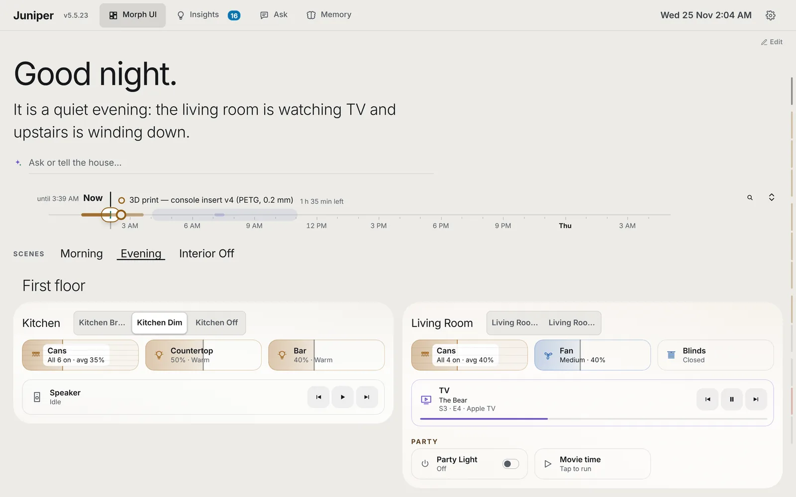
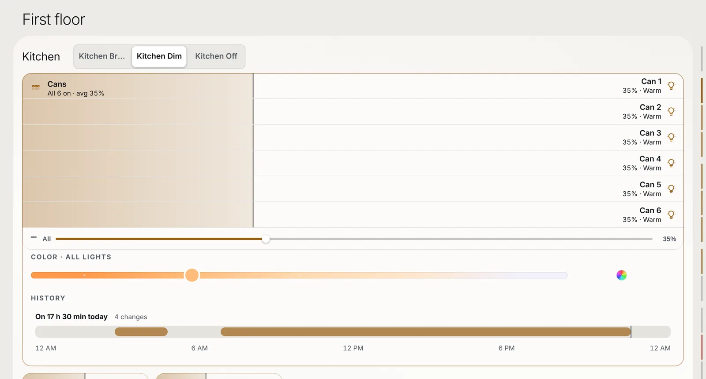
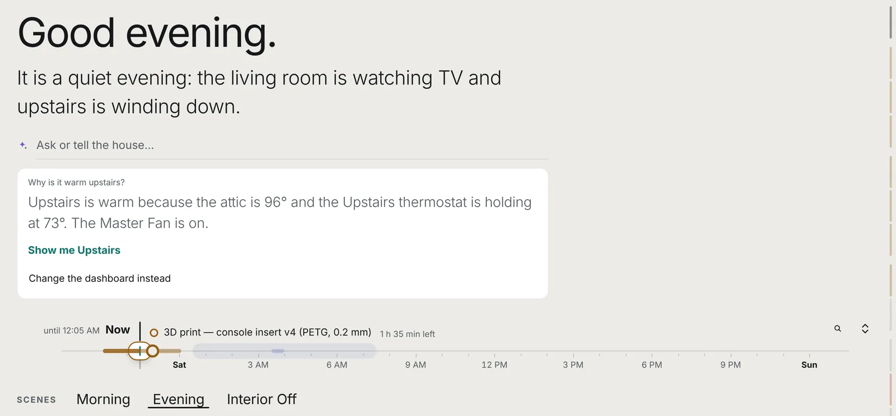
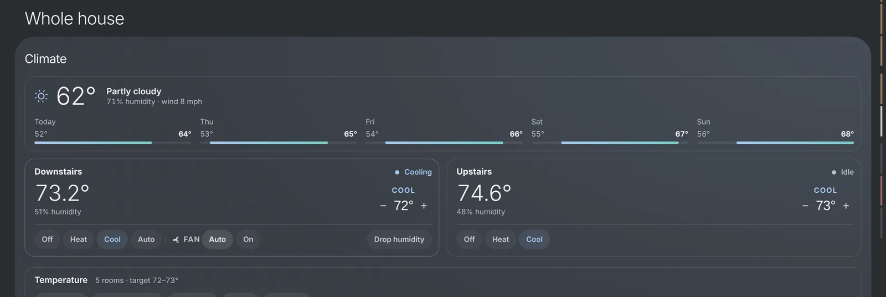
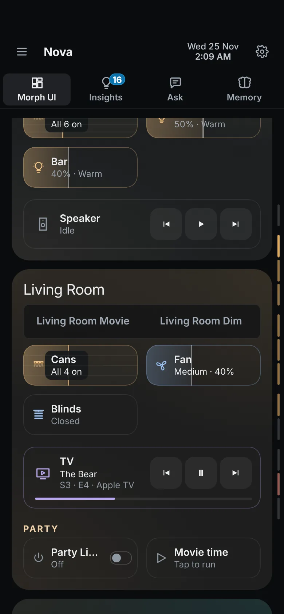

Morph is one page, read top to bottom: a greeting and a verdict, the Ask line, the Coming up
strip, the house's scenes, then your floors and rooms.



## Read the verdict

Under the greeting, one sentence says what is going on in the house. Its first clause takes
the colour of what it means.

| Colour | Means |
| --- | --- |
| **Rose** | Something is wrong: a door unlocked that should not be, a leak. |
| **Amber** | Something worth a look. |
| **Indigo** | The house is at rest. |

A card that stands out is tinted and carries a **because** line. The sentence and the cards
come from the same reading, so they never disagree.

The reading uses what brAIn has [measured as normal](/brain/measurements/) for your house.
On a fresh install the page works from the house's own state until those measurements exist.

## Find things where you left them

Nothing on the page reorders itself. Floors, rooms and cards keep the order you gave them,
and every room always shows all of its cards.

A room's title line carries its name, an optional icon, and its scenes as one segmented
control. A room with a single card is that card alone, with no box around it. Tiles sit on
one grid of equal columns, two half-columns on a phone. A section's `width` is its share of
the page ([Settings & files](/brain/morph/settings/#dashboardyaml)).


## Tap, slide, hold

| Gesture | Does |
| --- | --- |
| **Tap** | The main thing: toggle a light, play, lock, run a script. A garage door, an unlock and locking a lock ask for a second tap. |
| **Slide** | A level: brightness, fan speed, blind position. |
| **Hold** | Opens the card **in place** with its options and its history. Everything else makes room. |
| **Tap outside** | Folds everything back. |



An opened card shows:

- **Its options.** A light's colour is one track: the whites, then a rainbow dot for the full
  spectrum. A light or blind group ends with an **All** slider that sets every member.
- **Its history**, as Home Assistant records it: a light's day as a strip of on and off, a
  sensor's readings as a line you can scrub, a meter's week as bars. Tap a day or a bar for
  its hours and the logbook's "who". Charts with many lines have drag-to-zoom and a chip per
  line.
- **Details**, which opens Home Assistant's own dialog for the entity. An administrator also
  gets **Device page**. On a card that lists several things, tap one row first.

Smaller touches:

- Numbers roll when they change. A tile glows briefly when something else changes it: a wall
  switch, an automation, another phone.
- Tap a number or name that comes from a sensor to open that sensor's own card.
- A running fan spins faster with its speed.
- In the Home Assistant app, every action, slide detent and rail notch has a haptic.

## Ask the house

Type into *Ask or tell the house…* under the verdict. brAIn decides what the words are.



| You type | What happens |
| --- | --- |
| A question: *"what's using the most power right now?"* | The answer appears under the line, and the page lifts what it names. Answer again to carry on. It is one conversation, also in brAIn's **Ask** tab. |
| Something to remember, or a rule: *"remember the sump pump is in the laundry"*, *"tell me when the dryer is done"* | Done, and said in a line. |
| A change to the dashboard: *"put the porch light in Entry"* | Made as a [Tell](/brain/morph/tell-brain/), with Undo. |

If an answer was not what you wanted, **Change the dashboard instead** sends the same words
as a change.

## See the day in Coming up

The **Coming up** strip is the day on a line: what is scheduled and what is running now.

- Tap any item to open it in place.
- In the expanded view, tap a lane's name to hide or show it, and drag along the time axis to
  zoom.
- Give machines a lane of their own with `coming_up_lanes:`. Each lane shows when the machine
  ran and what is running now.

```yaml
coming_up_lanes:
  - label: Laundry
    entities: [sensor.washer_status, sensor.dryer_status]
    running: [running, drying]
  - label: Irrigation
    entities: [switch.zone_front_lawn, switch.zone_back_beds]
```

The strip shows while `coming_up:` is on, which is the default.

## Know the cards

Morph draws these itself. Leave `type` out and it picks one from the entity.

| Card | What it does |
| --- | --- |
| **Light**, **Light group** | A strip: tap toggles, slide sets brightness, hold for colour and history. A group shows each light as a lane. |
| **Fan**, **Cover** and their groups | Slide sets the speed or position. Covers are blinds, shades and garage doors. |
| **Lock** | Lock or unlock, with a second tap to confirm. |
| **Alarm** | Its modes as buttons. Disarming asks twice. |
| **Openings** | Doors, windows, motion and leaks as a list that says what needs you. |
| **Camera** | A snapshot every ten seconds. Opened, it streams. |
| **Thermostat** | The temperature on a ruler with the target band, and up to four script or scene buttons. |
| **Sensor** | A reading with today's sparkline. |
| **Readings** | Several temperature or humidity sensors on one chart. |
| **Meter** | Energy, water or gas: today, and the last seven days as bars. |
| **Weather** | Now and the forecast. |
| **Media** | What is playing, play and pause, volume and source. |
| **Vacuum** | Start, dock and state. |
| **Switch** | A switch, helper, siren or automation. |
| **Person** | Who is home, and since when. |
| **Button** | A button, script or scene, with when it last ran. |
| **Scenes** | A row of scenes, with the one last set lit. |
| **Entity** | Any entity as a strip. |
| **Note** | A line of words. |
| **Lovelace card** | Any other card, hosted as it is. |



### Host any Lovelace card

Any card you already use can sit in a room: a built-in card, a HACS card, anything. In Edit,
**Add card** offers **Lovelace card**. Paste the card's YAML or JSON. In `dashboard.yaml`:

```yaml
- title: Kitchen
  color: amber
  groups:
    - cards:
        - entity: light.kitchen_ceiling
        - type: lovelace
          card:
            type: history-graph
            entities:
              - sensor.kitchen_temperature
            hours_to_show: 24
```

A Lovelace card written directly (`type: tile`, `type: custom:…`) is hosted the same way.

### Show a group only when it matters

Give a group `when:` and it appears only at those times: patio heater controls while the
patio door is open, a Party group while party mode is on.

```yaml
groups:
  - label: Party
    when:
      entity: input_boolean.party_mode
      state: "on"
    cards:
      - entity: switch.party_lights
      - entity: script.movie_time
```

`state_not:` works the other way round. Either can be a list.

## Protect a sleeping room

| Setting | What it does |
| --- | --- |
| **Asleep rooms** | A room whose sleeper is asleep is dimmed. A sleep sensor that reads *In bed* / *Up* decides that over every other sign. |
| `sleep_guard: true` on a room | Anything the page would do to that room while it is asleep (a light, the fan, a scene, a slide) is held, and the room's header asks before sending it. Useful for a child's room. |
| `night_dim: true` | Dims the page at night. It is off by default. |
| **Away** | With everybody away, the page says so. |

## Get around on a phone

On a touch screen, the right edge of the page is a **rail of notches**, one per room in its
own colour, with the floors set apart. Swipe left to open it, then slide the same finger from
room to room. The room you are heading to is ringed while the rest dims, and letting go lands
on it.

On a phone brAIn's tabs sit in a row under its header, ☰ opens Home Assistant's sidebar, and
tiles fall into two half-columns. Pull the page down past the top to refresh.



## Find brAIn's cases and To Do

brAIn's cases (what it wants you to know or decide) and its To Do list are in
**Insights › Needs you**, not on the Morph page. See [Needs you & To Do](/brain/needs-you/).

- On a Home Assistant dashboard, the **Morph · brAIn's cases** card shows cases in the room
  they are about, each with a reply line.
  [Morph on HA dashboards →](/brain/morph/home-assistant-dashboards/#brains-cases-and-ask-as-cards)
- Morph's own suggestions for the dashboard are brAIn's cases too. A yes makes the change as
  a Tell. [How it learns →](/brain/morph/learning/)

## Reload when asked

Changes to the dashboard appear on their own, on every open screen. Two things need you:

| A bar at the top says | Why | Do |
| --- | --- | --- |
| **Reload** | Morph's code changed: an update, or brAIn changed your copy of it. | Press **Reload**. |
| **Restart Home Assistant** | brAIn was updated but Home Assistant still runs the older integration. | Restart Home Assistant once. |

## Who sees what

Someone who is not a Home Assistant administrator sees the dashboard alone, without brAIn's
other tabs. Changing the dashboard, Tell and ⚙ are for administrators.
