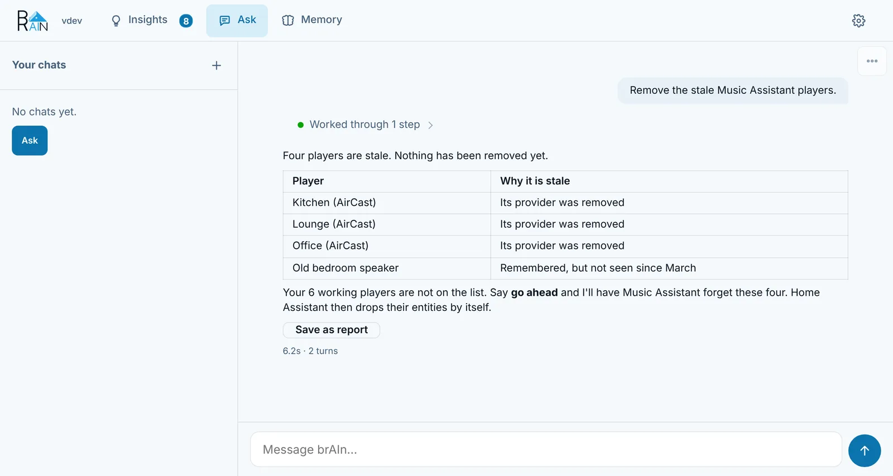

Ask brAIn in a sentence for anything Music Assistant's own interface can do, from the chat or the terminal.

## What you can ask

| Ask | What happens |
| --- | --- |
| *"Group the kitchen and the lounge and play my Discover Weekly."* | The two players are grouped and the playlist starts. |
| *"What's playing everywhere right now?"* | Every player with what it is playing. |
| *"Why is the Sonos provider erroring?"* | The provider's last reported error, read and explained. |
| *"Turn on crossfade for the office."* | That player's setting changes. |
| *"Make a playlist of what we played on Saturday."* | A new playlist in your library. |
| *"Remove every AirCast player."* | A list of the stale ones first, then removal when you say so. |

## Clear out stale players

Music Assistant remembers every player it has seen. A speaker left behind by a removed provider or an AirCast bridge comes back as a Home Assistant entity each time you delete it, because its settings live in Music Assistant.

Ask *"remove the stale players"* and brAIn:

1. **Lists them first**, with why each is stale. Nothing is removed until you say so.
2. **Has Music Assistant forget them** when you say go ahead. Home Assistant then drops the entities by itself.
3. **Reports any that are held** by a provider that cannot remove players, and can disable those instead.

A working player is never swept up by *"remove every player from that provider"*. Only the stale ones go.

## Set it up

Usually there is nothing to do. brAIn connects where Home Assistant's Music Assistant integration connects, with the sign-in Music Assistant gave Home Assistant. That sign-in can control, group, configure and remove players and edit the library.

Two options cover the rest:

| Option | When you need it |
| --- | --- |
| `music_assistant_token` | To add, change or remove **providers**, or change **server settings**. Create a long-lived token in Music Assistant → Settings → your profile → Tokens. Without it, brAIn tells you when it is refused. The token is in Home Assistant backups like every option, so use one you can revoke. |
| `music_assistant_url` | For a Music Assistant server Home Assistant is not connected to, such as `http://192.168.1.20:8095`. Set a token with it. |

## Who may use these tools

| Who is asking | What they get |
| --- | --- |
| The chat and the terminal | Everything. |
| Scheduled, unattended runs (cards, the Resident) | The overview, the search and read-only queries. Nothing that changes a player, the library or a setting. |
| Voice | None of these tools. Voice plays music through Home Assistant's own `music_assistant.play_media`, on the media players you have [exposed to voice](/brain/voice/#what-a-voice-level-agent-sees). |

**Protected entities apply.** A player that is a Home Assistant entity on your `protected_entities` list is not played, changed or removed, and the refusal names it.

## Tool reference

| Tool | What it does |
| --- | --- |
| `music_assistant_status` | The overview: whether brAIn can reach the server and with which role, every player (state, volume, what it is playing, group), the players worth clearing out and why, and every provider with its last error. |
| `music_assistant_search` | Search the library and every provider for tracks, albums, artists, playlists, radio stations, audiobooks or podcasts. |
| `music_assistant_play` | Play a search result, a list of them, or a name. Options: play, replace, next, replace next or add. Radio mode keeps similar music going. |
| `music_assistant_player` | One action on one player: play, pause, stop, next, previous, power, volume, mute, seek, group, ungroup, shuffle, repeat, clear the queue, enable, disable, rename. |
| `music_assistant_query` | Run one read-only command in Music Assistant's API. |
| `music_assistant_command` | Run any command in Music Assistant's API: players, queues, groups, the library, playlists, providers and server settings. |
| `music_assistant_remove_players` | The clean-up above. A dry run by default, stale players only by default, filtered by player or provider. |

brAIn's panel has no Music Assistant screen. Use Music Assistant's own for that.
