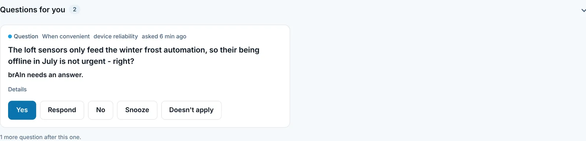
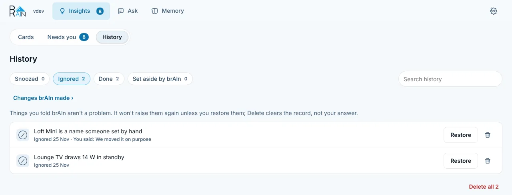
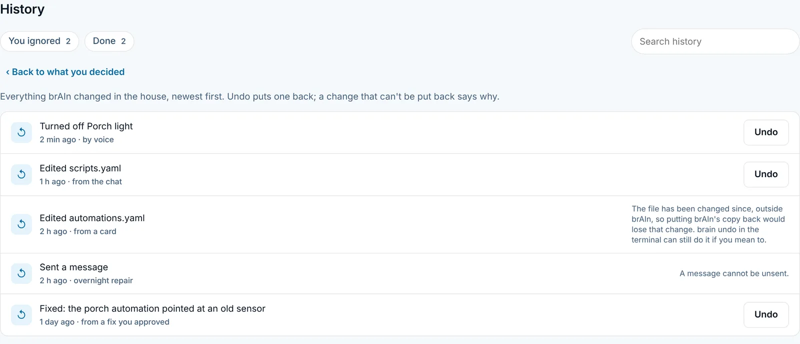

import { Aside, Steps } from '@astrojs/starlight/components';

**Insights → Needs you** is where you decide. Every problem, question, suggestion and tidy-up
brAIn has for you is a card here, and each one takes a single press to answer.

The number on the Insights tab is how many cards are waiting. The same number is
`binary_sensor.brain_needs_you` in Home Assistant.

## What is on the screen

| Part | What it shows |
| --- | --- |
| **Banner** | Only while something urgent is not already the first card: a leak, smoke, a freeze. |
| **Status line** | *Watching · last look 9 min ago*, or why brAIn is paused. Its **⋯** holds **Recheck** (run the [house checks](/brain/checks/) now) and **Read this morning's brief**. |
| **The queue** | Cards grouped as **Problems**, **Questions for you**, **Chores and suggestions** and **Tidy-ups**. A desktop shows three cards per group and a phone one, with **Show N more**. Empty, it says *Nothing needs you.* |
| **To Do** | The work you agreed to, with an *Add to To Do…* box. |

Until brAIn is signed in, knows what it may change and has taken its first look, a
three-step setup card stands in for the queue.

## Read a card

Every card has the same parts, top to bottom:

- **A chip**: **Urgent**, **Problem**, **Question**, **Tidy-up** or **Suggestion**, then how soon
  to act (*Act today*, *Soon*, *When convenient*).
- **A title** that uses the name you know the thing by.
- **Who acts**: *brAIn can fix this.*, *This needs you.* or *brAIn needs an answer.*
- **Why**, in up to three lines, and a **Fix** line saying what to do.
- **Details**: what brAIn read (the entity, the reading, when), how sure it is and what
  looked at it first. Closed until you open it.
- **One row of presses.**

A card nothing has looked at yet says **Unchecked**. [How brAIn decides what to show
you →](/brain/resident/)

## Answer a card

The first press is the one that fits the card. The rest are the same words everywhere: on
the panel, in [Repairs](/brain/notifications/#repairs), on your phone and on the Morph
dashboard.

| Press | Use it when | What happens |
| --- | --- | --- |
| **Go ahead** | brAIn could make the change itself. | Opens a box with brAIn's suggested change. Edit it or send it as it is, and brAIn works out a [plan](#plan-apply-and-undo). Nothing changes until you press **Apply**. |
| **Add to To Do** | It is real and needs your hands. | The card moves to [To Do](#to-do) with everything it held. brAIn stops raising it while it waits there. |
| **Respond** | You would rather say it in words. | Opens a one-line box. brAIn reads what you type and acts on it: *"I replaced it"* is Done, *"it's off on purpose"* is Ignore with that reason, *"do it, but at 23:00"* starts a plan. |
| **Check again** | You want to know if it is still true. | Runs the one house check that filed it. The card goes, or says *confirmed just now*. Only on cards a check raised. |
| **Dismiss** | It is old or no longer relevant. | Clears the card and records nothing. A problem that is still real comes back on the next look. |
| **Snooze** | Not now. | Nothing is recorded or taught. It returns later if still true: sooner the more it matters. The toast says when. |
| **Ignore** | brAIn has this wrong, or it is normal here. | Stops raising it for good, and asks *Why? (helps brAIn learn)*. See [Ignore](#ignore-the-answer-that-teaches). |

Behind **⋯** are the rare ones: **Ask** (talk it through in a new chat), **Done** (you already
fixed it, with an optional note) and, on a phone, whichever of *Check again* and *Dismiss*
did not fit the row.

Every press that ends a card hands back an **Undo** in the toast.

### Other kinds of card

| Card | Presses |
| --- | --- |
| **A yes/no question** | **Yes** files it as a fact. **No** closes it and keeps your reason as a correction. **Snooze** asks again later. **Doesn't apply** closes it and records nothing. |
| **A question that needs words** (*where is the water shutoff?*) | Type the answer and **Send**. It goes into memory in your words. Never type a code or a password. |
| **A suggestion** | **Apply**, **Snooze**, **Ignore**, with a week's trial under **⋯**. [Suggestions →](/brain/proposals/) |
| **A plan waiting for you** | **Apply**, with **What could go wrong** on the face of the card. |
| **A change brAIn made** | **Done** and **Undo**, with what Undo puts back written on the card. |
| **A quick chore** (*shut the back door*) | **Done** first, with **Add to To Do** under **⋯**. |

## Plan, Apply and Undo

<Steps>

1. Press **Go ahead**. The box holds brAIn's suggestion. Change the words if you want
   something different, then press **Fix**.
2. brAIn reads the entity, its history and the automation, changing nothing. The card comes
   back with **What Apply will change**: the exact steps, one sentence on what could go
   wrong in this house, and whether software should make this change at all. A change to an
   automation shows the lines that change and how often the old and new versions would have
   run last week.
3. Press **Apply**. brAIn carries out exactly those steps. If a step fails or the house has
   moved on, it stops, says so and puts back the edits it had made.

</Steps>

The steps you read are written by the code that carries them out, so what you approve is
what runs. A step that cannot say what it will touch is not offered. If brAIn concludes it
should not make the change, the card says *brAIn can't apply this* with the reason, and
leads with **Add to To Do**.

After a fix:

| Press | What it does |
| --- | --- |
| **Undo** | Puts back every file the fix edited under `/config` and reloads Home Assistant. Service calls the fix made are listed, not reversed. |
| **Restore** (under **⋯**) | Sets the devices the fix changed back to how they were just before, re-reads each and reports per device. Only you can press it. |

<Aside type="caution" title="What Restore never does">
It never unlocks a lock, disarms an alarm, or opens a garage, door or gate, and it never
touches a [protected entity](/brain/safety/#protected-entities).
</Aside>

brAIn checks its own fixes. Three minutes after one, it runs the check that found the
problem. If the problem is still there, the card returns saying the fix did not hold. It
looks again after a day, a week and a month. A problem that comes back twice gets a
suggested maintenance interval instead of a third fix. *Could not check* is shown as that,
never as success.

## Ignore: the answer that teaches

**Snooze** means "not now" and teaches nothing. **Ignore** means "you have this wrong", and
the reason you give is what brAIn learns from.

> *"That sensor always reads on, it's not stuck."*

That becomes a standing fact about your house, so the garage fridge that runs 24/7 is
flagged once. brAIn works out how far you meant it:

| Scope | Examples | Asked first? |
| --- | --- | --- |
| This rule on this device, or anything about this device | The usual case | No |
| This rule for a whole room, or everywhere | *"none of the loft sensors matter in summer"* | Yes, as a question on Needs you |
| For how long | Until a date, a month, the end of a season, or for good | No |

On one of the Resident's own reports, the box offers short reasons as chips: *Already
know*, *Sensor is broken* and *Not an issue here*.

**Ignore all like this**, on the Ignore form, stops the rule that raised the card from
raising anything. A *Not raising* line above the list has the press that turns it back on.
A rule that has been wrong three times and never right offers it straight away. It is
never offered on safety cards or the Resident's own cards.

<Aside type="caution" title="What a correction never covers">
A smoke, gas, carbon-monoxide or leak sensor, a lock, an alarm panel, anything on your
[protected list](/brain/safety/#protected-entities), or the freeze check, even if one is
added to that room later.
</Aside>

### How long each answer lasts

| Answer | Lasts |
| --- | --- |
| **Ignore** | For good, or for the time your reason named. |
| **Done**, or a ticked To Do item | For as long as it stays fixed. A house check raises it again if it finds it again, and the card says how long it stayed away. Anything else can return after ninety days. |
| **Snooze** | Until the time on the toast. |
| **Dismiss** | Until the next look, if it is still true. |
| No answer, on a card the Resident filed | The card leaves on its own after a week, a fortnight or a month, depending on how much it matters. Safety cards never do. |

## Talk it through

**Ask** (under **⋯**) opens a new conversation in the [Ask tab](/brain/terminal/) that
already holds everything brAIn knows about the card.

- The discussion changes nothing on its own. The card's presses ride above the message box.
- When Claude has finished looking, it offers **the ways this could end** as buttons, such
  as *Replaced the CR2032* or *That cupboard is never opened*. Each says where it lands:
  memory, To Do or a correction. Pressing one settles the card in those words.
- An agreed change can be a button too. Pressing it has brAIn plan that change and put the
  plan on the card for you to **Apply**.

## To Do

To Do is the work you have already decided to do. The queue above it is for decisions.

| To | Do this |
| --- | --- |
| Add an item | Press **Add to To Do** on a card, type into *Add to To Do…*, or call `brain.add_todo` from an automation. |
| Finish one | Tick its box. It is **Done**, and this is when brAIn writes the memory line. |
| Finish one and say what you did | Tap the item to open it, then **Done, with a note**. |
| Tell brAIn about it in words | Open the item and type into *Tell brAIn what to do with this…* |
| Take it off the list | Open it and press **Delete**. Nothing is written, and brAIn may raise the problem again if it sees it. |
| Put it off, or refuse it | Its **⋯** holds **Snooze** and **Ignore** (you will not do it and do not want to hear about it again). |

An item made from a card carries the card's text, evidence, suggested fix and entity.

To Do is also Home Assistant's **brAIn to-do** list (`todo.brain_system_to_do`), in the
To-do panel and the companion app. Ticking an item there is **Done** and deleting one is
Delete. A card brAIn is still asking about is never on it. It needs Home Assistant 2023.11
or later.

## History

**Insights → History** keeps what you answered, under **You snoozed**, **You ignored**,
**Done** and **Set aside by brAIn**, with a search box.

- **Restore** puts a row back. On an ignored row it lets brAIn raise it again.
- **Set aside by brAIn** is what brAIn's own look decided was not worth your evening:
  already cleared, a moment that passed, normal for that thing, or already known. Every row
  has the reason, and **Restore** puts it in the queue.
- **The bin** clears the record only. Your answer stands, so an ignored problem stays
  ignored. **Delete all** clears every row the filter and search are showing.
- Repeats fold: something snoozed six times is one row reading *6 times since 15 Sep*.

### Undo a change brAIn made

**History → Changes brAIn made** lists everything brAIn changed in the house in the last
thirty days, newest first, with where it came from: the chat, the terminal, voice, a fix
you approved, an overnight repair.

Each row has **Undo** or the reason it has none. Only the newest change to a file or device
can be undone. A file somebody else has edited since is left alone, and a sent message
cannot be unsent.

## Ask why brAIn stayed quiet

brAIn records every time it decided not to tell you something, and why: a check that went
quiet, a report you had already answered, a correction, a rule you muted, a message held
for quiet hours, a run the usage budget would not pay for, or a first look that judged it
not worth your attention.

Ask *"why didn't you tell me the garage was open?"* in [Ask](/brain/terminal/) and brAIn
answers from that record. If there is no record, it says so. brAIn may never have seen it,
which is a different answer from choosing to stay quiet.

## Answer from outside the panel

| Where | How |
| --- | --- |
| **Home Assistant's Repairs** | Every card that is a decision, with the same answers. |
| **Phone notifications** | A message about one card carries its buttons and a **Reply** box. |
| **The Morph dashboard** | The card is drawn in its room, with a reply line. |
| **The terminal** | `brain findings` lists them. `brain findings fix\|apply\|undo\|done\|wrong\|snooze` answers them. |
| **Automations** | The events `brain_case`, `brain_case_ended` and `brain_change`. See the [Reference](/brain/reference/#events). |

[Notifications, Repairs and replies →](/brain/notifications/)
