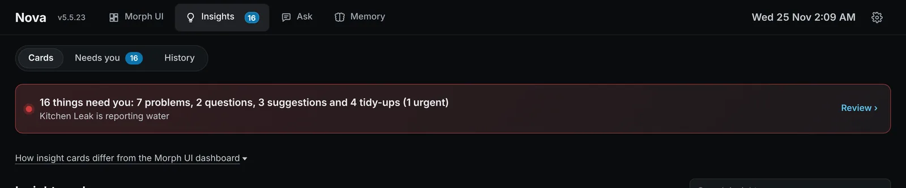

import { Aside } from '@astrojs/starlight/components';

brAIn reaches you without the panel open, and you can answer it from the lock screen. One
option turns it on: **`findings_notify_service`**, set to one of your `notify.*` services
(usually your phone's `notify.mobile_app_…`). The first screen of setup asks for it, and
there is no automation to write.

| Where | What you get |
| --- | --- |
| **Your phone** | A message about one card, with its buttons and a **Reply** box. |
| **Repairs** | Every card that is a decision, with the same answers. |
| **To-do** | Your [To Do](/brain/needs-you/#to-do) list in Home Assistant's own panel and app. |
| **A voice satellite** | Urgent problems said aloud, if you switch it on. |
| **Automations** | A sensor and events to build on. |

Without the option nothing is lost. Every card is still on [Needs you](/brain/needs-you/),
in Repairs and in `binary_sensor.brain_needs_you`, and safety alarms land in Home
Assistant's own notifications.

## Leaks, smoke, CO and gas never wait

The moment a moisture, smoke, carbon-monoxide or gas sensor **trips**, brAIn files a
**critical** card naming the sensor and the time and sends it at once, through quiet hours,
with reminders behind it.

- **No model is asked first.** Being signed out, automatic runs being paused or the usage
  budget being spent cannot hold it back.
- **Each trip is its own card.** Dismissing Tuesday's leak does not silence Friday's. A
  detector chattering on and off within five minutes is one card.
- **When the sensor reports clear**, the card says so and the reminders stop. The card
  stays until you answer it.
- **The Resident looks afterwards** and may add what it finds, including a look through a
  camera you ticked in the same room. It never decides whether you hear about it.

<Aside type="caution">
What counts is the sensor's *Show as* setting in Home Assistant. brAIn asks before showing
a smoke, gas, CO or leak sensor as anything else, so these alerts cannot be switched off by
accident.
</Aside>

## What gets sent, and when

| Tier | What you get |
| --- | --- |
| **A tripped leak, smoke, CO or gas detector** | Sent the moment it trips, through quiet hours, whatever else brAIn is doing. |
| **Critical and urgent**: a freeze, a hub that stopped answering | Pushed at once, even in quiet hours, then **asked again** after an hour, four hours and twelve hours. Each repeat says which it is and how long the problem has been open. Any answer stops it. |
| **At or above `findings_notify_min_severity`** (default `critical`) | Pushed **once**, timed and worded by [your sentence](#what-deserves-a-notification), and held through quiet hours unless its check says it cannot wait. |
| **Everything else** | No message. It is on Needs you, in Repairs and counted by `binary_sensor.brain_needs_you`. |

Set `findings_notify_min_severity` to `serious` to also hear once about a dying battery.
brAIn does not push the same unchanged problem about the same device again within a week.

### Quiet hours

Between `notify_quiet_start` and `notify_quiet_end` (22 to 7 by default, in your home's
timezone) only **urgent** messages get through: a device gone offline, an app that has
stopped, a disk about to fill, an impossible reading.

- Urgency belongs to the check, not the wording. A critical battery forecast three weeks
  away is not urgent. A boiler that stopped answering is.
- Everything else is **held** and arrives as one message when the quiet ends. Anything you
  fixed or dismissed overnight is dropped from it.
- Set both hours to the same value, or leave both empty, to be notified at any hour.

## What deserves a notification

**⚙ → Notifications → What deserves a notification** takes one sentence in your own words:

> *"Wake me for water, smoke, the freezer or the front door at night; batteries can wait for
> Saturday."*

For a message in the middle tier (above your floor, not an emergency), brAIn reads that
sentence, the time, your quiet hours and what it sent you in the last day. Then it does one
of four things:

- sends it now;
- holds it until a later time, at most a day and a half ahead;
- puts it on the next morning's list;
- leaves it on Needs you.

It also writes the message: a short title and a line you can act on from the lock screen,
such as *"Garage freezer is 6° warmer than a month ago. Check the seal."*

<Aside type="note" title="What your sentence cannot do">
- Anything escalating (a leak, smoke, a freeze, a hub that stopped answering) never goes
  through it.
- A critical card is never left off your phone.
- A message may only name the device it is about.
- If brAIn cannot ask Claude, the card is sent as it would have been without the sentence.
  ⚙ → Diagnostics shows how often that happened.
</Aside>

### brAIn learns from your swipes

Every notification is recorded with what happened to it: a button pressed, swiped away
(Android reports this, iPhone does not), or left alone.

Once a week, if at least 8 of 10 notifications about one device or one check were
dismissed or swiped away (over at least eight), brAIn asks on Needs you whether those
should wait for the morning list. **Yes** adds a line to your sentence, listed under the
box with a **Remove**. **No** is remembered. Critical and safety alerts are never counted,
and nothing changes until you answer.

## Answer from your phone

When the notify service is the Home Assistant companion app (`notify.mobile_app_*`) and
the message is about one card, it carries buttons: **Add to To Do**, **Snooze**,
**Ignore**, **Dismiss** and **Reply**. Tapping the message opens brAIn's panel. Android
shows three buttons, and **Dismiss** is always one of them.

**Reply** opens the companion app's text box. What you type goes to brAIn with the card:

| You type | What happens |
| --- | --- |
| *"It's always like that in winter"* | Ignored, until spring. |
| *"Remind me tomorrow"* | Snoozed. |
| *"I already replaced it"* | Marked done. |
| *"Why does this matter?"* | brAIn looks, with reading tools only, and answers in the next notification with the same buttons. |

- A reply that ends a card gets one line back, such as *"Got it. brAIn will stop flagging
  it until March."*, with an **Undo** button that works for five minutes.
- A reply cannot change the house.
- If the app is stopped when you press something, the answer waits for it.

## Repairs

Every card that is a decision also appears under **Settings → System → Repairs**. The
entry carries the card's text, what brAIn measured, what to do and which check raised it.

Opening it offers the card's answers: **Add to To Do**, **Done**, **Ignore** (with an
optional reason, kept as a correction), **Snooze**, **Dismiss**, and **Yes** on a question.
Answering there is answering on Needs you.

| In Repairs | Not in Repairs |
| --- | --- |
| Cards waiting on a decision. | `info` cards. |
| Every urgent card: a leak, an alarm, a freezing pipe. | A card brAIn is fixing right now. |
| At most 25 entries, oldest first. | A fix waiting for you to read it. |

## The To-do list

**brAIn to-do** (`todo.brain_system_to_do`) is [To Do](/brain/needs-you/#to-do) in Home
Assistant's To-do panel and mobile app.

- It holds the cards you added to To Do and anything you added yourself. Snoozed items are
  left off.
- Ticking one is **Done**, which is when brAIn writes the memory line.
- Deleting one takes it off the list and lets brAIn raise the problem again.
- Add items there, or with `brain.add_todo` from an automation.
- It needs Home Assistant 2023.11 or later.

## Say urgent problems aloud

**⚙ → Notifications → Say urgent problems aloud** is off by default. When it is on, a
serious, urgent problem from one of brAIn's house checks is announced on the voice
satellite in the room where motion was just seen, as well as sent to your phone.

It never speaks:

- to an empty house, or during quiet hours;
- about something already escalating on your phone;
- in words that name a person;
- through a speaker on your protected list.

It only announces. Answer on your phone. It needs a Home Assistant version with
`assist_satellite.announce`.

## The morning brief and the weekly report

Both are **off by default**, because each one sent costs a Claude run.

| Option | What it sends |
| --- | --- |
| `morning_brief` | One short message a day, at the hour your house starts moving. brAIn measures that hour, weekdays and weekends apart, and `morning_brief_hour` is the fallback. It is sent only when there is something to say: new problems, brAIn itself not working, or an odd night. |
| `weekly_report` | One message on `weekly_report_day`: what the house used against the week before, what was found and answered, what brAIn learned, and the one thing to do this week. It goes to everyone, so point it at a service that reaches every phone. An empty week sends nothing. |

## For automations

| Entity or event | What it is |
| --- | --- |
| `binary_sensor.brain_needs_you` | On while anything waits for a decision. The same number as the badge. |
| `sensor.brain_status` | The panel's status line: `watching`, `paused`, `needs_restart`, `signed_out` or `degraded`, with the sentence as an attribute. |
| `sensor.brain_findings_open_findings` | The count, the severity split and the texts. |
| `brain_case` / `brain_case_ended` / `brain_change` | A case opened, a case left the list, or brAIn changed the house. |

These entity ids are what a fresh install gets. If you renamed anything, yours differ. The
full list is in the [Reference](/brain/reference/#sensors).
