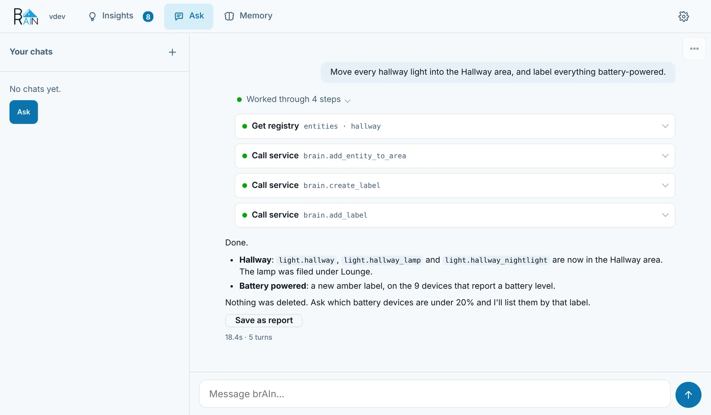

import { Card, CardGrid } from '@astrojs/starlight/components';

Power Tools are 91 `brain.*` services that do the jobs you normally click through **Settings** for. Ask brAIn in a sentence, or call them from your own automations.



## What you can ask

These work in the chat, the terminal, a `brain.run_task` prompt, and by voice with an agent set to **Whole house** or **Full admin**.

| Ask | What happens |
| --- | --- |
| *"Rename all the `shelly_1pm_xxxx` lights to what they actually are."* | Friendly names and entity IDs are fixed, then brAIn checks nothing still points at the old ones. |
| *"Create a Guest Room area, put these three devices in it, and add 'spare room' as a voice alias."* | The area exists, the devices are in it, and voice knows both names. |
| *"Label everything battery-powered, then show me the ones under 20%."* | A new label on every battery device, and a list. |
| *"Which automations reference entities that don't exist anymore?"* | A report of every broken reference. Nothing is changed. |
| *"Import this blueprint from the forum and set it up for the hallway."* | The blueprint is imported and an automation is made from it. |
| *"Backfill the gas meter history from this CSV."* | A preview of the rows, then the import when you say so. |
| *"Build me a manual heating override: a target slider and an on/off toggle."* | Two helpers and the automation that uses them. |
| *"Make a Guest dashboard with just the lights and the thermostat, and a login for the babysitter."* | A new dashboard and a non-admin account. |
| *"The bedroom fan is on a smart plug. Make it show up as a fan."* | A fan entity takes the plug's place in dashboards and voice. |
| *"Prune the backups older than a month but keep the newest three."* | A preview of what would go, then the delete. |

## The catalog

Each page opens with example requests, then lists every service with its fields.

<CardGrid>
  <Card title="Areas & Floors" icon="puzzle">
    15 services. Create, rename and delete rooms and floors, set icons and voice aliases, and move devices and entities.
    [Open →](/brain/power-tools/areas-and-floors/)
  </Card>
  <Card title="Labels" icon="seti:notebook">
    6 services. Create, rename, restyle and delete labels, and apply them to entities, devices and areas in one call.
    [Open →](/brain/power-tools/labels/)
  </Card>
  <Card title="Entities" icon="pencil">
    13 services. Rename, change entity IDs, enable, disable, hide, set aliases and icons, clear orphans, and change what a device shows as.
    [Open →](/brain/power-tools/entities/)
  </Card>
  <Card title="Devices & Integrations" icon="setting">
    9 services. Rename, enable, disable and delete devices. Reload, enable, disable and remove integrations.
    [Open →](/brain/power-tools/devices-and-integrations/)
  </Card>
  <Card title="Helpers" icon="seti:config">
    2 services. Create and delete all 8 helper types: toggles, sliders, selects, text, dates, counters, timers and schedules.
    [Open →](/brain/power-tools/helpers/)
  </Card>
  <Card title="Zones & Persons" icon="star">
    8 services. Create, move and delete zones. Add, rename and remove persons and their device trackers.
    [Open →](/brain/power-tools/zones-and-persons/)
  </Card>
  <Card title="Blueprints & Statistics" icon="download">
    2 services. Import a blueprint from a link. Import or backfill long-term statistics.
    [Open →](/brain/power-tools/blueprints-and-statistics/)
  </Card>
  <Card title="Dashboards" icon="laptop">
    7 services. Create, edit, restore, reset and delete dashboards with a backup before every change, and register custom cards.
    [Open →](/brain/power-tools/dashboards/)
  </Card>
  <Card title="Users" icon="approve-check">
    4 services. Create, delete, enable and disable accounts, with a guard against locking yourself out.
    [Open →](/brain/power-tools/users/)
  </Card>
  <Card title="Diagnostics & Repairs" icon="magnifier">
    3 services. Find references to dead entities. Raise and clear repair issues.
    [Open →](/brain/power-tools/diagnostics-and-repairs/)
  </Card>
  <Card title="Backups, Energy, Networks & More" icon="rocket">
    22 services. Backups, statistics and the energy dashboard, Z-Wave and Thread, addresses, categories, integration options, group members, user roles and dashboard settings.
    [Open →](/brain/power-tools/system/)
  </Card>
</CardGrid>

## Use them from an automation

Every Power Tool is a normal Home Assistant service. It appears under **Developer tools → Actions** with field pickers, and runs with no brAIn conversation involved.

```yaml
# Flag it in Repairs when the washer finishes but nobody empties it
- action: brain.create_repair_issue
  data:
    title: "Washing machine done"
    description: "Cycle finished over 2 hours ago and the door hasn't opened."
    severity: warning
    issue_id: washer_forgotten
```

Services that create something return its id (`area_id`, `floor_id`, `label_id`, and so on) as response data, so steps chain with `response_variable`. An `update_*` service writes only the fields you name. Everything you can create, you can also rename and delete.

## Safety

| Rule | What it means |
| --- | --- |
| **Admin only** | A call from a non-admin Home Assistant user is rejected. Automations and scripts run as the system. |
| **Voice is limited** | A **Voice assistant** level agent cannot reach Power Tools at all. Every new agent starts with `brain.*` ticked in its **Blocked services**. |
| **Checked first** | Every area, floor, label, device, entity and integration id is checked before anything changes. A typo fails with an error and nothing is half-applied. |
| **Previews** | The sweeps and bulk changes only report until you pass `dry_run: false`: `delete_orphaned_entities`, `delete_orphaned_devices`, `import_statistics`, `delete_backups`, `adjust_statistic_sum`, `heal_statistic_spikes`, `clear_orphaned_statistics`, `save_energy_prefs` and `zwave_remove_failed_node`. Targeted deletes act by default and accept `dry_run: true`. `find_orphaned_references` never changes anything. |
| **brAIn asks first** | brAIn confirms with you before it disables a device, integration or user, and before it deletes anything that matters. |
| **Protected entities hold** | From the chat and the terminal, a Power Tool passes the same checks as any other change. Your [protected entities](/brain/safety/) are refused. |
| **Safety sensors stay safety sensors** | `set_device_class` refuses to take a smoke, gas, carbon monoxide or leak sensor out of that type without `confirm_safety: true`. |
| **No lockout** | `disable_user`, `delete_user` and `set_user_group` refuse the owner, system users and the last administrator. |

## What Power Tools do not do

- **Add an integration.** Setup forms are interactive, so brAIn takes you to the screen and you click. It can remove one.
- **Touch credentials or sign-in internals.**
- **Edit objects defined in YAML.** A YAML dashboard, helper or person is not in the registry, so the service declines. brAIn edits the file instead, validates it and reloads. See [how the layers fit](/brain/how-brain-controls-ha/#yaml-config-is-not-an-exception).
- **Override core services.** Everything is under `brain.*`, so running [Spook](https://github.com/frenck/spook) alongside is fine.

## How brAIn uses them

brAIn reads ids with the `get_registry` tool (areas, floors, labels, devices, entities, integrations, users), then calls the `brain.*` service with `call_service`. It never reads or edits `/config/.storage`. Where this sits beside the other tools: [How brAIn controls your home](/brain/how-brain-controls-ha/).

## Credit

Power Tools are adapted from [Spook](https://github.com/frenck/spook) by Franck Nijhof (MIT licensed), with namespaced services, checks before every change, response data and previews added. If you do not run brAIn, use Spook directly.
