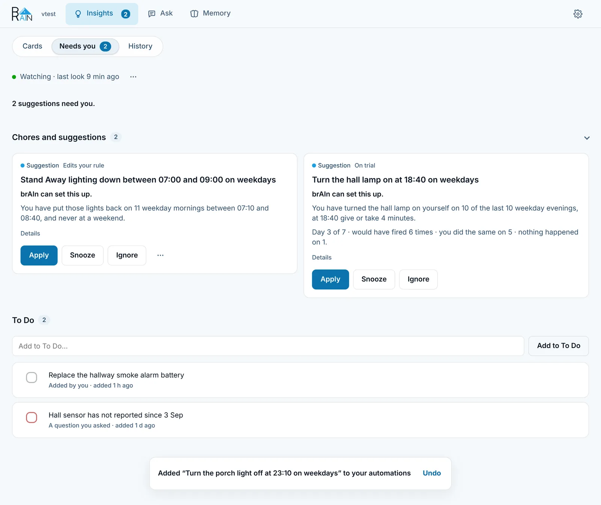

import { Aside, Steps } from '@astrojs/starlight/components';

A suggestion is brAIn offering to change something: an automation for a habit, a fix for a
rule you keep overriding, scenes for a room, an emergency playbook. Nothing is written until
you press **Apply**, and every Apply can be undone.

Suggestions are cards on **Insights → Needs you**, under **Chores and suggestions**. Turning
off Insights does not hide them, because the free [house checks](/brain/checks/) file them
too.

## What brAIn suggests

| Suggestion | Example | Where it comes from |
| --- | --- | --- |
| **A routine you already have** | *Turn the porch light off at 23:10 on weekdays* | Things you do by hand at the same time of day. [Details](#routines-you-already-have) |
| **The condition a rule is missing** | *Stand Evening lights down between 21:00 and 23:00 on weekdays* | An automation you keep undoing at the same hours. [Details](#the-condition-it-is-missing) |
| **A rule you asked for** | *"Whenever the front door opens after dark, turn the hall light on"* | A sentence you typed or said. [Rules & one-offs](/brain/intents/) |
| **A one-off you asked for** | *"Tell me when the tumble dryer finishes"* | A sentence about the next time. [Rules & one-offs](/brain/intents/) |
| **Scenes for a room** | *Four scenes for the Living room* | You ask for a room by name. [Scene designer](/brain/scenes/) |
| **An emergency playbook** | *Emergency playbook: water leak* | Your house has the detector for it. [Emergency playbooks](/brain/playbooks/) |

Two more routes file the same kind of card. An [insight card](/brain/insights/) can point at
an automation your house is missing. And the one automation brAIn may suggest at the end of
its first study of your home starts here already on a week-long trial, if you tick it.

At most 12 suggestions are open at once. A new one waits until you answer some.

## Answer a suggestion

Every suggestion has the same row of presses.

| Press | What happens |
| --- | --- |
| **Apply** | brAIn writes the change, reloads Home Assistant and checks it took. The toast offers **Undo**. |
| **Snooze** | The card goes away for now and comes back later. Nothing is recorded. The toast says when. |
| **Ignore** | *Not for this house.* A box asks *Why? (helps brAIn learn)*. The reason is optional, and it reaches every future suggestion. |
| **⋯ → Run** | Starts a [week-long trial](#try-it-for-a-week-first). Nothing is switched on. |

**Details** on the card holds the replay: how often the automation would have run over
your last 30 days. See [Shadow runner & replay](/brain/replay/).

An ignored suggestion is remembered by the change it described, not by its wording. The same
automation reworded does not come back. What you answered is in **Insights → History**.

## Try it for a week first

<Steps>

1. Press **⋯ → Run** on a suggestion. The card is marked **On trial**.
2. Live your week. On every checks pass, brAIn replays the automation over the days since
   and grades each firing against what you did by hand.
3. Read the line on the card as it fills in: *Day 3 of 7 · would have fired 6 times · you did
   the same on 5 · nothing happened on 1.*
4. Press **Apply** to keep it, or **Ignore** to decline it. After seven days the card says
   **Trial over** and stays, with its report, until you answer.

</Steps>

A trial creates nothing, calls nothing and subscribes to nothing. You can also press
**Apply** without a trial.

### The three verdicts

Each firing lands in one bucket, decided by your nearest press.

| On the card | Meaning |
| --- | --- |
| **you did the same** | You put the same thing in the same state within 15 minutes of when it would have fired. |
| **nothing happened** | No press either way. Weak evidence, and not counted against the change. |
| **you did the opposite** | You put it in the opposite state inside that window. You would have undone it. |

A press that puts the entity in some third state leaves that firing unanswered.

### What a trial cannot grade

- **A trigger brAIn cannot replay.** The card says *brAIn could not grade this trial* and
  why. That is different from *it would not have fired*, which is about the automation. A
  trigger aimed at a whole area, floor or label is one of these. The
  [replay's limits](/brain/replay/) apply unchanged.
- **An action that is not one entity going to one state.** A scene, a script or several
  service calls have nothing single to compare your press with, so the trial reports that
  instead of a score.
- **Scenes and playbooks.** They have no trial at all. Each page says what you get instead.

## Saying yes, and taking it back

**Apply** writes a real automation, and it is yours to edit, disable or delete like any
other.

| Suggestion | What Apply writes |
| --- | --- |
| A routine, a rule, a one-off, a playbook, a scene schedule | A new automation appended to `automations.yaml`, with the card's title as its name and a description saying where it came from. |
| A missing condition (**Edits your rule**) | One condition added to the automation you already have. The toast says *Changed*, not *Added*. |
| Scenes | The scenes, appended to `scenes.yaml`. |

Your file is not reformatted. Everything already in it stays byte for byte as you wrote it,
comments and ordering included.

Before the card leaves the list, brAIn checks three things:

1. The file was written.
2. Home Assistant reloaded it.
3. The automation (or every scene) now exists in Home Assistant.

If any of them fails, brAIn puts the file back, reloads again, and leaves the card where it
was with the reason on it. Nothing is recorded as accepted. When it works you also get a
notification that the change was made, sent straight away even in quiet hours.

### Undo

- **The toast carries Undo for five minutes.** It removes the automation and its registry
  entry, reloads Home Assistant, and puts the suggestion back on the list. A suggestion that
  was on trial comes back as a plain suggestion.
- **`brain undo` in the terminal works later.** The file is snapshotted into the edit
  journal before it is touched. See [the CLI](/brain/cli/).
- If the file cannot be put back, Undo says so. It never reports a success it did not have.

### What stops an Apply

Each refusal is a sentence on the card, and the card stays so you can press again once the
cause is fixed.

| Refusal | Why |
| --- | --- |
| **It touches a protected entity** | Anything in `protected_entities`. An action that targets an area or a device instead of named entities is also refused while that list is not empty. See [Permissions & safety](/brain/safety/). |
| **No `automation: !include automations.yaml`** | With packages or a split config, brAIn cannot tell which file Home Assistant reads. The refusal names the line it looked for. Scenes need `scene: !include scenes.yaml` the same way. |
| **The file is not a list** | `automations.yaml` is in a shape brAIn does not understand. An empty or missing file is created. |
| **A duplicate `id` or name** | Home Assistant refuses two automations with one id, and nobody can tell two with one name apart. |

<Aside type="caution" title="Nothing brAIn suggests is ever enabled on its own">
A trial changes nothing, and the automation exists only after you press **Apply**. The one
exception is a rule or scenes **you asked for** while *Act* or *No limits* is set in ⚙ →
Permissions. Those are applied at once, with the same checks and the same Undo.
</Aside>

## Routines you already have

> *You have turned the hall lamp on yourself on 10 of the last 10 weekday evenings, at 18:40
> give or take 4 minutes. Nothing in Home Assistant does it for you.*

brAIn keeps two months of the changes a person made, in the kinds of device a timer can
sensibly act on. Changes made by automations are left out. A wall switch that reaches Home
Assistant with no record of who pressed it is counted as unattributed, not guessed at.

The automation is a plain time trigger, with a weekday or weekend condition when the habit
has one. It never adds a condition it did not measure.

A habit is suggested only when all of these hold:

| Rule | Detail |
| --- | --- |
| **Six separate days** | Twelve presses on one Monday count as one day. |
| **Most of the days it could have happened** | At least 60% of them. Weekdays and weekends are counted apart. |
| **A time of day** | The presses fall within about 45 minutes of each other. |
| **Still happening** | Seen within the last 10 days. |
| **Nothing already does it** | No automation moves the same thing to the same state. |
| **Not protected** | Anything in `protected_entities` is left out before a card is made. |

A daily habit is offered as *weekdays* until it has six weekend days behind it too, which
takes about three weeks. Each pass offers at most three, strongest first.

## The condition it is missing

When you keep putting one automation back at about the same hours, the
[finding](/brain/needs-you/) reports the fight. This suggestion is the change that ends it.

> *Stand Evening lights down between 21:00 and 23:00 on weekdays*
>
> *Over the last 30 days it ran 30 times. With this condition it would have run 22 — 8 fewer,
> in the hours you keep putting it back.*

The card carries an **Edits your rule** pill. Apply adds one time condition to that
automation, so it stands down only in those hours on those days. The rest of the automation
and the rest of the file are untouched.

If the two numbers come out the same, the card says the change would have made no
difference over that window.

brAIn offers this only for a firm pattern: at least four overrides, on at least three
separate days, the latest within the last week, at least three quarters of them inside the
band, and a clear weekday or weekend shape. Each pass offers at most three.

Four cases are never offered as a card. They are listed in **⚙ → Diagnostics** with the
automation each is about:

- **The automation has no `id`.** Open it in Home Assistant's automation editor and save it
  once.
- **It already stands down over those hours.**
- **Its existing time condition reads an entity**, such as an `input_datetime`. brAIn cannot
  tell what that already forbids.
- **It acts on a protected entity.**

## Where to see it

| Where | What |
| --- | --- |
| **Insights → Needs you** | Open suggestions and trials, under **Chores and suggestions**. One-offs you applied sit under **Set to run once**. |
| **Insights → History** | What you applied and ignored, with your reasons. |
| **⚙ → Diagnostics** | Condition suggestions that could not be offered, and why. |
| `GET /api/proposals` | The same list as JSON. |
