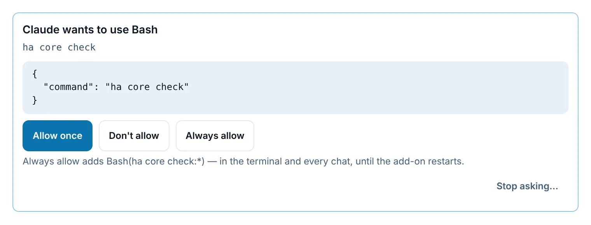

import { Steps, Aside } from '@astrojs/starlight/components';

Install brAIn, sign in, and let it study your house. It takes about five minutes, plus a few
minutes of study in the background.

## Before you start

| | |
| --- | --- |
| **Home Assistant** | OS or Supervised, 2023.6 or later. |
| **Host** | 64-bit, `amd64` or `aarch64`: a Raspberry Pi 4 or 5, an x86 mini PC, a 64-bit server. 32-bit boards are not supported. |
| **Memory** | About 1 GB free beyond Home Assistant's own. On a tight host, turn `assist_fast_mode` off. |
| **Account** | An Anthropic account. A Claude Pro or Max subscription is the most economical. An API key works too, but the usage-limit sensors need the subscription sign-in. |

<Aside type="caution" title="Back up Home Assistant first, somewhere that isn't this machine">
brAIn edits your real configuration: automations, dashboards, helpers, entities. It snapshots
files before it changes them and `brain undo` puts them back, but that is not a backup you can
restore from. Use **Settings → System → Backups**, then copy the backup off the device.
</Aside>

## Install it

<Steps>

1. **Add the repository.** In Home Assistant open **Settings → Add-ons → Add-on Store**, then
   **⋮ → Repositories**, and paste:

   ```text title="Repository URL"
   https://github.com/bruhautomation/BRUH-HA-Apps
   ```

2. **Install brAIn.** Find **brAIn** in the store, press **Install**, then **Start**. It
   pulls a prebuilt image, so nothing is built on your machine.

3. **Restart Home Assistant** once: **Settings → System → Restart**. This loads the brAIn
   integration. A notification tells you whenever a later update needs a restart.

4. **Accept the integration.** Home Assistant discovers **brAIn** in **Settings → Devices &
   services**. Accepting it adds the conversation agent, the sensors, the To-do list, the
   `brain.*` services and the 91 [Power Tools](/brain/power-tools/) admin services.

5. **Sign in.** Open **brAIn** in the sidebar and sign in with your Claude account. This one
   login covers the chat, the terminal, cards, voice and memory. Manage it later in
   **⚙ → Account**.

</Steps>

## Let it learn your home

<Steps>

1. **Say where brAIn may reach you.** The first screen asks for a notify service (your
   phone's `notify.mobile_app_…`) and, optionally, quiet hours. This is how a leak reaches
   you at 3 am. [Notifications →](/brain/notifications/)

2. **Press Start learning.** brAIn studies your house one topic at a time: names and areas,
   occupancy rhythms, energy, climate, device reliability. Findings appear under the progress
   as they land. You can close the panel. It carries on.

3. **Pick your cards.** When the study finishes, brAIn proposes insight cards based on what
   it found, each with a one-line reason. Only the ones you tick are created.

4. **Try one automation for a week.** If the study found something an automation would fix,
   the last step offers it as one sentence. Left ticked, it is drafted, replayed over your
   history and trialled for a week on Needs you. Nothing is written to your house until you
   accept it.

</Steps>

A fresh install has no insight cards until you pick them, apart from one overview card that
starts straight away. If your home is too sparse to learn from, brAIn says what is missing.
Add entities, let some history build up, and run it again.

## Your first day

### Answer what needs you

Open **Insights → Needs you**. The [house checks](/brain/checks/) run two minutes after the
app starts and cost no Claude run, so this list usually fills first: a battery gone quiet, a
device unavailable for days, an automation naming an entity that no longer exists. Each card
leads with one press: **Plan**, **Add to To Do**, **Snooze** or **Ignore**.
[Needs you →](/brain/needs-you/)


### Ask for something

Open **Ask** and type what you would otherwise go digging for:

```text title="In Ask"
Why did the hallway light come on at 3am? Fix it.
Which of my devices have stopped reporting?
Write me an automation that turns the towel rail on when the shower humidity spikes
Rename the switches in the garage to what they actually control
```

brAIn asks before it changes anything. A card appears in the chat with **Allow once** or
**Don't allow**. [Ask →](/brain/terminal/)



### Teach it something

Type a fact into **Memory → Knowledge**, such as *"the garage fridge is meant to run 24/7"*.
Or tell a voice assistant *"remember that we call the office lamp the beacon"*.
[Memory →](/brain/memory/)

## Next steps

| To | Do this |
| --- | --- |
| Turn on the dashboard, a personality or the loops | [⚙ › Features](/brain/features/) |
| Use brAIn as your voice assistant | **Settings → Voice assistants → your assistant → Conversation agent → brAIn**. The default agent reaches only what you expose to Assist. [Voice →](/brain/voice/) |
| Decide how much it asks | ⚙ → Permissions: *Ask first* (the default), *Act* or *No limits*. [Permissions & Safety →](/brain/safety/) |
| Protect locks, alarms and the garage door | Add them to `protected_entities`. [Protected entities →](/brain/safety/#protected-entities) |
| Let brAIn use cameras and calendars on its own | Tick them in ⚙ → Cameras & calendars. None are ticked at first. |
| Get a morning brief or weekly report | Turn on `morning_brief` and `weekly_report`. |
| Call it from automations | `brain.ask` returns data, `brain.run_task` runs a job. [Automations →](/brain/automations/) |
| Drive your other BRUH apps | Ask. [brAIn and the BRUH apps →](/brain/apps/) |
| See every option | [Reference](/brain/reference/) |

## If something goes wrong

| Symptom | Fix |
|---------|-----|
| The app won't install or start | Check the **Log** tab. It is almost always an architecture mismatch: images exist for `amd64` and `aarch64` only. |
| The integration was not discovered | You probably skipped the restart. Restart Home Assistant, then check **Settings → Devices & services**, or add **brAIn** there by hand. |
| A banner says Home Assistant needs a restart | The app was updated with a newer integration than Home Assistant has loaded. Restart Home Assistant. |
| Sign-in fails | Check the host can reach Anthropic. **⚙ → Account → Sign in again** opens the sign-in screen. |
| The usage pill shows `~` and the sensors stay unavailable | They need the account sign-in, not a pasted token or `ha login`. **⚙ → Account → Sign in again → Sign in to your Claude account**. |
| "It can't see my entities" | Confirm `enable_ha_mcp_server` is on, then run `brain doctor` in the terminal. It names any tool that fails. |
| Learning seems stuck | Study sessions run for up to `study_timeout_minutes` (30 by default). The progress list shows which topic is in flight. |
| Something else | ⚙ → Diagnostics → **Run all tests**, and **Report a problem** for one redacted text file to share. [Deep check →](/brain/doctor/) |
