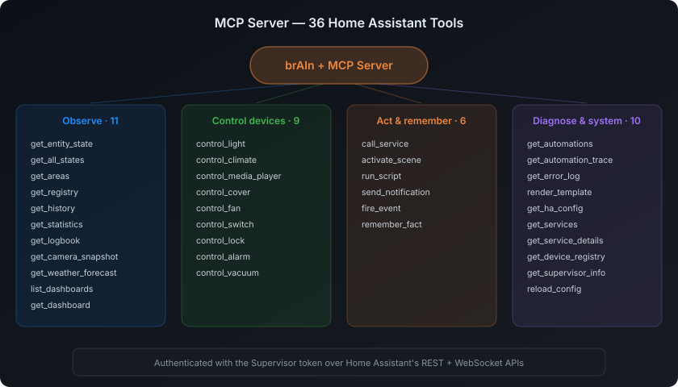
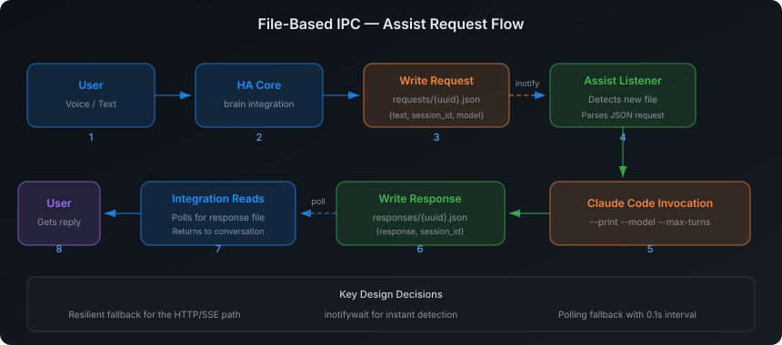

Everything you might need to look up. Configure the add-on from **Settings → Add-ons → brAIn →
Configuration**. The defaults work out of the box; the tables below mirror `config.yaml` and the
option labels Home Assistant shows, as shipped in brAIn 5.5.23.

## Configuration options

Some options are also in the panel's ⚙ Settings, which writes them back through the Supervisor so
both screens show the same value: `auto_refresh_hours`, `history_days`, `history_keep_runs`,
`history_keep_days`, `model`, `generation_timeout_minutes` (⚙ → Model & usage) and **Let brAIn act
without asking** (`dangerously_skip_permissions`, ⚙ → Permissions).

Setup's first screen asks for a notify service and quiet hours. The panel stores that answer in its
own settings as a **fallback under** the add-on options, so it takes effect at once, and an entry on
the Configuration tab always wins.

### Faces

| Option | Label | Type | Default | Description |
| --- | --- | --- | --- | --- |
| `enable_terminal` | Terminal | bool | `true` | Run the classic terminal on the Ask tab. Off runs brAIn as insights and voice only. |
| `enable_insights` | Insights tab | bool | `true` | Show the insight cards and let them regenerate on their schedule. Off stops every scheduled Claude run. **Needs you stays** either way: the house checks cost nothing and still file there. |
| `auto_launch_claude` | Start Claude in the terminal | bool | `true` | Open Claude Code when you open the classic terminal. Off gives a plain shell with `claude` available. |
| `auto_generate_context` | Write CLAUDE.md for your config | bool | `true` | Keep `/config/CLAUDE.md` up to date with a summary of your entities, areas and integrations, so Claude starts every conversation knowing the shape of your home. |
| `enable_ha_mcp_server` | Home Assistant tools | bool | `true` | Give Claude direct tools for states, services, the registry, history and templates. Off leaves Claude able to read your files but not your house. |
| `enable_mobile_ui` | Mobile terminal toolbar | bool | `true` | An arrow-key and modifier toolbar for the classic terminal on phones and tablets, plus the iOS dictation fix. |
| `dangerously_skip_permissions` | Let brAIn act without asking | bool | `false` | Off, the terminal and the chat ask before Claude runs a command, edits a file or changes something in Home Assistant. On, they stop asking. The same switch as ⚙ → Permissions → *Act*. [Details](#let-brain-act-without-asking). |

#### Let brAIn act without asking

- **Off (the default):** the terminal and the chat ask before Claude runs a command, edits a file or changes something in Home Assistant. Only reading is pre-approved.
- **On:** both stop asking, and in the chat and the terminal the action gate stops asking its own model about what you meant.
- **Still guarded with it on:** brAIn's Home Assistant tools refuse your protected entities, and so do plain shell service calls and YAML edits that name one. The tripwire, brAIn's own deny-list and your house rules still decide, and a conversation about a card still asks before it changes Home Assistant.
- **Not checked:** a shell command that reaches a protected entity some other way, and a change a shell command makes cannot be undone with `brain undo`.
- **Never reaches** Apply runs, voice or background runs.
- **No restart:** a new terminal session and the chat's next message pick it up. A terminal session already open keeps its setting until you end it with `/exit`.

⚙ → Permissions also offers a third level, **No limits**, which is a panel setting rather than an option: brAIn may do anything without asking, protected entities and house rules included. [Permissions & Safety →](/brain/safety/#three-permission-levels)

### Voice and automation

| Option | Label | Type | Default | Description |
| --- | --- | --- | --- | --- |
| `enable_assist_integration` | Voice assistant | bool | `true` | Register brAIn under Settings → Voice assistants as a conversation agent. |
| `enable_automation_integration` | Automation tasks | bool | `true` | Let automations hand brAIn a job with `brain.run_task`. Also answers `brain.ask`, AI Task, and Morph's Tell and learning loop. |
| `assist_fast_mode` | Fast voice responses | bool | `true` | Keep warm Claude processes ready so voice answers in about a second. Uses more memory. |

What a voice agent may reach is set **on the agent**: *Voice assistant* (only what you expose to Assist, the default), *Whole house* or *Full admin*, under Settings → Devices & services → brAIn → the agent → Configure. [Voice →](/brain/voice/)

### Memory and learning

| Option | Label | Type | Default | Description |
| --- | --- | --- | --- | --- |
| `learning` | Learn about your home | bool | `true` | Where ⚙ › Features › **Learning loop** starts. Read once, on the first start of a version with the switch; after that the switch decides and this option does nothing. [The four switches →](/brain/features/) |
| `memory_injection` | Use memory in answers | bool | `true` | Include what brAIn has learned in its prompts. Off keeps the document but stops it informing answers. |
| `memory_max_kb` | Memory size limit | 1–64 | `32` | How large the memory document may grow. Not a speed setting: voice reads a separate 2 KB summary. |
| `study_timeout_minutes` | Study session timeout | 2–120 | `30` | How long a study session may run before it is stopped. |
| `ask_why` | Ask why you did something | bool | `true` | Once a day at most, one Claude run works out **why** somebody did something by hand, and records it or asks one short question on Needs you. Three a week at most, never twice about the same thing, never about locks, alarms or where anybody is. |

### Notifications

| Option | Label | Type | Default | Description |
| --- | --- | --- | --- | --- |
| `findings_notify_service` | Send new findings to | string | *(empty)* | A notify service, such as `notify.mobile_app_your_phone`. Empty means no phone messages; Needs you, Repairs and the events work either way, and safety alarms go to Home Assistant's notifications. [Notifications →](/brain/notifications/) |
| `findings_notify_min_severity` | Notify from severity | `info` \| `warning` \| `serious` \| `critical` | `critical` | Only cards at or above this are pushed. `critical` keeps your phone for a leak, a freeze, a hub that stopped answering. `serious` also pushes a dying battery once. |
| `notify_quiet_start` | Quiet hours start (hour, 0-23) | string | `22` | From this hour only urgent messages ring your phone; the rest are held and arrive as one message when the quiet ends. Leave both empty, or set them the same, to notify at any hour. |
| `notify_quiet_end` | Quiet hours end (hour, 0-23) | string | `7` | When held messages are delivered, in your home's timezone. Anything fixed or dismissed overnight is dropped. |
| `morning_brief` | Send a morning brief | bool | `false` | One short message a day at the hour your home actually starts moving, only when there is something to say. Each one sent costs a Claude run. |
| `morning_brief_hour` | Morning brief fallback hour (0-23) | string | `7` | Used until brAIn has measured your own hour (about two weeks), or if your days are too irregular to have one. |
| `weekly_report` | Send a weekly report | bool | `false` | One message a week: what the house used, what was found and answered, what brAIn learned, and the one thing worth doing. A week with nothing in it sends nothing. |
| `weekly_report_day` | Weekly report day | `monday` … `sunday` | `sunday` | Which day it goes out. A report that missed its hour still goes out later the same day. |

### House checks and policy

| Option | Label | Type | Default | Description |
| --- | --- | --- | --- | --- |
| `checks_interval_hours` | House checks every (hours) | 0–168 | `6` | How often the [house checks](/brain/checks/) run. They read Home Assistant and the Supervisor directly and never call Claude. `0` turns the schedule off; `brain check` still runs them by hand. |
| `self_healing` | Fix three things overnight | bool | `false` | Once a night, inside quiet hours, up to three repairs: start an add-on set to run at boot that is stopped, ping a dead Z-Wave node, reload an integration that failed to set up. Nothing else, and never a protected entity. [Self-healing →](/brain/self-healing/) |
| `protected_entities` | Protected entities | list | `[]` | Entities brAIn may never act on, from any face. One entity id per line (`lock.front_door`) or a whole domain (`alarm_control_panel.*`). They can still be looked at. [Protected entities →](/brain/safety/#protected-entities) |

### Insight cards

| Option | Label | Type | Default | Description |
| --- | --- | --- | --- | --- |
| `auto_refresh_hours` | Refresh insights every | 0–168 | `24` | How often scheduled cards regenerate. `0` leaves you to regenerate by hand. |
| `history_days` | History to analyse | 1–30 | `7` | Days of history handed to a card run. More is better trends and more usage per run. |
| `history_keep_runs` | Keep past versions | 0–200 | `40` | Previous versions kept per card. |
| `history_keep_days` | Discard versions after | 0–365 | `30` | How long past versions are kept. |
| `model` | Claude model | string | *(empty)* | A model id, such as `claude-sonnet-5`, to run **every** job. Empty lets brAIn choose per job. [Which model does which job →](/brain/insights/#how-a-card-is-made) |
| `generation_timeout_minutes` | Insight timeout | 2–30 | `8` | How long one card run may take before it is abandoned. |

### ESPHome

| Option | Label | Type | Default | Description |
| --- | --- | --- | --- | --- |
| `esphome_dashboard_url` | ESPHome dashboard address | string | *(empty)* | Only when your ESPHome dashboard is not the ESPHome add-on (which brAIn finds by itself), e.g. `http://esphome.local:6052`. Editing device files never needs it; validating, compiling, installing and logs do. |
| `esphome_ha_token` | Home Assistant token for ESPHome | password | *(empty)* | A long-lived token from a Home Assistant administrator, needed to build and install through the ESPHome add-on on a current Home Assistant. Stored like every option, so it is in your backups. |

### Music Assistant

| Option | Label | Type | Default | Description |
| --- | --- | --- | --- | --- |
| `music_assistant_url` | Music Assistant address | string | *(empty)* | Only for a Music Assistant server Home Assistant is not connected to. Empty uses the server Home Assistant uses, with its sign-in. |
| `music_assistant_token` | Music Assistant admin token | password | *(empty)* | Optional. With an admin's long-lived token brAIn can also manage providers and server settings. It is in backups, so use one you can revoke. |

### Undo and access

| Option | Label | Type | Default | Description |
| --- | --- | --- | --- | --- |
| `edit_journal_days` | Keep undo history for | 0–365 | `14` | How long to keep the snapshots taken before Claude edits a file, so `brain undo` can put them back. `0` disables snapshots. |
| `access_share` | Access /share | bool | `true` | Read and write Home Assistant's share folder. |
| `access_media` | Access /media | bool | `true` | Read and write your media folder. |
| `access_backup` | Read backups | bool | `true` | Read (never write) the backup folder. |
| `access_addon_configs` | Access other add-on configs | bool | `true` | Read and edit other add-ons' configuration folders. A wide door. |
| `access_addons` | Access local add-ons | bool | `true` | Read and edit add-ons you are developing locally. |
| `additional_directories` | Extra folders | list | `[]` | Extra paths to mount. |
| `persistent_apk_packages` | Alpine packages to keep | list | `[]` | Alpine packages reinstalled on every start. |
| `persistent_pip_packages` | Python packages to keep | list | `[]` | Python packages reinstalled on every start. |
| `log_level` | Log level | `trace` … `fatal` | `info` | How much brAIn writes to the add-on log. `debug` also turns the terminal's own websocket logging on. |

The add-on's **Network** settings hold one optional port, **7681**: the classic terminal's direct
address, unpublished by default and password-protected either way. [Ports →](#ports)

## Recommended presets

### Quiet — terminal only

```yaml
enable_terminal: true
enable_insights: false
enable_assist_integration: false
enable_automation_integration: false
```

### Everything on

```yaml
findings_notify_service: notify.mobile_app_your_phone
morning_brief: true
weekly_report: true
protected_entities:
  - lock.front_door
  - alarm_control_panel.*
```

Then switch on what you want in ⚙ › Features.

## The panel

One sidebar entry. brAIn's integration serves it as its own panel and hides the older ingress
entry while it is there, so there is always exactly one way in.

| Tab | Section | What it is | |
|-----|------|-----------|---|
| **Morph UI** | Home | The Morph dashboard, while it is on in ⚙ › Features | [Morph](/brain/morph/) |
| **Insights** | **Cards** | Your insight cards, the deep review and suggested cards | [Insights](/brain/insights/) |
| | **Needs you** | Every decision waiting on you, and To Do | [Needs you](/brain/needs-you/) |
| | **History** | What you answered: Snoozed, Ignored, Done, Set aside by brAIn | [Needs you](/brain/needs-you/#history) |
| **Ask** | Chat / Classic | Claude Code as a chat or a true terminal | [Ask](/brain/terminal/) |
| **Memory** | **Knowledge** | Every fact brAIn holds, the memory document, and a Teach box | [Memory](/brain/memory/) |
| | **Timeline** | What the house is doing now, and what caused each change | [Timeline](/brain/activity/) |
| | **House book** | How this house works, chapter by chapter | [Upkeep](/brain/upkeep/#the-house-book) |

The number on Insights is how many cards are waiting on you. Old links to the Findings, To-do,
Proposals, Upkeep or Ideas panes open Insights; one to History opens Insights → History.

### ⚙ Settings

| Section | What's in it |
| --- | --- |
| **Features** | The [four switches](/brain/features/). |
| **Dashboard** | The Morph dashboard's own settings, history and code changes (while it is on). |
| **Account** | Signed in or not, **Recheck**, **Sign in again**, **Sign out**, and sharing the login with the other BRUH apps. |
| **Model & usage** | The model and how hard brAIn thinks, this session's and week's usage, your plan, **Automatic insights** and the share of each 5-hour session they may use, and how insight cards get their data and refresh. |
| **Permissions** | *Ask first*, *Act* or *No limits*; **Talk it through in chat**; house rules; which face Ask opens in and how many conversations keep a live process. |
| **Notifications** | What deserves a notification, in your words, and **Say urgent problems aloud**. |
| **Cameras & calendars** | Which cameras brAIn may look through on its own, and which calendars it may read. |
| **Personality** | The name, spoken voice and personality, and the assistant's own sections. [Learning →](/brain/learning/#shaping-who-it-is) |
| **Instructions** | What brAIn tells Claude, and your own additions. |
| **Diagnostics** | **Run all tests**, what is wrong right now, how right each kind of report has been, the measurements, the overnight check, who can reach the house, and **Report a problem**. |
| **Developer** | The house-check rehearsal, capture, and the development loop's repository, token, streams and limits. |
| **Guide** | The full documentation, searchable and offline. |
| **Minecraft** | The companion's settings, shown only with BRUH Minecraft installed. |


### Panel settings

These are stored by the panel, not the Configuration tab, and take effect without a restart.

| Setting | Values | What it does |
|---------|--------|--------------|
| `auto_enabled` | on / off | **Automatic insights**: the master pause for all *scheduled* work. Pressing something always runs. |
| `plan` | `pro`, `max5`, `max20` | Your Claude plan, used only to estimate a session window when there is no real figure to read. |
| `budget_percent` | 5–100 (default 25), or no limit | How much of each 5-hour session scheduled work may spend. |
| `thinking` | `light`, `normal`, `generous` | Steps every job's model tier down where a wrong answer is cheap, or up where reasoning counts. |
| `dangerously_skip_permissions` / `yolo_mode` | on / off | The *Act* and *No limits* levels in ⚙ → Permissions. |
| `talk_first` | on / off (default off) | Send what would become a draft to the chat instead. |
| `terminal_ui` | `chat`, `classic` | Which face Ask opens in. |
| `chat_model` | a model id, or unset | The chat's own model, picked from the chat. Unset follows `model`. |
| `chat_max_sessions` | a number, or no limit (default) | How many conversations keep a live Claude Code process. With no limit, the quietest idle one is put to sleep when memory runs short; a message wakes it. |
| `gather_mode` | `search` (default), `snapshot` | How a card gets its data: a map plus read-only tools, or the whole house up front. |
| `refresh_mode` | default `changed` | When a scheduled card actually re-runs: only when what it reads has changed. |
| `capture` | on / off (default off) | Record what the analyst was sent and answered, for the [corpus](/brain/corpus/). |

### Token budget

The usage pill in the top bar shows both windows, the 5-hour **session** and the **week**. Press it
for the reset times and what the budget gates. Only the session is budgeted against; scheduled work
pauses at the budget and anything you press still runs. The figures are your real Anthropic account
utilisation, so brAIn backs off when you are using Claude elsewhere. They need the subscription
sign-in; with an API key the session is an estimate and the week is not shown.

### Which model does which job

brAIn plans every Claude run by job rather than by one global model:

| Tier | Jobs |
|---|---|
| **Haiku** | The first look at every signal, scene naming, playbook text, the memory consolidator, the morning brief, the action gate's question, a follow-up look at a fix, compiling a house rule |
| **Sonnet** | Insight cards, fix plans, the weekly report, study, rules from a sentence, curiosity, onboarding |
| **Opus** | Applying a fix, turning a sentence into an automation, the weekly report's one thing |
| **The top tier** | The **deep review** you press for on Insights, never from a timer |

The **thinking** dial shifts the tiers, and a model typed into the `model` option overrides every
job, except that a top-tier model on a job nobody pressed for runs on its planned model instead.

## Voice assistant (Assist)

Select **brAIn** as a conversation agent in **Settings → Voice Assistants**. Each agent has its own name, model, personality, reach (*Voice assistant*, *Whole house* or *Full admin*) and Blocked services list — new agents start with the administration services (restarts, host shutdown, `update.install`, `recorder.purge`, `shell_command.*`, `backup.create` and the `brain.*` registry tools) already ticked. A *Voice assistant* agent may only use an entity's own services on entities you expose, so it cannot restart Home Assistant or create a login however a sentence is misheard. New agents default to Claude Haiku (`Default` inherits the terminal's model); `brain.clear_conversation` resets conversation memory (omit `conversation_id` to reset all). How it works — fast mode, the area map, personalities: [Voice Assistant](/brain/voice/).

## Insight jobs

Scheduled reports rendered to **sensors**, created from **Settings → Devices & Services → brAIn → Add Service → Insight job**. The report lands in the sensor's attributes: `preview` (first lines), `markdown` (full report), `card_yaml` (ready-to-paste card). A `brain_insight_complete` event fires after every run with `name`, `entity_id`, `success`, and `preview`. Templates, scheduling, and dashboard recipes: [Automations & Insight Jobs](/brain/automations/#insight-jobs).

## HA services

```yaml
# Send a prompt and wait for the response
action: brain.send_prompt
data:
  prompt: "What entities are offline?"
  timeout: 120
  model: haiku        # optional per-call override

# Run a task in the background, with optional notification
action: brain.run_task
data:
  prompt: "Check today's error log and summarise the issues"
  notify: true
  notify_entity: notify.mobile_app_phone   # where the notification goes; omit for a persistent notification
  model: haiku        # optional per-call override
  timeout: 300
  tools: read_only    # full (default) | house | read_only

# Run one or all insight jobs now
action: brain.run_insight
data:
  name: "Daily Briefing"   # omit to run all

# Do one thing next time. Returns immediately; the card lands on Needs you.
action: brain.intent
data:
  sentence: "Turn the porch light off when the guests leave"

# Study the home. Returns immediately; results arrive in memory.
action: brain.study
data:
  topic: "energy"          # omit to study whatever has gone stalest

# Teach it something durable
action: brain.add_memory
data:
  fact: "The garage fridge is meant to run 24/7"
  confidence: high         # high | medium | low
  source: "spouse"         # optional — where the fact came from (default "service")

# Answer one of brAIn's open questions — the same as Yes or No on Needs you
action: brain.answer_question
data:
  question: "Is the garage fridge meant to run 24/7?"   # or ts: <id from the Questions waiting sensor>
  answer: "Yes, it holds the overflow from the kitchen."  # must start with yes or no

# Ask a question and get the answer as DATA an automation can branch on
action: brain.ask
data:
  question: "Which rooms are below 18 °C right now?"
  schema:                    # optional — the shape the answer must fit
    type: object
    properties:
      rooms: { type: array, items: { type: string } }
    required: [rooms]
  tools: read_only           # read_only (default) | house | full
response_variable: cold      # cold.data.rooms is a list

# Put something on To Do (the same list as todo.brain_system_to_do)
action: brain.add_todo
data:
  text: "Replace the hallway smoke alarm battery"

# Run the house checks now instead of waiting for the next pass
# (also the "Run house checks" button on the brAIn System device)
action: brain.check

# Reset conversation memory
action: brain.clear_conversation
# data: { conversation_id: "..." }   # omit to clear all
```

`brain.ask` returns `response` (text) and, when you pass a `schema`, `data` — the object
Claude produced, validated against that schema before it was returned. It's read-only unless
you say otherwise, because a question isn't a change. `brain.run_task` accepts a `schema`
too.

**These twelve are brAIn's own services** (with `brain.minecraft_job`, which BRUH Minecraft's companion uses). The powerful ones need a Home Assistant
administrator: `brain.run_task` and `brain.ask` with `tools` wider than `read_only`,
and `brain.add_memory`, `brain.study`, `brain.intent` and `brain.answer_question`
(what they file is read by every later run). `brain.send_prompt` does not, because it
is the voice level Assist already gives any user. A task that failed — an expired
sign-in, a timeout — **raises an error** naming the reason rather than handing your
automation an apology as if it were the answer.

`brain.answer_question` closes the question exactly as Yes or No on Needs you does:
a yes files it as something brAIn knows, a no closes it, and anything after the no is
kept as a correction. The open questions and their ids are on the **Questions waiting**
sensor; an answer that does not start with yes or no is refused.

`brain.intent` queues the sentence and returns straight away, and what comes back is a card
on Needs you — a one-off, or a standing rule simulated against your history — including
when brAIn will not arm it. Nothing is written until you accept it. See
[Rules & one-offs](/brain/intents/).

Plus the **91 [Power Tools](/brain/power-tools/)** admin services for registry administration — including the four that change [what a device shows as](/brain/power-tools/entities/#what-a-device-shows-as) (`set_device_class`, `show_switch_as`, `stop_showing_switch_as`, `set_sensor_display`).

## Sensors

### Learning sensors

| Entity | Reports |
|--------|---------|
| `sensor.brain_memory_facts_learned` | How many things brAIn knows |
| `sensor.brain_memory_last_learned` | The most recent fact, with the text as an attribute |
| `binary_sensor.brain_memory_questions_waiting` | **Questions waiting**: on when brAIn has a yes/no question for you, with the questions and their ids as attributes. An install that had the older *Waiting on you* sensor keeps its entity id. |

A **`brain_learned`** logbook event fires for every new fact, so learning appears in your home's timeline next to lights and doors — see [Events](#events).

### Needs you and status

| Entity | What it is |
|--------|-----------|
| `binary_sensor.brain_needs_you` | On while anything waits for a decision — the same number as the badge on Insights. |
| `sensor.brain_status` | The panel's status line: `watching`, `paused` (with when it is back), `needs_restart`, `signed_out` or `degraded`, with the sentence as an attribute. |

### Findings sensor

`sensor.brain_findings_open_findings` exists to be *automatable* — the panel's badge answers the same question, but a badge cannot ring a phone at a sensible hour or sit on a dashboard. State is the open count; attributes carry the severity split (`critical` / `serious` / `warning` / `info`), the finding texts (first 20), and `newest`, because an automation that only knows "3" cannot put what is actually broken on a lock screen. It reads the mirror the add-on republishes to `/config/.brain/findings_state.json` on every findings change, and stays **unavailable until the add-on has written one** — which is what tells a fresh install apart from a clean bill of health.

### Usage-limit sensors

Your real Anthropic account utilization — the same numbers as **claude.ai → Settings → Usage**, not estimates. A background tracker asks Anthropic's usage endpoint shortly after each Claude run finishes — the only moment the numbers can have moved — and otherwise every **30 minutes**; the sensors read the tracker's file every 30 seconds.

| Sensor | Tracks | Key attributes |
|--------|--------|----------------|
| Session Usage | Percent of the current 5-hour session window used | `resets_at`, `data_source`, `last_updated` |
| Session Usage Resets At | When the 5-hour window resets | `utilization` |
| Weekly Usage | Percent of the rolling 7-day window used | `resets_at`, `data_source`, `last_updated` |
| Weekly Usage Resets At | When the 7-day window resets | `utilization` |

:::caution
These need an **OAuth / subscription login**, **not** an `ANTHROPIC_API_KEY`. With an API key — or before you've signed in — they stay **unavailable**. And during a streak of 429s from the usage endpoint the four sensors **will go unavailable by design**: the tracker's backoff (1, then 2, then 4 hours) deliberately exceeds the two-hour window after which a reading is too old to trust, because retrying a rate-limited endpoint is what sustains the limit. Either way, the reason lives on the **Usage tracker** diagnostic sensor below — HA hides the attributes of an unavailable entity, which is exactly why the explanation lives somewhere that never goes unavailable. `brain doctor` reports this too.
:::

### Usage tracker diagnostic sensor

The **Usage tracker** sensor's whole job is to be readable when the four above are not, so it **never goes unavailable**. Its state is `ok`, or the reason the others can't be: `no_oauth_token`, `api_key_has_no_usage_limits` (an API key bills per token and has no subscription window — that's a different situation, not a failed sign-in), `http_401`, `http_429` (with a `detail` attribute saying this is the *endpoint's* rate limit, not your account's usage), `network_error`, `stale`, or `not_running`. A failed poll records `last_error` and `next_attempt_at` *beside* the reading it deliberately left showing — so the moment the numbers blank, the diagnostic names the cause instead of saying `stale` and nothing else.

### Health sensors

`sensor.brain_system_health` (the **Health** sensor; `sensor.brain_usage_limits_health` on an older install) is brAIn's verdict on itself — `ok`, `degraded` or `failed` — with the reason and the switch to look at as attributes. It never goes unavailable: if the add-on has stopped publishing, that *is* the state. While it is not `ok`, Home Assistant's **Repairs** carries the reason too. A credential merely waiting for its next refresh is not a fault and does not degrade it.

`binary_sensor.brain_system_assist_healthy` reports voice-assistant pool health, with worker count, the pre-warmed spare, and last-request latency as attributes.

### House sensor

`sensor.brain_house` is what brAIn thinks the house is doing right now. Its state is the mode — `home`, `away`, `asleep`, `waking`, `guests`, or `unknown` when it cannot tell — and its attributes are `sentence`, `rooms_in_use`, `unusual_together`, `because`, `coming_up` and `published_age_minutes`. It is refreshed every few minutes and never goes unavailable: a reading that is missing or stale is `unknown` with a `reason` attribute, so an automation keyed on it never acts on how the house looked an hour ago. It is context for brAIn's own looks, and a wrong *away* can never make a leak alarm or a protected device any less important.

### Buttons, AI Task and other entities

| Entity | What it is |
|--------|-----------|
| `button.brain_system_run_house_checks` | **Run house checks** — the same as `brain.check` |
| `sensor.bruh_browser_status`, `binary_sensor.bruh_browser_waiting_on_you` | With BRUH Browser installed: the current errand, and whether it is waiting on you |
| *Run now* button, one per insight job | Runs that job now |
| `ai_task.brain_system_ai_task` | brAIn as Home Assistant's **AI Task** entity (Home Assistant 2025.7 and later): `ai_task.generate_data` gets a read-only answer, checked against the structure you asked for before it is returned |
| `sensor.<job>_insight` | One per insight job — see [Insight jobs](#insight-jobs) |

On Home Assistant versions that support it, other assistants can also ask brAIn what it has measured — what is normal for an entity, what it remembers, what caused a change — through Home Assistant's own LLM API, limited to what you expose to them.

### To-do list

`todo.brain_system_to_do` (`todo.brain_system_brain` on an install that had it before) is **To Do** in Home Assistant's own To-do panel and app: the cards you added to To Do and anything added with `brain.add_todo` or typed in the app. Ticking one off is **Done**; deleting one takes it off the list and lets brAIn raise the problem again. A card brAIn is still asking about is never on it.

Cards waiting on you also appear in Home Assistant's **Repairs**, with the same answers. [Notifications →](/brain/notifications/)

## Events

| Event | Fires | Payload |
|-------|-------|---------|
| `brain_finding` | Once per **newly-filed** finding — never for a re-report, because the store dedupes across every status and the settled ledger | `finding`, `severity`, `entity_id`, `fixable`, `source`, `ts` |
| `brain_learned` | Once per fact filed into memory (and once per forget) | `fact`, `source` |
| `brain_insight_complete` | After every insight-job run | `name`, `entity_id`, `success`, `preview` |
| `brain_case` | A finding opens on Needs you | `case_id`, `kind`, `claim`, `severity`, `status`, `entity_id`, `fixable`, `source` |
| `brain_case_ended` | That finding leaves the list, whichever ending it got | `case_id`, `kind`, `claim` |
| `brain_change` | brAIn changed something in the house (a fix landed) | `case_id`, `claim`, `entity_id` |
| `brain_task_complete` | A `brain.run_task` or `brain.ask` task finished | `task_id`, `status` (`completed` or `failed`), `error` on a failure |

`brain_finding` still fires beside `brain_case`, so automations written against it keep working. Snooze is not an ending — a snoozed case fires no `brain_case_ended` and comes back without a new `brain_case`. The first two also carry `name` and `message` fields phrased as sentences, so they read properly in the **logbook** — learning and findings appear in your home's timeline next to lights and doors. `brain_finding` is what to trigger on for anything fancier than the built-in push (`findings_notify_service` covers the simple case with no automation at all).

## MCP server tools

The built-in MCP server gives Claude **115 tools** against your live install — including `get_registry` (areas, floors, labels, devices, entities, integrations, users — entity rows say what a device shows as), `call_service` with `return_response` for the [Power Tools](/brain/power-tools/) workflow, the measurement tools, live automation traces, ESPHome and Music Assistant, and the [tools for the other BRUH apps](/brain/apps/), each listed only where that app is installed. Verify them on your own system with **`brain doctor`**. Full tool-by-tool reference: [MCP Tools](/brain/mcp/).



## CLI

Two dispatchers in the terminal — `brain` for brAIn's own faculties, `ha` for Home Assistant operations. `brain help` and `ha help` list everything; the full tables are on [The CLI](/brain/cli/).

```bash
brain memory list        brain learn energy      brain undo      brain doctor
ha log                   ha reload automations   ha check        ha context
```

`brain doctor` is free and never calls Claude. Two costed checks sit beside it and neither
ever runs on a timer: **`brain doctor --deep`** walks every face of the add-on with one real
round trip each (about five Claude turns), and **`brain doctor --rehearse`** plants a few
`brain_test_*` defects in your house, scores the checks and the analyst against them, and
removes everything — asking first, and naming exactly what it would create. Both are also
in **⚙ → Diagnostics** (**Run all tests**) and ⚙ → Developer. [Deep Check & Rehearsal](/brain/doctor/).

## Undo

brAIn **does not back up your configuration.** Home Assistant's own backups are whole-system and restorable, and versioning `/config` inside `/config` only made those backups bigger.

What it keeps instead is an **edit journal**: before Claude writes to any file under `/config`, the previous contents are snapshotted to `/data/.brain/edits/`.

```bash
brain undo                # list recent edits, newest first
brain undo 3              # revert edit #3
brain undo --all-today    # revert everything Claude changed today
```

Snapshots are pruned after `edit_journal_days` and capped by total size. A fix applied from [Needs you](/brain/needs-you/#plan-apply-and-undo) has its own **Undo** on the card, which puts back the files it edited and lists the service calls it made, and **Restore** puts those devices back. **`secrets.yaml` is never snapshotted.** An existing `/config/.git` directory from an older add-on is left strictly alone — brAIn never writes to it; delete it yourself if you don't want it.

## File ownership

Home Assistant saves `automations.yaml`, `scripts.yaml` and `scenes.yaml` as root, which used to leave them read-only for Claude. Since 2.11 **brAIn hands them back by itself** — at startup, before Claude edits a file it cannot write or runs a command that names one, and about once a minute for the files the editors rewrite — across `/config`, `/addon_configs`, `/share`, `/media` and `/addons` while each is mounted. Claude is told never to ask you for `sudo` or `chown`. `brain own <path…>` (or `brain own -r <folder…>`) does the same on demand and never touches `.storage`, `.cloud`, brAIn's credentials, `secrets.yaml` or the recorder database.

## Transport & health

In fast mode the worker pool serves an internal HTTP API on **port 8098** (the panel owns 8099), token-authenticated via the shared `/config` volume. The integration prefers it — no file polling, and replies stream so TTS starts at the first sentence. If the API is ever unreachable, both sides fall back to the original file protocol automatically. Nothing hardcodes the port; the integration reads it from the endpoint file the pool publishes.

`/api/health` — the endpoint the Supervisor watchdog polls — also calls the roll: it reports which background daemons are actually running (worker pool, listeners, usage tracker, memory consolidator, study watcher, ttyd) and when the last consolidation pass landed. That part is **informational only**, on purpose: a dead sibling can never fail liveness, or the watchdog would restart-loop the whole add-on over one daemon. `brain doctor` reads it and compares it against its own view.

### Diagnostics endpoints

All on the ingress panel (8099), all reachable from the terminal over loopback.

| Route | What it does |
|-------|--------------|
| `GET /api/diagnostics` | The whole bundle: versions, options, the run journal's last day, store counts, the health verdict, which checks could not run and why, the last deep check and rehearsal, the shadow-mode lines, and the capture counts. No prompts, no replies, no entity states. Same payload as the mirror at `/config/.brain/diagnostics.json` and as HA's own **Download diagnostics** button |
| `POST /api/doctor/deep` | Start a deep check. A second caller gets the run that is already going rather than a collision |
| `GET /api/doctor/deep` | The stages as they land, and the last run's verdict |
| `POST /api/doctor/rehearse` | Start a rehearsal. **Without `{"consent": true}` it answers `428`** carrying the exact list of what it would create, and writes nothing |
| `GET /api/doctor/rehearse` | The rehearsal's progress and last scores |
| `GET /api/capture` | One row per captured run: when, what, how many findings, how many endings label them |
| `GET /api/capture/{run id}` | One whole capture, exactly as it is on disk |
| `POST /api/capture/{run id}/export` | Copy that one capture to `/share/brain/corpus/` |
| `DELETE /api/capture/{run id}` | Remove it |



## Permissions architecture

| Channel | Mechanism | Default access |
|---------|-----------|----------------|
| Interactive terminal and chat | Prompts for anything but reading, plus the action gate (unless *Act* or *No limits* is chosen in ⚙ → Permissions) | Everything — you approve actions |
| Voice / conversation agents | The agent's reach (*Voice assistant*, *Whole house*, *Full admin*) + its Blocked services | *Voice assistant*: exposed entities, their own services, HA tools only |
| Automation tasks | The task's `tools` (`full`, `house`, `read_only`) — wider than `read_only` needs an administrator | `full`: MCP, shell, file edits, web |
| Card rendering (snapshot mode) | `--disallowedTools "*"` | **No tools at all** — it renders what it was handed |
| The analyst — insight runs, study sessions, typed questions | Explicit allow-list **and** explicit deny-list, checked from both ends in CI | **Read-only** HA tools; nothing that can change the house |
| **Plan and Apply** | A read-only plan first; **Apply** carries out exactly those steps, most of them by the panel itself, and any Claude run is held to the approved change — never on a schedule | Only what you approved |

The last three are the panel's three Claude paths, and only one can change the house. The analyst runs unattended, so its tool set is asserted from both ends rather than trusting one flag: `--allowedTools` only governs what runs *without a prompt*, and a headless run can't be prompted, so an un-listed tool merely **fails** rather than being **forbidden** — not the same guarantee with a real house behind it. The deny-list is checked against the MCP server's own tool names in CI, so a newly added acting tool fails the build instead of quietly reaching an unattended run.

Background channels never use `--dangerously-skip-permissions` — they can't prompt, so their pre-approvals live in a separate headless settings file. `/config/.claude/settings.local.json`, which the terminal and the chat read, pre-approves only reading Home Assistant. An action gate stands in front of every acting call in the chat and the terminal, decided from your own words and never from anything brAIn read; your `protected_entities` and house rules apply beneath it. Everything runs sandboxed as a non-root user (UID 1000), limited to `/config`, `/data`, and the enabled volume toggles.

## Ports

| Port | What | Needed? |
|------|------|---------|
| 8099 | The ingress panel. Also reverse-proxies `/terminal/`. | Internal; ingress handles it. |
| 7681 | ttyd, direct access. | **Unpublished by default** — declared as `null`, so nothing on your LAN can reach it until you assign a port in the add-on's **Network** panel (handy for a kiosk or a bookmarked full-screen terminal). |
| 8098 | The assist worker pool's internal API. | Internal only. |
| 8096 | The Morph dashboard's service health check, on loopback only. | Internal only; never published. |

A published terminal port answers the LAN with no Home Assistant login in front of it — the exposure HA documented in [GHSA-gh5m-4m97-c95h](https://github.com/home-assistant/core/security/advisories/GHSA-gh5m-4m97-c95h) — which is why 7681 ships off. ttyd also **always requires HTTP Basic auth** now, published or not: user `brain`, password generated into `/data/terminal-credential` and printed in the add-on log. The panel presents that credential upstream on every proxied request, so anyone coming in through ingress never sees a prompt.

## Where data lives

| Path | Contents |
|------|----------|
| `/config/CLAUDE.md` | Auto-generated install context |
| `/config/.brain/memory/memory.md` | **The memory document** — plain markdown, yours to edit |
| `/config/.brain/memory/voice.md` | The ≤2 KB distillate spliced into voice prompts (derived) |
| `/config/.brain/memory/inbox/` | Candidate facts awaiting consolidation |
| `/config/.brain/` | IPC bridge — request/response queues, sessions, logs |
| `/config/.brain/usage_limits.json` | Cached account utilization for the sensors |
| `/config/.brain/situation.json` | What the house is doing now — what `sensor.brain_house` reads |
| `/config/.brain/findings_state.json` | The findings mirror — derived, republished on every change; what the sensor, event, and push read (`/data` is invisible to HA, which is why it exists) |
| `/config/.brain/logs/{assist,automation}-YYYYMMDD.log` | Per-request debug logs |
| `/config/custom_components/brain/` | The HA integration |
| `/config/morph/` | The Morph dashboard, a git repository: its file, card types, dashboards brAIn may change, and `LEARNED.md` |
| `/config/.brain/ui/house.css`, `house.js` | Optional changes to brAIn's own page, written by brAIn when you ask |
| `/config/.brain/features.json` | The four Feature switches, as published |
| `/data/findings.json` | The findings work list itself (the mirror above is derived from it, never read back) |
| `/data/chat/` | The chat tab's scrollback, one file per conversation — capped, and only a scrollback: Claude Code owns the real conversation, so losing it never costs context |
| `/data/chat-trash/` | Deleted chat conversations, where the toast's Undo restores from (TTL'd and capped) |
| `/data/capture/` | Captured analyst runs, when `capture` is on — redacted as they are written, capped at the newest 50, and named in `backup_exclude` |
| `/share/brain/corpus/` | Where **Export** copies one capture, so the file editor and Samba can reach it. The only route out of the add-on |
| `/share/brain/reports/` | The redacted bundle `brain report` writes, and the problem files listed in ⚙ → Diagnostics → **Report a problem** |
| `/data/terminal-credential` | ttyd's generated Basic-auth password |
| `/data/run-sources.jsonl` | Which face (voice, consolidator, study, chat…) started each conversation — what keeps machine runs out of your Chats rail |
| `/data/.brain/edits/` | The edit journal `brain undo` restores from |
| `/data/` (add-on volume) | OAuth credentials, persistent packages |

## Dashboard cards

Any insight can be put on a dashboard from **Share** under its **⋯**: pick the dashboard and
view, and brAIn adds the card itself. For a dashboard kept in YAML, the same dialog gives you
the YAML to paste:

```yaml
type: iframe
url: /local/brain/energy-<your-card-token>.card.html   # or .html for just the chart
aspect_ratio: 110%
```

Insight HTML is mirrored into `/config/www/brain/`, where Home Assistant itself serves it at `/local/…` — same origin as every dashboard, so cards work on HTTP, HTTPS, and Nabu Casa alike with no port mapping. Each card has two files: `…card.html` (the whole card — heading, answer, numbers and chart, with the chart in a sandboxed frame) and `….html` (the chart alone, which is what dashboard cards made before 2.8 point at). The card always shows the latest run and reloads every 15 minutes. The card token is a per-install random secret embedded in the file name; the mirror holds *only* insight HTML — no API, no credentials, no controls. Anyone with the exact URL can view that insight, so treat the token like any dashboard-level secret.

## Privacy & security

- Home data is sent to Anthropic's API only when you ask for something or a run you scheduled fires; nothing else leaves your machine.
- Person **GPS coordinates are never included** in snapshots — only zone/state and areas.
- Generated visualizations render in **sandboxed iframes** (`sandbox="allow-scripts"`) — they cannot touch your HA session, cookies, or the panel.
- The panel is reachable only through **HA Ingress** (admin users); the terminal port ships [unpublished and password-protected](#ports).
- An **AppArmor profile** confines the container. It doesn't enumerate permitted binaries — brAIn runs an agent, and that list would break the first time you asked for something new — it denies the **host-escape set** instead: no mounting, no kernel modules, no raw sockets, no kernel tunables, no Docker socket, no ptracing out of the profile. brAIn rates **6/6** on the add-on store's security scale.
- **The Claude credential never rides into your backups.** HA backups are unencrypted unless you opt in, then get copied to cloud storage, NAS shares and support tickets — so `backup_exclude` keeps the OAuth credential, the terminal password, and the chat scrollback out of them. Restoring a backup costs you one sign-in.
- `secrets.yaml` is never snapshotted into the edit journal, and credentials are never read, written, or included in any snapshot.

## Mobile

The whole panel is built for a phone, not just shrunk to fit one: every tab and button is at
least 44px, no width collapses the tabs into a row of bare glyphs, and no text control is
under 16px (below that, iOS Safari zooms in on focus and never zooms back out, which strands
an ingress panel at an arbitrary scale).

The **Ask** tab folds the top bar away while the software keyboard is up and restores it
when you dismiss it; **⤢** folds it away for good and brings it back.

In Ask's **Classic** face, a one-tap toolbar sits above the keyboard:

- **21 keys** — `ESC`, `▾ Kbd`, `Tab`, `⇧Tab`, the four arrows, `PgUp`, `PgDn`, `^C`, `^D`,
  `^L`, `^U`, `/`, `@`, `#`, `!`, `|`, `Paste`, `×`. No sticky modifiers.
- **Swipe to scroll** — one-finger up/down (or the wheel on desktop) is translated to
  PgUp/PgDn proportionally, so long-press text selection still works.
- **Copying works** — OSC 52 clipboard sequences are intercepted and buffered across
  WebSocket frames, which is what lets you copy an OAuth URL out of the terminal on iOS.
- **Add to Home Screen** for a full-screen launcher without Safari chrome.
- **Voice dictation:** turn off iOS **Voice Control** (Settings → Accessibility) to avoid
  double-submission.
- Disable the whole classic-terminal toolbar with `enable_mobile_ui: false`.

## When to restart Home Assistant

| Scenario | Restart? |
|----------|----------|
| First install | **Yes** — HA must load the new custom component |
| Add-on version upgrade | **Yes** — updated Python files need reloading (a notification + repair appear) |
| Add-on restart, same version | No |
| Config option changes | No — read at add-on boot |

:::tip[Update not showing up?]
The Supervisor only re-pulls add-on repositories periodically. To pick up a fresh release immediately: **Add-on Store → ⋮ → Check for updates**.
:::

## Troubleshooting

| Symptom | Fix |
|---------|-----|
| Add-on won't start | Check the **Log** tab. Usually an architecture mismatch — the add-on builds for `amd64` and `aarch64` only. |
| Integration not discovered | Restart HA after the first add-on start. Add manually via **Settings → Devices & Services** if needed. |
| Home Assistant needs a restart | `sensor.brain_status` reads `needs_restart` after an add-on update with a newer integration. Restart Home Assistant. |
| The terminal asks for a second login | One credential is shared with the CLI in both directions; if it doesn't take, `brain doctor`'s auth check names the file it found and the one it expected. |
| It can't see entities | `enable_ha_mcp_server: true`? Run **`brain doctor`** — it reports any tool that errors. |
| Voice can't see or control a device | It isn't exposed to Assist — **Settings → Voice assistants → Expose**, or set that agent's reach to *Whole house* (brAIn → the agent → Configure). |
| Claude says it can't write `automations.yaml` | Shouldn't happen — brAIn hands files back by itself. Run `brain own /config/automations.yaml`; the startup log says how many files changed hands. |
| Voice agent answers wrong room | Run `brain doctor` — the "Assist area map" check confirms the room map is built. |
| A study session produced nothing | It probably hit `study_timeout_minutes`; the log says so. Raise it. |
| Cards look thin | The card found few matching entities — check areas are assigned and the relevant sensors enabled in HA. |
| Generation timed out | Raise `generation_timeout_minutes`, or set a faster `model`. |
| Usage sensors *unavailable* | Read the **Usage tracker** sensor's *state* — HA hides an unavailable entity's attributes, which is exactly why the reason lives in a sensor that never goes unavailable. `no_oauth_token` means sign in (an API key isn't one, see above); `http_429` means the tracker is waiting out the endpoint's rate limit and `next_attempt_at` says until when. |
| New findings never reach my phone | `findings_notify_service` is unset (it defaults to off), or the finding is below `findings_notify_min_severity` (default `critical` — set it to `serious` to be told about dying batteries too). Needs you, Repairs and the `brain_case` event carry everything regardless. |
| Something else is wrong | ⚙ → Diagnostics → **Run all tests**, then **Report a problem** for one redacted file to share. |
| Anything else | **Settings → Add-ons → brAIn → Log**, with `log_level: debug`. |

### Per-request debug logs

Every Assist and automation request is logged with channel, prompt size, model, the speed path it took (`warm`/`spare`/`cold`/`…+fallback`), duration, and a response preview.

```bash
tail -f /config/.brain/logs/assist-$(date +%Y%m%d).log
tail -f /config/.brain/logs/automation-$(date +%Y%m%d).log
```

Set `log_level: debug` in the add-on config before reproducing a bug for maximum detail.

## Disclaimer

brAIn is an independent project, not affiliated with, endorsed by, or sponsored by Anthropic. "Claude" and "Claude Code" are trademarks of Anthropic, PBC. The add-on runs the official Claude Code CLI under your own Anthropic account; your use of Claude through it is governed by [Anthropic's terms](https://www.anthropic.com/legal/consumer-terms).
