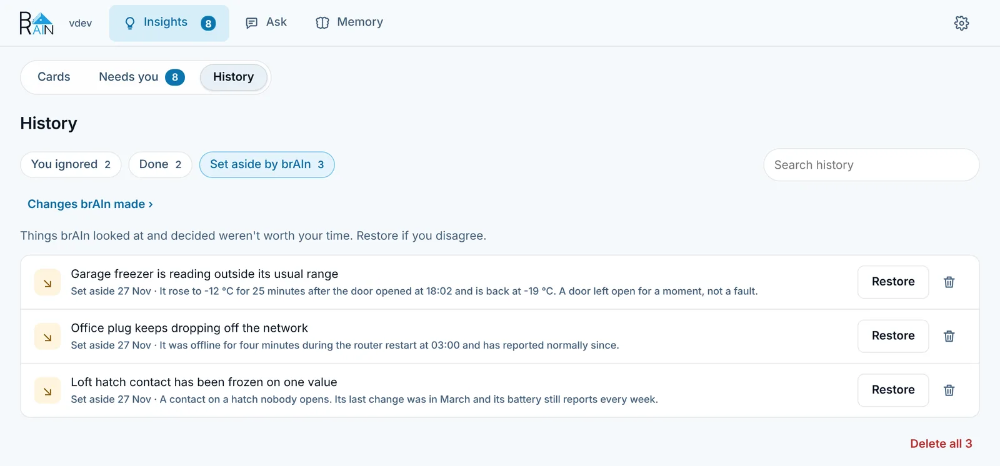

import { Aside } from '@astrojs/starlight/components';

brAIn checks every alert against your house's own history before it reaches you, so the
cards on **Needs you** are about real problems and come with what brAIn found.

The loop that does this is called the **Resident**. It reads what the
[house checks](/brain/checks/) and Home Assistant raise, decides what deserves attention,
and investigates before it asks you.

## What it does for you

| What happened in the house | What brAIn did | What you saw |
| --- | --- | --- |
| A window was left open on a cold evening | Compared the room's fall with how fast that room normally loses heat | A card naming the room, with the readings and *"Shut whatever is open"* |
| The freezer warmed for 25 minutes after its door was opened, then recovered | Read the history and saw it was back to normal | Nothing. The row is in **History › Set aside by brAIn** with the reason |
| A plug went offline for four minutes while the router restarted | Read the logbook and saw it had reported normally since | Nothing, and the same History row |
| A freezer warmed 6 °C over a month, never outside its usual range | Fitted a trend to a month of readings | A card: *"…has been drifting up for weeks"* |
| A leak sensor tripped at 3 am | Filed and sent it straight away, with no model run first | A phone alert through quiet hours |
| A sensor it has raised four times, and you ignored each time | Wrote a short judgement about that sensor into its facts | The judgement under **Memory → Knowledge**, which later looks read |

## See what it set aside

Open **Insights → History** and choose **Set aside by brAIn**. Each row carries the reason
in one sentence. Press **Restore** to put a row back on Needs you.

brAIn sets a card aside only when the problem has already cleared, was a moment that passed,
is normal for that device, or is something it already knows. You are never asked first.

## What is always shown

- **Water, smoke, gas, a freeze and anything on your protected list** are always shown, and
  so is anything the house itself flagged as urgent.
- **A tripped safety detector never waits for a look.** Code files it and sends it the
  moment it trips. [Notifications →](/brain/notifications/#leaks-smoke-co-and-gas-never-wait)
- **brAIn never changes your house from here.** Its strongest verdict files a case and
  alerts your phone, through quiet hours. A change still needs a plan you read and a press
  you make, and the card keeps an **Undo** afterwards. [Safety →](/brain/safety/)
- **A card nobody looked at is still shown.** If brAIn cannot look (signed out, automatic
  runs paused, the budget spent), a card that has waited 15 minutes appears as it was
  filed and says it is waiting. After an hour it is listed as not looked at.

## How a card is decided

**1. Signals arrive.** brAIn turns a small set of things into signals:

| Signal | Source |
| --- | --- |
| A protected entity changes | Home Assistant's event bus |
| Somebody arrives or leaves | Home Assistant's event bus |
| A leak, smoke, CO or gas sensor trips | Home Assistant's event bus |
| Something brAIn holds a fact about changes | Home Assistant's event bus |
| A row a [house check](/brain/checks/) filed | Every six hours by default |
| A reading well outside its [measured normal](/brain/measurements/) that no check reported | The measurements |
| A person puts back what an automation just did | The action record |
| An answer you gave on your phone | Notifications |
| Your measured bedtime and your measured morning | [Rhythm](/brain/measurements/#rhythm-when-this-house-gets-up) |

**2. The first look.** Every ten minutes, or straight away for something urgent, one
low-cost run reads the waiting signals and gives each a verdict in one sentence:
**ignore**, **watch**, **investigate** or **act**. It has no tools. Most signals are
*ignore*.

**3. The investigation.** *Investigate* starts a stronger run with read-only Home
Assistant tools: history, statistics, the logbook, traces, the measurements and what you
have told brAIn. It then does one of three things with a card a check filed:

- **Rewrites it** with what it found, what to do about this device in this house, and the
  readings it used.
- **Sets it aside** with its reason.
- **Shows it as filed**, with the first look's reason, when the investigation could not
  run, made no claim, or the day's allowance is spent.

A card already on Needs you is rewritten in place and never duplicated. The investigation
does not ask you to check something its tools can read. It asks you only about what no
sensor records: what you meant, what you prefer, something physical in the house.

When brAIn is unsure about something that matters, a stronger model looks again and may
withdraw the first conclusion. A claim that cites something the run never read is refused
whole.

## Set how much it investigates

Looks are cheap and frequent. Investigations are rationed per day. Choose
the level under **⚙ → Model & usage → How hard brAIn thinks**:

| Setting | Investigations a day | Second looks by a stronger model |
| --- | --- | --- |
| **Light** | 6 | 0 |
| **Normal** | 16 | 2 |
| **Generous** | 32 | 4 |

One look starts at most three investigations. The rest wait for the next look and are
never dropped.

## Cameras, only to confirm

When a leak, smoke, CO or gas sensor trips, or a door, window or lock is involved, the
investigation may look through the cameras you ticked in **⚙ → Cameras & calendars**. It
uses the ones in the same room, or all ticked cameras if none shares the room.

The first look never sees a camera. The whole house gets at most 12 camera looks a day, and
every prompt that may see a frame is told to describe the house and never a person.
[Cameras →](/brain/safety/#cameras)

## How it learns from your answers

Every verdict is recorded. Once a day brAIn compares each one with what you did next:

- you pressed **Ignore**, **Done** or **Add to To Do**;
- you restored something it set aside;
- a problem it passed over turned up within three days;
- you undid a fix.

Where the record is lopsided, brAIn writes a short judgement into its facts. You see it
under **Memory → Knowledge** and can delete it there. Each look is also shown a few of
brAIn's earlier calls on similar things and how they turned out.

Judgements have limits:

- They never make brAIn quieter about leaks, smoke, gas, freezing or your protected list.
- They never mention people.
- One disappears when a later card about the same thing turns out to be real.

Run `brain eval outcomes` in the terminal to see the record. This learning is part of the
[Learning loop](/brain/learning/) and stops when you switch that off.

<Aside type="tip" title="Check that the loop is running">
**⚙ → Diagnostics** shows how many signals are waiting, when brAIn last looked, what the day
has cost, and whether the event subscription is connected. A quiet house and a stopped
loop look the same without those numbers.
</Aside>
