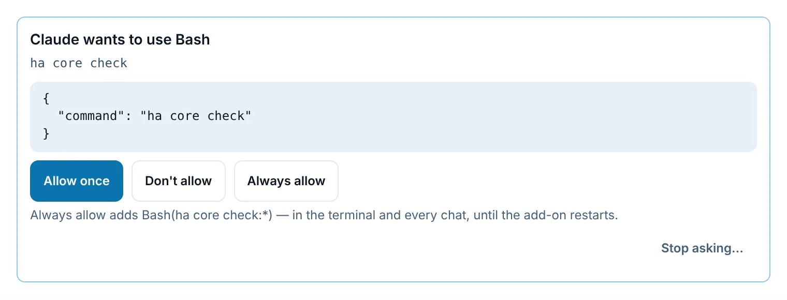
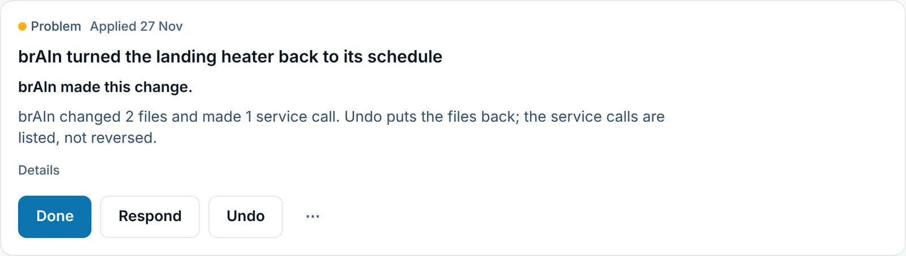

import { Aside } from '@astrojs/starlight/components';

You decide how much brAIn does without asking, what it may never touch, and you can put back
anything it changed. brAIn has real authority: `/config` read-write, admin access to the Home
Assistant API, and a shell. This page says where the edges are.


## The rules in short

| Rule | Detail |
| --- | --- |
| **Reading is never asked about.** | States, history, logs and your YAML are free to look at. |
| **Changing something asks first.** | In the chat and the terminal, unless you pick another [permission level](#three-permission-levels). |
| **Nothing on a schedule acts on your house.** | Cards, the morning brief, the weekly report and study sessions only read. What acts needs a press ([Plan and Apply](#plan-shows-the-change-first), accepting a suggestion) or is off by default (overnight self-healing). |
| **Some lines are never crossed.** | Your [protected entities](#protected-entities), the [tripwire](#the-tripwire) and your [house rules](#house-rules). |
| **A purchase always asks.** | See [below](#a-purchase-is-always-asked). |
| **What it changed can be put back.** | Files with `brain undo`, a fix with **Undo** and **Restore** on its card. See [Putting things back](#putting-things-back). |

## Three permission levels

Choose one in **⚙ → Permissions → What brAIn may do without asking**.

| Level | What it means |
| --- | --- |
| **Ask first** (default) | brAIn asks before it changes anything: a light, an automation, a setting or a file. |
| **Act** | brAIn makes changes on its own in the chat and the terminal. It keeps to your [house rules](#house-rules) and [protected entities](#protected-entities). This is the [Let brAIn act without asking](#let-brain-act-without-asking) switch. |
| **No limits** | brAIn makes any change on its own, everywhere. House rules and the protected list do not stop it. A plan is applied the moment it is written, and a change you asked for is accepted at once instead of waiting as a draft. |

You confirm *No limits* once, in words. Stepping back down is never asked about. Edit
snapshots stay, so `brain undo` still reverses a file. The rest of this page describes
*Ask first* and *Act*.

**Talk it through in chat**, under the levels, sends anything that would become a draft to
approve (something to do later, a change to an automation, new scenes) to the conversation,
which does it there.

## Answer an approval card

With *Ask first*, a change shows up in the chat as a card naming the tool and its target.



| Button | What it does |
| --- | --- |
| **Allow once** | Runs this one action. |
| **Don't allow** | Refuses it. The chat shows *Not permitted* in amber. |
| **Always allow** | Shown when Claude Code suggests a rule for the command. The line under it says what is added and for how long: the rest of this conversation, or the terminal and every chat until the app restarts. Nothing you press here outlives a restart. |
| **Stop asking…** | Opens the switch in ⚙. It does not flip it from the card. |

An unanswered card declines itself after ten minutes. In the classic terminal you get Claude
Code's own prompt.

If a conversation is waiting on a card while you look at another, its row says **Needs your
OK** and a toast offers a button to go there. See
[Chat & Terminal](/brain/terminal/#asking-before-acting).

## Let brAIn act without asking

The **Act** level is the switch **Let brAIn act without asking**. It is off by default. It is
in **⚙ → Permissions** and on the app's **Configuration** tab (`dangerously_skip_permissions`).
They are the same switch.

| | |
| --- | --- |
| **Reaches** | The classic terminal, the chat, and in those two the [action gate](#the-action-gate)'s model check. |
| **Never reaches** | Voice, insight cards, automation tasks, study sessions or an Apply run. |
| **Takes effect** | With no restart. A new terminal session and the chat's next message pick it up. A chat in the middle of an answer finishes under the old setting. |
| **If it cannot be read** | brAIn asks. A garbled setting counts as "ask". |
| **If Home Assistant refuses to save it** | Saving **on**: brAIn keeps asking and the switch goes back off. Saving **off**: brAIn stops acting anyway and tells you the Configuration tab could not be updated. |

<Aside type="caution" title="An open terminal session keeps the setting it started with">
Reopening the classic terminal returns to the same session, so a change reaches it only when
that session ends, in both directions. The line under the switch says when an open session is
still acting without asking (or still asking). Type `/exit` to start a fresh one.

If you turn the switch **off** while such a session is running, the next house checks file a
finding saying so. Turning it **on** never produces a card. The weekly access summary still
mentions it.
</Aside>

### What still decides with it on

- **Protected entities** are refused by every Home Assistant tool. So are a service call
  typed as a shell command and a YAML edit that names one.
- **brAIn's own deny-list**, the tools no brAIn session may use, still applies.
- **The action gate's floors and your house rules** still decide. Only its model check is
  skipped.
- **A [conversation about a card](#a-conversation-about-a-card)** still asks before it
  changes Home Assistant.
- **Edits made with Claude's file tools** can still be undone with `brain undo`.

### What it does not cover

With the switch on, Claude runs shell commands without asking.

- brAIn catches the obvious shell routes to a protected entity. A command that reaches one
  another way, such as a script written to a file and run later, is not checked.
- `brain undo` only puts back changes made through Claude's file tools. A change a shell
  command made has no snapshot.

If either matters to you, leave the switch off.

## A conversation about a card

**Ask** on a card opens a new conversation about it. Claude can read anything there.

| Switch | What asks |
| --- | --- |
| Off | Every service call, file edit and shell command shows a permission card. |
| On | Claude runs what it needs to work the problem out, shell commands included. Changing Home Assistant (a service call or a file edit) still shows a card. |

When you agree what to change, Claude can offer the change as a button. Pressing it does not
make the change. brAIn plans exactly that change, read-only, and puts the plan on the card
for you to [Apply](#plan-shows-the-change-first). See
[Needs you](/brain/needs-you/#talk-it-through).

## A purchase is always asked

BRUH Browser's `browser_purchase` asks at every level short of *No limits*, with the switch
on or off. Where nobody can be asked, it is refused. The items and total must be the cart as
it stands. [brAIn and the BRUH apps →](/brain/apps/#bruh-browser)

## Protected entities

Put the front door lock, the alarm and the garage door on `protected_entities`. brAIn can
still **look at** them and can never **act on** them.

```yaml
protected_entities:
  - lock.front_door
  - cover.garage_door
  - alarm_control_panel.*
```

One entity id per line, or a whole domain. The list holds for the terminal, the chat, Apply,
voice, automation tasks, overnight self-healing, and anything brAIn writes into
`automations.yaml` or `scenes.yaml`. It is enforced in code, where every Home Assistant call
brAIn makes passes through.

Indirect routes are refused too:

| Route | What happens |
| --- | --- |
| An **area or device** target containing a protected entity | Refused. A label or floor target is refused outright while the list is set. |
| A **scene, script or automation** | Checked by what it contains. One that reaches a protected entity is refused. One that only touches the hall light is fine, even with the lock in the same room. |
| A protected entity named **anywhere in a request** (a scene's entity map, a script variable) | Counts. |
| A switch shown as something else | Protected if either the switch or the entity standing in for it is on the list. |
| `fire_event` | Refused while the list is set, because the automations an event triggers cannot be checked. |
| A service call typed as a **shell command** (`ha service call`, a `curl` to the services API, a WebSocket `call_service`) | Refused, and Claude is pointed at the Home Assistant tool that can be checked. |
| A **YAML edit** that names a protected entity | Refused. |

<Aside type="caution" title="A shell cannot be checked completely">
A command line cannot be read for its targets. Something subtler, such as a script written to
a file and run later, relies on Claude keeping the rule it was told. This is one reason the
[switch](#let-brain-act-without-asking) is off by default.
</Aside>

## The tripwire

Press **Run** beside **Make a tripwire entity** in **⚙ → Diagnostics**. It creates
`input_boolean.brain_honeytoken`, a switch nothing in the house uses and brAIn is never told
about.

If anything tries to act on it, the action is refused before it reaches Home Assistant. A
security card is filed and sent to your phone straight away, naming the conversation that
asked. A tripped tripwire means something was talked into trying.

## House rules

Write up to ten rules in your own words in **⚙ → Permissions → House rules**, one per line:

> *Never turn the heating above 23.*
>
> *Don't open the garage after 22:00.*

Each rule becomes a precise check when you save it. From then on every action the gate sees
is checked against it, with no model involved. A rule can only make brAIn more careful. A
rule brAIn could not understand is listed as such, so you can reword it.

House rules do not reach voice agents at the default **Voice assistant** level, which run
under their own narrower limits.

## Voice agents

Set each agent's reach in **Settings → Devices & services → brAIn → the agent → Configure →
What this agent can reach**.

| Level | Sees | Can use |
| --- | --- | --- |
| **Voice assistant** (new agents) | Only what you expose to Assist | Home Assistant tools only, on those entities' own services |
| **Whole house** | Every entity | Home Assistant tools only |
| **Full admin** | Every entity | Everything the chat can: shell, file edits, config |

- A **Voice assistant** agent cannot restart Home Assistant, install an update, take a
  backup, create a user or use brAIn's registry tools.
- A non-admin Home Assistant user talking to a wider agent is answered at the
  voice-assistant level.
- Every agent also has a **Blocked services** list. New agents start with the administration
  services ticked: restart and stop, host reboot and shutdown, `update.install`,
  `recorder.purge`, `shell_command.*`, `backup.create` and the `brain.*` registry tools.
  Untick any of them for an agent only you talk to.
- The list is checked against what a call does, so `homeassistant.turn_on` aimed at a garage
  door is a cover call.

[Voice →](/brain/voice/)

## Cameras

brAIn looks through a camera on its own only if you tick it in **⚙ → Cameras & calendars**.
None are ticked to begin with. The same section chooses which calendars brAIn may read.

| Rule | Detail |
| --- | --- |
| **The house, not the people** | Every prompt that may see a frame is told to describe the house and never a person. |
| **A dozen looks a day** | Counted across the house. The list shows how many are used. If brAIn cannot count, it does not look. |
| **Only to confirm** | The Resident looks to confirm a tripped leak, smoke, CO or gas sensor, or a door, window or lock, using a ticked camera in the same room. |
| **Robot vacuum maps** | Published as cameras, and left out unless one is already ticked. |
| **Your own questions** | A camera you ask about in the chat or the terminal is you looking. It is not held to the list. |

## Plan shows the change first

**Go ahead** on a card never changes anything by itself. brAIn takes a read-only look at the entity, its
history and the automation involved, and comes back with the exact steps.


The steps are written by the code that will carry them out, so what you approve is what
runs. A change to an automation shows the exact lines that change in `automations.yaml`, and
how often the old and new versions would have run over the last week.

| Press | What happens |
| --- | --- |
| **Apply** | Carries out exactly those steps. brAIn's panel makes most of them itself, with no model and no shell: changing one automation, reloading a configuration, calling a service on named devices, renaming, moving to a room. It stops at the first step that fails and puts back the edits already made. |
| **Snooze** or **Ignore** | Leaves the plan on the card. Reading it again costs nothing. |

A step that needs Claude carries a **contract**: the service calls and files the plan listed,
and nothing else. Any other call is refused during that run, and so is any shell command that
does more than read. The one exception is `brain own` on the files the plan edits. A step
that cannot say what it will touch is not offered.

After a fix, brAIn looks again after a day, a week and a month. A problem that comes back
reopens its card. "Could not check" is shown as that, never as success.

## Putting things back



| What changed | How to put it back |
| --- | --- |
| A file Claude edited under `/config` | `brain undo` in the terminal: one edit, or everything from today. `secrets.yaml` is never snapshotted. |
| A fix's file changes | **Undo** on its card. It puts back every file and reloads Home Assistant. |
| A fix's service calls | **Restore** under the card's **⋯**. It sets each device back to how brAIn recorded it before the fix, reads it again, and says per device whether it is back. |
| A card you answered by mistake | **Undo** in the toast for a few minutes, or **Restore** in Insights → History. |
| An accepted suggestion | **Undo** in the toast, or `brain undo`. |
| A name or room tidy | **Undo** on its row in History, for 30 days. |

**Undo** lists a fix's service calls and does not reverse them, because undoing a call is
acting on your house a second time. **Restore** is always a press. It never unlocks a lock,
disarms an alarm, opens a garage, door or gate, or touches a protected entity, and it says so
for each one it skips.

For the house as a whole, use Home Assistant's own backups. More in the
[Reference](/brain/reference/).

## What brAIn changes about itself without asking

At any level, brAIn changes its own surfaces without a press:

- its own page's house layer (`/config/.brain/ui/house.css` and `house.js`);
- its copy of Morph's code, and what Morph has learned;
- its memory and its personality notes.

Every such change can be undone. A change that breaks brAIn's own page is put back the next
time the page loads. Add `?nohouse=1` to the address to skip the house layer for one visit.
Your house itself still needs whatever your permission level asks for.

## The action gate

Before brAIn acts on your house from the chat, the terminal, an automation task or an Apply
run, a gate checks the action against what you asked for. It sees three things:

- **your own words** in the conversation;
- **the action** itself;
- **what the action would reach**, worked out in code from Home Assistant's registries,
  through scenes, scripts, rooms and devices.

It never sees anything brAIn read on the way. Text planted in a device name, a calendar
entry, a media title or a web page cannot argue with it. That text also reaches Claude marked
as data, not instructions.

It decides in this order, and each step can only make it stricter:

| Step | What decides |
| --- | --- |
| 1. **The floors** | The [tripwire](#the-tripwire), your [protected entities](#protected-entities) and a voice agent's exposure limits refuse outright, in code. |
| 2. **Your [house rules](#house-rules)** | Only ever tighter. |
| 3. **A fix's contract** | During an Apply run, only the service calls and files of the [plan you approved](#plan-shows-the-change-first). |
| 4. **The obvious case** | One light, fan, blind or thermostat in the room you named goes straight through, with no model. |
| 5. **The switch** | With *Let brAIn act without asking* on, an action from the chat or the terminal that got this far goes through. |
| 6. **A cheap judgement** | Anything else is put to a small, fast model: does this match what the person said? It answers allow, ask or deny. Anything else counts as "ask". |

- **Unreachable never means allow.** If the gate cannot be reached or cannot decide, you are
  asked in the chat or the terminal. Where nobody is watching (an automation task, a fix),
  the action is refused.
- **Under *No limits*** the gate allows before the floors, with no model.
- **Voice agents at the Voice assistant level** are not sent to the gate. They already run
  under narrower limits, and a voice turn cannot wait for a second model.

## brAIn never asks you to chown

Home Assistant saves `automations.yaml`, `scripts.yaml` and `scenes.yaml` as root, and Claude
Code runs as its own non-root user. brAIn hands those files to Claude by itself. Claude is
told never to ask you for `sudo` or `chown`.

If a write is still refused, run this in the terminal, or ask Claude to:

```bash
brain own /config/scenes.yaml      # one file
brain own -r /config/packages      # a whole folder
```

It raises no approval card and needs no `sudo`. If it says the panel is not answering, the
app is not running. `brain doctor` checks that. See [the CLI](/brain/cli/).

| | |
| --- | --- |
| **At startup** | Your top-level YAML and the usual config folders: `packages`, `blueprints`, `esphome`, `themes`, `custom_templates`, `python_scripts` and any folder `configuration.yaml` includes with `!include_dir_*`. The startup log says how many files changed hands and warns if some could not. |
| **Right before an edit** | A file Claude cannot write, or a shell command that names one. |
| **About once a minute** | The top-level YAML that Home Assistant's editors rewrite, and each app's own folder under `/addon_configs`, so an app you install later is covered. |
| **Which folders** | `/config`, plus `/addon_configs`, `/share`, `/media` and `/addons` while the app's access option for each is on. A read-only file (a Samba copy, a restored backup) is made writable too. Files brAIn's panel creates there take the folder's owner. |
| **Never touched** | Anything outside those folders, `.storage`, `.cloud`, brAIn's saved credentials, `secrets.yaml`, the recorder database, or a file with other hard links. A symbolic link is answered for the file it points at, which must pass the same checks. |

The usual cause of a refusal that still happens is a command writing to a path held in a
variable, which brAIn cannot see.
