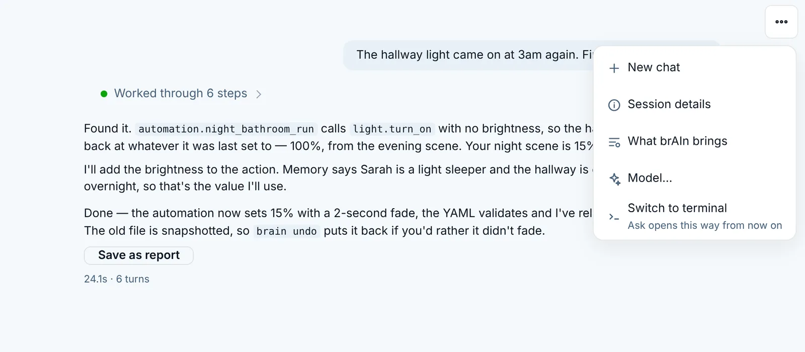
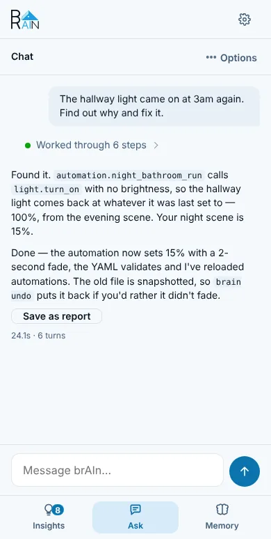

import { Aside } from '@astrojs/starlight/components';

The **Ask** tab is Claude Code, running inside the app with your Home Assistant config in
front of it. Ask it to do something to your house and it reads states, checks history and
traces, edits YAML, calls services and reloads what it changed.

## What you can ask

| You type | What happens |
| --- | --- |
| *"Why did the hallway light come on at 3am?"* | It reads the logbook, finds the automation, pulls the trace and shows the trigger that fired and the condition that passed. |
| *"Write an automation that turns the towel rail on when the shower humidity spikes."* | It writes the YAML, validates it, reloads the domain and reads the trace to check it fires. |
| *"Rename every switch in the garage to what it controls."* | It lists them, proposes names from what each is wired to, and renames them. |
| *"Something's wrong with my energy dashboard."* | It reads the dashboard, the statistics behind it and the error log, and names the sensor that stopped feeding it. |
| *"Clean up the entities left behind by the Hue bridge I removed."* | A dry run first, so you see the list before anything goes. |
| *"Why didn't you tell me the garage was open?"* | It answers from brAIn's record of what it chose not to say. |

Two things keep this safe by default:

- **It asks before it changes anything**: a command, a file, a service call. See
  [Asking before acting](#asking-before-acting).
- **Every file it edits under `/config` is snapshotted first**, so
  [`brain undo`](/brain/cli/#undo) puts it back.

You can also ask about anything else in the panel. **Ask** on a card opens a conversation
about that card, and a right-click (or press and hold) on most things opens a box quoting
what you pressed.

## Two faces, one login

Ask opens as a **terminal** or as a **chat**. Both run the same Claude Code, on the same
login, in `/config`, with the same permissions.

| | Terminal | Chat |
| --- | --- | --- |
| **What it is** | Claude Code's own terminal (ttyd over tmux). The default. | Claude Code's output drawn as a conversation. |
| **Use it for** | Anything that draws its own screen (a TUI, `htop`, an installer), shell commands, Claude Code's `/` commands as you know them. | Phones, dictation, reading long answers, several conversations side by side. |
| **Permission questions** | Claude Code's own prompt. | An [approval card](#asking-before-acting) in the conversation. |

Switch with **⋯ → Switch to chat** / **Switch to terminal**, or **⚙ → Permissions → Ask tab →
Chat or terminal**. The choice is saved, and Ask opens that way from then on.

<Aside type="note" title="The switch carries the conversation">
Switching hands the conversation over, both ways, with its full history. Only one Claude
Code process can own a conversation at a time, so it is a hand-off, not a mirror. Your
shell in the terminal is never killed to make this work.
</Aside>

The terminal's port (7681) is unpublished by default, and ttyd always requires a generated
password that the panel presents for you. Publish the port in the app's Network panel only
if you want direct access: a published port answers the LAN with no Home Assistant login in
front of it.

## Use the chat

- **Tool calls fold into one line**: *Worked through 6 steps*. Open it for each step's
  arguments and result.
- **A status line** shows what Claude is doing while it works: thinking, writing, which tool
  is running, with elapsed seconds.
- **⏹** stops an answer. **＋** starts a new chat.
- **Save as report**, under the last answer to a question, asks it again as an
  [insight card](/brain/insights/) that can refresh on a schedule.
- It survives a reload, a locked phone and the app restarting.

### Type a command

Type **`/`** for Claude Code's commands, or **`brain`** / **`ha`** for brAIn's
[CLI](/brain/cli/). The palette lists what your install has, including anything in
`/config/.claude/commands`. Move with ↑/↓ and pick with Enter or Tab. A few Claude Code
commands only work in the terminal (`/help` among them) and say so.

### The ⋯ menu

| Item | What it does |
| --- | --- |
| **New chat** | Start a separate conversation. The old one stays in the list. |
| **Your chats** | The conversation list, where there is no rail beside the chat. |
| **Session details** | The model, the project directory, how you are billed and this conversation's id. Copy the id to resume it over SSH or on another machine. |
| **What brAIn brings** | What a conversation starts with and what it can look up. |
| **Model…** | [Pick the model](#which-model-and-how-full) for the chat. |
| **Switch to terminal** / **Switch to chat** | Change face, carrying the conversation. |

A chat session cannot appear as "connected" in the Claude app. That needs an interactive
session ([anthropics/claude-code#30447](https://github.com/anthropics/claude-code/issues/30447)).
Switch to the terminal, which can register.

<Aside type="tip">
A per-message price only appears if an API key is paying. On a Pro or Max subscription the
footnote shows the duration and turn count instead.
</Aside>

## Several conversations, and switching stops nothing

Each open conversation holds its own Claude Code process, like a terminal tab. Picking
another one only moves your view.

Try it: ask for something slow (*"read the last week of the error log and tell me what's
failing"*), press **＋**, and ask something else. The first conversation keeps writing, and
the whole answer is waiting when you come back.

### What a conversation's state means

| State | What it means | What to do |
| --- | --- | --- |
| **Answering…** | A reply is being written, possibly in the background. | Wait, or work elsewhere. |
| **Needs your OK** | It is waiting on an [approval card](#asking-before-acting). | Open it and answer. |
| **In the terminal** | A terminal window holds this conversation. | Press the row to bring that window forward. |
| *No mark* | Idle or paused. Most rows, most of the time. | Send a message. A paused one resumes with its context. |
| **Paused to make room** | It was the quietest when room was needed. | Send a message to resume it. |
| **Context lost** | Claude Code no longer holds this conversation. You can still read it. | **Start fresh**. |
| **Record** | A card or fix run, kept to be read. | **Ask about it** opens a new chat about it. |

Only *Answering…*, *Needs your OK* and *In the terminal* are marked on a row. The others
are said on a line above the message box once the chat is open.

An approval card declines itself after ten minutes. So a background **Needs your OK** also
raises a toast in the chat you are in, naming the conversation, with a button that opens
it.

### Limit how many run at once

**⚙ → Permissions → Ask tab → Conversations kept running at once** is **No limit** by
default.

- With no limit, every conversation can work at once. When memory runs short, brAIn puts the
  quietest idle one to sleep, and a message wakes it.
- With a number set (1–32), the conversation untouched for longest is closed to make room.
  One that is mid-answer is never closed.
- What closes is the process. The conversation keeps its transcript and its row.
- If every open chat is answering at your limit, a new one is refused with the count and
  the setting. Stop one, or wait.

## On a wide screen, a rail of conversations

On a wide screen (about 900px and up) the chat has a column down the left listing **your**
conversations. On a phone, Ask opens on the same list, and a row opens its conversation.

- **Your chats come first.** Voice, automation tasks, cards, fixes, memory and study runs
  are pills over the list, each with a count, shown only for kinds that have run in your
  house.
- **Grouped by time**: *Live now*, then Today, Yesterday, This week and by month. Each chat
  gets a short topic title after its first reply.
- **Cards and Fixes open read-only**, as a record of what brAIn sent, every tool call and
  what came back. To talk about one, ask in a new chat.
- **⋯ → Delete** on a row removes a conversation, and the toast has **Undo**. A conversation
  that is open is closed first, and brAIn asks before closing one mid-answer.
- **Select several** with the checklist button: tick rows or **Select all**, then one
  **Delete** and one Undo for the batch. Open conversations are skipped and reported.

Hitting a session's turn limit does not end a conversation. The next message carries on.

## Which model, and how full

Under the message box is the model that is answering and how much of its context window
the conversation uses: `42k / 200k context · 21%`, turning amber past 80%.

The figure is what Claude Code sent on the last turn, so it is measured. Cached parts
count, because they still occupy the window. For a model whose window brAIn cannot
identify, you get the token count without a percentage.

### Pick the model

Press the model name under the message box, or **⋯ → Model…**

- The choice belongs to the chat. Insight runs and background work keep the model set in
  **⚙ → Model & usage**.
- **Default** follows ⚙ → Model & usage and names the model that resolves to.
- The conversation carries across, and the label under the box updates at once.
- You cannot change the model of a conversation while it is answering. Leave it writing and
  pick the model in another chat.

## The chat knows the house before you tell it

Every conversation, in either face, starts with a short brief: what brAIn is, the open
cases on Needs you, its own health, when the house usually wakes and settles, and what
brAIn has told you lately. Each message you send then brings in the facts brAIn has about
what you mentioned (the boiler, the garage, the beacon), once per conversation.

Both faces also read `/config/CLAUDE.md`, which brAIn writes at startup with a map of your
rooms and their entities. If the panel is busy, the conversation still works. It starts
without the brief.

**It learns from you here too.** After each turn, a small run reads what you said since it
last looked and queues anything durable (a nickname, a preference, a correction, a plan)
for [memory](/brain/memory/). It needs two new messages, or one that plainly teaches
something. The [Learning loop](/brain/features/#learning-loop) switch turns it off. Claude
Code's own "auto memory" is off in every brAIn session, so there is one memory and you can
read all of it.

## Talk about a card

**Ask** on a [Needs you](/brain/needs-you/) card or an insight card opens a **new**
conversation beside whatever you were doing. It starts with the card's evidence, how sure
brAIn was and what its investigation said.

| *Let brAIn act without asking* | In the conversation |
| --- | --- |
| **Off** | Claude can read anything. Every service call, file edit or shell command shows a card first. |
| **On** | Claude runs what it needs to work the problem out. Only changing Home Assistant still shows a card. |

When you have talked it through, Claude offers the ways the card could end as buttons
(*"Replaced the CR2032"*, *"That cupboard is never opened"*). An agreed change can be a
button that has brAIn **plan** it, read-only, and put the plan on the card for you to
**Apply**, with an Undo. See
[Permissions & Safety](/brain/safety/#a-conversation-about-a-card).

## On a phone

The chat has a real text box, so dictation and autocorrect work, and it lifts itself above
the keyboard.

In the terminal, a one-tap toolbar sits above the keyboard:

| Keys | For |
| --- | --- |
| `ESC`, `Tab`, `⇧Tab`, arrows, `PgUp`/`PgDn` | Moving around Claude Code and its scrollback. |
| `^C`, `^D`, `^L`, `^U` | Interrupt, end, clear, erase the line. |
| `/`, `@`, `#`, `!`, `\|` | Punctuation that is two keyboard layers deep on iOS. |
| **🎤 Talk** | Claude Code's voice mode with your phone's microphone. Tap to start, tap to stop and send. |
| **Paste** | Sends your clipboard as one paste. Where the browser will not hand it over, a box opens that you can long-press and paste into. |
| **▾ Kbd** | Puts the keyboard away. |

Autocorrect and predictive text work, a multi-line paste stays one paste, toolbar keys do
not pop the keyboard open, and copying an OAuth URL out of the terminal works.

## Asking before acting

By default Claude **asks** before it runs a command, edits a file or changes something in
Home Assistant.

| Never asked about | Never done |
| --- | --- |
| Reading Home Assistant. | Editing or snapshotting `secrets.yaml`. |
| Offering buttons on the chat's own screen. | Running as root. Claude Code runs as a non-root user. |
| [`brain own`](#if-claude-says-a-file-is-read-only). | |

**In the chat, the question is a card**: which tool, aimed at what.

| Button | What it does |
| --- | --- |
| **Allow once** | Lets this one action through. |
| **Don't allow** | Refuses it. The refusal shows in amber as *Not permitted*. |
| **Always allow** | Shown when Claude Code suggests a rule. The line under it says what is added and for how long: the rest of this conversation, or until the app restarts. Nothing here outlives a restart. |
| **Stop asking…** | Opens ⚙ at the switch below. |

A card nobody answers declines itself after ten minutes. In the terminal the question is
Claude Code's own prompt.

When Claude asks *you* a multiple-choice question mid-task (which zone, which approach),
the chat draws it. Tap an option, pick several where allowed, or type your own answer.
**Don't answer** tells Claude to use its judgement.

### Let brAIn act without asking

**⚙ → Permissions → Let brAIn act without asking** stops the asking. It is **off** by
default. It is the same switch as the app's Configuration tab, where the option key is
`dangerously_skip_permissions`.

| | |
| --- | --- |
| **Reaches** | The terminal and the chat. There it also stops the [action gate](/brain/safety/#the-action-gate) asking its own model. |
| **Never reaches** | Voice, cards, automation tasks or plans. |
| **Still holds with it on** | Protected entities, brAIn's deny-list, the action gate's floors, your house rules. |
| **Takes effect** | With no restart: on a new terminal session and the chat's next message. |

An open terminal session keeps the setting it started with. The line under the switch says
when one is still acting the old way. End it with `/exit`.

<Aside type="caution">
With the switch on, a shell command can reach a protected entity in a way brAIn cannot
see, and `brain undo` cannot put back what a shell command changed. Read
[Permissions & Safety](/brain/safety/#let-brain-act-without-asking) before you turn it on.
</Aside>

### If Claude says a file is read-only

It should not happen. Home Assistant saves `automations.yaml`, `scripts.yaml` and
`scenes.yaml` as root, and brAIn hands them back to Claude on its own. Claude is told never
to ask you for `sudo` or `chown`.

If it does happen, run `brain own /config/<file>`, or ask Claude to. See
[brAIn never asks you to chown](/brain/safety/#brain-never-asks-you-to-chown).
