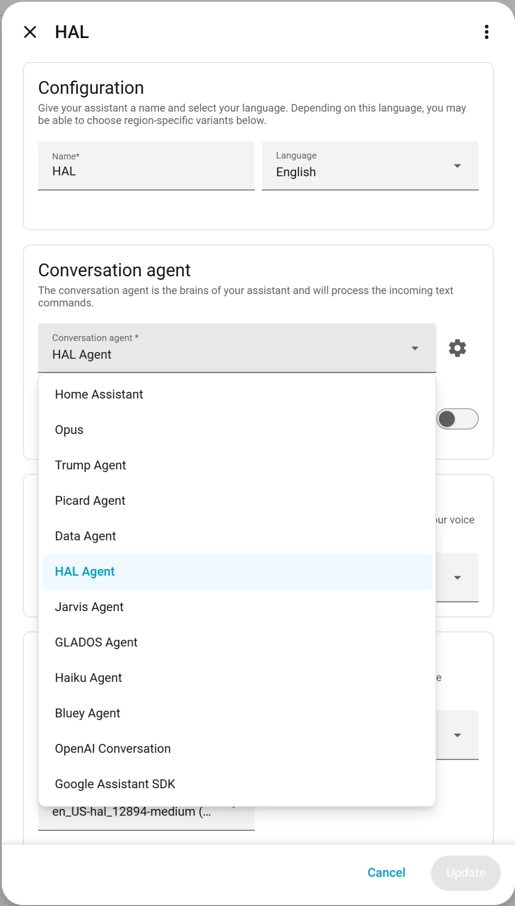

import { Steps, Aside } from '@astrojs/starlight/components';

Pick **brAIn** as the conversation agent for a voice assistant and every satellite, the Assist dialog and the mobile app talk to an assistant that knows your house.



## What you can say

| Say | What happens |
| --- | --- |
| *"Turn off the lights."* (to the kitchen satellite) | The kitchen lights go off. A satellite's request carries its room and floor. |
| *"Turn on the beacon."* | The office lamp comes on, because [memory](/brain/memory/) says that is what you call it. |
| *"It's too cold in here."* | brAIn acts the way your heating works. On a heat pump with weather compensation it raises the flow temperature. |
| *"Remember that we call the office lamp 'the beacon'."* | Stored at once, filed as taught by voice, and as yours when you are signed in. |
| *"I like the bedroom at 19."* | Remembered as your preference, not everyone's. |
| *"Turn the hall light back on."* | Done, and counted as you overriding the automation, the same as pressing the switch. |
| *"Which bedroom?"* (brAIn asks you) | The satellite keeps listening for your answer (Home Assistant 2025.4 and later). |
| *"Start the Friday party on the den speaker."* | Your other BRUH apps answer too. See [by voice, app by app](#your-other-bruh-apps-by-voice). |

Typical commands answer in about 3 to 5 seconds. Replies stream, so speech starts at the first sentence on pipelines that support it.

## Add an agent

<Steps>

1. Open **Settings → Devices & services → brAIn → Add service** and add a conversation agent.

2. Give it a name, a model, a personality, and choose **What this agent can reach**.

3. Open **Settings → Voice assistants**, pick or add an assistant, and choose your agent under **Conversation agent**.

</Steps>

Change any of this later under the agent's **Configure**. You can run several agents at once:

```text title="Two agents, one house"
"Jarvis"        You are Jarvis, a dry British butler. Address me as "sir".
                However excited you get, keep spoken replies under two sentences.
                Reach: Full admin. Blocked: nothing.

"Kids' speaker" You are a cheerful helper for a 7-year-old. Short, simple words.
                Never mention alarms or locks; if asked, say you'll fetch a grown-up.
                Reach: Voice assistant.
                Blocked: lock.unlock, lock.open, alarm_control_panel.*, script.*
```

| Setting | What it does |
| --- | --- |
| **Personality** | Leads the prompt and owns identity, tone and length. Without one, a built-in default applies: helpful, efficient, one or two short sentences. With one, that default is dropped, so say it in the persona if spoken replies should stay short. |
| **Model** | New agents use Claude Haiku for quick replies. Pick any model per agent. **Default** uses brAIn's own voice model and thinking depth. |
| **What this agent can reach** | One of three levels, below. |
| **Blocked services** | Services this agent may never call, below. |

With **Personality** on in [⚙ › Features](/brain/features/), the name and personality from ⚙ › Personality are the household's assistant everywhere, voice included. An agent's own prompt still leads for that agent.

## Choose what an agent can reach

| Level | Sees | Can use |
| --- | --- | --- |
| **Voice assistant** (new agents) | Only what you expose to Assist | Home Assistant tools only |
| **Whole house** | Every entity | Home Assistant tools only |
| **Full admin** | Every entity | Everything the brAIn chat can: shell, file edits, config, the web |

<Aside type="caution">
A **Full admin** agent can edit your configuration from a misheard sentence. Give that level only to an agent you alone talk to. Keep the kitchen speaker a **Voice assistant**.
</Aside>

- **The level is set on the agent and nowhere else.** The app options `assist_tool_access` and `assist_exposure` no longer exist. An agent that used to follow them is now a **Voice assistant**. If you had widened either option, open the agent's **Configure** and pick a wider level.
- **Each agent is told its level.** A voice-level agent tells you where to expose an entity instead of looking for another way in. A whole-house agent never asks you to expose something.
- **A non-admin gets the narrow level.** Somebody signed in who is not a Home Assistant administrator, talking to a Whole-house or Full-admin agent, is answered at the Voice-assistant level. Their lights still work, and the agent says why if they ask for more.
- **A satellite or an automation has no user** and gets the agent's own level.

<a id="what-voice-can-see"></a>

### What a voice-level agent sees

It sees what you have exposed under **Settings → Voice assistants → Expose**. Un-expose the front door lock there and a voice-level agent can neither read it nor act on it, by name or through *"everything in the hallway"*.

- An entity nobody has set gets Home Assistant's own default. **A lock is never exposed unless you expose it.**
- Area, device and label targets are refused, because a hidden entity could be reached through its room.
- Templates, the logbook, the room list and brAIn's own reads (what is normal, why something changed, habits) only reach exposed entities. House-wide reads (activity, findings, the registries) are refused.
- A voice-level agent cannot file a fact about an entity it cannot see.
- If the exposure list cannot be read, voice sees **nothing**, and the log says so.

### What a voice-level agent may do

| Rule | Detail |
| --- | --- |
| **A request has to name something** | A call that names no entity is refused, unless it is a notification or a BRUH app's play action. So a voice agent cannot restart Home Assistant, shut down the host, install an update or create a user. |
| **An entity uses its own services** | `light.turn_on` on a light is fine. A service from another domain aimed at that light is refused. Exceptions: `homeassistant.turn_on`/`turn_off`/`toggle`, text-to-speech, Music Assistant playing on a speaker, and a scene applied inline. |
| **No updates** | `update.install` is refused even on an update entity. |
| **No administration** | A restart, an update, a backup, a user and the [Power Tools](/brain/power-tools/) need **Whole house** or **Full admin**. |

### What every agent is held to

- **`protected_entities` are refused at every level**, Full admin included.
- **Blocked services are checked by what a call does.** `homeassistant.turn_on` aimed at `cover.garage_door` is a cover call. A call whose targets cannot be resolved, such as a whole area, is refused on a restricted agent.
- **New agents start with administration blocked**: restart and stop, host reboot and shutdown, `update.install`, `recorder.purge`, `shell_command.*`, `backup.create` and `brain.*` (all 91 Power Tools, including `brain.create_user`). Untick any of them for an agent you alone use. Unlocking, opening covers and running scripts are in the list, unticked. Agents you already had are not changed.
- **Every entity a request names is checked, wherever it is named**: a scene's inline `entities`, a speaker in `media_player_entity_id`, an entity passed to a script as a variable.
- **A scene, script or automation is checked by what it reaches.** One that reaches a protected entity is refused on every agent. On a voice-level agent, so is one that reaches an entity you have not exposed. A script that only touches the hall light is not refused because a protected lock shares the room.

How this fits with the chat, the terminal and house rules: [Safety](/brain/safety/). Option syntax: [Reference](/brain/reference/).

## Follow-ups and context

- **One conversation, one session.** While the same Assist chat or voice session stays open, each turn resumes the same session, so follow-ups remember what was said. If resume is not possible, recent turns are replayed instead.
- **Fresh instructions.** A conversation resumed after a pause is answered under today's instructions and area map.
- **Start over.** A new session starts clean. `brain.clear_conversation` resets one conversation, or all of them.
- **A question keeps the satellite listening** on Home Assistant 2025.4 and later. On older versions your answer still continues the same conversation.
- **Your automation's context arrives too.** An `extra_system_prompt`, and anything Home Assistant said before brAIn was asked (the question an `assist_satellite.start_conversation` announced), reach brAIn, so your *"yes"* knows what it answers.
- **Never done twice.** If a turn has already reached a device and then fails, brAIn does not re-run it. It tells you the command may have partly happened and asks you to check. A turn that failed before touching anything is retried quietly.

## Your other BRUH apps, by voice

With another BRUH app installed, any agent can drive it. There is nothing to set up. Full tool lists: [brAIn and the BRUH apps](/brain/apps/).

| App | Say | A voice-level agent may | It may not |
| --- | --- | --- | --- |
| **BRUH Minecraft** | *"Teleport Alex to Sam"*, *"put Alex in creative"*, *"make it day"*, *"who's on?"* | Play: teleport, game modes, items, time, weather, chat | Op, ban, kick, the whitelist, console commands, stopping the server, installing add-ons |
| **BRUH Print** | *"Print three freezer-bag labels for bolognese"* | Print up to 10 labels at once | Print more than 10 |
| **BRight** | *"Start the Friday party on the den speaker"* | Start and stop shows on speakers and scenes it can see | Import an edited show |
| **BRUH Bambu Studio** | *"Design a 40 mm knob for a 6 mm D-shaft and print two"*, *"pause the print"* | Design a part, start a print from a file (4 copies at most), pause, resume, change speed, light and temperature | Stop a print, slice, send G-code, import a link |
| **BRUH Cooking** | *"Start the Joule at 57 for two hours"* | Start and stop a cook | |
| **GardenRX** | *"Log two pounds of tomatoes"* | Log a harvest, a spray and a note | Queue a spray, change inventory, add a crop |
| **BRUH Browser** | *"Add my usual order to the grocery cart"* | Start a cart errand and ask how it went | Buy, or stop an errand |

Minecraft names are matched the way you say them, so "Alex" finds `.AlexPlays`. A name that could be two people is asked about, never guessed.

An agent's **Blocked services** list applies to these too. Take `bruh_minecraft.teleport` away from the kitchen speaker if you want to.

## Have brAIn speak first

Switch on **Say urgent problems aloud** under ⚙ → Notifications. A serious house-check finding that needs attention now is then announced on the satellite in the room somebody is in, as well as sent to the phone. It is off by default.

It never speaks during quiet hours, when everybody is away, on a satellite you have protected, more than once per finding, or more than once every half hour. Nothing a person is called is said aloud.

## Speed and health

| | |
| --- | --- |
| **Fast mode** | `assist_fast_mode`, on by default. Keeps one warm worker per active conversation plus a spare, three at most, so a turn skips start-up. Budget about 150 to 300 MB of RAM per worker. |
| **The area map** | brAIn already holds which entities are in which room, so *"turn off the kitchen lights"* acts on its first turn. A voice-level agent's map holds only what you exposed. |
| **Health sensor** | `binary_sensor.brain_system_assist_healthy` reports worker count, the spare, last-request latency and failed turns by kind. |
| **Check the whole path** | `brain doctor` probes voice end to end. Every voice turn, failures included, is in brAIn's run journal. |

There is no turn limit to tune. A voice run has a guard far past any real command, and one that trips it is told to finish with what it has.
