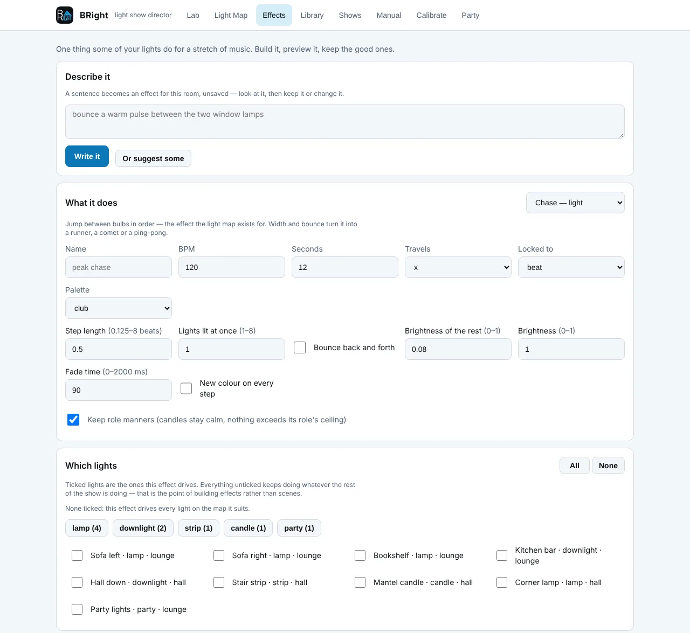

import { Steps, Aside } from '@astrojs/starlight/components';

An **effect** is one thing some of your lights do for a stretch of music: a chase across the
room, a build into the drop, a strobe on the last four bars. Every show is a list of effects, and
the Effects tab builds the same ones the automatic director uses.



## Describe an effect and let Claude write it

<Steps>

1. Type a sentence in **Describe it**, such as *"bounce a warm pulse between the two window
   lamps"*.
2. Press **Write it**. Claude fills in the form for your room, naming your lights.
3. The effect lands unsaved. Preview it, change anything, then save it or put it in a show.

</Steps>

**Or suggest some** asks Claude for ideas that suit your light map. Both buttons need
[brAIn](/brain/) and use the `director_model` option. Everything else on the tab works without it.

## Build an effect by hand

<Steps>

1. **Pick what it does.** Choose one of the [22 types](#the-22-effect-types). Each setting is
   named in plain words with its unit and range.
2. **Tick the lights it owns**, one by one or with a role chip such as `lamp (4)`. Everything you
   do not tick keeps doing what the rest of the show is doing. With nothing ticked, the effect
   drives every light on the map it suits.
3. **Choose how it travels** under **Travels**.
4. **Choose what it locks to** under **Locked to**.

</Steps>

| Travels | Order through the lights |
| --- | --- |
| `x`, `-x` | Left to right, right to left |
| `y`, `-y` | Front to back, back to front |
| `center_out`, `edges_in` | From the middle outward, from the edges inward |
| `snake` | Reading order through the room |
| `zone` | Room by room |
| `random` | Shuffled, the same way every night |
| `listed` | The order you listed the lights |

| Locked to | Steps on |
| --- | --- |
| `beat` | Every beat of the song |
| `downbeat` | The first beat of each bar |
| `bar` | Whole bars |
| `time` | Plain seconds, ignoring the music |

**Keep role manners** is on by default. It stops a candle strobing and holds each light under its
role's brightness ceiling. Turn it off when an effect is meant to own a fixture outright.

## Preview it, then run it on the lights


- **Preview** draws the effect two ways: the room, animated on your floor plan, and a strip with
  one row per light and time running left to right. Scrub with the slider or press **▶ Play**.
- **The cost line** shows how many cues the effect sends and the busiest bulb's messages per
  second, against a budget of 18 per second.
- **Run it on the lights** plays it on the real bulbs with no music, then restores them.

The preview uses the same render the compiler turns into packets, so what you see is what the
bulbs get.

## Save and reuse an effect

| To | Do this |
| --- | --- |
| Keep an effect | Name it and press **Save this effect**. It keeps its lights as well as its settings. |
| Bring one back or remove it | **Load** or **Delete** under **Saved effects** |
| Add it to a show | Under **Put it in a show**, pick a compiled track and a scene, then **Add to the chosen scene**. The show recompiles and stays editable. |
| Save an effect from a show | Press **＋ Library** on its row in the [show editor](/bright/shows/#edit-a-show) |

Saved effects also appear in the [Manual](/bright/manual/) rack (★) and in every brief Claude
gets. A show script can use one by name:

```json
{"use": "kitchen chase"}
```

## The 22 effect types

| Effect | What it does |
| --- | --- |
| `wash` | Holds a colour. The still ground everything else moves against. |
| `fade` | Travels from one level to another across the window. A transition instead of a cut. |
| `build` | Climbs in stages, optionally lighting one more fixture per stage, into a drop. |
| `pulse` | The beat. One packet carries eight beats of motion and the bulb keeps time. |
| `strobe` | Hard flashing for a short burst. One packet per bulb however fast it runs. |
| `chase` | Jumps between bulbs in order. Width and bounce make it a runner, a comet or a ping-pong. |
| `sweep` | One wave travelling across the room, shifted by where each light stands. |
| `breathe` | A slow rise and fall under everything else. |
| `sparkle` | A few random lights catch each beat. |
| `colour_cycle` | Rotates the palette through the lights. Motion without brightness. |
| `rainbow` | Hue spread across the room, turning slowly. Uses its own colours. |
| `theater` | Alternating groups answering each other. |
| `stab` | One hit at one moment, such as the drop. |
| `blackout` | Takes the selected lights down. |
| `melody` | Follows the tune. Each note lands on a light placed by its pitch, in a palette colour, so a rising phrase climbs across the room. |
| `harmony` | Follows the chords. The selection crossfades on every chord change. |
| `colour_drift` | The colour travels and the brightness stays still. The only motion a candle can join. |
| `saturate` | *Colour swell*. Saturation washes out toward white and back, with the level untouched. |
| `level` | Brightness follows how loud the song is. Pick a band to follow the kick, the vocal or the shimmer. |
| `hit` | A drum hit: full brightness the instant the beat lands, then a decay. |
| `accent` | A hit on every drum the analyser heard, at the strength it heard it. Put the kick on one set of lights and the snare on another. |
| `aux` | Party lights and lasers: on, off, or flashed on the beat, sent early by the latency the Lab measured. |

`melody` and `harmony` need the song's musical analysis. On the Effects tab they preview against a
stand-in tune. In a show they use the real one.

### Mix swells and strikes

| Kind | Effects | How it moves |
| --- | --- | --- |
| **Swell** | `pulse`, `breathe`, `sweep`, `colour_drift`, `saturate` | Smoothly up and back |
| **Strike** | `hit`, `accent`, `stab`, `strobe` | Full brightness the instant it lands, then a decay |

A show made only of swells looks like lights fading in and out near the music. Strikes give it an
attack.

<Aside type="caution" title="One bulb-run effect per light at a time">
`pulse`, `strobe`, `breathe`, `sweep`, `stab`, `hit`, `accent`, `colour_drift` and `saturate` are
run by the bulb itself, and a LIFX bulb runs only one at a time. If two overlap on the same light,
the later one cancels the earlier and one effect appears to do nothing. Give them different lights
or different times. Everything else layers freely, and the show editor flags the clash on the
effect's row.
</Aside>
