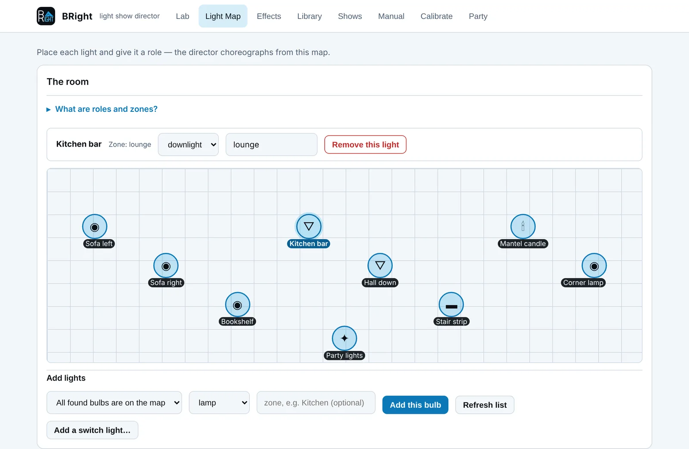

import { Card, CardGrid, LinkCard, Aside } from '@astrojs/starlight/components';

<Aside type="caution" title="Experimental">
BRight is being built in the open and is marked **experimental** in the add-on store. The whole
chain works end to end, but behaviour still changes between releases. Restarting it is always
safe: shows and analysis are regenerable, and nothing it does touches your Home Assistant
configuration.
</Aside>

## What it is

A Home Assistant add-on that turns the lights you already own into a lighting rig for music.
BRight analyses each track **once** — the beat grid, sections and drops, the chords, the melody,
which drum each accent was, and synced lyrics where they exist — and compiles a **show**: a
timeline of effects sent straight to your LIFX bulbs over the LAN, plus on/off cues for party
lights and lasers on any Home Assistant switch.

Then it plays the track through a Home Assistant media player and runs the show against a clock
anchored to how long *your* speaker actually takes to start. The lights land on the beat instead
of two seconds behind an AirPlay buffer.

<CardGrid>
  <Card title="Analysed once, played many times" icon="seti:audio">
    A track's analysis and its compiled show are files. Play it again tomorrow and nothing is
    recomputed — at show time the engine is just a clock and a cue list.
  </Card>
  <Card title="The bulb keeps time" icon="random">
    A beat pulse is one packet that tells the bulb to run a waveform for eight beats, not hundreds
    of packets a second. Shows stay locked even on a busy Wi-Fi network.
  </Card>
  <Card title="Measured, not guessed" icon="approve-check">
    Your phone's microphone hears a click track from the speaker and BRight works out its real
    delay. A Chromecast, an AirPlay speaker and a wired output each get their own number.
  </Card>
  <Card title="Editable all the way down" icon="pencil">
    Every show is a script of *effects* — chases, builds, strobes, a melody running across the
    room. Claude writes it, the built-in choreographer writes it, or you do. Same file either way.
  </Card>
  <Card title="Play it live" icon="rocket">
    The Manual tab turns your light map into an instrument: tap bulbs on the beat, record loops in
    bars, hit DROP and FLASH. It all locks to the song's own grid.
  </Card>
  <Card title="It tells you when it can't" icon="warning">
    A speaker that never started, a media folder Home Assistant will not serve, a Chromecast that
    cannot resolve `homeassistant.local` — each is a named step in one check, not a dark room.
  </Card>
</CardGrid>

## Use cases

**A party in one sentence.** Friday night, guests arriving. You say *"start party mode"* to your
voice assistant. Your Saturday-night set starts on the living-room speaker, every track with its
own show; the next song's show is written in the background while this one plays. At 1am,
*"stop the party"* calls your **Good night** scene instead of putting the party colours back.

**A song that deserves a show.** You love one track and want it to look designed. Compile it,
watch it on the Shows tab without lighting the house, then type *"the chorus needs more movement,
warmer verses"* and press **Revise with Claude**. Every version is kept, so the evening you spent
tuning it is never lost to a rewrite.

**The kitchen gets its own effect.** In the Effects tab you write *"bounce a warm pulse between the
two window lamps"*. Claude builds the effect for your room, you preview it on the floor plan, keep
it as a preset, and drop it into the chorus of three shows. Everything you did not select keeps
doing what the show was already doing.

**You are the lighting desk.** A friend is DJing from their own phone. You start a Manual session
with no song, tap **TAP** four times to set the tempo, record a four-bar loop on the sofa lamps,
and save DROP for the moment the bass comes back in.

**Movie night, but louder.** An automation starts a single track's show when the credits roll,
using `bright.start_show`, and puts the room back exactly as it was afterwards.

**Ask brAIn.** With [brAIn](/brain/) installed: *"start the Friday party on the den speaker"*,
*"play the show for this song"*, *"stop the lights and put the bedtime scene on"*. brAIn also
writes the Claude-directed shows — BRight needs no Claude login of its own.

## What you need

| | |
|---|---|
| **Home Assistant** | 2023.6 or newer, with the add-on store (Home Assistant OS or Supervised), on an `aarch64` or `amd64` machine |
| **Music** | Audio files under Home Assistant's `/media` folder — mp3, m4a, aac, flac, ogg, opus or wav |
| **A speaker** | Any `media_player` Home Assistant can send media to: Chromecast/Google, AirPlay, Sonos, DLNA, a wired output |
| **Lights** | LIFX bulbs on the same LAN (driven directly over UDP), and/or party lights and lasers on any Home Assistant `switch` or `light` |
| **Optional** | [brAIn](/brain/), which lets Claude design the choreography. Without it the built-in algorithmic director always compiles a show |

BRight works with no LIFX bulbs at all (the party-light channel still runs), and with no brAIn.

<Aside title="Why /media?">
A show plays its track by handing the speaker a media-source link, and Home Assistant only serves
those for files under its media folder. A folder anywhere else would analyse perfectly and never
play a note — so every music folder must be under `/media`.
</Aside>

## The tabs, in the order they want to happen

| Tab | What it is for |
| --- | --- |
| **Lab** | Discover bulbs, check how fast each one answers, measure a switch's latency, and run **Test mode** — a song with every ticked bulb pulsing on the beat |
| **Light Map** | Place each light on a floor plan and give it a role and a zone — the cast list every show is written for |
| **Effects** | Build, describe, preview and save effects by hand |
| **Library** | Pick the folders to scan and analyse the music |
| **Shows** | Compile, watch, edit and revise one show per track |
| **Manual** | Play the lights yourself, live, locked to the beat |
| **Calibrate** | Test playback, then measure each speaker's delay with your phone |
| **Party** | Tick songs, pick a speaker, press Play — and save sets to start by name |

Two steps are the ones people skip and then wonder why the lights are early: the **Light Map**
and **Calibrate**.

<CardGrid>
  <LinkCard title="Quick Start" href="/bright/quickstart/" description="From install to a room full of lights following a song." />
  <LinkCard title="Light Map, Lab & Calibration" href="/bright/light-map/" description="Roles, zones, bulb checks, Test mode and speaker delay." />
  <LinkCard title="Effects" href="/bright/effects/" description="All 22 effects, how they travel through the room, and the preview." />
  <LinkCard title="How a Show Is Built" href="/bright/shows/" description="What BRight hears, the four layers, and the visual show editor." />
  <LinkCard title="Manual Mode" href="/bright/manual/" description="Loops, DROP, FLASH and the effect rack, from your phone." />
  <LinkCard title="Parties" href="/bright/parties/" description="Sets, saved parties, end scenes and live sync trim." />
</CardGrid>
