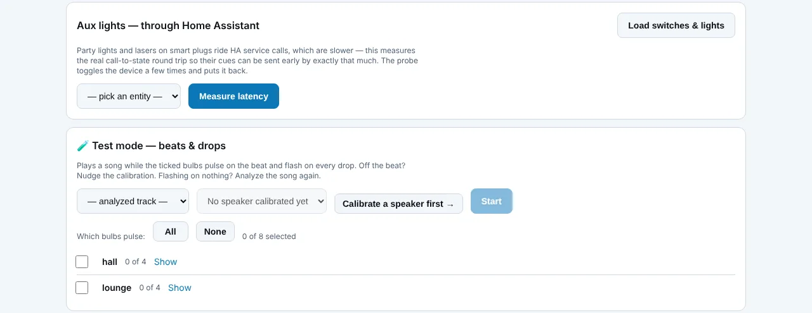
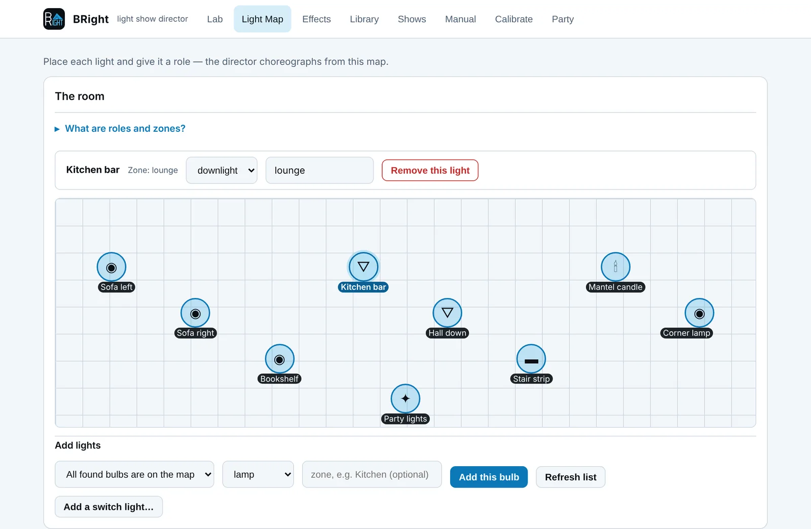
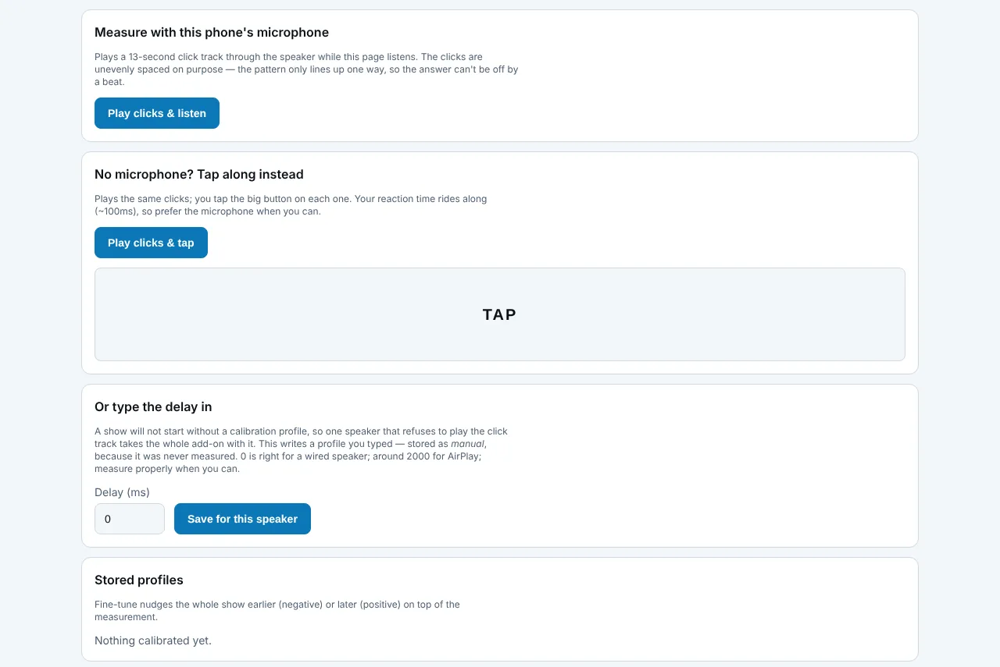

import { Aside } from '@astrojs/starlight/components';

Three tabs hold everything BRight needs to know about the room before it can light a song: the
**Lab** (what the lights are and how fast they answer), the **Light Map** (where they are and
what each one is for) and **Calibrate** (how late your speaker is).

## Lab — measure the house

Nothing in the Lab changes your lights permanently; it measures.

- **LIFX bulbs — direct LAN.** **Discover bulbs** broadcasts on the LAN and lists every bulb that
  answers. **Check** measures one bulb's round trip with an invisible echo (not a flash) and its
  sustained message rate; **Probe all unprobed** does every bulb not yet checked, and becomes
  **Stop** while it runs. A room's list starts with one line such as *"All 8 checked, all fast"*.
- **Aux lights — through Home Assistant.** Party lights and lasers on smart plugs ride Home
  Assistant service calls, which are slower. **Measure latency** toggles the chosen entity a few
  times, measures the real call-to-state round trip, and puts it back. Compiled shows send those
  cues early by exactly that much.
- **Latency report.** Everything measured so far, in one read.

### Test mode — beats & drops

The honest end-to-end check. Pick an analysed track and a calibrated speaker, tick which bulbs
join in, and press **Start**: the song plays while every ticked bulb pulses on the beat and
flashes on every drop. No choreography — just the whole chain from analysis to speaker to bulb.

- **Off the beat?** Nudge the calibration (see below).
- **Flashing on nothing?** Analyse the song again.

Bulbs are grouped by zone in closed folds, each with a tick for the whole zone and a count.
The test starts with the bulbs this browser last used — one light you can see is all the proof
needs, not every light in the house blinking at once.

## Light Map — where the lights are

The Light Map is the director's cast list. Drag each light to roughly where it sits in the room
— **left ↔ right matters most**, because sweeps and chases travel across it — and give it a role.

Tap a light to select it: the dot, its row in the list and the bar above the floor all highlight
together, and the selected light can be re-roled or removed right there. Every dot carries its
name on the map, and lights that share a spot show as one dot with a count you can open.

### Adding lights

- **The picker** lists every discovered bulb that is not on the map yet. Choose one, give it a
  role and (optionally) a zone, and press **Add this bulb**. This is the one to use after the
  first run.
- **Add every discovered bulb** adds every unmapped bulb at once — the right button exactly once.
  Neither ever overwrites a light you have already placed.
- **Add a switch light…** adds a party light or laser by its Home Assistant entity.

### Roles — what a light *is*

A role changes how BRight drives a light, and it is how a show says "the candles" without naming
four bulbs — which is what keeps a show working when you add a fifth.

| Role | What the director does with it |
| --- | --- |
| `candle` | Glows and drifts, capped at 45% brightness. Never strobes or pulses hard. |
| `downlight` | Carries the beat at full range. |
| `lamp` | Carries the beat, with more colour latitude. |
| `strip` | Carries motion — sweeps travel across the room on it. |
| `party` | A switch: on or off, no colour, sent early to cover Home Assistant's latency. Saved for the moments that earn it — drops, choruses. |
| `laser` | Same as `party`, rarer. |

Getting a role wrong is how a bedside candle ends up strobing.

### Zones — which part of the house

A **zone** is just a name you give a group of lights, usually a room. Type the same word on
several lights and they are one zone; there is no list to maintain. A zone exists exactly as long
as a light is in it, and a light with no zone still plays in every show.

What zones buy you is being able to talk about *part* of the house:

- An effect can own just the kitchen — `"select": {"zones": ["kitchen"]}` — and leave everything
  else exactly as the scene put it.
- A chase or sweep with `"order": "zone"` travels room by room rather than straight across the
  floor plan — what you want in an open-plan space where "left to right" crosses three areas.
- A party's allowed lights and the Claude director both read them, so "keep it to the lounge
  after 11" is one word rather than five bulb ids.

Set a zone when you add a bulb, or select any light on the map and type one beside its role.
**Suggest zones from names** proposes zones from a word the lights' names share ("Kitchen bar",
"Kitchen pendant") and saves them only when you press **Use these zones**. The list under the
map groups lights by zone, counts lights not yet placed, and has a search box.

<Aside title="The map is not decoration">
It is what an effect travels *through*. A chase ordered by `x` runs left to right across the room
you drew, `center_out` starts in the middle, and `zone` walks room by room. Getting the positions
roughly right is what makes the automatic shows look deliberate.
</Aside>

## Calibrate — how long your speaker takes

`media_player.play_media` returns when Home Assistant has *taken* the command, not when sound
comes out. Between the two, Home Assistant resolves the media, signs a path and hands a URL to a
speaker that then fetches it over the network — and buffers it. AirPlay buffers about two seconds,
and no API reports it. So BRight measures it.

1. **Test playback** first. It sends the click track and follows it the whole way — file on disk,
   media id, the address handed to your speaker, the command, and whether the speaker actually
   started — and names the step that broke. **■ Stop the sound** stops it.
2. **Play clicks & listen** — the real measurement. Open the panel **on your phone**, in the room
   with the speaker. BRight plays a 13-second click track; the page records it through the
   microphone and cross-correlates. The clicks are unevenly spaced on purpose: the pattern lines
   up exactly one way, so the answer cannot be out by a beat.
3. **Play clicks & tap** — for browsers that refuse the microphone (plain HTTP). You tap the big
   button on each click. Coarser, because your reaction time (~100 ms) rides along.
4. **Or type the delay in.** A show will not start without a calibration profile, so one speaker
   that refuses the click track would otherwise block everything. A typed profile is stored as
   *manual* — it never claims to have been measured. 0 is right for a wired speaker; about
   2000 ms is a reasonable guess for AirPlay.

**Stored profiles** keep a median across runs plus a **fine-tune** nudge per speaker (negative
moves the whole show earlier). Run the measurement once per speaker, and again if shows ever feel
consistently early or late — speakers renegotiate their buffers between sessions. A speaker you
no longer have can be deleted.

The click track lives at `/media/bright/calibration.wav`, because your speaker fetches it from
Home Assistant, not from the add-on.

### Trimming while it plays

While any show or party is running, **−25 ms / +25 ms** trims the sync by ear, and
**🎤 Sync by ear** does the same trim measured: the phone records the room for four seconds,
BRight matches what it heard against the playing track, and the lights shift by exactly the
difference. **Keep this trim** folds either kind into the speaker's calibration, so every future
show starts in tune.
