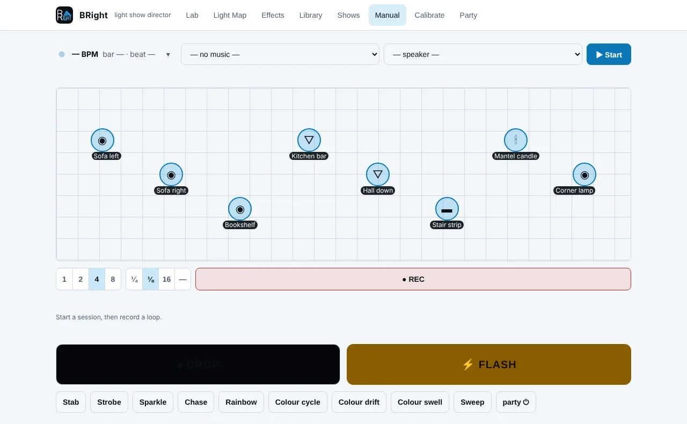

import { Steps, Aside } from '@astrojs/starlight/components';

Manual mode makes your light map an instrument: tap bulbs on the beat, record loops, and hit
**DROP** and **FLASH**, all from one screen on your phone.

## Start a session

<Steps>

1. In the top row, pick a song and a calibrated speaker. To perform to music that is already
   playing, leave it on **— no music —**.
2. Press **▶ Start**. BRight snapshots every mapped bulb first.
3. Press **■** to stop. The room goes back exactly as it was.

</Steps>

Starting a show or a party, or pressing any Stop, also ends the session, stops every loop and
restores the room.

## Lock to the beat

The top row shows the tempo, the bar and the beat, and a dot that strikes on every beat and
harder on the *one*. A chip says which grid drives it:

| Chip | When | How it keeps time |
| --- | --- | --- |
| **♪ track** | You started on an analysed song | It follows the song's own beats and downbeats, including any push and pull |
| **✋ tapped** | External music, or none | Press **TAP** on four or more beats to set the tempo. Press **⤓ 1** on a downbeat if the speed is right but the bar starts in the wrong place |

## Play the bulbs

Tap a bulb on the map and that bulb plays. It lights on screen the instant you touch it.

## Record a loop

<Steps>

1. Pick a length: **1**, **2**, **4** or **8** bars.
2. Pick what notes snap to: **¼**, **⅛**, **16**ths, or **—** to keep your timing as played.
3. Press **● REC**. It counts you in to the next downbeat: `ARMED · in 3 … 2 … 1`.
4. Play the figure on the bulbs. The button reads `REC bar 2/4` and fills as it goes.
5. At the end of the last bar it closes itself and starts looping.

</Steps>

Each loop follows the song's bar lines, so it stays in time when the tempo moves. It gets a tile
under the map in its own colour, with a ring sweeping its cycle and its pattern as ticks. The
bulbs it drives wear a ring in the same colour.

| To | Do this |
| --- | --- |
| Mute or unmute a loop | Tap its tile |
| Overdub onto a running loop | Hold its tile, then **⏺ Dub**. Your next taps go into that loop. One loop takes the taps at a time |
| Empty a loop but keep it | Hold its tile, then **Clear** |
| Remove a loop | Hold its tile, then **Delete** |
| Cancel a recording that is waiting to start | Press **REC** again |

## Hit the pads and the rack

| Control | What it does |
| --- | --- |
| **DROP** | Takes every light to black, at once |
| **FLASH** | Pulses every light to full white and back. The bulb returns by itself, so a flash never leaves the room bright |
| **The rack** | Fires a one-shot effect: Stab, Strobe, Sparkle, Chase, Rainbow, Colour cycle, Colour drift, Colour swell or Sweep. Then your [saved effects](/bright/effects/#save-and-reuse-an-effect) (★), then a switch per kind of party light. Scroll it sideways |

DROP and FLASH always take the whole room. A rack effect fires on the bulbs you tapped most
recently, or on the whole room if you have tapped none. It runs at the transport's tempo, or
120 BPM until there is one.

<Aside type="tip">
The beat dot, bar count and loop tiles are drawn on your phone, so they keep moving when a bulb is
off or unreachable. If the live connection cannot open, taps, pads and the rack still work, more
slowly, and the transport controls say so.
</Aside>
