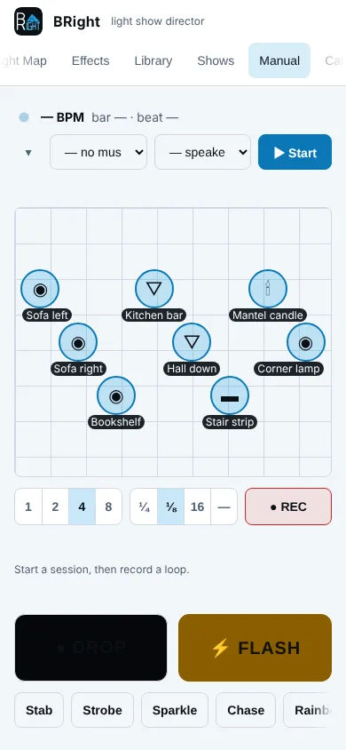

import { Steps, Aside } from '@astrojs/starlight/components';

The other kind of evening: you are the director, live, from your phone. The whole tab is **one
screen** — the transport, the room, your loops, both pads and the effect rack — with nothing to
scroll past, because scrolling to find DROP is the same as not having DROP.

## Start a session

Pick a song and a calibrated speaker from the top row — or pick no music and perform to whatever
is already playing — and press **▶ Start**. BRight snapshots every mapped bulb, so **Stop** puts
the room back exactly as it found it. Once running, the row collapses to ■ and one line saying
what is playing.

## The transport

The top row reads the tempo, the bar and the beat you are on, and a dot that strikes on every beat
and harder on the *one* — the answer, at a glance, to "is this actually locked to the music".
Two grids can drive it, and a chip says which:

- **♪ track** — you started on an analysed song, so the grid is the song's own beats and
  downbeats. A track that pushes and pulls carries the bars with it.
- **✋ tapped** — external music, or none. Press **TAP** on four or more beats to set the tempo,
  and **⤓ 1** on a downbeat when the speed is right but the phase is half a beat out.

Your phone runs its own playhead off that grid — the server sends the tempo and a phase, not a
message per beat — so the pulse, the bar count, every loop's sweep and every flash on the map are
drawn locally at frame rate, even when a bulb is off or unreachable.

## The map is the instrument

The middle of the screen is your light map, with the lights where you put them. Tap a bulb and
*that bulb* plays, right under your finger. It lights up on screen the instant you touch it,
without waiting for the room's answer to travel back over the network.

## Loops are clips

You choose the length before you play, so a loop stays with the song instead of walking away from
it over a minute.

<Steps>

1. Pick a length — **1, 2, 4 or 8 bars** — and what notes snap to: **¼**, **⅛**, **16**ths, or
   **—** for nothing straightened, which is what a swung or hand-placed figure wants.
2. Press **● REC**. It arms and counts you in to the next downbeat — `ARMED · in 3 … 2 … 1`.
3. Play the figure on the bulbs. The button says `REC bar 2/4` and fills as it goes.
4. At the end of the last bar it closes itself and starts looping. Every repetition is re-derived
   from the song's own bar lines, so a tempo that moves takes the loop with it.

</Steps>

Each clip gets a **tile** under the map in its own colour — a ring sweeping its cycle, its length,
and its pattern as ticks with the playhead crossing them — and the bulbs it drives wear a ring in
the same colour.

- **Tap a tile** to mute or unmute it.
- **Hold a tile** for **Clear** (empty it, keep the loop), **Delete**, and **⏺ Dub**, which points
  the next taps into that clip to overdub onto a running loop. One clip takes the taps at a time.
- Pressing **REC** while a clip is waiting to start cancels it.

## The pads and the rack

- **DROP** takes every light to black, right now. **FLASH** pulses every light to full white and
  back — the bulb does the returning, so a flash can never strand the room bright. Both always take
  the whole room, and both are the biggest targets on the panel.
- **The rack** along the bottom scrolls sideways: one-shot effects (Stab, Strobe, Sparkle, Chase,
  Rainbow, Colour cycle, Colour drift, Colour swell, Sweep), then your saved effects (★), then a
  switch per kind of party light. An effect fires on **the bulbs you tapped most recently** — tap
  two lamps, hit Sparkle, and those two sparkle — or on the whole room when you have tapped
  nothing. It fires at the transport's tempo, 120 BPM until there is one.

<Aside title="Why it never lags behind your hand">
Gestures ride one live connection rather than a web request each, and late work is dropped rather
than queued, so tapping sixteenths never makes the room fall behind. If the live connection cannot
be opened, taps, pads and the rack still work at one request per gesture, and the transport
controls say so out loud.
</Aside>

Semi-manual, semi-automated: you decide *what* and *when*, and the bulbs run the envelopes in
between. Starting a show or a party — or pressing any Stop — ends the session, stops every clip
and restores the room.
