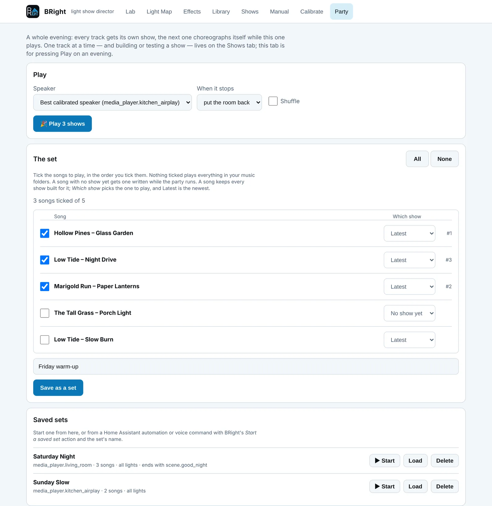

import { Steps, Aside } from '@astrojs/starlight/components';

The Party tab plays a whole evening: every song with its own show, one after another, from one
button or the sentence *"start party mode"*.



## Start a party

<Steps>

1. Pick the **Speaker**. Any calibrated speaker works. With none calibrated, the picker offers
   **Calibrate a speaker first**.
2. Tick the songs under **The set**. They play in the order you tick them, and each shows its
   place (`#1`, `#2`). Tick nothing to play every analysed song in your music folders.
3. Press **🎉 Play**.

</Steps>

| Option | What it does |
| --- | --- |
| **When it stops** | Put the room back as it was, or call a Home Assistant scene. See [Choose how the night ends](#choose-how-the-night-ends) |
| **Shuffle** | Off unless you tick it, so the order you chose is the order you get |
| **Which show** | Per song. **Latest** plays the newest show. Pick an older [version](/bright/shows/#go-back-to-an-earlier-version) for the night you want it |

A song with no show yet gets one written while the party runs. The next song's show compiles
while the current one plays. If that compile fails, the song plays a basic show. A song that
fails outright is skipped, so one bad file never ends the night.

## Control it while it plays

The tab shows the playing song with the room's position on it, the room live, and what is up
next.

| Control | What it does |
| --- | --- |
| **⏮ Prev** / **⏭ Next** | Move through the queue. Prev on the first song replays it |
| **−25ms lights later** / **+25ms lights earlier** | Trim the sync by ear |
| **🎤 Sync by ear** | The phone listens to the room and shifts the lights to match |
| **Keep this trim** | Saves the trim to the speaker's calibration |
| **■ Stop & restore lights** | Ends the party. It appears only while something is running, with a line saying what is playing and how far through the queue it is |

## Save a set and start it by name

A saved set keeps what is on screen: the speaker, the songs and their order, which show each
plays, shuffle, and what happens when it stops.

| To | Do this |
| --- | --- |
| Save | Name it and press **Save as a set** |
| Start one from the panel | **▶ Start** under **Saved sets** |
| See what a set would play first | **Load** puts it back on screen |
| Remove one | **Delete** |
| Start one from an automation | Call `bright.start_party` with its name |
| Start one by voice | Ask [brAIn](/brain/): *"start the Friday party on the den speaker"* |

```yaml
automation:
  - alias: "Saturday night"
    triggers:
      - trigger: conversation
        command: "start saturday night"
    actions:
      - action: bright.start_party
        data:
          party: "Saturday Night"
```

Anything you give at the time wins over what the set saved, so the usual set on a different
speaker works. `bright.start_party` requires the name, so a typo fails in the automation trace
instead of playing the default folder. A set that names lights uses only those and leaves every
other light alone.

## Choose how the night ends

By default, stopping restores every light to what it was before the show. At 1am you probably
want "everything off" or "night lights" instead.

Pick a scene under **When it stops**, or pass `end_scene` to the service. Stopping then calls that
scene instead of restoring.

<Aside type="tip">
If the scene fails to run, BRight restores the lights instead. The room never keeps the party
colours.
</Aside>

## Add a Stop button to a dashboard

The show-status sensor's `active` attribute is true while a run is in progress, so this button
appears exactly when the panel's Stop does:

```yaml
type: button
name: Stop the party
tap_action:
  action: perform-action
  perform_action: bright.stop_show
  data:
    scene: scene.good_night
visibility:
  - condition: state
    entity: sensor.bright_show_status
    attribute: active
    state: true
```

## Steer the mood

The mood box is on the [Shows tab](/bright/shows/#choose-who-writes-the-show), not here. It
steers the next show Claude writes, and you can see the show it produced there.

See the [Reference](/bright/reference/) for every service and attribute.
