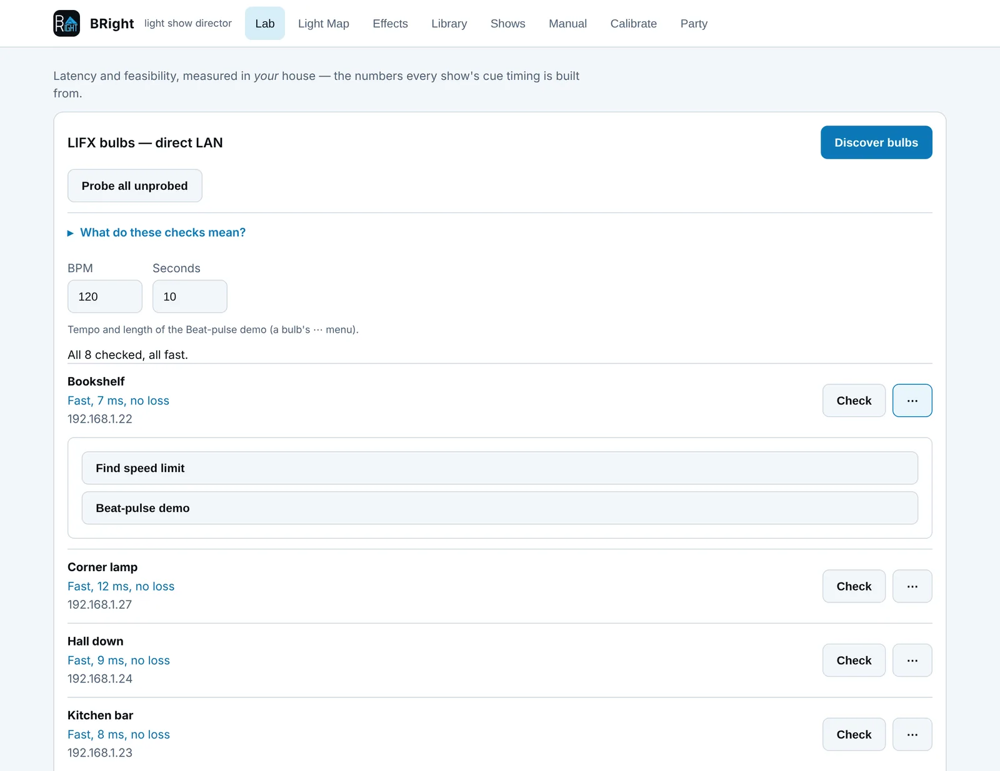
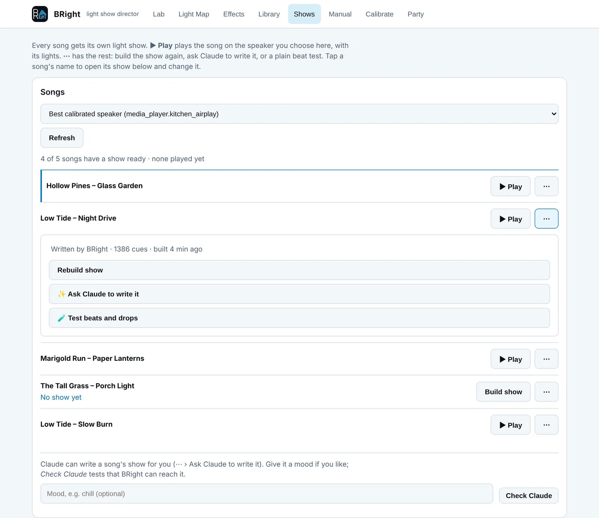

import { Steps, Aside } from '@astrojs/starlight/components';

Go from install to a room following a song in about twenty minutes, plus the time your library
takes to analyse the first time.

## Install

<Steps>

1. **Add the repository.** In Home Assistant open **Settings → Add-ons → Add-on Store → ⋮ →
   Repositories** and add:

   ```text title="Repository URL"
   https://github.com/bruhautomation/BRUH-HA-Apps
   ```

2. **Install BRight and start it.** It downloads a prebuilt image. The panel appears in your
   sidebar as **BRight**.

3. **Accept the integration.** Under **Settings → Devices & Services**, accept the discovered
   **BRight**. This adds the `bright.*` services and the show-status sensor. Restart Home
   Assistant only if the app's log asks for it.

</Steps>

Open the panel from the sidebar. It answers only Home Assistant itself, on a port the Supervisor
assigns.

## Your first show

<Steps>

1. **Test the speaker.** On **Calibrate**, pick a speaker and press **Test playback**. BRight
   sends a click track and names the step that broke if you hear nothing.

   On a Chromecast, Google or Nest speaker the usual cause is an *Internal URL* of
   `http://homeassistant.local:8123`. See [When nothing plays](/bright/reference/#when-nothing-plays).

2. **Find the bulbs.** On **Lab**, press **Discover bulbs**, then **Probe all unprobed**. Each
   bulb reports how quickly it answers ("Fast, 8 ms, no loss"). For party lights or lasers on smart
   plugs, pick one under **Aux lights** and press **Measure latency**.

   

3. **Map the lights.** On **Light Map**, drag each light to roughly where it sits in the room.
   Give each a **role** (`candle`, `downlight`, `lamp`, `strip`, `party` or `laser`) and,
   optionally, a **zone** such as a room name. Add switch-driven lights with
   **Add a switch light…**. See [Light Map, Lab & Calibration](/bright/light-map/).

4. **Measure the speaker.** Open the panel **on your phone**, in the room with the speaker. On
   **Calibrate**, press **Play clicks & listen**. BRight plays a 13-second click track and works
   out the delay through the microphone.

   | If | Do this instead |
   | --- | --- |
   | The browser refuses the microphone (plain HTTP) | **Play clicks & tap** |
   | You are in a hurry | **Or type the delay in**: 0 for a wired speaker, about 2000 ms for AirPlay |

5. **Analyse the music.** On **Library**, press **Browse media**, tick the folders to scan, then
   press **Analyze new tracks**. Each track is analysed once.

6. **Play a show.** On **Shows**, pick the speaker and press **Build show** beside a song, then
   **▶ Play**. Tap the song's name to open its show: your room, the song, and every effect as a
   row you can edit.

   

7. **Throw a party.** On **Party**, tick the songs (or none, for everything), pick the speaker and
   press **🎉 Play**. Press **Save as a set** to start it later by name.

</Steps>

## Check the sync once

- **Run Test mode.** In **Lab → Test mode — beats & drops**, pick an analysed track and a
  calibrated speaker, tick a bulb you can see, and press **Start**. The bulb pulses on the beat
  and flashes on every drop. If it is off the beat, nudge the calibration. If it flashes on
  nothing, analyse the song again.
- **Trim by ear.** While a show or party plays, **−25ms** and **+25ms** shift the lights. On the
  Party tab, **🎤 Sync by ear** measures the shift from the room and **Keep this trim** saves it
  for that speaker.

<Aside type="tip">
Rebuild a show after you change the Light Map. A show is built for the lights that were on the map
when it was compiled.
</Aside>

## Next

- [How a Show Is Built](/bright/shows/): watch, edit and revise a show.
- [Effects](/bright/effects/): build your own.
- [Manual Mode](/bright/manual/): play the lights live.
- [Reference](/bright/reference/): options, services, the sensor and troubleshooting.
