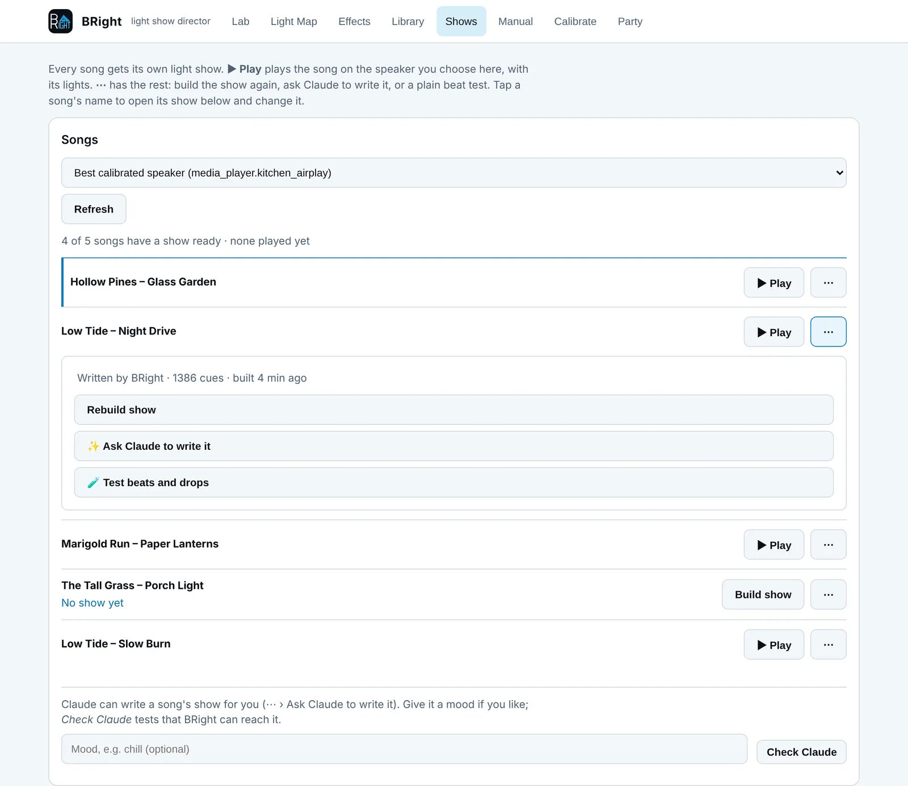
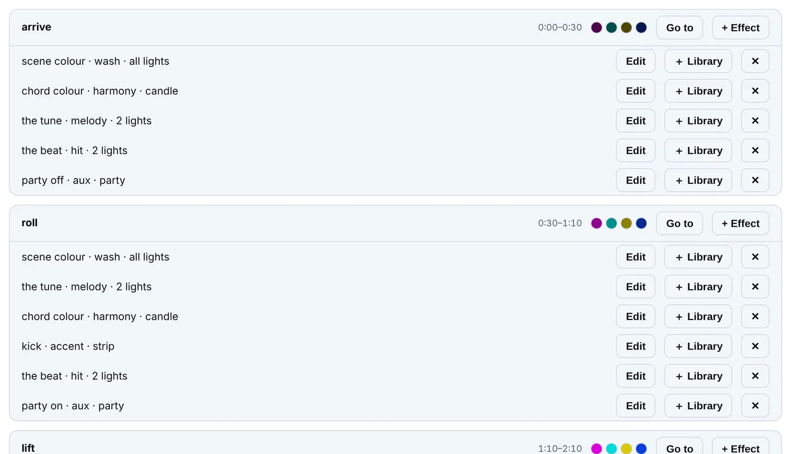
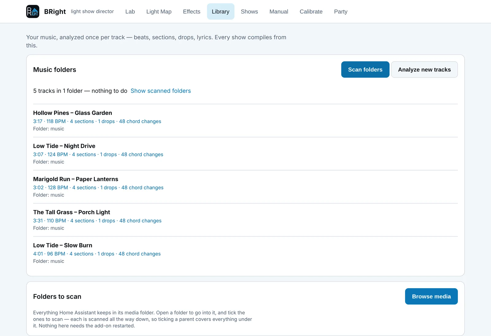

import { Steps, Aside } from '@astrojs/starlight/components';

Every song gets its own show, compiled ahead of time. The Shows tab is where you build one, watch
it without lighting the house, change it, and keep every version.


## Build and play a show



Pick a speaker at the top of **Songs**, then use a song's row:

| To | Press |
| --- | --- |
| Compile a show for a song that has none | **Build show** |
| Play the song on the speaker with its lights | **▶ Play** |
| Compile it again, for example after changing the Light Map | **⋯ → Rebuild show** |
| Have Claude write the show | **⋯ → ✨ Ask Claude to write it** |
| Pulse every mapped light on the beat and flash on drops, with no choreography | **⋯ → 🧪 Test beats and drops** |
| Stop and put the room back | **■ Stop & restore lights** |
| Shift the lights while it plays | **−25ms** / **+25ms** |

Playing needs a [calibrated speaker](/bright/light-map/#measure-your-speakers-delay) and an
[analysed track](#analyse-your-music). A show is built for the lights on the map when it was
compiled, so rebuild after you change the map.

## Watch a show on screen

Tap a song's name and its show opens below the list.

| Part | What it shows |
| --- | --- |
| **The room** | Your floor plan, each light in its colour at the scrubbed instant |
| **The song** | The waveform with its sections and drops |
| **Three lanes** | The chord changes as labelled blocks, the melody as a pitch line, and the drums with the kick low and the rest high |
| **Scene blocks** | The show's scenes across the song. Press one to jump to it |
| **The strip** | One row per light, time running left to right |
| **Effect rows** | One bar per effect, drawn from what the compiler rendered |

Drag the scrub bar and the room shows that instant. **▶ Play** runs the show at real speed on the
screen, not the bulbs. While a real show plays, the playhead follows it. A line under the strip
says what is running now and what starts next.

## Edit a show



| To | Press |
| --- | --- |
| Change an effect | **Edit** on its row. It opens the same form as the [Effects tab](/bright/effects/) |
| Add an effect to a scene | **+ Effect** |
| Remove an effect | **✕** |
| Jump to a scene | **Go to** |
| Keep an effect as a saved effect | **＋ Library** |
| Edit the show as text | **Code**. It is the same document: change either and the other follows |
| See every cue | **Show the cue list**: when, which light, and which effect asked for it |

The preview follows every change at once. Nothing is written until you press **Save & compile**,
which validates the show, compiles it and checks each bulb's message budget. A show that would
flood a bulb is refused with the reason, and the show you had is untouched.

**Worth looking at** lists only effects with a problem: one that selects no lights, one whose
analysis is too old, or one whose waveform another effect cancels. When the show is fine, it is
empty.

## Revise a show with Claude

<Steps>

1. Watch the show.
2. Type what you noticed in the box under the editor, such as *"the chorus needs more
   movement"* or *"less strobe, warmer verses"*.
3. Press **✍ Revise with Claude**. The whole show goes back to Claude with your words.

</Steps>

A failed revision costs an error message, never the show. Revising needs [brAIn](/brain/).

## Go back to an earlier version

**Versions of this show** lists every compile, revision and hand edit, newest first, with who
wrote it.

| To | Press |
| --- | --- |
| Make an older version the one that plays | **Play this one** |
| Keep a version for good | **Name it** |

The version marked *playing* is what a party runs. Unnamed versions are dropped oldest-first once
there are more than a dozen. Named versions and the playing one are never dropped.

## Choose who writes the show

The `director_mode` option decides:

| `director_mode` | Who writes |
| --- | --- |
| `auto` (default) | Claude, when [brAIn](/brain/) is installed. Otherwise the built-in director, so a show always compiles |
| `algorithmic` | The built-in director only. Claude is never called |
| `claude` | Claude only. Compiling fails with the reason instead of falling back |

BRight has no Claude login of its own. It asks brAIn to run the job on the model in
`director_model` (default `opus`).

- **Check Claude** tests every link between BRight and Claude.
- **The mood box** above it (*"chill"*) steers the next show Claude writes.
- **What Claude is told about this track and your room** shows the exact brief: each light's
  name, role, zone and position, the travel orders through your room, the song's sections, chords,
  melody, accents and lyrics, and your saved effects.

Claude's answer goes through the same validation and compile as a show you edit by hand.

## Analyse your music



<Steps>

1. On **Library**, press **Browse media** and tick the folders to scan. Each is scanned all the
   way down.
2. Press **Analyze new tracks**. Tracks are analysed one at a time, and a bad file is reported
   and skipped.

</Steps>

Analysis runs once per track. Tracks are known by their content, so renaming a file does not
analyse it again, and the same song in two folders is one song. A track analysed by an older
BRight says so in the Library. It still plays, and **Analyze** refreshes it.

### What BRight hears

| | What it finds | What a show does with it |
| --- | --- | --- |
| **Beat and structure** | The beat grid, sections, drops, and loudness in low, mid and high bands | Where to be bright, where to build, where a stab lands |
| **Hits** | Each accent, ranked, and which drum it was | Kick and snare on different lights |
| **Chords** | Each chord change, and the key | A palette that moves with the harmony |
| **Melody** | The tune as notes, grouped into phrases | Light that climbs when the tune does |
| **Repeats** | Where the chorus comes back | A repeat the show can answer |
| **Lyrics** | Time-synced lines from LRCLIB, when they exist | A moment pinned to a line |

When BRight cannot hear something clearly, it reports nothing for it instead of guessing.

## How a show is layered

The automatic director and Claude's brief both build a show from four layers, each on different
lights:

| Layer | What it does | Typically on |
| --- | --- | --- |
| **Ground** | The room's colour, moving slowly with the harmony | Candles, strip |
| **Pulse** | The beat, as a `hit` | Lamps or downlights doing nothing else |
| **Hits** | The kick and the snare, on the drums the analyser heard, including fills | Lamps, downlights |
| **Voice** | The melody, placed by pitch. A run up the scale is a run of light across the room | One kind of light |

Two rules shape it:

- **One layer per light.** A bulb runs one waveform at a time, so each fixture belongs to one
  layer. The director claims whole roles first, and splits a role (left lamps for the kick, right
  for the snare) only when a layer has nowhere else to go.
- **A layer arriving is an event.** A chorus is the strip joining the kick and the lamps switching
  to the tune, not only more brightness. A drop takes the whole room.

BRight sends each rhythmic cue slightly early so the brightest instant falls on the beat. You do
not need to allow for it when writing effects.

## Write or edit a show as a file

Every compile also writes the script to `/config/.bright/shows/<track>-<hash>.json`, where Home
Assistant's File editor can open it. A `README.md` and an `EFFECTS.md` (every effect type and its
parameters) sit beside the scripts.

<Aside type="caution">
The file is a copy. Editing it changes nothing until you press **Reload from file** on the Shows
tab or call `bright.import_show`. Broken JSON is refused with the line it broke on, and the show
you had stays.
</Aside>

The minimum script is a scene with a window, a palette and some effects:

```json
{
  "version": 2,
  "palette_name": "club",
  "scenes": [
    {
      "start": 0, "end": 48, "mood": "roll", "kind": "mid",
      "palette": [[200, 0.9], [300, 0.8]],
      "brightness": 0.5,
      "effects": [
        {"type": "pulse", "name": "beat", "select": {"roles": ["lamp"]},
         "params": {"every_beats": 1, "depth": 0.35}},
        {"type": "chase", "name": "kitchen runner", "order": "x",
         "select": {"zones": ["kitchen"]},
         "params": {"step_beats": 0.5, "width": 2, "bounce": true}}
      ]
    }
  ],
  "moments": [
    {"t": 48, "snap": "beat",
     "effect": {"type": "stab", "name": "drop",
                "select": {"roles": ["lamp", "laser"]},
                "params": {"strength": 0.9}}}
  ]
}
```

| Field | What it does |
| --- | --- |
| `select` | Names ids, roles, zones or excludes. Everything it does not name is untouched. Roles and zones ignore capitals. |
| `params` | Anything left out takes its default. Out-of-range values are clamped, so `depth: 1.2` is read as `1`. |
| `"snap": "beat"` | Moves a moment onto the nearest beat. |
| `"base": false` | On a scene, stops it washing every light at its start, so the room stays as the last scene left it. |
| `{"use": "kitchen chase"}` | Uses a saved effect by name. |
