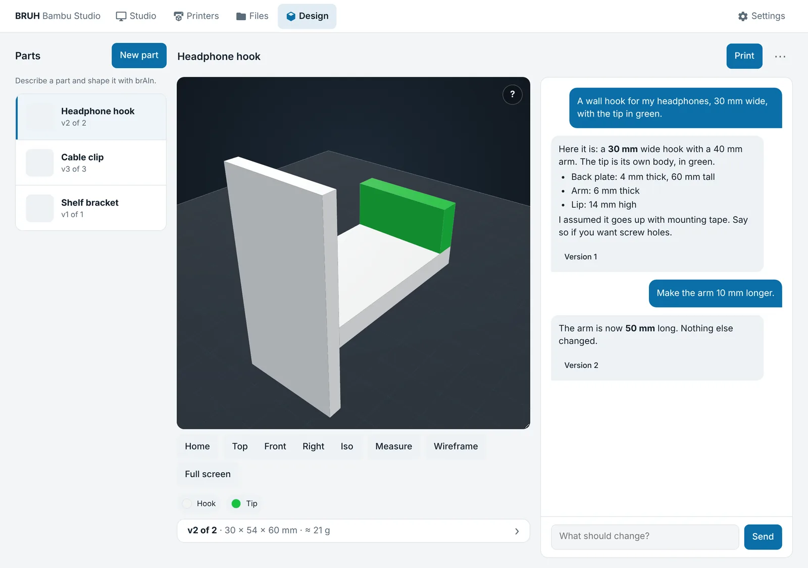
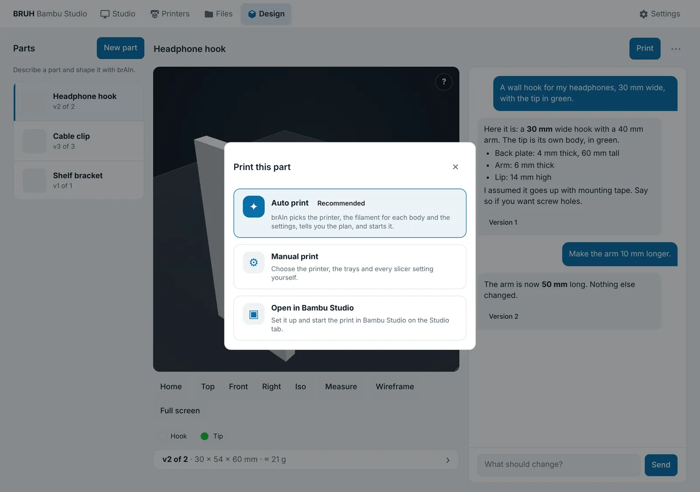
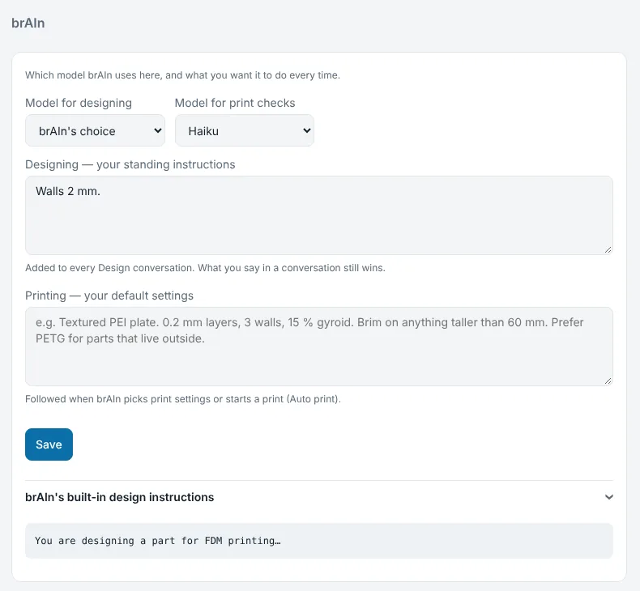

import { Steps, Aside, FileTree } from '@astrojs/starlight/components';
import measureShot from './images/design-measure.webp';
import phoneShot from './images/design-phone.webp';

Describe a part in a sentence and brAIn designs it, shows it in 3D, changes it as you talk,
and prints it.

The **Design** tab appears when [brAIn](/brain/) is installed with its **Automation
integration** on. Without brAIn the tab is hidden, or shows the parts you already have and
says why it cannot chat. Nothing else in the app changes.

## Design a part

<Steps>

1. **Describe it.** Press **New part** and say what it is for, what it fits and any sizes you
   know: *a wall hook for a 20 mm rail, holds a bike helmet*. brAIn picks defaults, says what it
   chose, and asks only what it cannot guess, with its questions as buttons you can tap.

2. **Look at it.** brAIn writes the part, the app builds it into STEP, 3MF and STL and shows it
   in the 3D view. A build that fails goes back to brAIn to fix, twice at most, before you
   see it.

3. **Change it by talking.** *Make it 10 mm longer.* *Add a chamfer on the screw holes.* *Put
   our initials on the front in black.* Every change that builds is a new version. Nothing is
   overwritten.

4. **Print it.** Say *print it*, or press **Print**. See [Print a design](#printing-a-design).

</Steps>

<Aside type="note">
brAIn cannot open a link or see a photo in a design conversation. Give it the measurements
that matter.
</Aside>

## Look at the part in 3D

The part is drawn in the colours it will print in, on a bed like the printer's. A multi-colour
part shows each body in its own colour.

| To | Mouse | Touch |
|---|---|---|
| Turn the part | Drag, or Shift + middle-drag. It turns about the point you grab | One finger |
| Slide it | Middle-drag or right-drag | Two fingers |
| Zoom | Wheel, toward the pointer | Pinch, toward your fingers |
| Centre a point | Double-click | |

The **?** in the corner of the view shows these, and opens by itself the first time.

| Button | What it does |
|---|---|
| **Home** | Back to the corner view with the whole part in sight |
| **Top**, **Front**, **Right**, **Iso** | Turn to that side, framing the whole part |
| **Measure** | Measure between two points (below) |
| **Wireframe** | Show the edges through the part |
| **Full screen** | Fill the screen with the view and its tools. Escape or **‹ Leave full screen** comes back |

**Invert vertical drag** in **Settings › 3D view** is on by default: dragging down raises the
view. Turn it off for Fusion 360's way round. It is remembered on that browser.

### Measure it

Press **Measure** and tap two points. You get the distance and its X, Y and Z legs.

- **Picks snap** to a corner, the middle of an edge, an edge, the centre of a flat face or a
  face. A marker says which.
- **A face and a point** give the distance square to the face.
- **Two faces or two edges** give the angle between them.
- The last five measurements stay listed until **Clear**. Escape starts the current one again.

### Hide bodies and change colours

Each body has a pill under the view.

- **Tap its name** to hide or show it.
- **Tap its colour dot** to change what it prints in. The AMS trays' colours come first, then
  any colour, or **Back to brAIn's colour**.

Your choice is saved on the part, used by Print, and passed to brAIn with your next message.

### On a phone

The view sits above the conversation, which scrolls on its own. **▾** folds the view away for
a long conversation. On a desktop the view and conversation sit side by side, and the view's
bottom edge drags to make it taller.

## Go back to an earlier version

One line under the view says which version you are on, its size, its weight and how many
warnings it has. Open it for what changed, the warnings, the dimensions and the other versions.

- **The chips** switch between versions.
- **Keep working from vN** makes an older version the base for the next change.
- **⋯** on the part downloads its **3MF** or **STEP** (named like `Wall hook v3.3mf`) or deletes
  the part.

## Printing a design

| Choice | What happens |
|---|---|
| **Auto print** (recommended) | brAIn chooses a printer that is online and idle, the AMS tray for each body (material first, then the closest colour) and the settings. It says its plan and starts the print. Saying *print it* in the conversation does the same |
| **Manual print** | You choose the printer, the tray for each body and every [print option](/bruh-bambu-studio/printing/#print-options), starting from what brAIn suggests |
| **Open in Bambu Studio** | Opens that version on the [Studio tab](/bruh-bambu-studio/studio/) as a full project, with the settings of the first of your printers that has its model set and one filament per colour |

Auto print asks first only when something is missing: no idle printer, a colour or material
that is not loaded (it says which to load), or a printer whose last print may still be on the
plate.

After the print is sent, the conversation shows the sliced time, the filament per colour, and
when the print started.

**Ask for any print option in words.** *Print it by object.* *Four copies.* *Ironing on top.*
*On the textured plate.*

<Aside type="tip">
Set each printer's **model** on **Settings › Printers**. Printing a design uses Bambu Studio's
own profiles for that printer and each tray's filament.
</Aside>

### Print in several colours

A part in several colours is several bodies that touch. A logo on a cube is two bodies. Each
body prints from its own tray, so load those colours in the AMS. The external spool holds one
filament and suits a one-colour part.

A print-in-place part never comes apart on the plate, because a designed part is sent as one
object.

### What brAIn takes care of

- It knows each printer's build volume and nozzle, and keeps the part inside it.
- It splits a part that is too big into pieces that join.
- It lays out copies and print-by-object jobs.
- It keeps a second colour to a few layers, because every colour change purges filament, and
  says roughly what a wasteful choice would cost.

## Standing instructions

**Settings › brAIn** shapes every conversation. Changes apply on the next message, with no
restart.

| Setting | What it does |
|---|---|
| **Model for designing**, **Model for print checks** | *brAIn's choice* (brAIn's own plan), Haiku (fastest), Sonnet, Opus (most capable) or Fable |
| **Designing** instructions | Added to every Design conversation: units, wall thickness, fillets, screw clearances |
| **Printing** instructions | Followed when brAIn picks print settings or starts a print with Auto print: plate, layer height, walls, infill, brims, materials |
| *brAIn's built-in design instructions* | Shows what yours are added to |

What you say in a conversation still wins over your standing instructions.

## Find a part's files

<FileTree>
- share/bambu/designs/
  - wall-hook-3f9c2a/
    - part.json  the conversation, versions, prints and state
    - v1/
      - design.py  the script brAIn wrote
      - report.json  what the build found
      - Wall hook.3mf
      - Wall hook.step
      - Wall hook.stl
    - v2/
</FileTree>

Open the STEP in Onshape or Fusion, or the 3MF in Bambu Studio. Come back days later from the
parts list and the same conversation resumes. It also appears in brAIn's own chat list.

## Safety

<Aside type="note" title="brAIn never runs anything itself">
brAIn answers design requests with **reading tools only**. It never writes files or runs
anything. The app runs the script brAIn writes in a **separate process with no Home Assistant
token and a time limit**, after checking it imports nothing but CadQuery, the app's cadkit
helpers, math and numpy.
</Aside>

## Design from chat, voice or an automation

The same conversation, versions and print are reachable outside the Design tab, and the part
is on the tab afterwards.

| From | Use |
|---|---|
| brAIn's chat, the terminal, voice | brAIn's `bambu_design` tool. See [Voice & brAIn](/bruh-bambu-studio/voice/) |
| An automation | `bruh_bambu.design_part`, `design_status` and `print_part`. See [Home Assistant](/bruh-bambu-studio/home-assistant/#designing-from-an-automation) |
