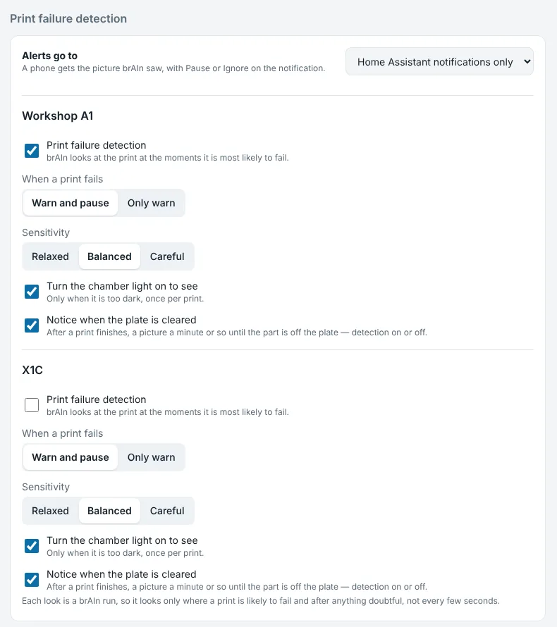

import { Aside, Steps } from '@astrojs/starlight/components';
import panelShot from './images/failure-detection-panel.webp';

Failure detection watches a print through the printer's camera, warns you when something looks
wrong, and pauses a print that has clearly failed.

## Turn it on

<Steps>

1. On the **Printers** tab, switch on **Failure detection** on the printer's card. The **i**
   beside it explains when it looks.
2. In **Settings › Print failure detection**, choose your phone under **Alerts go to**.
3. Keep the chamber light on. It gives the sharpest pictures.

</Steps>

Without [brAIn](/brain/) the [free checks](#free-checks-all-the-time) still run and the card
says *Watching (basic)*.

## What happens when brAIn looks

| brAIn sees | What happens |
|---|---|
| **Looks fine** | Nothing |
| **Unsure** | Nobody is told. brAIn looks again a few minutes later |
| **Warning**: something looks wrong but the print may still be fine | You are told, with **Ignore** (no more warnings about that problem for the rest of the print) and **Pause print**. brAIn looks again soon, and closes the warning itself if the print looks fine |
| **Failure**: spaghetti, a part come loose or knocked over, a blob on the nozzle, nothing coming out | The printer is **paused** and you are told, with **Resume — not a failure** (the same problem then only warns for the rest of the print) and **Stop print** |

- With **Only warn** chosen, the printer is never paused.
- Stringing and warping only ever warn.
- A look brAIn cannot judge is never a failure. It looks again later.
- **Check now** on the card asks for a look at any time.

## Get alerts

Every warning and failure is a Home Assistant notification and a `bruh_bambu_print_alert`
event.

With a phone chosen under **Alerts go to**, the alert also goes to the phone with the picture
brAIn judged and buttons that answer it. An alert that is answered, or clears by itself, takes
its notification with it.

## Where it looks

When a print starts, the app reads its G-code and plans the looks layer by layer.

| Look | Why |
|---|---|
| The **first layer**, once it is down | Most failed prints fail here |
| **A couple of millimetres up** | A part that is going to come loose has by then |
| Where the part **narrows sharply** | A wide base becoming a thin column |
| The first **bridges and overhangs**, and where **supports** start | |
| A **colour or filament change** | |
| Where the part gets **tall for its base** | It could wobble or be knocked over |
| The **last layers** | |
| One routine look in any long stretch | Nothing else was planned there |

**Relaxed** plans 5 looks a print, **Balanced** 8 and **Careful** 13, never two within a few
minutes. When the file cannot be read, the looks are spread by layer and the card says so.

### Read the timeline

The card shows the plan as dots along the print's layers, with *Now* at the current layer.

| Dot | Meaning |
|---|---|
| Hollow | Planned |
| Green | Looked fine |
| Amber | A doubt |
| Red | A failure |
| Dashed | Missed |

Press a dot for what that look is for. The next look is named under the line. *3 of 8 planned
looks done · 2 extra* counts the extra looks that a doubt or a sudden change asked for.

### What brAIn is shown

brAIn gets three pictures: the camera now, Bambu Studio's picture of the finished plate, and
the frame from its last look. It is also told the layer, the height the part should have
reached, and why this moment was chosen. Its run is read-only.

The bed and toolhead move while printing, so one frame is often a smear. Each look takes four
frames about a second apart and sends the sharpest. brAIn is told a smear or a moved plate is
not a failure.

## Free checks, all the time

These need no brAIn and cost nothing.

| Check | What happens |
|---|---|
| **A covered lens or a dark chamber** | Nothing is judged until the camera can see again. The card says why, with **Turn the light on** when the light is the reason |
| **A frozen camera** | A picture that has stopped changing is not judged |
| **A sudden change on the plate** | A jump far beyond this print's usual change asks brAIn to look now |
| **The printer's own camera alerts** | An HMS message from the printer's camera asks brAIn to look now. Without brAIn it is raised as a warning |

*Turn the chamber light on to see* (on by default) turns the light on once per print when it
is dark. With that setting off, a print starting in the dark is warned about before the first
look.

brAIn's own pause and usage budget apply to every look nobody pressed for. **Check now**
always asks.

## Plate clear

After a print finishes, the app watches for the part being taken off, **even with failure
detection off**. It takes a picture a minute or so for up to 12 hours. Once the plate is clear,
the finished print leaves the card and the printer says *Ready*.

- **Plate is clear** on the card says so by hand. That plate is remembered as the empty plate,
  so later prints clear by themselves.
- With no empty plate known yet, the app asks brAIn once when the plate changes.
- *Notice when the plate is cleared* in Settings turns the watch off.

## Settings

In **Settings › Print failure detection**:

| Setting | Choices |
|---|---|
| **Alerts go to** (all printers) | The notify service that gets phone alerts |
| **Print failure detection** (per printer) | On or off |
| **When a print fails** | **Warn and pause** or **Only warn** |
| **Sensitivity** | **Relaxed**, **Balanced**, **Careful** (5, 8 or 13 looks a print) |
| **Turn the chamber light on to see** | On by default |
| **Notice when the plate is cleared** | On by default |

**Settings › brAIn** picks the model print checks run on.

The same settings are the `bruh_bambu.set_failure_detection` service (`mode` pause or warn,
`sensitivity` low, medium or high, `light`, `plate`, `notify`). The entities are listed on
[Home Assistant](/bruh-bambu-studio/home-assistant/#failure-detection-entities).

<Aside type="caution">
Failure detection is a second pair of eyes, not a fire alarm. It looks at planned moments, not
every second, and a camera that cannot see the plate cannot judge it. Do not leave a printer
running unattended on its word alone.
</Aside>
