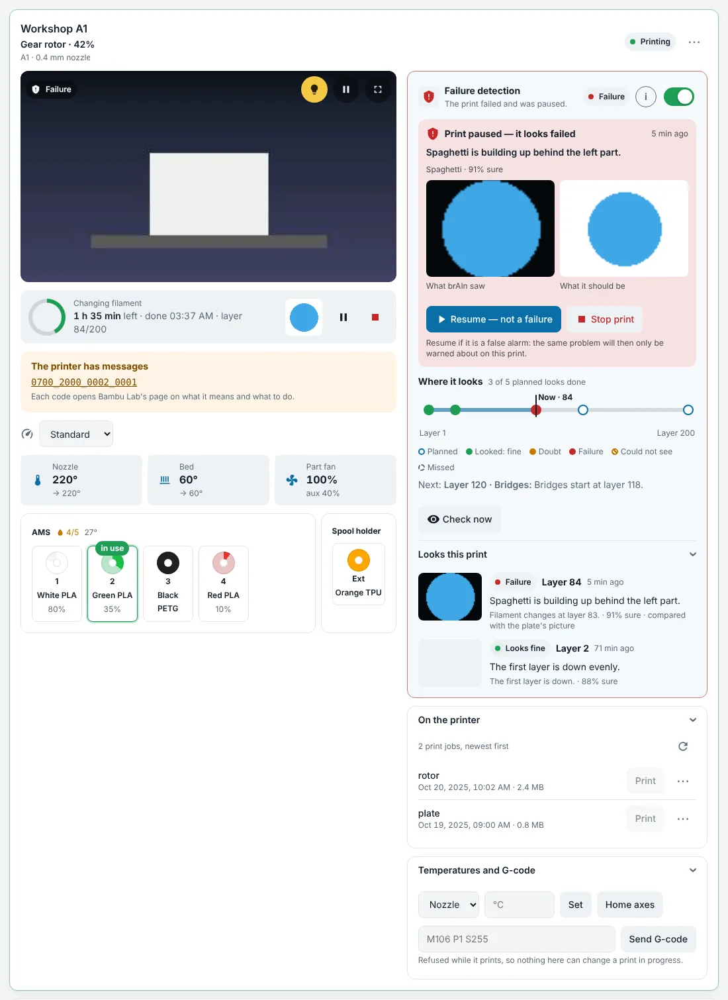
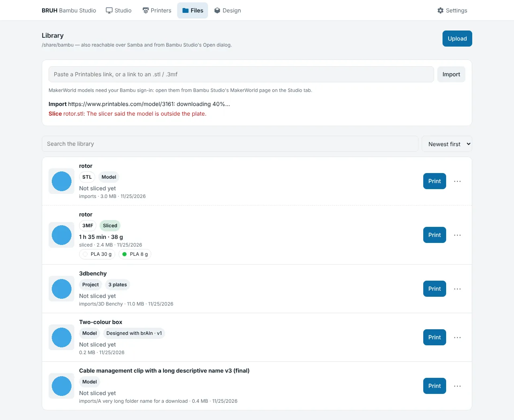
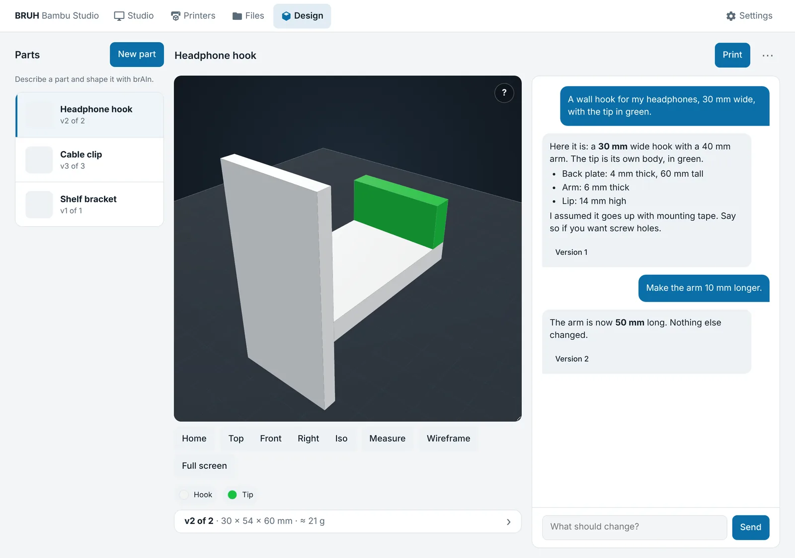

import { CardGrid, LinkCard, Aside } from '@astrojs/starlight/components';

<Aside type="caution" title="Experimental">
BRUH Bambu Studio works on the printers it has been tried on, but it is new. Keep Bambu
Handy or the printer's own screen within reach the first few times you start a print from
Home Assistant.
</Aside>

BRUH Bambu Studio puts Bambu Lab's own slicer in your Home Assistant sidebar and connects
your Bambu Lab printers to Home Assistant over your network. You slice, print, watch and
automate from one panel, and nothing goes through Bambu's cloud.

## What you can do

### Print

| You do | What happens |
|---|---|
| Drop an STL, STEP or 3MF into `/share/bambu`, or press **Upload** | It appears on the **Files** tab with a picture and a **Slice & print** button |
| Paste a Printables link and press **Import** | Every model file on the page lands in `/share/bambu/imports/` |
| Press **Slice & print**, pick the printer and the AMS tray | The model is sliced with Bambu Studio's own profiles for that printer, uploaded and started |
| Change layer height, walls, infill, supports, copies or the build plate in the dialog | The print uses them. Empty fields keep Bambu Studio's profile |
| Open the **Studio** tab | The real Bambu Studio, with a mouse on a computer or touch controls on a phone |

[Printing & Jobs →](/bruh-bambu-studio/printing/) · [The Studio →](/bruh-bambu-studio/studio/)

### Watch and control

| You do | What happens |
|---|---|
| Open the **Printers** tab, on a computer or a phone | Live camera, stage, progress ring, time left, finish time, temperatures and AMS trays |
| Press **Pause**, **Resume** or **Stop**, or change the speed | The printer does it. Stop takes two presses |
| Add the *BRUH Bambu printers* card to a dashboard | The same camera, progress and controls in Lovelace or Morph |
| Take the finished part off the plate | The card says *Ready* by itself, so an automation knows the next print can start |

### Catch failed prints

| You do | What happens |
|---|---|
| Switch on **Failure detection** on a printer | brAIn looks at the camera at the moments the print is most likely to fail |
| Nothing. A corner lifts and the part comes loose | The printer is paused and your phone gets the picture, with **Resume — not a failure** and **Stop print** on the notification |
| Leave the chamber dark or cover the lens | The card says it cannot see, and offers **Turn the light on** |

[Failure detection →](/bruh-bambu-studio/failure-detection/)

### Design parts with brAIn

| You say | What happens |
|---|---|
| *A wall hook for my headphones, 30 mm wide, with the tip in green.* | brAIn designs it and shows it in a 3D view, in the colours it will print in |
| *Make the arm 10 mm longer.* | A new version. The old one is kept |
| *Print two.* | brAIn picks the idle printer and the tray for each colour, says its plan and starts the print |

[Design with brAIn →](/bruh-bambu-studio/design/)

### Automate and ask

| You do | What happens |
|---|---|
| Trigger on `binary_sensor.<printer>_print_problem` | Flash a light, or anything else, when a print has a problem |
| Call `bruh_bambu.print_file` at 06:00 | A print starts on a schedule. A refusal says why in the automation trace |
| Ask a voice assistant *how long is left on the print?* | It reads the progress and time left |
| Say *design me a wall hook and print it* | brAIn designs it and prints it once it has built |

Voice has limits on purpose. It can start a print of a file and design a part. It cannot
stop a print, slice, send G-code, import a link or open Bambu Studio.

[Home Assistant →](/bruh-bambu-studio/home-assistant/) · [Voice & brAIn →](/bruh-bambu-studio/voice/)

## What you need

| | |
|---|---|
| **Home Assistant** | Home Assistant OS or Supervised, 2024.7.0 or newer |
| **Machine** | **amd64 (x86-64) only.** Bambu Lab publishes Bambu Studio for Linux only as an x86-64 AppImage, so it does not install on a Raspberry Pi or another ARM machine |
| **Download** | About 220 MB from Bambu Lab's GitHub releases on first start |
| **Printers** | One or more Bambu Lab printers Home Assistant can reach (X1, P1, A1 and A1 mini, P2S, H2 series), each with its **access code** |
| **Printer settings** | On recent firmware, **LAN-only mode** and **Developer mode** on |
| **Optional** | [brAIn](/brain/) with its Automation integration on, for the Design tab, brAIn's looks in failure detection, and chat and voice control |

<CardGrid>
  <LinkCard title="Quick Start" description="Install, restart once, add a printer, print." href="/bruh-bambu-studio/quickstart/" />
  <LinkCard title="Printing & Jobs" description="The library, imports, print options and the printer card." href="/bruh-bambu-studio/printing/" />
  <LinkCard title="Design with brAIn" description="Describe a part, measure it, change it, print it." href="/bruh-bambu-studio/design/" />
  <LinkCard title="Reference" description="Every option, port, folder and supported printer." href="/bruh-bambu-studio/reference/" />
</CardGrid>
