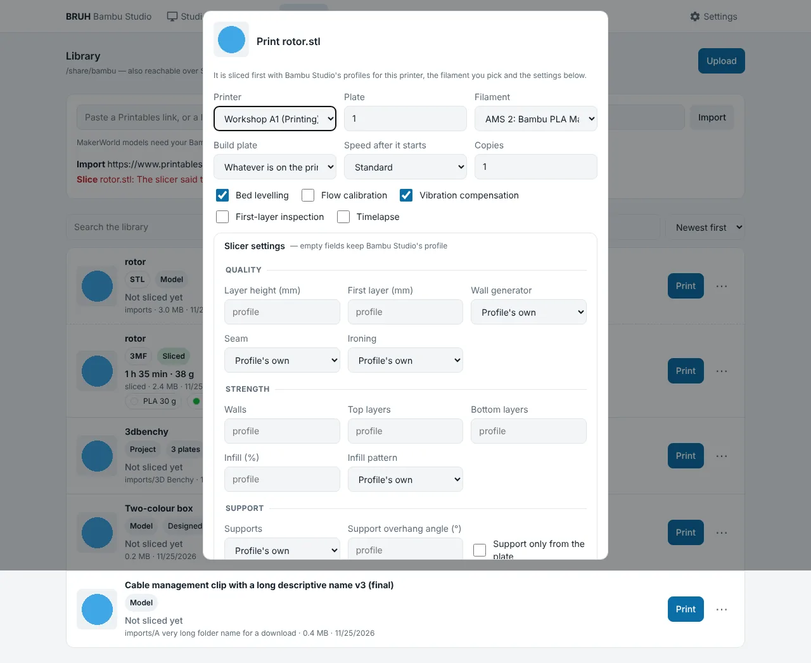

import { Aside, FileTree, Tabs, TabItem, Steps } from '@astrojs/starlight/components';
import phoneShot from './images/printers-phone.webp';

Print any model from the **Files** tab, then watch and control the printer from the
**Printers** tab. Every print is sliced in the app if it needs it, uploaded to the printer and
started over your network. Nothing goes through Bambu's cloud.

## Add models to the library

Models and print files live in `/share/bambu`.

| To add a model | Do this | It lands in |
|---|---|---|
| From your computer | Press **Upload** on the **Files** tab | `/share/bambu/` |
| Over the network | Copy it in over Samba or with the File Editor | `/share/bambu/` |
| From Bambu Studio | Save the project into the folder | `/share/bambu/` |
| From Printables | Paste the model page's link and press **Import** | `/share/bambu/imports/<model name>/`, every STL, 3MF and STEP on the page |
| From a direct link | Paste a link to an `.stl`, `.3mf`, `.step`, `.obj` or `.amf` and press **Import** | `/share/bambu/imports/` |

<Aside type="note" title="MakerWorld and Thingiverse">
**MakerWorld** only gives a model to a signed-in Bambu account. Open the
[Studio tab](/bruh-bambu-studio/studio/), sign in on Bambu Studio's MakerWorld page and open the
model there. **Thingiverse** only gives files to apps with a key, so paste the link of the STL
itself.
</Aside>

### Read the list

Each row shows a picture, the slice line (*1 h 35 min · 38 g*, or *Not sliced yet*) and one
button: **Print** for a sliced file, **Slice & print** for anything else. The row's **⋯**
holds **Slice**, **Open in Studio** and Delete.

- Search sits above the list. Sort by newest or by name.
- The same model kept as 3MF and STL sits together, each row labelled with its format.
- A file that has already been sliced remembers its slice, so printing it again does not
  slice twice.
- A part designed with brAIn is listed once, as its current version, with **Open design**
  instead of Delete.

The app's own working folders stay out of the list:

<FileTree>
- share/bambu/
  - Phone stand.3mf  a project you saved from Bambu Studio
  - cable-clip.stl  something you uploaded
  - imports/
    - Desk organiser/  every model file from one Printables page
  - sliced/  slices on the way to a print (hidden from Files)
  - designs/  every version of every part designed with brAIn (shown once each)
</FileTree>

## Print a file

<Steps>

1. Press **Slice & print** (or **Print**) on the file's row.
2. Choose the printer. For a bare model, choose the AMS tray or the external spool. With no
   tray chosen, the best match is used.
3. Change any [print option](#print-options), or leave them as the profile has them.
4. Press **Print**.

</Steps>

| The file is | How it is sliced |
|---|---|
| A **Bambu Studio project** (`.3mf` saved from Bambu Studio) | With the printer, process and filament settings saved in it |
| A **bare model** (an STL, a STEP, a 3MF from Printables) | With Bambu Studio's own profiles for that printer's model and the tray's material |
| **Already sliced** | Not at all. It prints as sliced. Asking for more than one copy slices it again |

A printer that is idle, finished or failed is ready, and the print starts straight away. A
printer that is printing or paused refuses, and says which.

<Aside type="tip">
Set each printer's **model** on **Settings › Printers**. The model picks the profile, so a
printer named "Shelf printer" that is an A1 slices for the A1's 256 mm bed. A profile that does
not say how big its bed is is refused.
</Aside>

### Slice without printing

**Slice** in a row's **⋯** slices a project and keeps the result. **Open in Studio** opens the
file in the sidebar's Bambu Studio.

### When a slice is changed or refused

- **Settings that Bambu Studio would reject are fixed first**, and you are told what changed.
  100% infill prints rectilinear. A spiral vase gets one wall, no infill, no top and no
  supports.
- **A refused slice says why in words**, such as *the process profile does not list this
  printer as compatible* or *part of the model is over the edge of the bed*.
- **Slicing does not touch the Studio tab.** On a machine short of memory the Studio window
  closes while the slice runs and opens again on the same file afterwards.

### Slice a bare model from a service

`bruh_bambu.slice_file` on a bare model needs a machine and a process profile, named the way
Bambu Studio lists them. `bruh_bambu.list_files` returns them under `profiles`. The machine may
also be one of your printers by name. **Print** and `bruh_bambu.print_file` choose the profiles
themselves.

When in doubt, open the model in Bambu Studio, set it up and save it as a project into
`/share/bambu`.

## Print options

The same options are offered everywhere: the **Print** dialog on the Files tab, **Manual
print** for a designed part, the `bruh_bambu.print_file` service, and brAIn in a conversation.

<Tabs>
<TabItem label="When it starts">

| Option | Choices |
|---|---|
| Build plate | auto (whatever is on it), textured PEI, smooth PEI, cool, engineering |
| Speed | silent, standard, sport, ludicrous |
| Bed levelling | on / off |
| Flow calibration | on / off |
| Vibration compensation | on / off |
| First-layer inspection | on / off (X1 lidar) |
| Timelapse | on / off |
| Copies | 1–50, arranged on the plate |

</TabItem>
<TabItem label="Slicer settings">

For a model sliced here. An empty field keeps Bambu Studio's profile for that printer and
filament.

- Layer height and first layer height
- Walls, top and bottom layers
- Infill density and its pattern, wall generator, seam
- Ironing
- Supports: type, overhang angle, from the plate only
- Brim and its width, skirt
- **Print order**: *by object* prints each part to the end before the next
- Prime tower, flush into infill or objects
- Spiral vase, fuzzy skin
- Nozzle temperature

</TabItem>
</Tabs>

Copies of anything that is not a Bambu Studio project are laid out on the plate before slicing.
A print-in-place part stays in one piece.

## Watch and control a printer

Each printer is one card on the **Printers** tab.

| Part of the card | What you see and do |
|---|---|
| **Header** | The state (*Printing*, *Finished*, *Ready*) and the file with its progress, or the last print and how long ago it ended |
| **Camera** | The printer's own camera, live while somebody is looking. Buttons switch the chamber light, pause the camera and go full screen |
| **The print** | Stage (levelling, heating, changing filament…), progress ring, time left, finish time, layer and the job's picture. **Pause** / **Resume**, **Stop** (press twice) and the speed |
| **Printer messages** | Each HMS code links to Bambu Lab's page about it |
| **Readings** | Nozzle, bed and chamber temperatures and the fans |
| **AMS** | Each tray as a spool with its colour and material (*White PLA*), its name and how much is left, the tray *in use*, the humidity (4 or 5 of 5 is worth drying) and the spool on the holder. Press a tray to read its tag again |
| **Failure detection** | See [Failure detection](/bruh-bambu-studio/failure-detection/) |
| **On the printer** | The print jobs on the printer's own storage, newest first, to print again or delete from **⋯**. The first eight show, the rest are behind **Show all** |
| **Temperatures and G-code** | Set a nozzle or bed temperature, home the axes, or send up to 32 lines of G-code. Refused while printing |
| **⋯** | **Refresh** (a full report, useful after changing a spool), **Reconnect** and **Remove printer** |

- **A finished print stays on the card until the part is off the plate.** The app
  [notices the cleared plate](/bruh-bambu-studio/failure-detection/#plate-clear) by itself, or
  press **Plate is clear**. The printer then says *Ready*.
- **An X1, P2S or H2 camera needs LAN mode live view** switched on in the printer's settings.
  The card says so when it is off.
- **An A1's AMS Lite shows no humidity**, because it has no sensor.

On a phone the card stacks into one column:

## Change settings

The panel's **Settings** tab holds everything you set once.

| Section | What it holds |
|---|---|
| **Printers** | The printers added, **Find printers** and *Add a printer by hand* |
| **Print failure detection** | Where alerts go and each printer's [detection settings](/bruh-bambu-studio/failure-detection/#settings) |
| **brAIn** | The models and your [standing instructions](/bruh-bambu-studio/design/#standing-instructions) |
| **3D view** | *Invert vertical drag* |
| **Home Assistant** | Whether the integration is set up, the restart when one is owed, and how to add the dashboard cards |
