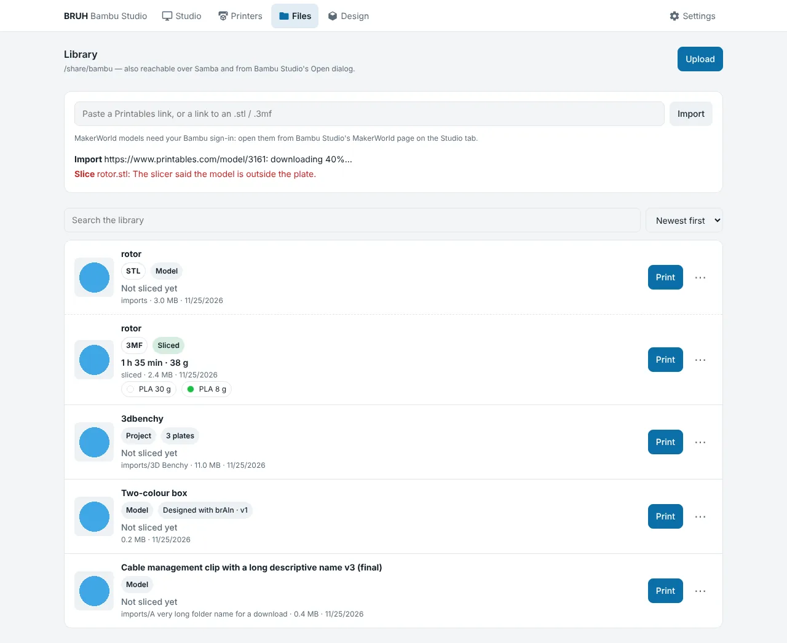

import { Aside, FileTree, Tabs, TabItem } from '@astrojs/starlight/components';
import phoneShot from './images/printers-phone.webp';

Every print, whoever starts it — the **Files** tab, a designed part, an automation, brAIn — is
the same job: **slice** (only if the file is not sliced yet), **upload** to the printer over
FTPS, and **start** over MQTT. Nothing goes through Bambu's cloud.

## The library: `/share/bambu`

Models and print files live in **`/share/bambu`**, so you can reach them over Samba, from the
File Editor, from the panel's **Files** tab, and from Bambu Studio's own Open dialog.

<FileTree>
- share/bambu/
  - Phone stand.3mf  a project you saved from Bambu Studio
  - cable-clip.stl  something you uploaded
  - imports/
    - Desk organiser/  every model file from one Printables page
  - sliced/  the add-on's own slices on the way to a print (hidden from Files)
  - designs/  every version of every part designed with brAIn (shown once each)
</FileTree>

The **Files** tab lists what *you* brought in: uploads, imports, and what you save from Bambu
Studio into the folder. The add-on's own working files stay out of it. A designed part is
listed once, as its current version, with **Open design** instead of Delete.

Every row has the same lines, so **Print** is always in the same place:

- a picture — a sliced 3MF's own plate picture, or a drawing of an STL, STEP or plain 3MF made
  once and kept;
- the slice line — the print time and filament weight (*1 h 30 min · 31 g*) when it has a
  slice, or *Not sliced yet*;
- **Print**, and a **⋯** with **Slice**, **Open in Studio** and Delete.

A file that already has a slice in `sliced/` names it, so printing it again needs no second
slice. The same model kept as 3MF and STL sits together, each row labelled with its format.
Search sits above the list, and it sorts by newest or by name.

### Importing from a link

Paste a link into the box at the top of the **Files** tab and press **Import**:

- a **Printables** model page brings every model file on it (STL, 3MF, STEP) into
  `/share/bambu/imports/<model name>/`;
- a link straight to an `.stl`, `.3mf`, `.step`, `.obj` or `.amf` file downloads that file
  into `/share/bambu/imports/`.

<Aside type="note" title="MakerWorld and Thingiverse">
**MakerWorld** (what Bambu Handy shares) only gives a model to a signed-in Bambu account, so
the add-on cannot fetch it for you. Open the [Studio tab](/bruh-bambu-studio/studio/), sign in
on Bambu Studio's MakerWorld page, and open the model there — it goes straight into the slicer.
**Thingiverse** only gives files to apps with a key; paste the link of the STL itself instead.
</Aside>

## Printing a file

Press **Print** on a row:

- **A Bambu Studio project** (`.3mf` saved from Bambu Studio) carries its printer, process and
  filament settings, so a project that is not sliced yet is sliced first with the settings
  saved in it — exactly as the app would.
- **A bare model** — an STL, a STEP, a 3MF from Printables — carries none, so it is sliced with
  **Bambu Studio's own profiles for that printer**, and you pick the AMS tray (or the external
  spool) it prints from. With no tray chosen, the best-matching one is used.
- **An already sliced file** prints as it was sliced. Asking for more than one copy slices it
  again.

Two more buttons sit in each row's **⋯**: **Slice** slices a project without printing, and
**Open in Studio** opens it in the sidebar's Bambu Studio.

A printer that is idle, finished or failed is taken to be ready, and a print starts on it
straight away. A printer that is printing or paused is refused, and the refusal says which.

<Aside type="tip">
Set each printer's **model** on the Printers tab. It picks the profile — so a printer you
named "Shelf printer" that is an A1 slices for the A1's 256 mm bed. A profile that does not
say how big its bed is is refused rather than sliced for a bed of the wrong size.
</Aside>

### Slicing without the window

Slicing runs through **Bambu Studio's own command line**, in the add-on, with its own settings
folder — it never disturbs the Bambu Studio window open in the sidebar. On a machine short of
memory, the window is closed while the slice runs and opens again, on the same file, when it
ends; the Studio tab says so meanwhile.

Before every slice the settings are checked against Bambu Studio's own rules and fixed where
they disagree (100% infill prints rectilinear; a spiral vase gets one wall, no infill, no top
and no supports), and you are told what was changed. When Bambu Studio refuses anyway, you get
its own error lines and its exit code in plain words — *the process profile does not list this
printer as compatible*, *part of the model is over the edge of the bed* — instead of a number.

Slicing a bare model by name from a service needs a machine and process profile named the way
Bambu Studio lists them (`bruh_bambu.list_files` returns them under `profiles`); the machine
may also be one of your printers by its name. **Print** and `bruh_bambu.print_file` don't need
this — they choose the profiles themselves from the printer's model and the tray's material.
When in doubt, open the model in Bambu Studio, set it up, and save it as a project into
`/share/bambu`.

## Print options

Every way of printing offers the same options, from one list: the **Print** dialog on the Files
tab, **Manual print** for a designed part, the `bruh_bambu.print_file` service, and brAIn in the
conversation.

<Tabs>
<TabItem label="When it starts">

| Option | Choices |
|---|---|
| Build plate | auto (whatever is on it), textured PEI, smooth PEI, cool, engineering |
| Speed | silent, standard, sport, ludicrous |
| Bed levelling | on / off |
| Flow calibration | on / off |
| Vibration compensation | on / off |
| First-layer inspection | on / off (X1 lidar) |
| Timelapse | on / off |
| Copies | 1–50, arranged on the plate |

</TabItem>
<TabItem label="Slicer settings">

For a model sliced here. An empty field keeps Bambu Studio's own profile for that printer and
filament.

- Layer height and first layer height
- Walls, top and bottom layers
- Infill density and its pattern, wall generator, seam
- Ironing
- Supports — type, overhang angle, from the plate only
- Brim and its width, skirt
- **Print order** — *by object* prints each part to the end before the next
- Prime tower, flush into infill or objects
- Spiral vase, fuzzy skin
- Nozzle temperature

</TabItem>
</Tabs>

Copies of anything that is not a Bambu Studio project are laid out on the plate before slicing
and arranged by Bambu Studio; a print-in-place part stays in one piece.

## The Printers tab

Each printer is one card, laid out by what matters now.

**The header** carries the printer's state in the same words as the dashboard card —
*Printing*, *Finished*, *Ready* — and, under the name, the file with its progress or *finished
2 h ago*.

**The camera.** The printer's own camera, over your network. A P1 or A1 sends pictures on port
6000; an X1, P2S or H2 streams RTSPS on port 322, and only with **LAN mode live view** switched
on in the printer's own settings (the card says so when it is off). The camera runs while
somebody is looking and stops a little after. Buttons on the picture switch the chamber light,
pause the camera, and go full screen.

**The print.** The stage (levelling, heating, changing filament…), a progress ring, the time
left and the clock time it finishes, the layer, and the picture of the job when it was sent from
here. **Pause** / **Resume** and **Stop** (press twice) beside it, and the speed under it.

**A finished print** stays on the card until its part is off the plate. The add-on notices the
plate being cleared by itself (see [Plate clear](/bruh-bambu-studio/failure-detection/#plate-clear)),
or press **Plate is clear**. The printer then says *Ready*.

**Readings.** Nozzle, bed and chamber temperatures and the fans. Temperatures and G-code (up to
32 lines, refused while printing) are in their own fold.

**AMS.** Every tray as a spool showing its colour and material (*White PLA*), its name and how
much is left when the printer reports it, the tray feeding the nozzle marked *in use*, the AMS
humidity (4 or 5 of 5 is worth drying), and the spool on the holder. Press a tray to have the
AMS read its tag again. An A1's AMS Lite is open to the room and has no humidity sensor, so none
is shown.

**⋯** holds **Refresh** (asks the printer for a full report — useful after changing a spool),
**Reconnect** (drops the connection and opens a new one) and **Remove printer**.

**Printer messages.** Each HMS code links to Bambu Lab's page about it.

**On the printer** lists the print jobs on the printer's own storage, newest first, with their
size and date, to print again or (from **⋯**) delete. The first eight show; the rest are behind
**Show all**.

On a phone the card stacks into one column:

**Failure detection** has its own box on the card — see
[Failure detection](/bruh-bambu-studio/failure-detection/).

## Settings

The **Settings** tab keeps everything you set once out of the way of the printers:

- **Printers** — the printers added, **Find printers** and *Add a printer by hand*.
- **Print failure detection** — where alerts go and, for each printer, its detection settings.
- **brAIn** — the models and your standing instructions (see
  [Design with brAIn](/bruh-bambu-studio/design/#standing-instructions)).
- **3D view** — *Invert vertical drag*.
- **Home Assistant** — whether the integration is set up, the restart when one is owed, and how
  to add the dashboard cards.
