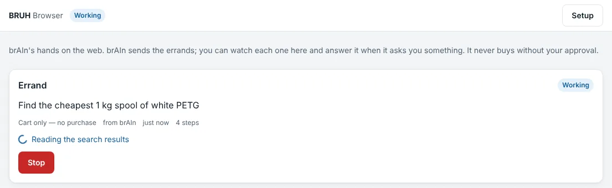
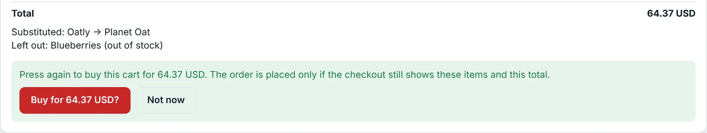

import { Aside } from '@astrojs/starlight/components';

Ask brAIn for something on a website, watch the errand run in the sidebar, answer it when it
needs you, and approve a cart before anything is bought.

## Run an errand

Ask brAIn in chat, in the terminal or by voice:

> *"Add my usual Walmart order plus oat milk."*
> *"Find the cheapest 1 kg spool of white PETG."*

The **Browser** page shows the errand above the live browser: what it is doing now, how many
steps it has taken, and its report and cart when it finishes. Press **Stop this errand** to
end it at any time. Nothing already in a cart is removed.

An errand does not ask permission for ordinary steps such as searching, opening pages and
filling the cart.

| Limit | What happens |
|---|---|
| One errand runs at a time | Up to **three** wait behind it. A fourth is refused with a sentence. |
| **Most steps per errand** (80 by default) | The errand stops and asks whether to carry on. |
| **Longest errand** (30 minutes by default) | The errand is stopped and reported. |
| The app stopped mid-errand | The errand is marked failed on the next start. It is never re-run unasked. |
| History | The last 40 errands are kept under **Recent errands**. |

## Answer it when it needs you

The errand stops, says what it needs, and gives you a way to answer.

| It needs | You do |
|---|---|
| **A choice**: two products that fit, a substitute, a delivery slot | Press the option, or type what it should do instead. A yes-or-no question has **Yes** and **No**. |
| **Something in the browser**: a login, a CAPTCHA, a "verify it's you" code, a pop-up | Do it in the live browser on the page, then press **I've done it, carry on**. |
| **The Claude extension is asking** for permission in its side panel | Open the side panel and allow it. The page says how (setup step 4). |

| Where you answer | What is allowed |
|---|---|
| The page | Everything |
| brAIn's chat or terminal (*"tell it to use the frozen ones"*) | Choices. Not logins, CAPTCHAs or codes. A person does those in the browser. |
| Voice | Only a choice that doesn't change what you spend. A question about money, or an answer that mentions paying, ordering, a price or a total, is refused. |

## Review the cart and buy

When the cart is ready, the page shows the **store**, **every item** with its quantity and
price, the **fees**, the **delivery slot**, the **total**, and anything **substituted** or
**left out**.

You have three ways to end it:

- **Say *"buy it"* to brAIn**, in chat or the terminal. brAIn shows its approval card with
  the store, items and total. Approve it and the order is placed.
- **Press Buy this** on the page. It asks once more with the total. Press again to place
  the order.

  

- **Press Don't buy.** That cart can **never** be bought, on the page or through brAIn.

Either way the order is placed by a **second errand**. It re-reads the checkout and buys
only if it still matches what you approved. If a price, a fee or an item changed, it stops
and tells you.

<Aside type="caution" title="A purchase is always asked about">
brAIn's approval card for a purchase is the one rule its YOLO mode does not lift. A purchase
is asked about in chat or the terminal, and refused everywhere else: insight runs, checks
and voice.
</Aside>

### The spending gate

A purchase errand is refused unless its approval passes every check, every time.

| Check | Rule |
|---|---|
| The cart | A **cart errand of this app** that finished with items and a total |
| Age | The cart finished **under 30 minutes ago** |
| Once | The cart has **never been approved before** |
| Total | The approved total **matches to the cent**, or within **Price change allowed at purchase** (0% by default) |
| Declined | You have not pressed **Don't buy** on it |
| Browser | It runs in **this app's own Chrome**. Nothing is bought on another computer. |

The purchase errand's instructions are built from that cart, not from anyone's words. They
name the items and the most it may cost.

<Aside type="note" title="The spending guard is a net, not a guarantee">
Every errand also runs with a check that refuses a click on anything labelled "Place order",
"Buy now", "Pay" and the like when the errand has no approved purchase. A site can label its
button any way it likes, so this guard is the second line. The first is that no errand is
told it may buy without your yes.
</Aside>

## What it will not do

- Place an order **without your approval**.
- Type or reveal a **password** or **card number**.
- Change **account, address or payment** settings.
- Accept new **terms, subscriptions, memberships or trials**.
- Add a **tip** or a **protection plan** nobody asked for.
- Follow **instructions written on a web page**. Page text is content, never orders.
- Run JavaScript in a signed-in page, or upload files.

## Teach it what you usually buy

Ask brAIn: *"Look at my old Walmart orders and learn what I usually buy."* An
**order-history errand** reads the store's order history and saves a profile for that store.

| The profile holds | |
|---|---|
| **Items** | The name as the store shows it, size, usual quantity, how often, when last bought |
| **Brands you prefer** | |
| **Things to avoid** | When your history shows them |

| You do | What happens |
|---|---|
| *"Add my usual Walmart order."* | The cart errand starts from your Walmart profile first and the store's buy-again list second. brAIn tells you what it knows and asks what changed before it starts. |
| *"Add my usual"*, with no store | brAIn asks first (*"your usual Walmart order?"*) and uses the profile only if you say yes. |
| Run another order-history errand | It adds to the profile and updates what changed. |
| Press **Remove** beside an item, brand or thing to avoid | It stays out, even when the next order-history errand sees it again. |
| Press **Clear profile** twice | The whole store is forgotten. |

Rules the profile follows:

- **Only an order-history errand saves one.** An ordinary shopping errand never changes it,
  and nothing in it is guessed.
- **One store's profile never reaches another store's errand.** "My usual from Costco" never
  gets your Walmart one.
- **Only you can remove or clear**, on the page.
- **It is never an approval.** A profile is handed to an errand as a list of things you have
  bought before. Nothing in a product name can read as permission to buy.
- **It is in Home Assistant backups**, like your errand history. It holds what you buy, not
  passwords. It goes nowhere except into a later errand for that store, and to brAIn when it
  asks.

## Choose which browser runs an errand

Your Claude account may have the Claude extension in more than one Chrome: this app's, and
perhaps the one on your laptop. The page lists them under **Browsers this account has
connected**.

| Situation | What happens |
|---|---|
| You haven't chosen | Errands use this app's own Chrome. |
| You press **Use by default** on another, or tell brAIn to use another for an errand | That errand runs there. The extension on that computer keeps asking its own person before it acts, and **nothing is ever bought there**. |
| More than one is connected and you haven't said | brAIn asks which, can remember your answer as the default, and says which browser it used. |
| This app's Chrome isn't connected, or the page can't tell which is its own | The errand stops and asks which to use. It never quietly falls back to another computer. Press **This is the BRUH Browser** on the right one. |

## Options

| Option | Default | What it does |
|---|---|---|
| **Claude model** (`model`) | `sonnet` | The model an errand runs on: `sonnet`, `opus` or `haiku`. Sonnet handles the many small steps of a shopping errand quickly. Opus is slower and uses more of your plan. Haiku slips more on busy shop pages. |
| **Most steps per errand** (`max_turns`) | `80` | 10–300. How many steps one errand may take before it stops and asks you to continue. A weekly grocery order is often 40 to 80. |
| **Longest errand** (`task_timeout_minutes`) | `30` | 5–180 minutes. An errand still running after this long is stopped and reported. |
| **Price change allowed at purchase** (`purchase_tolerance_percent`) | `0` | 0–20%. How far an approved cart's total may move before the order is placed. 0 means exactly the approved total. Beyond the limit the errand stops and tells you. |
| **Screen size** (`screen_resolution`) | `1366x900` | The virtual screen Chrome draws on. |
| **Log level** (`log_level`) | `info` | How much the app writes to its log. |

## Privacy and security

| | |
|---|---|
| **What leaves the house** | Errands use your Claude plan and send the pages the browser reads to Anthropic, as Claude in Chrome always does. |
| **The browser profile** | Holds your shop sessions and both Claude sign-ins. It is **left out of Home Assistant backups** on purpose. After restoring a backup, sign in again. |
| **Who can see the browser** | Admins, through Home Assistant's sidebar and nothing else. |
| **What brAIn can reach** | Only the errand API, with a token this app writes to `/config/.bruh_browser/api_token`. **Buy this**, **Don't buy**, **I've done it** and **This is the BRUH Browser** are pressed only on the page. |
| **Chrome's sandbox** | Chrome runs without its own sandbox when the container can't give it one, which is normal for an app. The container, an unprivileged user and the AppArmor profile are then the boundary. The setup card says which is in force. |
| **Chrome policy** | Remote debugging is off, browser sync and browser sign-in are disabled, and the extension is force-installed. |

## brAIn's tools

brAIn lists these only when this app is installed.

| Tool | What it does | Who may use it |
|---|---|---|
| `browser_task` | Start an errand, optionally in a named browser, optionally an order-history errand. It never buys. | Chat, terminal, voice |
| `browser_status` | How it went, the cart, the question it is waiting on. With `browsers`, the connected browsers. With `profiles`, your shopping profiles. A long report comes back whole, or in parts with an `offset`. | Everyone, including unattended runs |
| `browser_answer` | Pass on your answer to its question. | Chat, terminal. Voice only for a choice that isn't about money. |
| `browser_stop` | Stop an errand. | Chat, terminal |
| `browser_purchase` | Buy a cart you approved, always behind brAIn's approval card. | Chat and terminal only, always asked |

Everything a web page said (the report, questions, item names) reaches brAIn marked as
untrusted.

brAIn's `sensor.bruh_browser_status` says what the last errand was (a shopping cart, a
purchase, order history, a setup test), the store, and one sentence about how it ended. It
never holds item names, the total, or anything the errand read.

## Troubleshooting

Every failure ends an errand with a sentence on the page and in `browser_status`. Where a
setup step is to blame, there is a **Show setup step N** button.

| Symptom | What to do |
|---|---|
| "Browser extension is not connected" | Redo setup steps 1 and 2: the extension installed, and signed in to claude.ai. |
| No Chrome tools in the run | Step 3: Claude Code isn't signed in with a paid plan, or an API key is set, which keeps Chrome off. |
| "The extension is waiting for someone to allow it" | Step 4: open the extension's side panel in the live browser, answer **Allow**, and keep allowing the site. Then run the Test. |
| It asks which browser to use | This app's Chrome isn't connected, or it can't tell which is its own. Press **This is the BRUH Browser** on the right one under **Browsers this account has connected**. |
| Shops signed out after a restore | The browser profile isn't in backups, on purpose. Sign in again. |
| An errand stopped at a sign-in | It never types passwords. Sign in in the live browser and press **I've done it, carry on**. |

<Aside type="caution" title="What hasn't been proven on a real house yet">
The app was driven against a stand-in for Claude Code, not a real extension. The parts most
likely to need a fix on first contact are: Claude Code's print mode driving a Chrome on a
virtual screen in a container, the extension connecting from a container, the extension
honouring "act without asking" from a script, and brAIn's approval card appearing for a
purchase in every chat mode. None of them fails silently. If brAIn's approval can't be
shown, a purchase is refused, not made.
</Aside>
