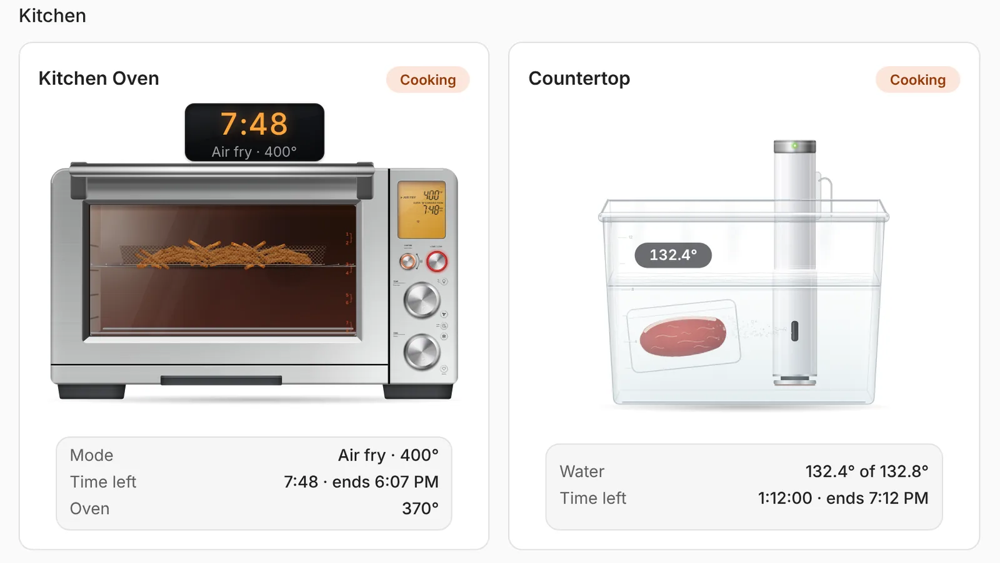
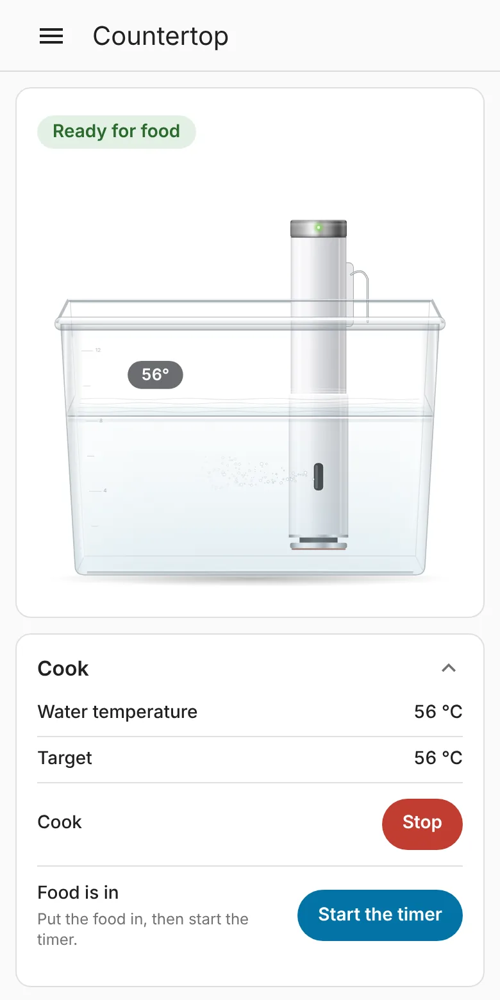
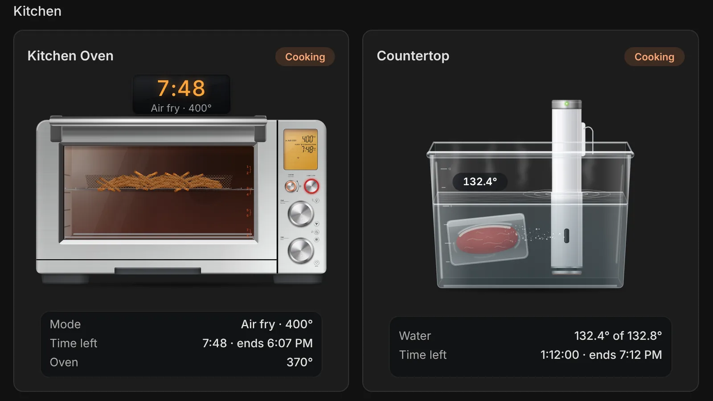

import { Aside, Card, CardGrid } from '@astrojs/starlight/components';

## The sidebar panel

**BRUH Cooking** in the sidebar shows each appliance as a drawing of the real thing, with
what it is doing.

- **Overview** — a card for each appliance, grouped by area, with its status, the oven's
  display, and the temperature and time left. With only one appliance, the panel opens
  straight to it.
- **Drawings** — drawn from measurements of Breville's own photos. The Joule is clipped in
  a clear container of water, which circulates while it cooks, steams as it warms, and
  holds the bag of food once it's in. The oven shows its display as the real one does, the
  rack at the mode's position with the mode's accessory, the food while it cooks, the
  elements glowing as the mode uses them, and the fan turning. Its finish, brushed or
  black stainless, comes from the appliance.
- **Full view** — everything the entities offer: Start, Stop and Continue, the settings for
  the next cook, a chart of the cook's temperature against its target, and the
  appliance's details.
- **Presets** — built-in sous vide and oven presets fill in the settings; **Start** starts
  the cook. Administrators can save the current settings as a preset, and rename, update
  or delete saved ones. Saved presets are shared with everyone.
- **Screen readers** — every drawing is described in words, changes such as "ready for
  food" and "done" are announced, and everything works from the keyboard.

Anyone who can use Home Assistant can use the panel, as they can the appliance's
entities, and the same rules apply: untested appliances are monitor-only unless you allow
control, a running oven cook can't be changed, and **Stop always works**.

The panel works on a phone and follows your Home Assistant theme.

<CardGrid>
  <Card title="Light">

  </Card>
  <Card title="Phone, ready for food">

  </Card>
</CardGrid>

## brAIn and voice

brAIn reaches the appliances through two tools, listed only while the `bruh_cooking`
integration is in Home Assistant:

- **`cooking_status`** — what each appliance is doing (state, temperature, time left, the
  oven's mode and door, an error), what its **next cook** would be, in words, and with
  `presets: true`, the presets each one can cook.
- **`cooking_control`** — `start` (an appliance by name, a preset, and any of temperature,
  minutes, mode, convection, level, keep warm and start timer automatically), `stop`, and
  `continue` (the food is in, or out).

So all of these work in brAIn's chat and terminal, and by voice:

> *"Start the Joule for chicken breast."*
> *"Set the oven to air fry at 400 for 20 minutes."*
> *"Is the water ready?"*
> *"How long is left on the oven?"*
> *"The food's in."*
> *"Stop the oven."*

When brAIn doesn't say which appliance and there's more than one, it is asked which; a name
it doesn't recognise is refused with the names there are. A start over a running cook is
refused rather than replacing it.

**brAIn's rules for changing the house apply.** An unattended brAIn run — an insight card, a
check — can read the appliances but never starts, stops or continues one, and in chat a
start or a stop passes brAIn's [action gate](/brain/safety/) like any other change. **Voice
may read, start, stop and continue**: starting a cook remotely is what this add-on is for,
and the appliances themselves are the last check.

If Home Assistant is still running an older copy of the integration after an update,
`cooking_status` says a restart is owed, and so does Repairs.

## Presets

The built-in presets follow published guidance: **USDA FSIS**, the **FDA Food Code** and
**Douglas Baldwin's** sous vide tables.

| Sous vide | Oven |
|---|---|
| Steak — rare, medium-rare, medium, well done | Frozen fries, chicken wings |
| Beef roast, short ribs | Frozen pizza, fresh pizza |
| Pork chop, pulled pork | Roast vegetables, roast chicken |
| Chicken breast, chicken thighs | Cookies, cake |
| Salmon, white fish, shrimp | Leftovers, salmon fillets |
| Soft eggs, vegetables | Dried fruit, bread dough, pot roast |

Each preset carries a one-line note on the doneness or food it is for. In a Fahrenheit
house a sous vide preset cooks **the whole degree it shows** — 56 °C is shown and cooked as
133 °F (and sent to the Joule as 56.1 °C) — on the panel, in the cook, and in what brAIn
reads. Saved presets keep the nearest half degree.

<Aside type="caution" title="Presets are a starting point">
Times assume pieces about 1 in (25 mm) thick; thicker ones need longer. Sous vide cooks some
foods below the USDA's minimum temperatures and holds them there long enough instead, and
not every preset pasteurizes: the steak presets don't, and the salmon, white fish and shrimp
presets need seafood that's safe to eat raw. Follow a trusted cooking guide, especially when
cooking for anyone who is pregnant, very young, older or has a weakened immune system.
</Aside>

## A sous vide cook, step by step

1. Set **Target temperature** and **Cook time** (0 holds the temperature until you stop
   it), then turn on **Cook**. Status changes to *Preheating*.
2. At temperature, Status changes to *Ready for food*. Put the food in and press
   **Continue** to start the timer. With **Start timer automatically** on, the timer starts
   without waiting for Continue.
3. While the food cooks, **Time remaining** counts down and **Cook end** shows when it will
   finish. On a sous vide, changing Target temperature or Cook time changes the running
   cook.
4. When the timer ends, Status changes to *Done*. Take the food out and press
   **Continue**, or turn off **Cook**.

## An oven cook

- **Choose a mode** — Bake, Air fry, Roast, Broil, Pizza, Cookies, Reheat, Slow cook, Proof,
  Warm, Dehydrate, Bottom bake, Bottom broil, Outer broil, Middle top broil. Choosing one
  resets the other settings to that mode's defaults. Broil and slow cook use **Level**
  instead of a temperature; Pizza, Cookies and Reheat offer **Frozen food**.
- **After a remote start, press Start on the oven.** Until then Status reads *Press the
  button on the appliance*.
- **Preheating** ends when the oven decides: its sensor within 15 °C (27 °F) of the
  temperature it holds, or after 5 minutes, whichever comes first — from a cold start
  usually the 5 minutes, so Status can read *Ready for food* while Temperature still reads
  low. **Preheat** counts the 5 minutes too and never goes back during a preheat.
- If the timer doesn't start by itself, press **Continue** once Status reads *Ready for
  food*. (Pressing Start on the oven at that point cancels the cook.)
- **A running oven cook can't be changed** — as in the Breville+ app. Its settings show the
  running cook, even one started on the oven itself.
- **When the timer runs out** the oven turns itself off: Status reads *Done* and Cooking
  turns off, but the cook stays open, so **Cook** stays on. Turn it off to close it.
- **Keep warm** holds the food at 160 °F (70 °C) for an hour after the timer; Status reads
  *Keeping warm* and Time remaining counts down the hour.
- While it cooks, the oven's Temperature reads **lower than its target**: the oven holds
  its own sensor below the setpoint — about 320 °F (160 °C) for a 350 °F bake.

## Where a cook's settings came from

Every cook says where its settings came from — a named preset (", changed at the start" when
other settings were given beside it), the preset the panel last applied, *the cook settings
in Home Assistant*, or *started on the appliance or in the app*. It's on the Status sensor's
last-cook attributes and in what brAIn reads.

Settings for the next cook are kept in Home Assistant, survive restarts, and go to the
appliance only when a cook starts; changing settings in the Breville+ app doesn't change
them here. The next cook is described in words ("No timer: heats the water to 140 °F and
holds it there until you stop it"), with a separate *Tip* listing the presets at that
temperature.

## When an appliance is offline

- **It says why**, from what is observed: Breville refusing the sign-in, the cloud
  connection down, or the connection fine while the appliance reports offline — each with
  **one thing to try**.
- **It says since when**, from when it was last heard from ("Offline since 16:04, when it
  was last heard from"), and for one never heard from, "Never heard from since BRUH Cooking
  started at 14:05".
- **Readings keep their last value, marked as old** (`stale: true`, `as_of`), so they aren't
  mistaken for broken entities; **controls go unavailable**, because they can't be used.
- After **10 minutes** out of contact, the **Problem** sensor turns on with `cause:
  offline`, the reason and what to try. An appliance you keep unplugged between cooks will
  show Problem on while it is unplugged.
- Losing contact doesn't end a cook, and contact coming back doesn't start a new one.

## Safety

Cooks start remotely, with nobody nearby.

- Only start a sous vide when it's **in water**, and an oven only when there's **nothing
  inside that shouldn't be heated**.
- For a delayed start, don't leave raw food sitting in unheated water.
- **UL-certified Joules** (North America) wait for a press of their top button before cooks
  above 85 °C, and the **Joule Oven** waits for a press of Start before it heats.
- **Stop always works**, from every path, even on an appliance that is monitor-only.
- Untested models (the Joule Turbo) are **monitor-only** until you allow control in the
  integration's options.
