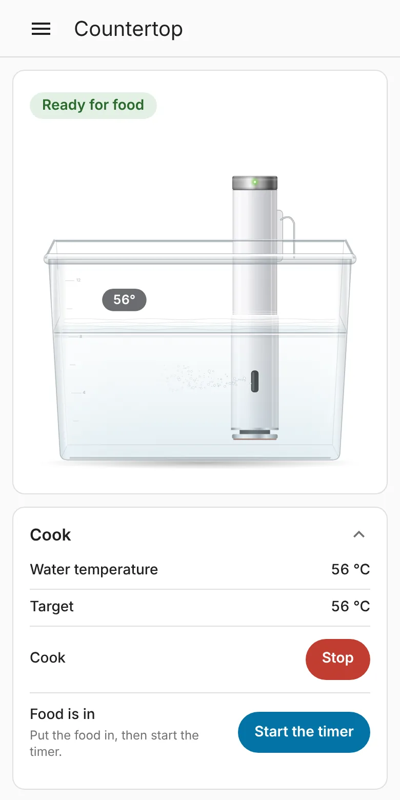

import { Steps, Aside } from '@astrojs/starlight/components';

Install the app, add your Breville+ or Sage account, and start a first cook by voice or
from the panel.

## Before you start

<Aside type="caution" title="brAIn first">
BRUH Cooking **won't start without brAIn**. If you haven't installed it yet, follow
[brAIn's Quick Start](/brain/quickstart/) first.
</Aside>

You also need Home Assistant 2026.2 or newer, your Breville+ or Sage account (without
multi-factor authentication), and the appliance on Wi-Fi.

## Install

<Steps>

1. **Add the repository.** If you installed brAIn, it is already there. Otherwise go to
   **Settings → Add-ons → Add-on Store → ⋮ → Repositories** and add:

   ```text title="Repository URL"
   https://github.com/bruhautomation/BRUH-HA-Apps
   ```

2. **Install BRUH Cooking** and press **Start**. It finds brAIn and deploys the
   `bruh_cooking` integration. The app has no page of its own. The panel comes with the
   integration.

3. **Restart Home Assistant once** (**Settings → System → Restart**), so it loads the
   integration.

4. **Add your account.** Go to **Settings → Devices & services**. BRUH Cooking is under
   *Discovered*. Press **Add**, log in with your email and password, and choose your brand:
   **Sage** in the UK, Europe and the UAE, **Breville** elsewhere.

</Steps>

Each supported appliance on the account becomes a device, named as in the app, and
**BRUH Cooking** appears in the sidebar.

Your password is only sent to Breville. Home Assistant keeps a login session, not the
password, and asks you to log in again if the session expires. To add another account, add
the integration again.

## Your first cook

<Steps>

1. **Put the Joule in water**, or check the oven is empty and ready.

2. **Ask brAIn**: *"Heat the Joule for a medium-rare steak."* brAIn starts the preset and
   tells you what it started.

   Or open **BRUH Cooking** in the sidebar, choose the preset under **Presets**, and press
   **Start**.

3. **Watch it preheat.** Status reads *Preheating*. At temperature it reads *Ready for
   food*.

4. **Add the food and continue.** Press **Start the timer** on the panel, press the
   **Continue** button entity, or tell brAIn *"the food is in"*. **Time remaining** counts
   down.

   

5. When the timer ends, Status reads *Done*. Take the food out and press **Continue**, or
   stop the cook.

</Steps>

<Aside type="note" title="The oven waits for you">
After a remote start, the Joule Oven waits for you to press **Start** on its own panel
before it heats, as it does when you start a cook from the Breville+ app. Until then, Status
reads *Press the button on the appliance*.
</Aside>

## Next

- [Cooking with it](/bruh-cooking/guide/): brAIn and voice, the panel, presets, how a sous
  vide and an oven cook run, and safety.
- [Entities & services](/bruh-cooking/reference/): every entity, `start_cook` and the
  services brAIn calls, options, automations and troubleshooting.
