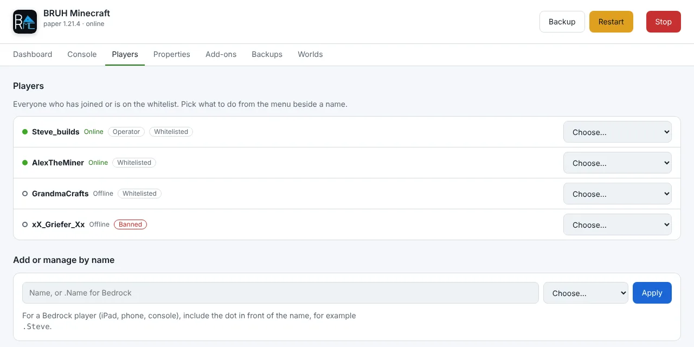

import { Aside, Steps } from '@astrojs/starlight/components';

Minecraft comes in two editions that cannot normally play together: **Java** (PC and Mac) and
**Bedrock** (iPad, iPhone, Android, Switch, Xbox, PlayStation and the Windows store version). BRUH
Minecraft runs a Java server and puts **Geyser** in front of it, which translates for Bedrock
players, plus **Floodgate**, which lets them sign in without a Java account. Both are installed,
configured and updated for you.

## Joining from a Bedrock device

<Steps>

1. Put the device on the **same network** as Home Assistant.
2. Open Minecraft → **Play** → **Friends**. The house server appears under LAN games — the add-on
   runs with host networking precisely so this discovery works.
3. If it does not appear: **Servers** → **Add Server**, enter your Home Assistant machine's IPv4
   address and port **19132**. Prefer the raw address over `homeassistant.local`, which iOS sometimes
   fails to resolve.

</Steps>

From outside your home, forward `19132/udp` to the Home Assistant machine (and see the caution under
family mode below).

## Names with a dot

Floodgate puts a `.` in front of every Bedrock player's name — `.Sam` — so a Bedrock player can
never collide with a Java account of the same name. The panel's **Players** tab explains it, and
when you whitelist or op a Bedrock player by name, **include the dot**. brAIn matches names the way
you say them, so *"teleport Sam to Alex"* finds `.Sam`.

## Family mode — no Xbox accounts

By default Bedrock players sign in with a Microsoft account, checked by Floodgate. For children who
do not have one, turn the world's `online-mode` **off** in the wizard or on the **Properties** tab.
The add-on then changes everything that depends on it: Geyser's sign-in mode becomes offline,
Floodgate is removed, Bedrock login validation is off and secure-profile enforcement is off. Java
and Bedrock both join without signing in.

<Aside type="caution" title="Only on a home network">
With accounts unchecked, anyone who can reach the server can join under any name. Keep an offline
server off the internet. It also means a name proves nothing, so brAIn's companion never grants a
grown-up's *Can ask for anything* on an unchecked name.
</Aside>

The `geyser_auth_type` option controls this directly: `auto` (default) picks `offline` when the
active world's `online-mode` is off and `floodgate` otherwise; `online` and `offline` force it.

## What Bedrock players see

- **Plugins and data packs** — everything. They run on the server. This is why the
  [Add-on browser](/bruh-minecraft/addons/) only offers server-side add-ons.
- **Resource packs** — Geyser pushes a converted copy on join. Flat block and item textures come
  across; custom 3D models, model-data items, animated textures and sounds do not. That is a Bedrock
  platform limit, not a setting.
- **Featured worlds** such as Drehmal install entirely server-side, so iPads explore the whole map
  with nothing to download. See [Worlds & Backups](/bruh-minecraft/worlds/#featured-worlds).
- **The companion** — its allay, choice pads, the boss bar of a long job, the spyglass and its
  pointing all work for Bedrock players. A skin set by brAIn appears to a Bedrock player after they
  rejoin.

## Server types

Geyser runs as a plugin on **Paper, Purpur and Folia**, and as a mod on **Fabric**. Vanilla and
Forge are not supported by Geyser-as-a-plugin; set `enable_bedrock_support: false` there to avoid the
warning. Geyser and Floodgate appear under **Server software** on the Add-ons tab with their
versions; turn `enable_bedrock_support` off rather than removing them.

## Troubleshooting

| Symptom | Fix |
| --- | --- |
| iOS hangs on "Connecting multiplayer server…" | Set `geyser_mtu: 1200`. Many home routers fragment UDP above about 1200 bytes mid-handshake, which Bedrock does not recover from. |
| Not in the Friends tab | Same subnet/VLAN? Guest networks, IoT VLANs and client isolation block discovery. Add the server manually by IPv4 and port 19132. |
| "Please log into Xbox" / "You are not permitted to join" | The world needs `online-mode=false` for players without accounts (home network only). |
| "You are already connected to this server" | A previous connection hung. The ghost-session kicker (`auto_kick_ghost_sessions`) clears it; or kick the old session from **Players**. |
| "Slow down, you're connecting too fast!" | Set the world's `connection-throttle` to `0` on the **Properties** tab — safe on a home network. |
| A client a version ahead or behind cannot join | Keep `install_viaversion` and `install_viabackwards` on (the default). |
