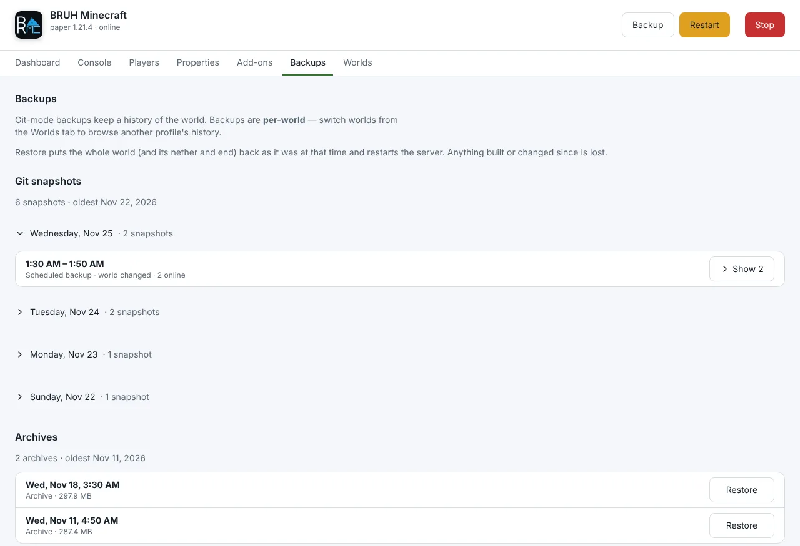
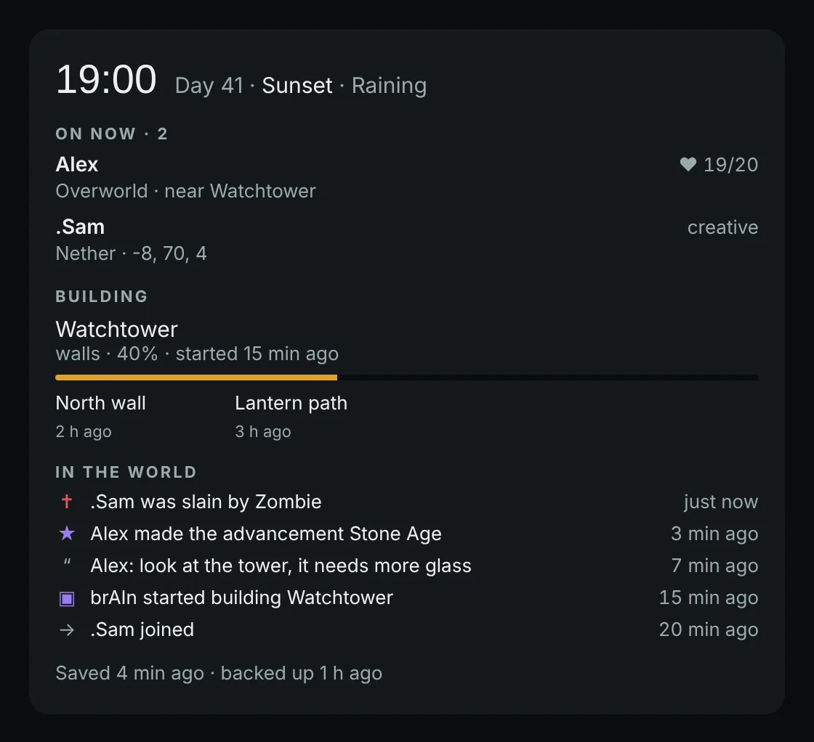

import { CardGrid, LinkCard } from '@astrojs/starlight/components';

BRUH Minecraft runs a Minecraft Java Edition server on your Home Assistant machine and puts a
management panel in the sidebar. Java and Bedrock players join the same world, and Home Assistant
can see and drive everything in it.

## What you can do

### Play together on any device

| You do this | This happens |
| --- | --- |
| Open **Friends** in Minecraft on an iPad, phone, Switch, Xbox, PlayStation or Windows | The house server is listed under LAN games. Tap it to join the same world as the Java players. [Bedrock players →](/bruh-minecraft/bedrock/) |
| Join from a PC or Mac at `<your-HA-host>:25565` | You are in. Clients a version ahead or behind can join too |
| Turn the world's `online-mode` off | Children without Microsoft accounts join in seconds. The app fixes every setting that depends on it. Home network only |
| Forward `25565` and `19132/udp` on your router | Friends outside the house can join |

### Add things to the game

| You do this | This happens |
| --- | --- |
| Open **Add-ons**, search *sit*, press **Add to world**, then **Restart now** | Everyone can sit on stairs, iPads included. Nothing is installed on any device. [Add-on browser →](/bruh-minecraft/addons/) |
| Select several results and press **Add all to world** | Up to 25 plugins, data packs, server mods and resource packs install together, with what they require |
| Press **Install** on a featured world such as Drehmal | A whole adventure map is added as a new world, resource pack included. Your current world is untouched |
| Tick a plugin on the **Configuration** tab | EssentialsX, LuckPerms, WorldEdit and nine more are fetched for your Minecraft version at every start |

### Run the server from the sidebar

| You do this | This happens |
| --- | --- |
| Open the **Console** tab | The live, colour-coded server log, with a box to send any command |
| Pick **Op**, **Kick**, **Ban** or a whitelist change beside a name on **Players** | It applies at once. Op, ban and kick ask first |
| Edit a value on **Properties** and press **Save** | The active world's `server.properties` changes. Difficulty, game mode and whitelist apply live |
| Press **Tune for my hardware** | The app suggests memory and view distance for this machine. You confirm first |
| Press **Backup**, **Restart** or **Stop** in the header | It happens now. **Update** appears only when a newer server build is waiting |

The server restarts itself after a crash, clears hung sessions that block a rejoin, and warns
before its memory setting would starve the host.

### Keep several worlds, and roll any of them back

| You do this | This happens |
| --- | --- |
| Press **Create new world…** or **Import** a `.zip` | A new world with its own settings, plugins, players and backups |
| Press **Switch** | The server restarts into that world. The panel is back in about 30 seconds |
| Do nothing | The world is backed up every hour, as git snapshots that store only what changed |
| Press **Restore** on this morning's snapshot | The whole world goes back to that time. [Worlds & backups →](/bruh-minecraft/worlds/) |

### Connect the game to the house

| You do this | This happens |
| --- | --- |
| Add the **BRUH Minecraft** device to a dashboard | Players online, TPS, the world's time and weather, and the latest thing that happened |
| Call `notify.bruh_minecraft_broadcast` when the oven timer ends | *"Dinner's ready"* appears in game chat |
| Trigger on `bruh_minecraft_join` | The kitchen speaker says who joined |
| Automate `bruh_minecraft.stop_server` at 8:30pm | Bedtime enforces itself, with a one-minute warning in chat |
| Put `say bruh:signal porch_lights on` in a command block | A lever in your build turns on the real porch light |

Services answer with the server's own reply, and a refusal fails the call with the reason.
[Home Assistant integration →](/bruh-minecraft/home-assistant/)

### Play with brAIn's companion

With [brAIn](/brain/) installed, a companion joins the family in the world as a small named allay.

| You do this | This happens |
| --- | --- |
| Type *"build a little bridge over the river"* in game chat | It builds the bridge as a job while you keep playing, and says one line when it is done |
| Point your spyglass at a wall and say *"make this red"* | "This" is what you pointed at |
| Stand on a coloured pad for two seconds | A child who cannot read yet has answered a question |
| Say *"stop the bridge"*, or press **Undo** in the panel | The blocks it changed are put back |
| Ask brAIn from a phone or voice assistant: *"teleport Sam to Alex"*, *"who's on?"* | brAIn runs the server for you, matching names the way you say them |

The companion never builds in a **protected place**, and every block it changes can be undone.
[The companion →](/bruh-minecraft/companion/)

## What you need

| | |
| --- | --- |
| **Home Assistant** | OS or Supervised, 2023.6.0 or newer |
| **Machine** | 64-bit (`aarch64` or `amd64`): a Raspberry Pi 4 or 5, a mini PC, any 64-bit server |
| **Memory** | About 2 GB free beyond Home Assistant, 4 GB or more with plugins |
| **Server software** | Paper (default), Purpur, Folia, Vanilla, Fabric or Forge. `LATEST`, `SNAPSHOT` or a pinned version, the year-numbered releases (26.x) included |
| **Accounts** | None for the server. Players need a Microsoft account unless the world's `online-mode` is off |
| **Optional** | [brAIn](/brain/) for the companion and voice control |

An existing world is never moved to a new Minecraft version until you press **Upgrade this
world**. The panel answers only through Home Assistant, and AppArmor confines the container.

## Where to go next

<CardGrid>
  <LinkCard title="Quick Start" href="/bruh-minecraft/quickstart/" description="Install, accept the EULA, connect from Java or Bedrock." />
  <LinkCard title="Add-on Browser" href="/bruh-minecraft/addons/" description="Plugins, data packs, server mods and resource packs from Modrinth." />
  <LinkCard title="Bedrock Players" href="/bruh-minecraft/bedrock/" description="iPads, phones and consoles, family mode, and what Geyser can show." />
  <LinkCard title="The Companion & BRUH Sight" href="/bruh-minecraft/companion/" description="brAIn in the world, the spyglass, choice pads, jobs and undo." />
  <LinkCard title="Worlds & Backups" href="/bruh-minecraft/worlds/" description="Profiles, featured worlds, imports, snapshots and restore." />
  <LinkCard title="Home Assistant Integration" href="/bruh-minecraft/home-assistant/" description="Entities, events, services and automation recipes." />
  <LinkCard title="Command Generator" href="/bruh-minecraft/command-generator/" description="Build plugin commands with a form and a copy button." />
  <LinkCard title="Reference" href="/bruh-minecraft/reference/" description="Every option, port, path and fix." />
</CardGrid>
