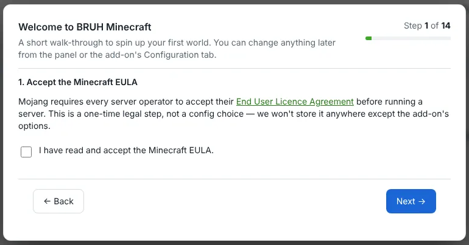

import { Steps, Aside } from '@astrojs/starlight/components';

Five minutes from zero to a running Minecraft server.

## Prerequisites

- **Home Assistant OS** or **Supervised**, version **2023.6.0** or newer.
- A **64-bit host** (`aarch64` or `amd64`: a Raspberry Pi 4/5, an x86 mini PC, any 64-bit server).
  Java is bundled in the add-on — you do not install it.
- About **2 GB of free memory** beyond what Home Assistant itself uses (4 GB or more with plugins).
  The add-on warns at start when its memory setting would leave the host less than about 2 GB.

## Install it

<Steps>

1. **Add the repository.** In Home Assistant: **Settings → Add-ons → Add-on Store → ⋮ →
   Repositories**, then paste:

   ```text title="Repository URL"
   https://github.com/bruhautomation/BRUH-HA-Apps
   ```

2. **Install the add-on.** Find **BRUH Minecraft** in the store and click **Install**. It
   downloads a prebuilt image rather than building one on your machine.

3. **Start it and open the panel.** Click **Start**, then open **BRUH Minecraft** from the sidebar.

4. **Walk through the wizard.** The first-run wizard asks you to accept the
   [Minecraft EULA](https://www.minecraft.net/eula) (Mojang requires it), then sets up your first
   world one step at a time: online or offline mode, the server software (Paper is the default) and
   the first world's settings. Finish, and the add-on restarts and the panel takes over.

   

   Prefer YAML? Set `eula: true` on the add-on's **Configuration** tab instead. While you are there,
   `memory_mb: 4096` is worth it for more than about five players or any plugins.

5. **Accept the integration.** When Home Assistant offers the discovered **BRUH Minecraft**
   integration, click **Configure** under **Settings → Devices & Services**. That adds the sensors,
   buttons, services and game events.

6. **Connect.** Java players use `<your-HA-host>:25565`. Bedrock players (iPad, iPhone, Android,
   consoles, Windows) use `<your-HA-host>:19132` — and on the same network the server appears in
   Minecraft's **Friends** tab by itself. Watch the Dashboard's player count tick up.

7. **Make yourself an operator.** Join once, then on the panel's **Players** tab choose **Op**
   from the menu beside your name. Ops are kept per world.

</Steps>

## Family mode (no Xbox required)

Want children to join without Microsoft accounts? Pick **offline mode** in the wizard — or change it
later on the panel's **Properties** tab:

```properties
online-mode=false
```

That is the whole change. The add-on then fixes every setting Microsoft and GeyserMC gate behind
that one flag — secure-profile enforcement, Geyser's sign-in mode, Floodgate, Bedrock login
validation — so Java and Bedrock both join without an Xbox sign-in.

<Aside type="caution" title="Home network only">
Offline mode is unsafe on a server reachable from the internet: anyone who guesses a username can
join as that player. It also means [brAIn's companion](/bruh-minecraft/companion/) cannot trust a
name, so a grown-up's *Can ask for anything* is not used.
</Aside>

## Open it to the internet

Forward these on your router to your Home Assistant host:

| Port | Why |
|------|-----|
| `25565/tcp` + `25565/udp` | Minecraft Java |
| `19132/udp` | Minecraft Bedrock |

**Do not forward `25575`** — RCON listens only on the machine itself. **Do not forward `8099`** —
that is the management panel, which refuses any request that did not arrive through Home Assistant.

## Common first-install hiccups

| Symptom | Fix |
|---------|-----|
| `EULA has NOT been accepted` | Finish the wizard, or set `eula: true`. |
| `address already in use: 25565` | Another server is running. Stop it, or change the port mapping. |
| Bedrock not in the Friends tab | Same subnet/VLAN as Home Assistant? Add it manually: `<HA IPv4>:19132`. |
| iOS hangs on "Connecting…" | Set `geyser_mtu: 1200`. |
| "Please log into Xbox" | Turn the world's `online-mode` off on the **Properties** tab (home network only). |
| A plugin warning, server still starts | A bad URL in `plugins:` — the log names it. Fix or remove it. |
| Panel does nothing when opened by IP | By design — open it from the sidebar. |

For more, see [Bedrock players](/bruh-minecraft/bedrock/) and the
[Reference](/bruh-minecraft/reference/#troubleshooting).
