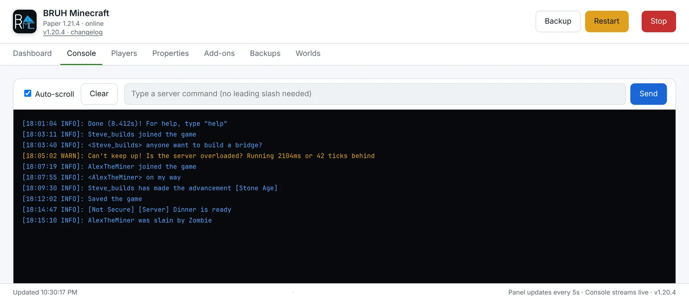
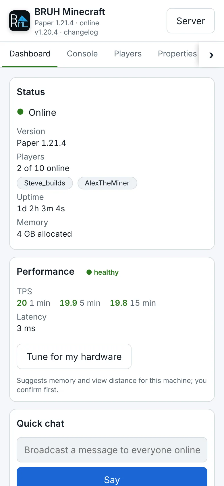

Look up any option, port, path or fix. Set options under **Settings → Add-ons → BRUH Minecraft →
Configuration**. Entities, events and services are on
[Home Assistant Integration](/bruh-minecraft/home-assistant/).

## Configuration options

### Required

| Option | Default | What it does |
|--------|---------|--------------|
| `eula` | `false` | **Set to `true` to start** (or accept it in the first-run wizard). Accepts the [Minecraft EULA](https://www.minecraft.net/eula). |

### Server type & version

| Option | Default | What it does |
|--------|---------|--------------|
| `server_type` | `paper` | `paper`, `purpur`, `folia`, `vanilla`, `fabric` or `forge`. Paper is recommended; BRUH Sight needs Paper or Purpur. |
| `minecraft_version` | `LATEST` | `LATEST`, `SNAPSHOT`, or pinned (`1.21.4`, `26.2`). For Paper and Folia, `LATEST` means the newest version with a **stable** build. A **new** world starts there; an existing world keeps its version (and gets newer builds of it) until you press **Upgrade this world** on the Add-ons tab. |
| `auto_update_server` | `true` | Re-resolve the server jar on every start. A failed check logs a warning and starts the installed server. |
| `active_world` | `default` | Which world is live (1–32 of `A–Z a–z 0–9 _ -`). Usually set by **Switch** on the Worlds tab. |

### Memory & JVM

| Option | Default | Notes |
|--------|---------|-------|
| `memory_mb` | `2048` | 512–65536, used as both `-Xms` and `-Xmx`. The app warns (log and panel) when less than about 2 GB would be left for the host. |
| `use_aikar_flags` | `true` | The widely used G1GC tuning for Minecraft. |
| `extra_jvm_args` | `""` | Your own extra JVM flags. |

| Players | `memory_mb` |
|---------|-------------|
| 4 | 2048 |
| 10, with plugins | 4096 |
| 20 or more, heavy | 6144–8192 |

**Tune for my hardware** on the Dashboard suggests a value for your machine.

### Backups & restarts

| Option | Default | Notes |
|--------|---------|-------|
| `auto_backup` | `true` | Back the world up on a schedule. |
| `backup_interval_minutes` | `60` | 5–1440. |
| `backup_keep_count` | `48` | 1–500; older backups are pruned. |
| `backup_use_git` | `true` | `true` = git snapshots storing only changes; `false` = `.tar.gz` archives. |
| `auto_restart_on_crash` | `true` | Restart the server when it exits unexpectedly, including when the system kills it for memory. The wait grows from 10 seconds to 5 minutes, and it gives up after 10 restarts in an hour. |
| `auto_restart_schedule` | `""` | Reserved; currently has no effect. Schedule restarts with an automation on `bruh_minecraft.restart_server`. |

### Connection handling

| Option | Default | Notes |
|--------|---------|-------|
| `auto_kick_ghost_sessions` | `true` | When a new login is refused with "You are already connected", kicks the hung session so the retry succeeds. |
| `auto_quarantine_duplicates` | `true` | Moves duplicate plugin jars, and jars built for a newer Minecraft than the server runs, to `plugins/.quarantine/` at start. Moved, never deleted. |

Connection throttle and idle timeout are per-world `server.properties` keys (`connection-throttle`,
`player-idle-timeout`) on the **Properties** tab.

### Bedrock cross-play

| Option | Default | Notes |
|--------|---------|-------|
| `enable_bedrock_support` | `true` | Install Geyser + Floodgate so Bedrock clients can join. |
| `geyser_auth_type` | `auto` | `auto` picks `offline` when the active world's `online-mode` is off, else `floodgate`. `floodgate`, `online` and `offline` force it. |
| `geyser_mtu` | `1400` | 576–1492. Drop to `1200` if iOS hangs on "Connecting…". |

See [Bedrock Players](/bruh-minecraft/bedrock/).

### Plugins

Besides the [Add-on browser](/bruh-minecraft/addons/), you can tick popular plugins or list your own
URLs. Only `paper`, `purpur` and `folia` load plugins.

**One-click plugins.** A ticked plugin is fetched from Modrinth at every start: the newest release
build **for your server's Minecraft version**, or skipped with a warning when there is none.

- Dependencies switch on with them. `install_essentialsx_chat` brings `install_essentialsx`, and
  `install_viabackwards` brings `install_viaversion`.
- Unticking does **not** remove the jar. Remove it on the Add-ons tab.

| Option | Default | Plugin | What it does |
|--------|---------|--------|--------------|
| `install_viaversion` | `true` | ViaVersion | Newer clients can join |
| `install_viabackwards` | `true` | ViaBackwards | Older clients can join |
| `install_essentialsx` | `false` | EssentialsX | Homes, warps, `/tpa`, `/spawn`, kits, `/heal` |
| `install_essentialsx_chat` | `false` | EssentialsXChat | Chat formatting and group prefixes |
| `install_luckperms` | `false` | LuckPerms | Permissions and groups |
| `install_worldedit` | `false` | WorldEdit | In-game mass block editing for builders |
| `install_coreprotect` | `false` | CoreProtect | Who placed or broke what, and rollback |
| `install_griefprevention` | `false` | GriefPrevention | Golden-shovel land claims |
| `install_mcmmo` | `false` | mcMMO | RPG-style skills |
| `install_chestsort` | `false` | ChestSort | Sorted chests and inventories |
| `install_veinminer` | `false` | VeinMiner | Break a whole vein at once |
| `install_spark` | `false` | Spark | Find what is causing lag |

**Custom URLs.** For anything else:

```yaml
plugins:
  - url: https://example.com/Essentials.jar
    name: Essentials.jar          # optional rename
  - "https://example.com/ViaVersion.jar"   # a plain URL also works
```

- A bad URL is skipped with a warning and never blocks startup.
- Unchanged jars are not downloaded again.
- A jar deleted on the panel comes back on the next start while its URL or tick is still set.

:::tip
GitHub `releases/latest/download/X.jar` URLs only resolve when the asset is named exactly `X.jar`.
Versioned file names need a pinned URL.
:::

The [Command Generator](/bruh-minecraft/command-generator/) builds commands for these plugins with a
form and a copy button.

### Other

| Option | Default | Notes |
|--------|---------|-------|
| `rcon_password` | auto-generated | RCON listens only on `127.0.0.1:25575`. Leave it blank. |
| `enable_ha_integration` | `true` | Deploy the `bruh_minecraft` integration and its bridge. |
| `announce_ha_events` | `true` | Announce Home Assistant-triggered events (restarts, backups) in chat. |
| `log_level` | `info` | `trace` to `fatal`; the app's own log, not the server's. |

## Ports

| Port | What | Needed? |
|------|------|---------|
| 25565/tcp + udp | Minecraft Java Edition | For anyone joining from Java |
| 19132/udp | Minecraft Bedrock, through Geyser | With `enable_bedrock_support` on: phones, tablets, consoles and Windows Bedrock |
| 24454/udp | Simple Voice Chat | Only with that plugin installed |

The app runs with host networking (Bedrock LAN discovery needs it), so these answer on the host's
own address. The management panel (8099) answers only through Home Assistant.

## What's set where

| What | Where | Scope |
|------|-------|-------|
| How the app runs: EULA, server type and version, memory, backups, Bedrock, plugin ticks and URLs, log level | The **Configuration** tab | Every world |
| How a world plays: `server.properties` | The **Properties** tab | Per world |
| Players, ops, whitelist and bans | The **Players** tab (each world's JSON files) | Per world |
| Add-ons | The **Add-ons** tab (`.bruh-addons.json`) | Per world |

Each world's `server.properties` starts with defaults on first boot, then it is yours. Difficulty,
game mode and whitelist apply live, and the rest on the next restart. The app enforces only the
RCON, query and port keys, and in offline mode keeps secure-profile enforcement off.

Experimental features (Mojang's *feature packs*) go in `initial-enabled-packs`, comma-separated,
keeping `vanilla`. They affect only **newly generated** worlds, so create a fresh world with the pack
enabled.

## Panel tabs

| Tab | What it does |
|-----|--------------|
| **Dashboard** | Status, players online, uptime, memory, TPS with a healthy/degraded/struggling badge, **Tune for my hardware**, quick chat and a quick command, and brAIn's **Companion** card. A banner warns when the server log cannot be heard |
| **Console** | The live, colour-coded server log, and a command box (no leading slash needed) |
| **Players** | Everyone who has joined or is listed, Online/Offline, with a menu of the changes that fit each one; op, ban and kick ask first |
| **Properties** | The active world's `server.properties` |
| **Add-ons** | Everything in the world and whether it needs a restart, server software and updates, and the Modrinth browser. See [Add-on Browser](/bruh-minecraft/addons/) |
| **Backups** | Snapshots and archives by day, with Restore. See [Worlds & Backups](/bruh-minecraft/worlds/) |
| **Worlds** | Switch, create, rename, import, download, delete, and featured worlds |

| Header control | What it does |
|----------------|--------------|
| **Backup** | Backs the active world up now |
| **Restart** | Restarts the server only, in about 15 seconds |
| **Stop** | Stops the server. It stays stopped until started |
| **Update** | Shown only when a newer server build is waiting |
| Version · changelog | Opens the release notes. It reads *"Updated since you last looked"* after an update |

On a phone the header buttons fold into a **Server** menu.





## Offline behaviour

The server starts with no internet once it has been online once. When the download servers cannot be
reached at start, the app reuses the cached server jar, plugins, Geyser and Floodgate. Settings,
players, backups, the panel and the Home Assistant integration work as usual. The very first start
needs internet.

## Security

- **The panel only answers requests that arrive through Home Assistant.** It refuses any connection
  that is not from the Supervisor or the machine itself. Two paths stay public: `/pack/<name>`, which
  players' games fetch resource packs from, and `/api/health`.
- **AppArmor is on.** Plugin jars run with the server's full authority, so the container is confined.
- **Add-on downloads are verified** against the SHA-512 Modrinth publishes.
- **A watchdog** polls `/api/health` and restarts a hung panel.
- **The RCON password and console log are excluded from Home Assistant backups.** Your worlds and
  world backups are included.

## Where data lives

| Path | Contents |
|------|----------|
| `/config/minecraft/` | Link to the active world |
| `/config/minecraft-worlds/<world>/` | Full server root per world |
| `/config/minecraft-backups/` | Git snapshots or archives |
| `/config/resource-packs/` | Uploaded resource packs |
| `/config/.bruh_minecraft/` | The Home Assistant bridge |
| `/config/custom_components/bruh_minecraft/` | The integration |
| `/data/server-cache/` | Cached jars |
| `/data/panel/` | Panel state, RCON secret, console log |

## Troubleshooting

### Won't start

| Symptom | Fix |
|---------|-----|
| `EULA has NOT been accepted` | Finish the wizard, or `eula: true`. |
| `address already in use: 25565` | Stop the other server, or remap the port. |
| Out-of-memory crashes | Raise `memory_mb`, and check the host has room (the app warns). |
| A plugin warning, then it continues | A bad URL in `plugins:`. Fix or remove it. |
| A one-click plugin did not appear | No Modrinth build exists for your Minecraft version; the log names it. |
| A plugin moved to `plugins/.quarantine/` | A duplicate, or built for a newer Minecraft. Install a build for your version. |

### Connection

| Symptom | Fix |
|---------|-----|
| Cannot connect from the internet | Forward `25565/tcp` + `25565/udp` (and `19132/udp` for Bedrock). Never forward `8099`. |
| Panel does nothing when opened by IP | This is intended. Open it from the sidebar. Refusals are in the app log. |
| "Please log into Xbox" | The world's `online-mode=false` on **Properties** (home network only). |
| iOS hangs on "Connecting…" | `geyser_mtu: 1200`. |
| "You are already connected" | The ghost-session kicker clears it; or kick from **Players**. |
| Bedrock not in the Friends tab | Same subnet/VLAN? Add the server by IPv4 and port 19132. |

### Performance and the world

| Symptom | Fix |
|---------|-----|
| TPS sensors unavailable | TPS is only reported by Paper, Purpur and Folia. |
| Sagging TPS | Lower view distance (8) and simulation distance (6) on **Properties**; add `install_spark` to find the cause. |
| The Dashboard says the feed may miss chat | A plugin or script changed the join or chat format so joins are not being heard. The `world_feed` sensor carries the reason. |
| The companion's bubble never shows | BRUH Sight needs Paper or Purpur; the app log says when it is not answering. |

### Where to look

| Log | Where |
|-----|-------|
| Start-up errors | The app's **Log** tab. Set `log_level: debug` and reproduce for more detail |
| Live server log | The panel's **Console** tab |
| Full server log | `/data/panel/console.log` |

File issues at <https://github.com/bruhautomation/BRUH-HA-Apps/issues>.
