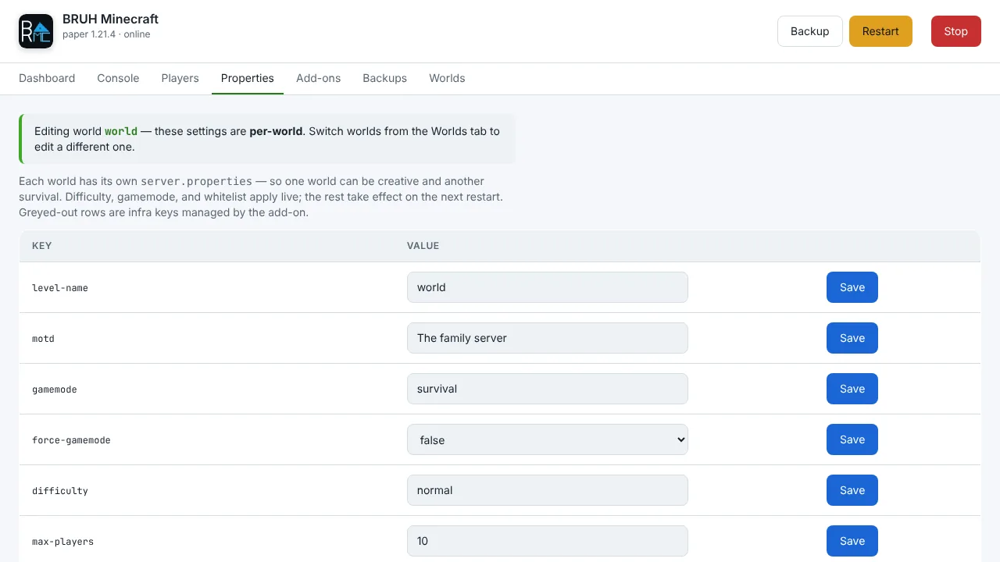
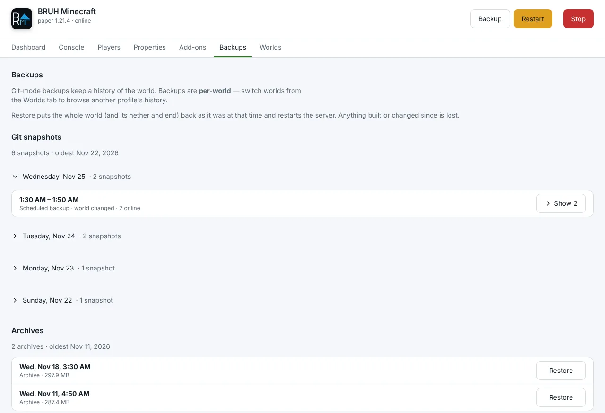

import { Aside } from '@astrojs/starlight/components';

## Worlds

Each **world** is a full server root at `/config/minecraft-worlds/<name>/` with its own world files,
`server.properties`, plugins and add-ons, operators, whitelist and bans, and backup history. One runs
at a time: **Switch** restarts the add-on into another, and the panel is back in about 30 seconds.

| Action | What it does |
| --- | --- |
| **Switch** | Makes that world active and restarts the add-on into it |
| **Rename** | Moves the world, its level folder and name, its backups and the active-world setting together; restarts the server if it was running |
| **Download** | The world as a file |
| **Delete** | Removes the world and its backup history. The active world cannot be deleted — switch away first |
| **Create new world…** | A wizard for a fresh world with its own game mode, difficulty and player rules |
| **Import** | A Minecraft world `.zip` up to 2 GB. The folder holding `level.dat` is found wherever it is in the zip, and staged as a new world to switch to |

Each world's line says what it is: *Survival · Normal difficulty · Normal world · Whitelist on*.

**Shared across worlds:** the add-on's own options — server type and version, memory, backups,
Bedrock, the `plugins:` list and plugin ticks — and the RCON password. **Per world:** everything
about how the world plays.

### Per-world settings

The **Properties** tab edits the active world's `server.properties`: MOTD, game mode, difficulty,
max players, PVP, hardcore, `online-mode`, whitelist, view and simulation distance, world
generation, flight, command blocks, spawn protection and the rest. Difficulty, game mode and
whitelist apply live; the rest on the next restart. Keys the add-on manages (RCON, query, ports)
are shown read-only, and world-generation keys are marked as only affecting new worlds.

**Tune for my hardware** on the Dashboard inspects the machine's memory and CPU and suggests
`memory_mb` plus the world's view and simulation distance; you confirm first.

### Featured worlds

Curated community worlds installed with one click, entirely **server-side** — so iPads and iPhones
on Bedrock just join, with nothing to download.

- **Install** downloads the world and its bundled data packs as a **new** world (your current one is
  untouched), writes its settings from the catalog, hosts its resource pack for Java players and
  converts it to a Bedrock pack that Geyser pushes on join.
- **Switch** then pins the server to the software and Minecraft version the world needs, turns
  Bedrock support on and restarts. Switching back to your own world may need a version picked again
  on the Configuration tab.

The headline entry is [Drehmal: APOTHEOSIS](https://www.drehmal.net), a hand-built 12k × 12k
adventure world (about 1.5 GB, Minecraft 1.20.1 on Paper). Bedrock players can explore the whole
map; vanilla retextures convert, custom 3D models and animated textures do not, and Drehmal's
optional client-side mods are not needed to play.

## Backups

Backups run on a schedule (`auto_backup`, every `backup_interval_minutes`, keeping
`backup_keep_count`), on demand from the header's **Backup** button, and before anything large the
companion does. They are per world: switch worlds to browse another one's history.

- **Git snapshots** (`backup_use_git: true`, the default) keep a history with only the changes
  stored each time.
- **Archives** (`backup_use_git: false`) are timestamped `.tar.gz` files — simpler for very large
  worlds.

Snapshots are grouped by day, older days folded; a run of identical scheduled snapshots folds into
one line with **Show N**. Each says what it was — scheduled, manual or before a world change —
whether the world changed, and how many players were on.

**Restore** puts the whole world (with its Nether and End) back as it was and restarts the server.
It asks first, naming the time it goes back to, because anything built since is lost.

<Aside title="Smaller than a backup: Undo">
To take back just one thing the companion did, press **Undo** on that action in the Companion card
or in brAIn — it puts back the blocks it changed and leaves everything else alone.
</Aside>

## Where it all lives

| Path | Contents |
|------|----------|
| `/config/minecraft/` | Link to the active world |
| `/config/minecraft-worlds/<world>/` | Full server root per world, including `.bruh-world/` (feed journal, build log, atlas, companion state) and `.bruh-addons.json` |
| `/config/minecraft-backups/` | Git snapshots or archives, kept per world |
| `/config/resource-packs/` | Uploaded resource packs, served to players |
| `/config/www/minecraft/` | Pictures of finished builds |
| `/config/.bruh_minecraft/` | The bridge to Home Assistant |
| `/data/server-cache/` | Cached server jars, so the server starts with no internet |
| `/data/panel/` | Panel state, the RCON secret and the console log (both excluded from Home Assistant backups) |
