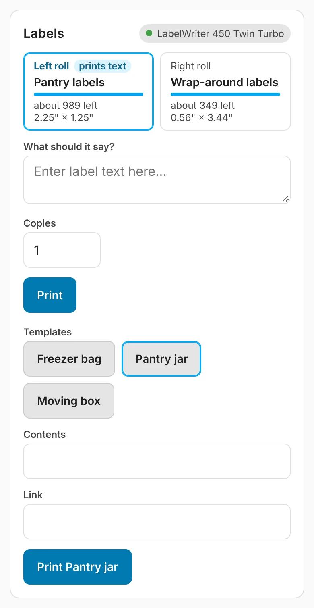

import { Steps, Aside } from '@astrojs/starlight/components';

The BRUH Print card puts a text box and a **Print** button on any dashboard, so anyone in the
house can print a label from a phone.

<div style="display:grid;grid-template-columns:repeat(2,minmax(0,1fr));gap:1.5rem;align-items:start">




</div>

## Add the card

<Steps>

1. Edit a dashboard and press **Add card**.
2. Search for **BRUH Print** and pick it. BRUH Print registers the card for you.
3. Set the title, mode, copies and what to show in the visual editor. `quick`, `fields` and the
   entity options are set in YAML.

</Steps>

The card talks to Home Assistant, not to the app. It works on mobile data through Home Assistant
Cloud the same way it does at home.

## What you can do on it

| Part | What it does | Option |
| --- | --- | --- |
| Status pill | Shows the printer and whether it is ready | `show_status` |
| Roll tiles | Show each roll's label, size and *about N left*. Press a roll to make plain text print there. | `show_rolls` |
| Text form | Type a label and press **Print** | `mode: text` |
| Template form | Fill in one template's fields and print | `mode: template` |
| Quick buttons | Print a fixed text or a filled-in template in one press | `quick` |
| Template list | A button per saved template. Press one, fill in its fields, print. | `show_templates` |

Pressing a roll tile changes the same setting as the **Prints on** line on the panel's Quick tab.

## Examples

A family card with two one-press labels:

```yaml
type: custom:bruh-print-card
title: Label the freezer
mode: text
quick:
  - label: "Leftovers"
    text: "Leftovers"
  - label: "Dated freezer bag"
    template: Freezer bag
    fields: { contents: "Leftovers" }
```

A form for one template:

```yaml
type: custom:bruh-print-card
title: Pantry jar
mode: template
template: Pantry jar
fields:
  - contents
  - key: link
    label: Recipe link
```

Every saved template, one press each:

```yaml
type: custom:bruh-print-card
show_templates: true
```

## Options

| Option | Default | What it does |
| --- | --- | --- |
| `title` | `BRUH Print` | The card's heading |
| `mode` | `text` | `text` for a free-text form, `template` for one template's form |
| `template` | | The template's name. Required with `mode: template`. |
| `fields` | `[]` | With `mode: template`, the fields the form asks for: a name, or `key` with an optional `label` and `default` |
| `stock` | | A stock id for text prints, instead of the roll marked **prints text** |
| `copies` | `1` | Copies per press |
| `quick` | `[]` | One-press buttons: `label` plus `text`, or `label` plus `template` with `fields` |
| `show_status` | `true` | Show the printer status pill |
| `show_rolls` | `true` | Show the roll tiles |
| `show_templates` | `false` | List the saved templates as buttons |
| `printer_entity`, `left_roll_entity`, `right_roll_entity`, `problem_entity` | found automatically | Point the card at renamed entities |

## What the card says after a print

| What happened | What the card says |
| --- | --- |
| It printed | *Printed 1 on the left roll*, plus any notes about the label |
| The print was refused | The reason, such as which stock is in the roll and which the label is for |
| The job was taken and nothing printed | *BRUH Print took the job and printed nothing*, with why |
| No answer came back | *BRUH Print took the job, but sent nothing back to say a label came out. Check the printer.* |

## Fix a card that shows nothing or cannot print

| What you see | Why | What to do |
| --- | --- | --- |
| *Custom element doesn't exist* | Home Assistant has not started serving the card's folder yet | Restart Home Assistant once. A repair under **Settings → System → Repairs** says so and clears itself. |
| *This card cannot print: Home Assistant has no `bruh_print.print_text` service* | The integration is not loaded | Set up the BRUH Print integration under **Settings → Devices & Services** |
| *Printing works from here, but this card cannot find the printer sensor or the roll sensors* | The entities were renamed | Name them in the card, as below. Printing keeps working meanwhile. |

```yaml
type: custom:bruh-print-card
printer_entity: sensor.label_maker_printer
left_roll_entity: sensor.label_maker_left_roll
```

Name only the entities the card cannot find. It still finds the rest by itself.

## Updates and caching

A card update reaches your dashboard on the next page load. You do not need to clear the browser
cache.
