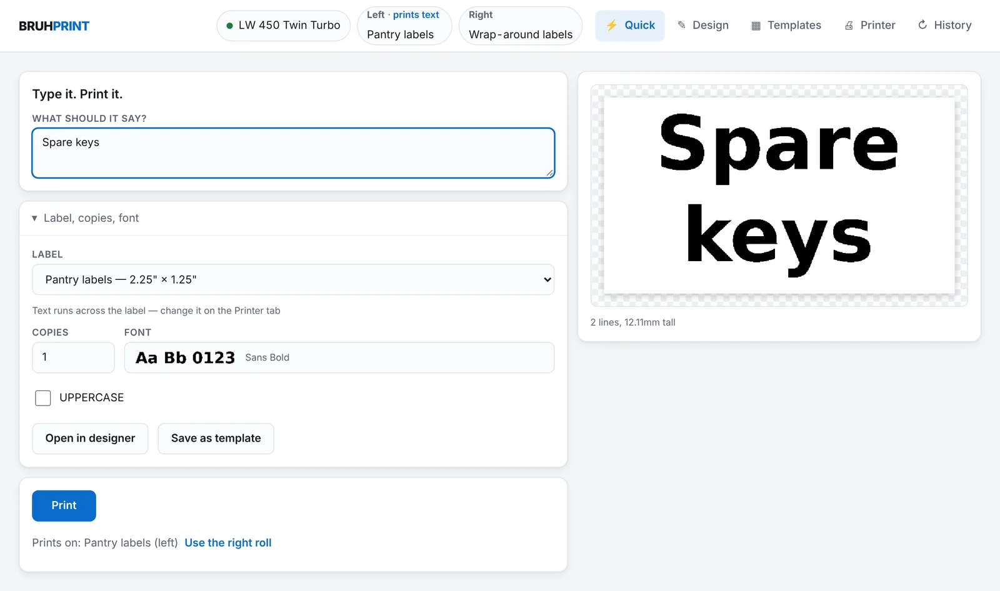
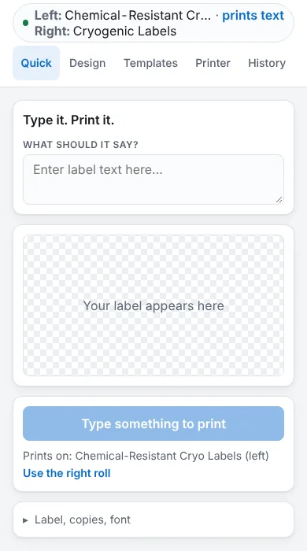
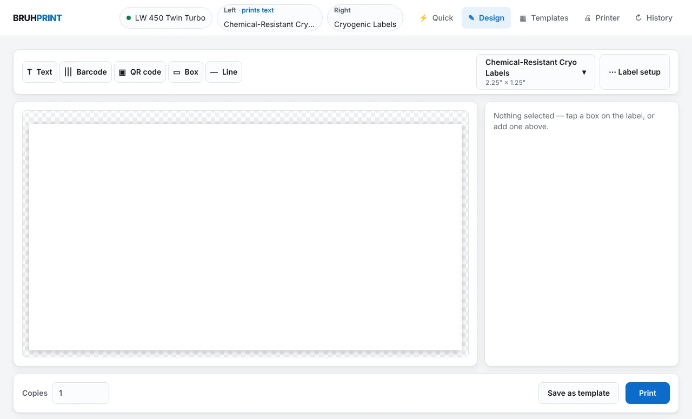

import { Aside } from '@astrojs/starlight/components';

## Quick — type it, print it

The Quick tab is three things in order: what to say, the picture, then **Print**. On a phone the
preview sits on the same screen you are typing on.

<div style="display:grid;grid-template-columns:minmax(0,2fr) minmax(0,1fr);gap:1rem;align-items:start">





</div>

**The autofit is the product.** It does not just pick a size — it tries **every way of breaking
your words across lines** and keeps the arrangement whose letters come out biggest. *Spare keys*
is biggest on two lines; *Attic* is biggest on one. Line breaks you type are honoured.

Text is fitted by its **ink**, not the font's box: the font reserves room for ascenders and
descenders a given word may not have, and fitting to that is how a word ends up touching one edge
while filling half its height. BRUH Print measures the letters actually drawn, and keeps a 2 mm
border clear of every edge (a LabelWriter's registration wanders a fraction of a millimetre as the
roll unwinds).

Under **Label, copies, font**: the label (only rolls that are actually loaded are offered), copies,
the font (each choice drawn by the label renderer itself), **UPPERCASE**, **Open in designer** and
**Save as template**. **Prints on** names the roll text goes to; with two rolls loaded it offers
**Use the right roll** (or left) to move text there, and that one choice is shared with the dashboard card and the
`bruh_print.choose_label` service, so they always agree.

## The designer



Everything under the canvas is the server's own render — the same renderer that packs the
printer's bytes — so what is on screen is what comes out.

**The canvas *is* the printable area.** The stock's margin, any band your printer cannot reach on
that roll, the dot columns a 2.25″ label loses to a 2.24″ print head, and any edge you asked to
keep clear all come off before the canvas is drawn. Everything you can see prints.

- **The bar** is the add strip (**Text**, **Barcode**, **QR code**, **Box**, **Line**), the label
  you are on (its name with its size under it), and **⋯ Label setup** — the label's name, which
  way its text runs, and whether boxes line up as you drag.
- **Boxes line up as you drag.** Edges and centres catch on the printable area, on other boxes
  and on a 1 mm grid, with a thin line drawn at whatever they caught. Turn it off with **Line boxes
  up as I drag** in Label setup.
- **Text re-fits while you drag** a text box's corner.
- **Nothing can be placed off the label.** Dragging, resizing, typing, nudging and turning all
  clamp to the printable area.
- **The properties pane** has **Left / Top / Width / Height** in millimetres, then **Across**
  (left, centre, right, fill), **Down** (top, middle, bottom, fill) and **Nudge 1 mm** arrows.
  **⟳ Rotate**, **Duplicate** and **Delete** act on the selected box; rotate turns text and
  barcodes a quarter at a time.
- **A box that cannot be drawn is outlined in red** — a barcode too narrow for its data, a QR code
  with nowhere to go, a fixed text size that clips — with a note under the label. The label still
  prints.

### Element types

| Type | What it does |
| --- | --- |
| `text` | Auto-fits at size 0 ("as large as fits its box"). Wraps on spaces, then mid-word. A fixed size that does not fit is noted and clipped, never silently shrunk. |
| `barcode` | Code 128 (sets B and C), with the human-readable text underneath by default. |
| `qr` | Error correction L, M, Q or H (default M). Always square. |
| `box` | Outline or filled, with an optional corner radius. |
| `line` | A rule; its direction follows whichever dimension is larger. |

<Aside title="Barcodes are never scaled down to fit">
A barcode's bars have to be a whole number of printer dots wide. At 1.4 dots each bar rounds on
its own, five equal bars come out 1, 1, 2, 1, 2 dots, and a scanner reads the wrong widths. So a
symbol that cannot fit at one whole dot per module is **reported**, never drawn smaller. The same
rule holds for QR codes.
</Aside>

## The label document

The JSON the designer produces, `bruh_print.print_label` takes and templates store. Measurements
are millimetres from the top-left of the drawable area.

```json
{
  "stock": "edcc-082wh",
  "rotate": 0,
  "name": "Pantry jar",
  "elements": [
    {
      "type": "text",
      "x_mm": 1, "y_mm": 1, "w_mm": 38, "h_mm": 11,
      "props": {"text": "Pantry — rice", "font": "sans-bold", "size_mm": 0,
                "align": "center", "valign": "middle", "wrap": true}
    },
    {
      "type": "barcode",
      "x_mm": 1, "y_mm": 13, "w_mm": 53, "h_mm": 14,
      "props": {"data": "JAR-0042", "hri": true}
    }
  ]
}
```

- `rotate` turns the design canvas: at 90 or 270 you lay a narrow wrap-around label out as a long
  strip. A **new** label takes the stock's own text direction; a **saved** label keeps the
  direction it was drawn at.
- An element's own `rotate` turns that box's contents within the label.
- `size_mm: 0` on text means "as large as fits its box".
