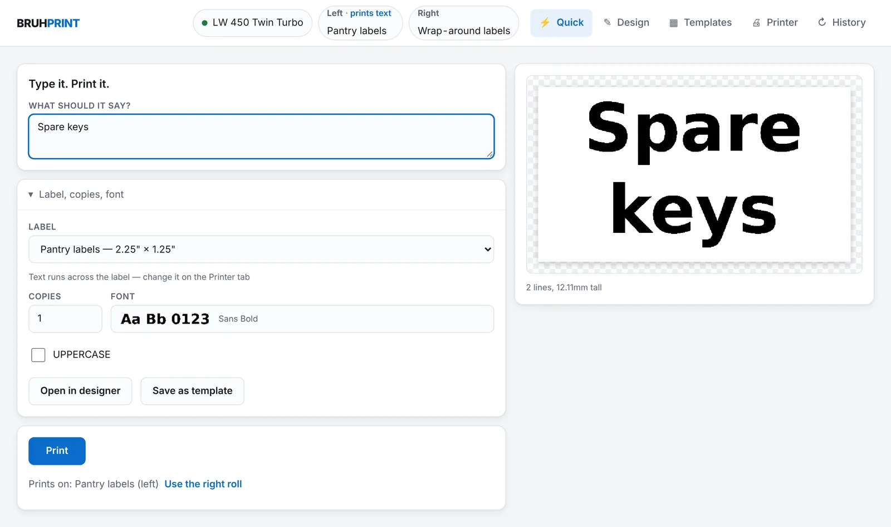
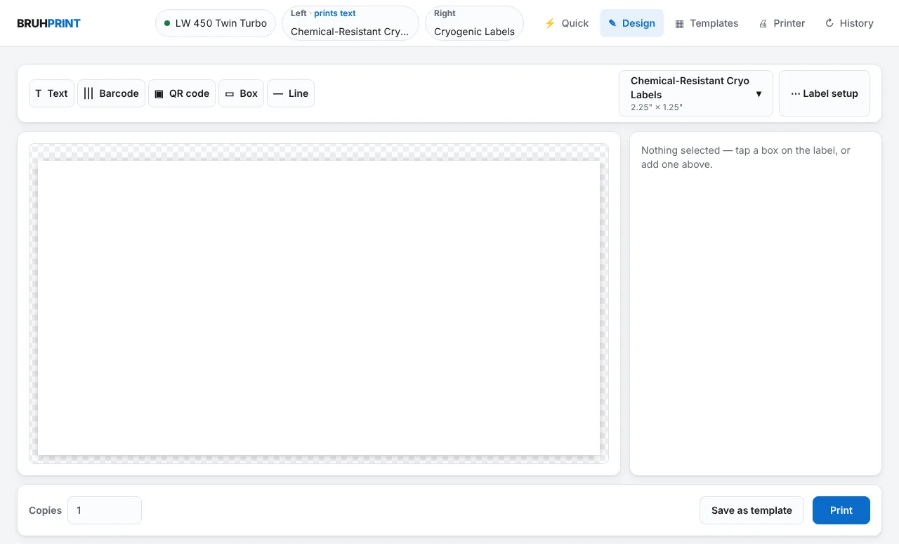
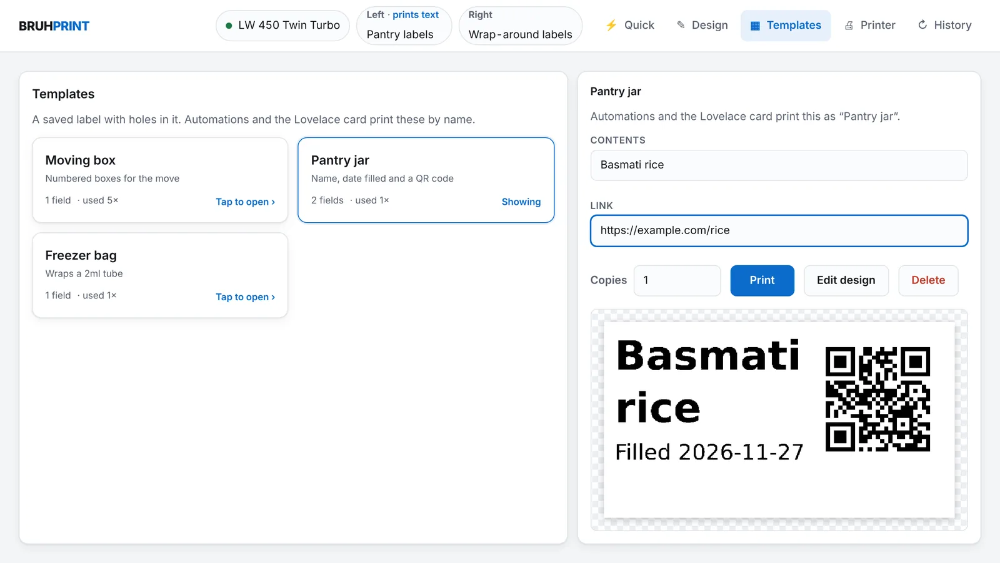
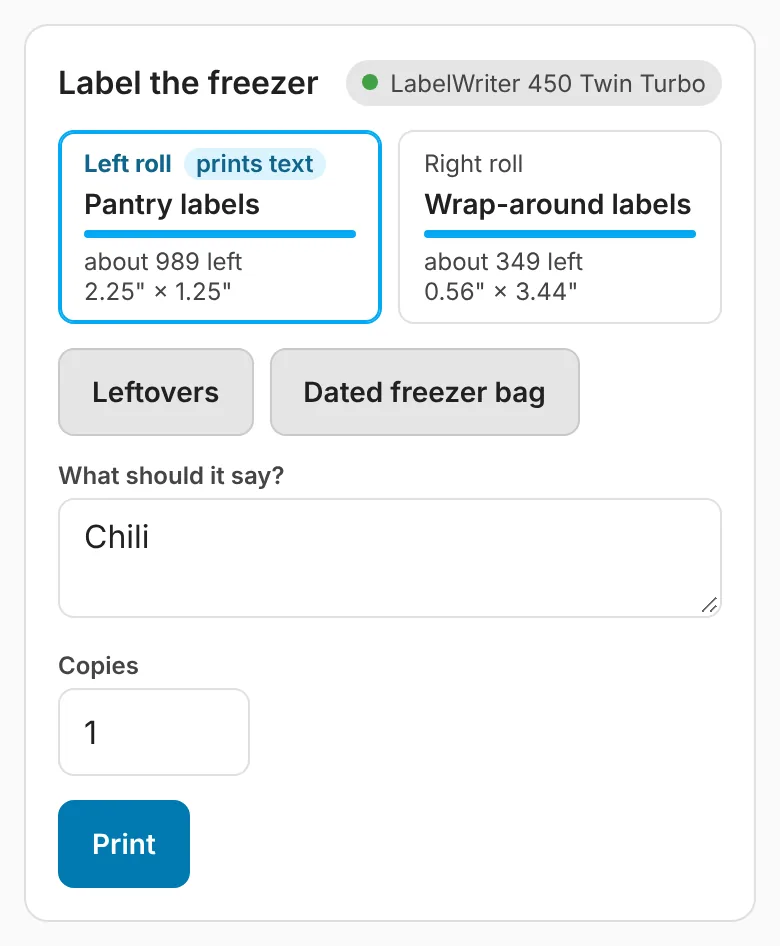
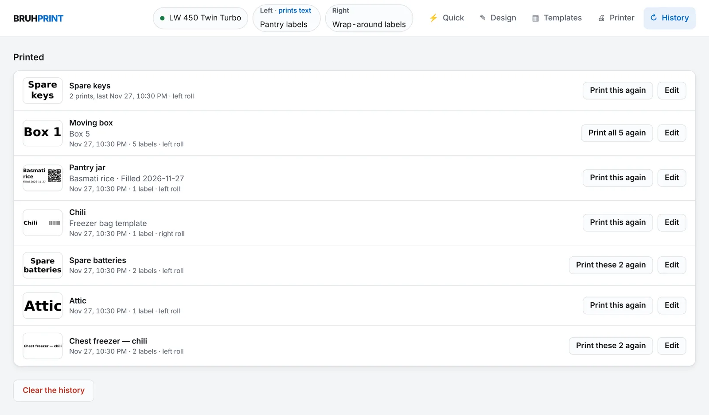

import { CardGrid, LinkCard, Aside } from '@astrojs/starlight/components';

BRUH Print drives a USB **DYMO LabelWriter** straight from Home Assistant, with no CUPS and no
driver to install. You get a label studio in the sidebar, services for automations, and a card for
your dashboards.



## What you can do

### Type a word, get a label

Open **Quick**, type *Spare keys*, press **Print**. BRUH Print tries every way of breaking your
words across lines and prints the arrangement with the biggest letters. *Spare keys* lands on two
lines, *Attic* on one. [Quick & the Designer →](/bruh-print/designer/)

### Design a label

Drag **Text**, **Barcode**, **QR code**, **Box** and **Line** onto the canvas. Boxes snap into
line, text re-fits as you resize it, and everything you can see on the canvas prints.



### Save a template and fill in the blanks

Write `{{contents}}` on a label and save it. It becomes a box to fill in on the panel, on the
card and in automations. `{{date}}` fills itself in. [Templates →](/bruh-print/templates/)



### Print a numbered run

A template that says *Box 1* takes a number. Enter **From** 1 and **To** 25 and the panel says
*Prints 1–25, 25 labels* before anything prints.

### Print from an automation

```yaml
action: bruh_print.print_template
data:
  template: Freezer bag
  fields:
    contents: Chili
```

The automation never names a roll. The template knows its label, and BRUH Print knows which roll
holds it. [All eight services →](/bruh-print/reference/#services)

### Print from a dashboard, on any phone

<div style="display:grid;grid-template-columns:minmax(0,1fr) minmax(0,1.6fr);gap:1.5rem;align-items:start">



<div>

Add the **BRUH Print** card to any dashboard. It can be:

- a text box and a **Print** button
- one-press buttons for labels you print all the time
- a form for one template
- a list of every saved template

It works at home and away. [Dashboard Card →](/bruh-print/card/)

</div>

</div>

### Ask brAIn

With [brAIn](/brain/) installed, say *"print a label that says spare batteries"* or *"print three
freezer-bag labels for bolognese"* to any voice assistant. brAIn checks what is loaded and which
templates exist first. A voice assistant prints at most 10 copies at once.

### Print it again

**History** keeps every print with a thumbnail. **Print this again** repeats it, and **Edit** opens
it in the designer.



### Never print on the wrong roll

A LabelWriter cannot tell what labels are in it, so you tell BRUH Print once. From then on:

- **You pick a label, never a roll.** On a Twin Turbo, BRUH Print sends each label to the roll
  that holds it.
- **A label for a stock that is not loaded is refused**, with a sentence naming both stocks.
  Without that check, a wide label on a narrow roll prints across the backing paper, once per copy.
- **Everything else prints with a note.** A barcode that will not fit or a fixed font size that
  clips is reported beside a label that still comes out.

[Rolls, Stock & Twin Turbo →](/bruh-print/rolls/)

### Barcodes that scan, labels that line up

- Every bar and QR module is a whole number of printer dots. A code that cannot fit is reported,
  never shrunk into one that will not scan.
- **Line up this roll** prints a numbered grid. You read four numbers off it, and every label on
  that roll lands where it should.
- Each roll shows *About N left*, and Home Assistant gets sensors for the printer, both rolls, the
  last label, today's count and a problem flag.

## What you need

| | |
| --- | --- |
| **Printer** | A DYMO LabelWriter on USB: 400, 450, 450 Turbo, 450 Twin Turbo, 450 DUO, 4XL, Wireless, 550, 550 Turbo or 5XL. An unrecognised DYMO is driven as a 450. |
| **Home Assistant** | 2023.6 or newer with the add-on store, on an `aarch64` or `amd64` machine the printer plugs into |
| **Setup** | Nothing to switch on for USB |
| **Optional** | [brAIn](/brain/), for printing by voice or chat |

<Aside type="caution" title="LabelWriter 550, 550 Turbo and 5XL check their media">
These printers read an RFID tag on the roll and will not feed labels without one. Nothing in
software can change that.
</Aside>

## Where to go next

<CardGrid>
  <LinkCard title="Quick Start" href="/bruh-print/quickstart/" description="Plug in, say what is loaded, line up the roll, print." />
  <LinkCard title="Quick & the Designer" href="/bruh-print/designer/" description="Autofit, the canvas, barcodes, QR codes and fonts." />
  <LinkCard title="Templates" href="/bruh-print/templates/" description="Blanks, dates, numbered runs, automations and History." />
  <LinkCard title="Rolls, Stock & Twin Turbo" href="/bruh-print/rolls/" description="What is loaded, lining up a roll, the stock catalog and print quality." />
  <LinkCard title="Dashboard Card" href="/bruh-print/card/" description="Print from any Lovelace dashboard, from any phone." />
  <LinkCard title="Reference" href="/bruh-print/reference/" description="Options, services, entities, brAIn tools and troubleshooting." />
</CardGrid>
