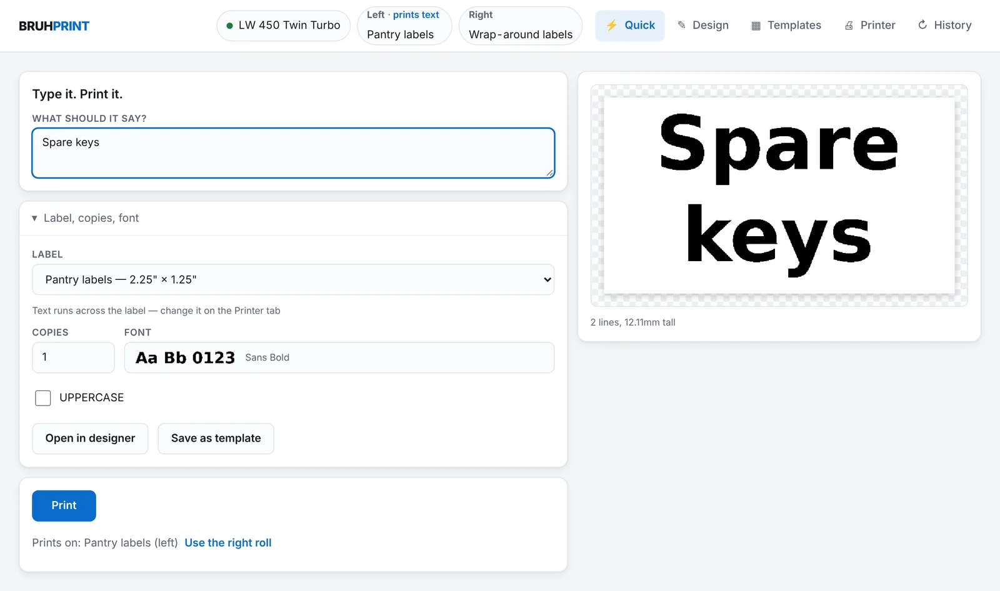

import { Steps, Aside } from '@astrojs/starlight/components';

From a boxed LabelWriter to a printed label in about ten minutes.

## Install

<Steps>

1. **Plug the printer in.** Connect its power supply and a USB data cable to your Home Assistant
   machine.

2. **Add the repository.** In Home Assistant open **Settings → Add-ons → Add-on Store → ⋮ →
   Repositories** and add:

   ```text title="Repository URL"
   https://github.com/bruhautomation/BRUH-HA-Apps
   ```

3. **Install BRUH Print and start it.** There is no USB setting to turn on. The first lines of the
   app's **Log** say what it found:

   ```text
   INFO: USB printers: LabelWriter 450 Twin Turbo (…)
   ```

4. **Accept the discovered integration** under **Settings → Devices & Services**. That adds the
   `bruh_print.*` services, the sensors and the dashboard card.

5. **Open BRUH Print from the sidebar.** The **Printer** tab shows your LabelWriter.

</Steps>

<Aside type="caution" title="No printer on the Printer tab?">
If you plugged the printer in after the app started, restart the app. If it still does not appear,
check that the printer has power, that the cable carries data, and that no CUPS or print-server
app is holding the printer.
</Aside>

## Print your first label


<Steps>

1. **Say what is loaded.** On the **Printer** tab, under **What is loaded**, pick the label in each
   roll. The common DYMO part numbers are in the list. For anything else, open **Label stock → Add
   a stock** and enter two measurements.

2. **Line up the roll.** Press **Line up this roll**, then **Print**. One label comes out with a
   numbered grid. Type in where the label's four edges fall on it and press **Apply**. See
   [Lining up a roll](/bruh-print/rolls/#lining-up-a-roll).

3. **Print a check label.** A complete frame around the edge means the roll is lined up.

4. **Check the text direction.** Under **Label stock**, each row has a **Text direction** picker.
   Change it once if text runs the wrong way on that label.

5. **Print.** On the **Quick** tab, type something, look at the preview, press **Print**.

</Steps>



## Add the dashboard card

Edit a dashboard, press **Add card**, and search for **BRUH Print**. You get a text box and a
**Print** button that work from any phone. See [Dashboard Card](/bruh-print/card/).

<Aside title="Custom element doesn't exist">
Restart Home Assistant once. BRUH Print raises a repair that says so, and the repair clears itself.
</Aside>

## If something is off on day one

| What you see | What to do |
| --- | --- |
| It says it printed and nothing came out | **Printer → Settings → If nothing comes out**. Pick the next mode and press **Print a check label**. Try *Standard*, then *Compact*, then *Bare minimum*. |
| **Check paper and lid** says the printer did not answer | Nothing. A LabelWriter in the middle of a feed does not reply. |
| **Check paper and lid** says it cannot ask | Nothing. This printer's USB connection is one-way, and it still prints. **Show connection info** shows what it exposes. |

More in [Troubleshooting](/bruh-print/reference/#troubleshooting).

## Next

- [Quick & the Designer](/bruh-print/designer/)
- [Templates](/bruh-print/templates/)
- [Reference](/bruh-print/reference/) for options, services, entities and troubleshooting
