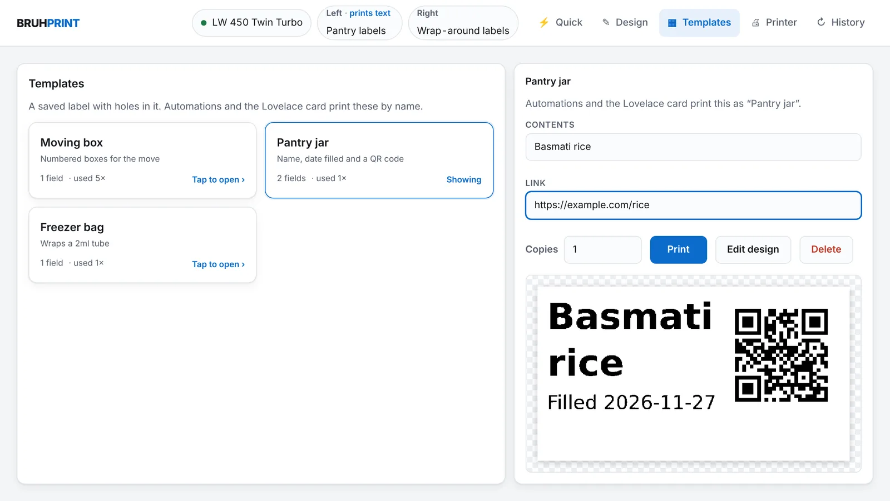
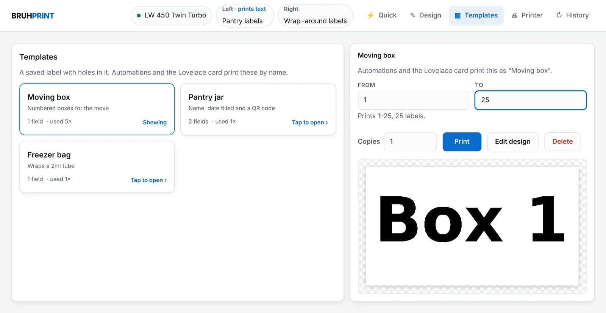

import { Steps, Aside } from '@astrojs/starlight/components';

A template is a saved label with blanks. You fill them in on the panel, on the dashboard card,
through brAIn or from an automation, and it prints on the label it was made for.



## Make a template

<Steps>

1. On the **Quick** or **Design** tab, write `{{contents}}` where the blank goes. A blank works in
   a text, a barcode's data or a QR code's data.
2. Press **Save as template** and give it a name. Automations and the card use that name.
3. Open the **Templates** tab. The template has a box called *contents*.

</Steps>

| You write | You get |
| --- | --- |
| `{{anything}}` | A box with that name on the form |
| `{{date}}`, `{{time}}`, `{{datetime}}` | Filled in at print time, as `2026-11-27`, `14:05` and `2026-11-27 14:05` |
| One number and no blanks, such as *Box 3* | A field called `number` |

The form always matches the label. Delete a placeholder and its box goes away. Two different
numbers on one label (*Box 3 of 12*) are left alone, so write `{{field}}` for the one you mean.

## Print a template

Open it on the **Templates** tab, fill in the boxes, set **Copies** and press **Print**. The
preview updates as you type. With only one template saved, the tab opens straight into it.

While a box is empty, a note under the preview names it, and **Print** is refused until you fill
it in. **Edit design** opens the label in the designer, and **Delete** removes the template.

## Print a numbered run



A numbered template shows **From** and **To**. Enter 1 and 25, and the panel says *Prints 1–25,
25 labels* before anything prints. Leave **To** empty to print one label.

A run of more than 10 labels asks you to confirm. History shows the run as one row.

## Print from an automation

```yaml
action: bruh_print.print_template
data:
  template: Freezer bag
  fields:
    contents: "{{ states('input_text.leftovers') }}"
  copies: 2
```

| Situation | What happens |
| --- | --- |
| A field is empty | The print is refused, with the missing field named |
| You send a field the template does not have | It prints, and the answer carries a note naming that field and the ones the template takes |
| A numbered template, no `number` sent | It prints the number it was saved with. `fields: {number: 29}` prints *Box 29*. |
| The name's capitals differ | It still matches. Template names are not case-sensitive. |
| The template's label is not in the printer | The print is refused, naming both stocks |

You never name a roll. The template remembers its label, and BRUH Print knows which roll holds it.

<Aside title="Fields are plain text">
A field's value is dropped into the label exactly as sent. Templates have no expression language,
so do any calculation in the automation, as in the example above.
</Aside>

## Print from the dashboard or by voice

- The [dashboard card](/bruh-print/card/) can be a form for one template (`mode: template`) or a
  button per saved template (`show_templates: true`).
- [brAIn](/brain/) reads the templates and their fields before it prints. *"Print three
  freezer-bag labels for bolognese"* uses the template that exists.

## Print something again


Every print lands on the **History** tab with a thumbnail, the date, the count and the roll.

| To do this | Do this |
| --- | --- |
| Print it again | Press the button on its row. It says how many it will print: **Print this again**, **Print these 2 again** or **Print all 5 again**. |
| Change it first | **Edit** opens the label in the designer |
| Reprint from an automation | `bruh_print.reprint`, with an `entry` or with none for the most recent |
| Empty the list | **Clear the history** |

Repeat prints of one label fold into a single row (*2 prints, last Nov 27*). A numbered run keeps
its own row.
