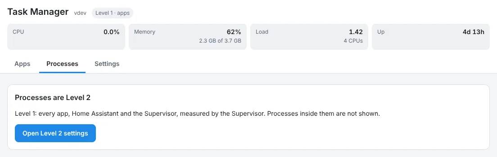
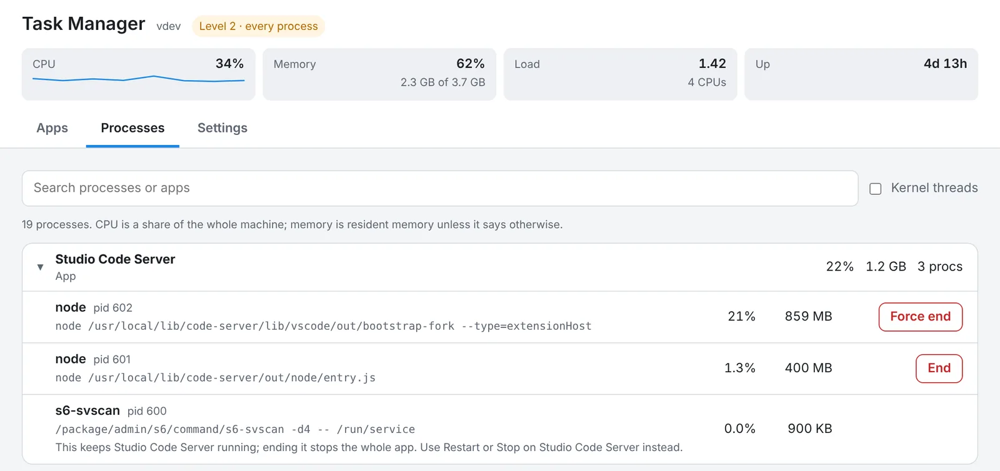

import { Aside, Steps } from '@astrojs/starlight/components';

Find what is using your Home Assistant machine, then restart, stop or end it knowing what
that costs.


## Find what is using the machine

Open **Task Manager** in the sidebar. The top bar shows the whole machine, and the **Apps**
tab lists everything on it, busiest first.

| Top bar | What it is |
|---|---|
| **CPU** | The whole machine, with the last few minutes as a line |
| **Memory** | Used of total |
| **Load** | The 1-minute load average beside the number of CPUs |
| **Up** | How long the machine has been running |

The badge beside the title says which level you are on: *Level 1 · apps* or *Level 2 · every
process*.

The **Apps** tab lists every app, Home Assistant, the Supervisor and the Supervisor's plugins
(DNS, Audio, CLI, Multicast, Observer). Search by name, or sort by CPU, memory or name.

| On each row | What it is |
|---|---|
| **CPU** | Its share of the **whole machine**. 50% on a four-core machine is two cores' worth. The line under it is the last few minutes. |
| **Memory**, **Net**, **Disk** | Memory in use, network down and up per second, disk read and write per second |
| Labels | *App*, *Home Assistant*, *Supervisor*, *Supervisor plugin*, *this app*, *stopped*, and *high CPU for…* while it is above the runaway threshold |
| **Processes** | With Level 2 on, jumps to that app's processes |
| **Restart**, **Stop**, **Start** | See below |

On a phone the title and meters scroll away with the page and the tabs stay at the top.

## Restart, stop or start an app

Press **Restart**, **Stop** or **Start** on the app's row. Each asks first and says what will
happen:


- which **Home Assistant integrations** talk to the app and go unavailable while it is down
- whether its **sidebar panel** stops opening
- whether it **starts again at boot**, and that a watchdog does not undo a manual stop

The panel runs each action as a job and reports how it went, because restarting Home
Assistant takes minutes. Every restart is written to the app's log.

| Limit | |
|---|---|
| Home Assistant, the Supervisor | Can be restarted, not stopped |
| BRUH Task Manager itself | Never offers to stop itself |

## See every process (Level 2)

Level 2 lists every process on the machine, grouped by the app it belongs to. It is off
until you turn it on.

<Steps>

1. On the **Settings** tab, switch on **Show every process** (or *Level 2: show every
   process* on the Configuration tab).

2. Turn **Protection mode** off on this app's **Info** page. Only you can do this.

3. **Restart** the app.

</Steps>

The Settings tab ticks off each step and names the one that is missing: *switched on but
Protection mode is still on*, *Protection mode is off but the add-on hasn't restarted
since*, or *Protection mode is off but Level 2 is switched off*. In the last case it reads
nothing and asks you to turn Protection mode back on.


Each group shows its total CPU, memory and number of processes. Open a group to see its
processes, busiest first, with the **pid** and **command line**.

| On the Processes tab | What it means |
|---|---|
| CPU | A share of the whole machine, the same scale as the Apps tab |
| Memory | Resident memory (what is in RAM now). Where the operating system allows it, proportional memory instead, which splits shared libraries between the processes using them. Hover the figure to see which. |
| **Kernel threads** | Hidden unless you tick the box |
| **Unknown container** | A container the app could not match to an app. It is shown, but nothing in it can be ended. |

With Level 2 off, the tab says so and links to the settings:



### What turning Protection mode off does

| It does | It does not |
|---|---|
| Let **this one app see every process** on the machine and its command line. Command lines occasionally contain a password someone typed into a setting. | Let it read other apps' passwords or tokens. Its AppArmor profile blocks reading another process's environment, memory and root filesystem, and ptrace, whatever Protection mode says. |
| Let this app **send signals to processes in other apps**, which is how End process works. | Open any network port, or change anything about your other apps. |

The store's **security rating is 5** instead of 6, because the app asks for the process list
at all. The rating is the same with Protection mode on or off.

When you are finished, switch Level 2 off and turn Protection mode back on.

## End a process

<Steps>

1. With Level 2 on, switch on **Allow ending processes** on the **Settings** tab. It is off
   by default.

2. On the **Processes** tab, press **End** on a process inside an app, and confirm.

   

3. The process is asked to stop (SIGTERM), so it can save and exit cleanly.

4. If it is still running **five seconds later**, the button becomes **Force end**
   (SIGKILL). That stops it at once, without letting it save anything.

   

</Steps>

The decision is made again over a fresh read when you press. If the process changed since the
page drew the button, it says so and sends nothing. Every process ended is written to the
app's log at warning level.

### Never offered

Each of these says why on its row, and points at **Restart** where that is the gentler
answer.

| Not offered for | Why |
|---|---|
| Home Assistant | Restart it instead. That shuts it down cleanly and saves its database first. |
| The Supervisor, Supervisor plugins | They run every app. Restart instead. |
| The operating system, the kernel | Ending them can make the machine unreachable until it is power-cycled. |
| BRUH Task Manager itself | |
| An unknown container | It can't be matched to an app. |
| An app's init or process supervisor | Ending it stops the whole app. Use Restart or Stop. |
| Anything on **Never end these** | Your own list |

**Never end these** takes one entry per line: a process name or an app's slug. Wildcards
work (`mosquitto`, `*_frigate`).

<Aside type="note" title="Could ending a process break something?">
Ending a helper inside an app (a worker, an ffmpeg stream, an editor's extension host)
usually leaves the app running. Ending an app's main program usually stops the app, and the
Supervisor restarts it if its watchdog is on. When you're not sure, use **Restart** on the
Apps tab. Some apps' own security profiles refuse signals from other apps. The app then says
so and points at Restart.
</Aside>

## Act on a runaway app

An app using at least **80%** of the machine's CPU for at least **10 minutes** is marked as
running away. You get a banner on the panel, a mark on its row, and the **Runaway app**
binary sensor turns on. Both numbers are options.

- It is a **streak**, not an average. One reading below the threshold ends it, so an update
  or a backup doesn't count.
- A reading the Supervisor couldn't take doesn't reset the clock.
- **Nothing is stopped automatically.**

### Restart a runaway app

```yaml
alias: Restart a runaway app
triggers:
  - trigger: state
    entity_id: binary_sensor.bruh_task_manager_runaway_app
    to: "on"
actions:
  - action: hassio.addon_restart
    data:
      addon: "{{ state_attr('binary_sensor.bruh_task_manager_runaway_app', 'apps')[0].slug }}"
  - action: notify.notify
    data:
      message: >
        Restarted {{ state_attr('binary_sensor.bruh_task_manager_runaway_app', 'apps')[0].name }}
        after it used the CPU for too long.
```

`hassio.addon_restart` only restarts apps. Home Assistant and the Supervisor are never
listed with an app's slug here.

## Options

Change these on the **Settings** tab or the app's Configuration tab. Both show the same
values. A change on the Settings tab takes effect at once, without a restart. If the
Supervisor refuses a change, the panel shows its reason.

| Option | Default | Range | What it does |
|---|---|---|---|
| **Home Assistant integration** (`enable_ha_integration`) | on | | Install the companion integration and its sensors. Configuration tab only. |
| **Level 2: show every process** (`process_view`) | off | | Read and show every process. Needs Protection mode off and a restart. |
| **Level 2: allow ending processes** (`allow_ending_processes`) | off | | Offer End on processes inside apps |
| **Never end these** (`protected_processes`) | empty | | Process names or app slugs never offered End. Wildcards work. |
| **Runaway threshold** (`runaway_cpu_percent`) | 80 | 10–100 | % of the machine's CPU |
| **Runaway time** (`runaway_minutes`) | 10 | 1–240 | Minutes above the threshold |
| **Measure every** (`sample_seconds`) | 5 | 2–60 | Seconds between measurements, and the window each CPU figure covers. Raise it on a slow Raspberry Pi. |
| **Log level** (`log_level`) | `info` | | The app's own logging. Configuration tab only. |

## Sensors

With **Home Assistant integration** on, the app installs `bruh_task_manager` and Home
Assistant offers to set it up. It adds one *BRUH Task Manager* device:

| Entity | What it is |
|---|---|
| **CPU** | The whole machine's CPU, % |
| **Memory used** | The whole machine's memory, %. Used and total bytes are attributes. |
| **Busiest app** | The name of the app using the most CPU. Its slug, CPU and memory, and the top ten, are attributes. |
| **Busiest app CPU** | That app's CPU, % |
| **Runaway app** (binary sensor) | On while an app is running away. The apps (with their slugs), the threshold and the time are attributes. |

If the app stops measuring, the measurements go **unavailable**. **Runaway app** goes
**unknown**, not off, with the reason as an attribute.

There are no services. Home Assistant's own `hassio.*` actions restart and stop apps.

## With brAIn

Task Manager doesn't need [brAIn](/brain/). When both are installed:

- brAIn's security check treats Task Manager's Protection mode being off as you switching
  Level 2 on, not as a fault.
- brAIn's development loop watches Task Manager's state and log, so a problem can be
  reported and fixed.

## Troubleshooting

| Symptom | What to do |
|---|---|
| **Processes** says Level 2 is off | **Settings** names the missing step. Most often Protection mode was turned off but the app wasn't restarted since. |
| **End** is missing on a process | Turn on **Allow ending processes**. If it is on, the process is on the never-offered list or your **Never end these** list. The row says which. |
| End says the app refused | That app's own AppArmor profile refuses signals from other apps. Use **Restart** on the Apps tab. |
| **Runaway app** is unknown | The app stopped measuring, or its figures went stale. The sensor's `reason` attribute says which. Check the app is running. |
